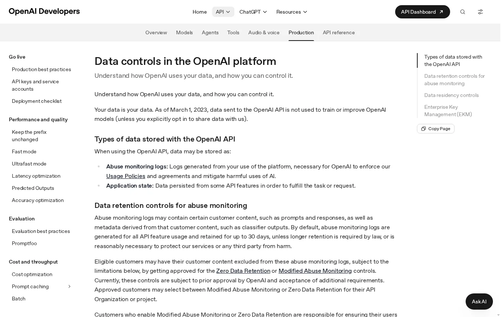
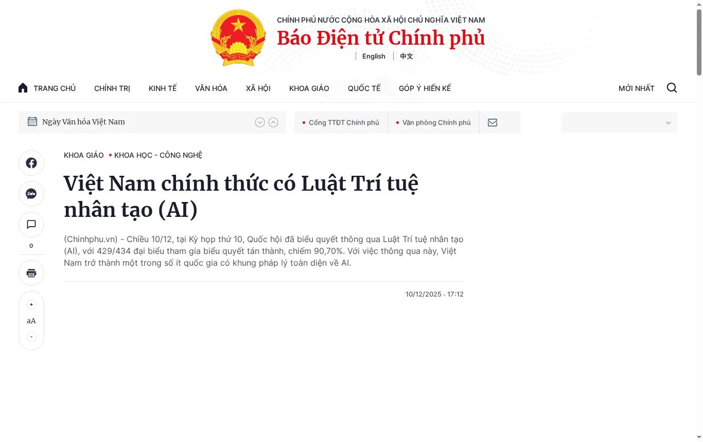
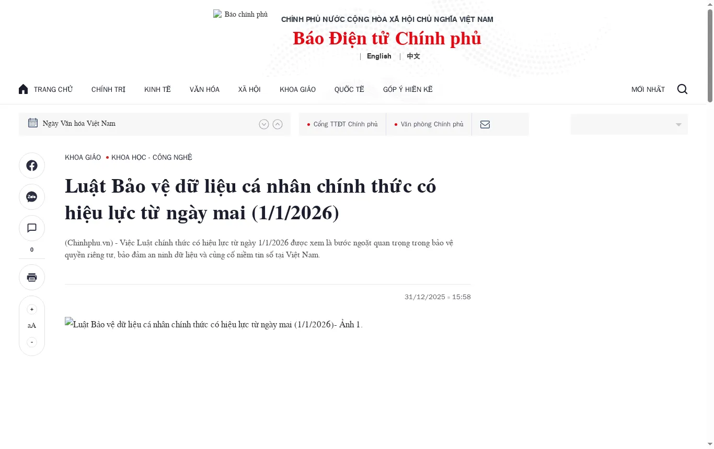

> Thuộc chuyên đề: [Hướng dẫn dùng công cụ AI phổ biến](huong-dan-dung-cong-cu-ai-pho-bien.md) · Bài viết của [KimQ Tech](https://kimq.tech)

**AI agency** là đơn vị cung cấp dịch vụ ứng dụng trí tuệ nhân tạo cho doanh nghiệp khác: xây chatbot, tự động hoá quy trình, tạo nội dung bằng AI, tích hợp mô hình AI vào phần mềm có sẵn, đào tạo nhân viên dùng AI. Doanh nghiệp thuê AI agency khi muốn dùng AI nhưng chưa có đội kỹ thuật riêng, hoặc cần làm nhanh hơn tự xây.

Từ này dễ nhầm với **AI agent** (tác tử AI), vốn là một loại phần mềm. Bài này giải thích AI agency làm gì, khác gì agency truyền thống, chi phí tính thế nào, câu hỏi cần hỏi trước khi ký hợp đồng và các quy định pháp lý ở Việt Nam liên quan.

*Minh bạch: KimQ Tech cũng cung cấp giải pháp AI cho doanh nghiệp. Bài viết trình bày tiêu chí chung để bạn đánh giá bất kỳ đơn vị nào, kể cả chúng tôi.*

## Tóm tắt nhanh

| Câu hỏi | Trả lời ngắn |
|---|---|
| AI agency là gì? | Đơn vị làm dịch vụ AI cho doanh nghiệp: tư vấn, xây, vận hành giải pháp AI |
| Khác AI agent? | AI agent là phần mềm tự thực hiện chuỗi việc; AI agency là công ty, có thể xây AI agent cho bạn |
| Dịch vụ phổ biến | Chatbot, tự động hoá quy trình, AI agent, nội dung AI, tích hợp AI vào phần mềm, đào tạo |
| Chi phí | Thường gồm phí triển khai + phí vận hành hằng tháng + chi phí mô hình AI theo lượng dùng |
| Rủi ro lớn nhất | Dữ liệu khách hàng, phụ thuộc nhà cung cấp, kỳ vọng sai về độ chính xác |
| Pháp lý cần biết | Luật Trí tuệ nhân tạo (hiệu lực 1/3/2026), Luật Bảo vệ dữ liệu cá nhân (hiệu lực 1/1/2026) |

## AI agency khác AI agent và agency truyền thống thế nào?

| | AI agency | AI agent | Agency marketing truyền thống |
|---|---|---|---|
| Là gì | Công ty dịch vụ | Phần mềm | Công ty dịch vụ |
| Sản phẩm giao | Hệ thống AI chạy được, quy trình, đào tạo | Tự nhận việc, gọi công cụ, trả kết quả | Chiến dịch, nội dung, quảng cáo |
| Tốc độ mở rộng | Nhanh nhờ tự động hoá | Chạy liên tục | Phụ thuộc số nhân sự |
| Người dùng cuối | Doanh nghiệp thuê | Nhân viên hoặc khách hàng | Doanh nghiệp thuê |

Một AI agency thường dùng **AI agent** và **công cụ tự động hoá** làm nguyên liệu. Ví dụ: xây một AI agent đọc email đặt hàng, tạo đơn trong phần mềm bán hàng và trả lời khách qua Zalo. Nếu bạn muốn tự tìm hiểu phần kỹ thuật, xem [Top 10 framework AI agent mã nguồn mở](top-10-framework-ai-agent-ma-nguon-mo.md) và [Top 8 công cụ tự động hoá quy trình mã nguồn mở](top-8-cong-cu-tu-dong-hoa-quy-trinh-ma-nguon-mo.md).

## AI agency làm những dịch vụ gì?

1. **Tư vấn và lộ trình AI**: khảo sát quy trình, chọn việc nên tự động hoá trước, ước tính lợi ích.
2. **Chatbot và trợ lý ảo**: trả lời khách trên website, Facebook, Zalo, dựa trên tài liệu sản phẩm của doanh nghiệp.
3. **Tự động hoá quy trình**: nối các phần mềm (CRM, kế toán, email, Google Sheets) và để AI xử lý bước đọc, phân loại, soạn thảo.
4. **AI agent**: phần mềm tự thực hiện chuỗi việc nhiều bước, có con người duyệt ở bước quan trọng.
5. **Nội dung bằng AI**: video sản phẩm, ảnh, bài viết, giọng đọc, có biên tập người.
6. **Tích hợp mô hình AI** vào phần mềm có sẵn qua API, thường kèm cổng quản lý chi phí và quyền truy cập.
7. **Đào tạo**: hướng dẫn nhân viên dùng AI an toàn, viết câu lệnh, kiểm tra kết quả.

## Chi phí thuê AI agency tính thế nào?

Không có bảng giá chung; mỗi dự án khác nhau. Một báo giá rõ ràng thường tách ba phần:

| Phần chi phí | Gồm gì | Câu hỏi nên hỏi |
|---|---|---|
| Phí triển khai (một lần) | Khảo sát, thiết kế, xây, kiểm thử, đào tạo | Bàn giao những gì? Có mã nguồn, tài liệu không? |
| Phí vận hành (hằng tháng) | Máy chủ, bảo trì, sửa lỗi, cập nhật | Cam kết thời gian phản hồi sự cố là bao lâu? |
| Chi phí mô hình AI (theo lượng dùng) | Tiền gọi OpenAI, Google, Anthropic… theo số token | Ai trả? Có giới hạn ngân sách và cảnh báo không? |

Phần thứ ba hay bị bỏ quên. Chatbot trả lời 10.000 tin nhắn mỗi tháng tốn khác hẳn 100 tin nhắn. Yêu cầu agency **ước tính theo lưu lượng thực tế** và đặt **trần chi phí**.

## 12 câu hỏi cần hỏi trước khi thuê AI agency

**Về kết quả**

1. Dự án tương tự đã làm là gì? Có cho xem bản chạy thật (demo) với dữ liệu mẫu không?
2. Đo thành công bằng chỉ số nào: thời gian xử lý giảm, tỷ lệ trả lời đúng, số đơn?
3. Khi AI trả lời sai thì quy trình xử lý thế nào? Có chuyển sang người thật không?

**Về dữ liệu**

4. Dữ liệu của chúng tôi lưu ở đâu, ai truy cập được?
5. Dùng mô hình AI của hãng nào? Hãng đó có dùng dữ liệu gửi qua để huấn luyện không?
6. Có ký thoả thuận xử lý dữ liệu cá nhân không?
7. Khi chấm dứt hợp đồng, dữ liệu được trả lại và xoá thế nào?

**Về quyền sở hữu và phụ thuộc**

8. Chúng tôi sở hữu những gì: mã nguồn, câu lệnh, quy trình, dữ liệu huấn luyện?
9. Có đổi được sang nhà cung cấp mô hình AI khác không, nếu giá tăng?
10. Hệ thống có chạy được nếu agency ngừng hoạt động không?

**Về vận hành**

11. Ai theo dõi hệ thống hằng ngày? Báo cáo định kỳ gồm gì?
12. Chi phí mô hình AI có cảnh báo khi vượt ngưỡng không?

Câu 5 có thể kiểm chứng: ví dụ, [tài liệu của OpenAI](https://developers.openai.com/api/docs/guides/your-data) nêu dữ liệu gửi qua API **không dùng để huấn luyện** mô hình từ 1/3/2023, trừ khi khách hàng chủ động đồng ý. Trong khi đó, nhiều gói AI miễn phí cho cá nhân có thể dùng dữ liệu để huấn luyện. Agency nghiêm túc sẽ dùng API hoặc gói doanh nghiệp, không dùng tài khoản cá nhân miễn phí cho dữ liệu khách hàng.

*Ảnh chụp màn hình: Tài liệu của OpenAI về cách xử lý dữ liệu gửi qua API. Nguồn: [developers.openai.com](https://developers.openai.com/api/docs/guides/your-data), chụp ngày 25/11/2026.*

## Pháp lý ở Việt Nam cần biết khi làm dự án AI

**Luật Trí tuệ nhân tạo** (Luật số 134/2025/QH15) được Quốc hội thông qua ngày 10/12/2025, **có hiệu lực từ 1/3/2026**, theo [Hệ thống văn bản Chính phủ](https://vanban.chinhphu.vn/?pageid=27160&docid=216334&classid=1&typegroupid=3). Luật quy định việc nghiên cứu, phát triển, cung cấp, triển khai và sử dụng hệ thống AI. Doanh nghiệp dùng AI để phục vụ khách hàng nên hỏi agency hệ thống thuộc nhóm rủi ro nào và cần minh bạch gì với người dùng.

*Ảnh chụp màn hình: Bài Báo Chính phủ đưa tin Quốc hội thông qua Luật Trí tuệ nhân tạo. Nguồn: [baochinhphu.vn](https://baochinhphu.vn/viet-nam-chinh-thuc-co-luat-tri-tue-nhan-tao-ai-102251210164948585.htm), chụp ngày 25/11/2026.*

**Luật Bảo vệ dữ liệu cá nhân** (Luật số 91/2025/QH15) thông qua ngày 26/6/2025, **có hiệu lực từ 1/1/2026**. Chatbot, hệ thống chăm sóc khách hàng bằng AI thường xử lý tên, số điện thoại, lịch sử mua hàng; đó là dữ liệu cá nhân. Hợp đồng với agency cần làm rõ ai là bên kiểm soát, ai là bên xử lý dữ liệu và trách nhiệm khi có sự cố.

*Ảnh chụp màn hình: Bài Báo Chính phủ về việc Luật Bảo vệ dữ liệu cá nhân có hiệu lực từ 1/1/2026. Nguồn: [baochinhphu.vn](https://baochinhphu.vn/luat-bao-ve-du-lieu-ca-nhan-chinh-thuc-co-hieu-luc-tu-ngay-mai-1-1-2026-102251231155609721.htm), chụp ngày 25/11/2026.*

Bài này không phải tư vấn pháp lý. Với dự án xử lý nhiều dữ liệu cá nhân, nên hỏi luật sư.

## Dấu hiệu nên tránh

- **Hứa "AI thay hết nhân viên"** hoặc độ chính xác 100%. AI vẫn sai; hệ thống tốt có bước kiểm tra.
- **Không cho thử trước**, chỉ có video giới thiệu.
- **Dùng tài khoản AI cá nhân** để xử lý dữ liệu của bạn.
- **Không bàn giao gì** khi kết thúc hợp đồng; mọi thứ nằm trong tài khoản của agency.
- **Báo giá trọn gói nhưng không nói chi phí mô hình AI** sẽ tính thế nào khi lượng dùng tăng.

## Tự làm hay thuê AI agency?

| Tự làm khi | Thuê AI agency khi |
|---|---|
| Có nhân sự kỹ thuật, việc đơn giản (một chatbot trả lời câu hỏi thường gặp) | Cần nối nhiều phần mềm, nhiều bước |
| Ngân sách thấp, chấp nhận làm chậm | Cần chạy nhanh, có người chịu trách nhiệm |
| Dữ liệu ít nhạy cảm | Có dữ liệu khách hàng, cần quy trình bảo mật rõ |

Cách làm an toàn: bắt đầu bằng **một dự án nhỏ, đo được** (ví dụ chatbot trả lời câu hỏi thường gặp trên Zalo trong 30 ngày), rồi mới mở rộng.

## Đọc thêm trong chuyên đề

- [Top 10 framework AI agent mã nguồn mở](top-10-framework-ai-agent-ma-nguon-mo.md).
- [Top 8 công cụ tự động hoá quy trình mã nguồn mở](top-8-cong-cu-tu-dong-hoa-quy-trinh-ma-nguon-mo.md).
- [Hướng dẫn dùng công cụ AI phổ biến](huong-dan-dung-cong-cu-ai-pho-bien.md).

Nếu doanh nghiệp đang cân nhắc **chatbot trả lời khách trên website, Facebook, Zalo**, xem [Chatbot đa kênh](https://kimq.tech/san-pham/chatbot-da-kenh) và [Trợ lý AI trên Zalo](https://kimq.tech/san-pham/tro-ly-zalo) của KimQ Tech, rồi đối chiếu với 12 câu hỏi ở trên.

## Câu hỏi thường gặp

**AI agency là gì?**
Là công ty cung cấp dịch vụ ứng dụng AI cho doanh nghiệp: tư vấn, xây chatbot, tự động hoá quy trình, AI agent, nội dung AI và đào tạo.

**AI agency và AI agent khác nhau thế nào?**
AI agency là công ty dịch vụ. AI agent là phần mềm tự thực hiện chuỗi việc. Một AI agency có thể xây AI agent cho bạn.

**Thuê AI agency tốn bao nhiêu?**
Tuỳ phạm vi. Báo giá nên tách phí triển khai, phí vận hành hằng tháng và chi phí mô hình AI theo lượng dùng.

**Doanh nghiệp nhỏ có cần AI agency không?**
Không bắt buộc. Việc đơn giản có thể tự làm bằng công cụ có sẵn. Thuê agency hợp lý khi cần nối nhiều hệ thống hoặc xử lý dữ liệu khách hàng.

**Mở AI agency cần gì?**
Kỹ năng tự động hoá và tích hợp AI, hiểu quy trình của ngành khách hàng, và quy trình bảo vệ dữ liệu theo Luật Bảo vệ dữ liệu cá nhân. Năng lực thật thể hiện qua dự án chạy được, không phải danh sách công cụ.

---

> Bài viết có sử dụng AI hỗ trợ soạn thảo. Nội dung và số liệu được đối chiếu với nguồn chính thức ngày 25/11/2026; ảnh là ảnh chụp màn hình trang chính thức, có ghi nguồn và ngày chụp.

## Về KimQ Tech

[KimQ Tech](https://kimq.tech) xây giải pháp AI và tự động hoá vận hành cho doanh nghiệp Việt: [AI Studio](https://kimq.tech/san-pham/ai-studio), [AI Gateway](https://kimq.tech/san-pham/ai-gateway), [Trợ lý AI trên Zalo](https://kimq.tech/san-pham/tro-ly-zalo), [Chatbot đa kênh](https://kimq.tech/san-pham/chatbot-da-kenh), [Tự động hoá](https://kimq.tech/san-pham/tu-dong-hoa). Cần tư vấn? [Liên hệ KimQ Tech](https://kimq.tech/lien-he) hoặc email contact@kimq.tech.

---

*Thông tin kiểm tra trên Hệ thống văn bản Chính phủ và trang chính thức của OpenAI ngày 25/11/2026 và có thể thay đổi. Bài viết không phải tư vấn pháp lý.*
