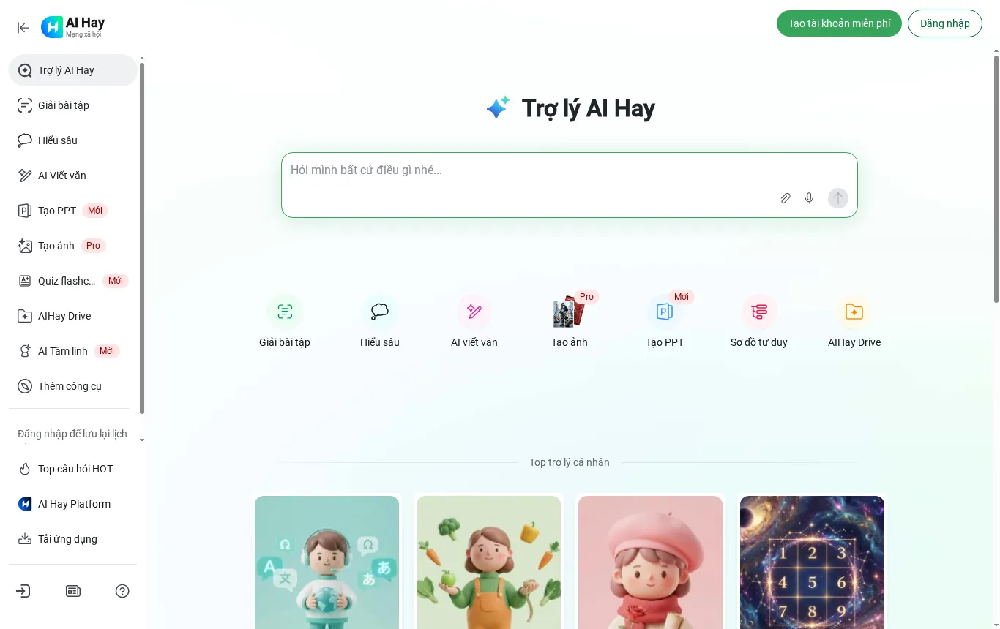
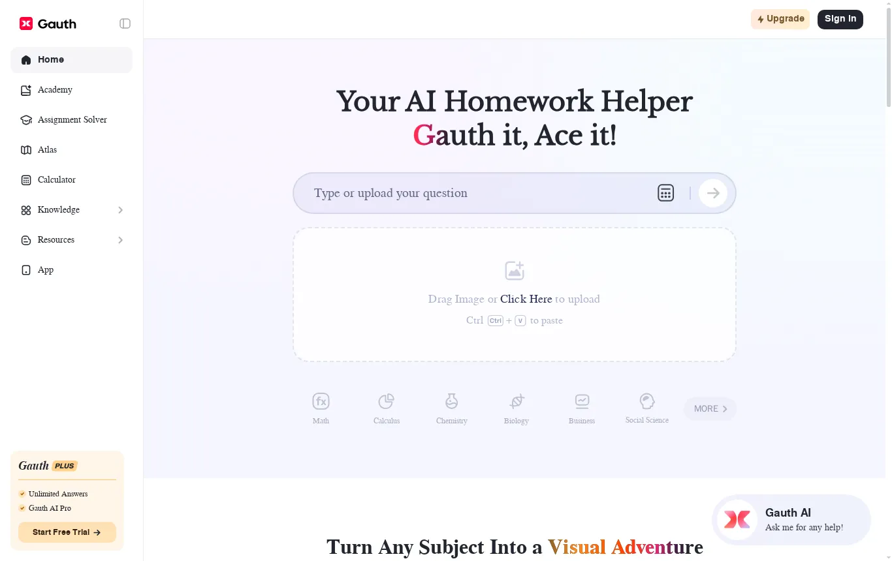
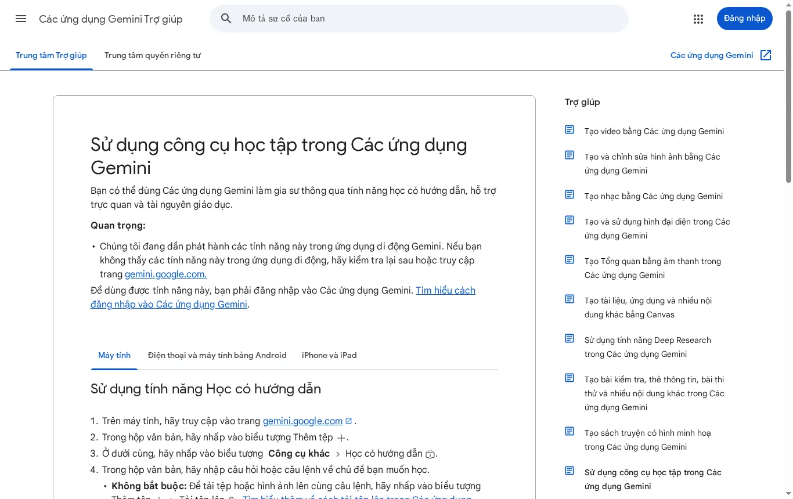

> Thuộc chuyên đề: [Hướng dẫn dùng công cụ AI phổ biến](huong-dan-dung-cong-cu-ai-pho-bien.md) · Bài viết của [KimQ Tech](https://kimq.tech)

Chụp ảnh đề bài, vài giây sau có lời giải từng bước. Các ứng dụng **AI giải bài tập** đang có mặt trên điện thoại của rất nhiều học sinh, sinh viên Việt Nam. Dùng đúng, AI là gia sư kiên nhẫn 24/7. Dùng sai, AI làm bài hộ và bạn mất kiến thức lẫn điểm thi.

Bài này giới thiệu 4 công cụ phổ biến: **AI Hay**, **Gauth**, **Học có hướng dẫn của Gemini** và **Study mode của ChatGPT**, kèm cách dùng để học thật và những rủi ro phụ huynh cần biết. Thông tin kiểm tra trên trang chính thức ngày **25/11/2026**.

## Tóm tắt nhanh

| | AI Hay | Gauth | Gemini, Học có hướng dẫn | ChatGPT, Study mode |
|---|---|---|---|---|
| Nguồn gốc | Ứng dụng Việt Nam | Thuộc ByteDance (công ty mẹ TikTok) | Google | OpenAI |
| Tiếng Việt | Gốc tiếng Việt | Có | Có | Có |
| Chụp ảnh đề bài | Có | Có | Có (tải ảnh, tệp) | Có |
| Cách trả lời | Lời giải, giải thích | Lời giải từng bước | Hỏi gợi mở, giải thích từng bước | Hỏi, gợi ý, kiểm tra kiến thức |
| Hợp với | Bài tập trên lớp, viết văn, làm slide | Toán, khoa học tự nhiên | Hiểu sâu một chủ đề | Ôn thi, tự kiểm tra |

**Nguyên tắc chung:** dùng chế độ **hỏi gợi mở** (Gemini, ChatGPT) khi muốn hiểu bài; dùng **lời giải đầy đủ** chỉ để đối chiếu sau khi đã tự làm.

## AI Hay: ứng dụng hỏi đáp AI của Việt Nam

*Ảnh chụp màn hình: Trang chủ AI Hay. Nguồn: [aihay.vn](https://aihay.vn/), chụp ngày 25/11/2026.*

**AI Hay** là nền tảng hỏi đáp AI bằng tiếng Việt, có web và ứng dụng điện thoại. Theo trang chủ, ngoài trợ lý hỏi đáp chung, AI Hay có các công cụ:

- **Giải bài tập** và **Hiểu sâu**
- **AI viết văn**
- **Tạo PPT**, **Sơ đồ tư duy**, **Quiz flashcard**
- **Tạo ảnh** (gói Pro)
- Các "trợ lý cá nhân" do cộng đồng tạo: dịch, viết email, viết caption, hướng nghiệp

Tạo tài khoản miễn phí để lưu lịch sử hội thoại. Một số tính năng cần gói Pro.

**Lưu ý:** AI Hay có cả trợ lý xem tarot, thần số học, "tư vấn sức khoẻ", "tư vấn tâm lý". Đây là nội dung do AI tạo, **không thay cho bác sĩ, chuyên gia tâm lý**. Phụ huynh nên nói rõ với con điều này.

## Gauth: chụp đề toán, ra lời giải từng bước

*Ảnh chụp màn hình: Trang chủ Gauth. Nguồn: [gauthmath.com](https://www.gauthmath.com/), chụp ngày 25/11/2026.*

**Gauth** (trước đây là Gauthmath) tự giới thiệu là "trợ lý làm bài tập bằng AI": bạn kéo thả hoặc dán ảnh đề bài, nhận lời giải từng bước và giải thích. Gauth mạnh nhất ở **toán, vật lý, hoá học**. Gauth còn có **Gauth Atlas**, biến một chủ đề thành sơ đồ hình ảnh để khám phá, mỗi hình dẫn về nguồn gốc.

Gauth thuộc ByteDance. Điều khoản của Gauth yêu cầu người dùng **từ 13 tuổi trở lên** (cao hơn ở một số nước), người chưa thành niên cần cha mẹ đồng ý. Ứng dụng thu thập dữ liệu tài khoản và ảnh bạn tải lên, nên **không chụp kèm thông tin cá nhân** như tên, lớp, trường trên đề.

## Gemini: chế độ Học có hướng dẫn

*Ảnh chụp màn hình: Trang trợ giúp công cụ học tập trong Gemini. Nguồn: [support.google.com](https://support.google.com/gemini/answer/16448384?hl=vi), chụp ngày 25/11/2026.*

Gemini có tính năng **Học có hướng dẫn** (Guided Learning), biến Gemini thành gia sư: thay vì đưa đáp án ngay, Gemini chia nhỏ vấn đề, hỏi lại bạn và giải thích từng bước. Gemini có thể chèn hình ảnh, sơ đồ và video YouTube vào câu trả lời để minh hoạ.

Cách bật trên máy tính:

1. Vào [gemini.google.com](https://gemini.google.com), đăng nhập.
2. Trong hộp văn bản, bấm **Thêm tệp**, rồi **Công cụ khác → Học có hướng dẫn**.
3. Gõ câu hỏi hoặc chủ đề muốn học, có thể tải ảnh đề bài hoặc tệp bài giảng lên.
4. Trả lời các câu hỏi Gemini đặt ra để đi tiếp từng bước.

Sinh viên có thể dùng Gemini với gói nâng cao miễn phí theo chương trình ưu đãi, xem [Gemini cho sinh viên](gemini-cho-sinh-vien.md).

## ChatGPT: Study mode

**Study mode** của ChatGPT hướng dẫn từng bước thay vì trả lời nhanh. Theo trang giới thiệu của OpenAI, chế độ này có:

- **Học qua câu hỏi, gợi ý, giải thích từng bước.**
- **Điều chỉnh theo trình độ** và nhớ các buổi học trước.
- **Câu hỏi kiểm tra** (trắc nghiệm, câu hỏi mở) kèm nhận xét để củng cố chỗ yếu.
- **Theo dõi tiến độ** những phần đã nắm và phần cần ôn.

Bật bằng cách chọn **study** trong phần cài đặt của khung chat rồi đặt câu hỏi. Xem chi tiết tại [trang Study mode của ChatGPT](https://chatgpt.com/features/study-mode/).

## Cách dùng AI giải bài tập để học thật

Học sinh dùng AI hiệu quả nhất thường theo quy trình **"tự làm trước, hỏi AI sau"**:

1. **Tự làm bài 10–15 phút**, ghi rõ chỗ bị tắc.
2. **Hỏi AI về chỗ tắc**, không hỏi cả bài: "Em làm đến bước này thì không biết đặt ẩn thế nào, gợi ý cho em, đừng giải hộ."
3. **Tự làm tiếp** với gợi ý.
4. **So đáp án** với AI, nếu khác thì yêu cầu AI chỉ ra bước sai.
5. **Yêu cầu AI ra 2–3 bài tương tự** để luyện lại.

Mẫu câu lệnh hữu ích:

- "Giải thích khái niệm đạo hàm cho học sinh lớp 11 bằng ví dụ quãng đường và vận tốc."
- "Đây là lời giải của em, chỉ ra bước sai nhưng đừng sửa hộ."
- "Hỏi em 5 câu trắc nghiệm về chương Cảm ứng điện từ, chấm và giải thích câu sai."
- "Tóm tắt bài học này thành 10 thẻ hỏi đáp để ôn thi."

Muốn viết câu lệnh tốt hơn, xem [Prompt AI: cách viết câu lệnh hiệu quả](prompt-ai.md).

## Rủi ro cần biết

### AI vẫn giải sai

AI có thể đưa ra lời giải trông rất chắc chắn nhưng sai, nhất là với bài hình học có hình vẽ, bài nhiều bước, đề chụp mờ hoặc đề tiếng Việt có ký hiệu đặc biệt. **Luôn kiểm tra lại đáp án**, đặc biệt trước khi nộp bài hay ôn thi.

### Chép lời giải là gian lận

Nộp lời giải AI như bài của mình là gian lận học thuật. Giáo viên ngày càng dùng công cụ phát hiện văn bản AI và hỏi lại trực tiếp trên lớp. Xem cách giáo viên kiểm tra trong bài [Check đạo văn AI](check-dao-van-ai.md). Văn nghị luận, tiểu luận do AI viết rất dễ nhận ra vì giọng văn chung chung.

### Quyền riêng tư của trẻ

- Kiểm tra **độ tuổi tối thiểu** của từng ứng dụng trước khi cho con dùng.
- Không chụp đề bài có tên, số điện thoại, ảnh mặt.
- Với học sinh nhỏ, phụ huynh nên tạo và quản lý tài khoản.

### Phụ thuộc vào AI

Khi bài kiểm tra trên lớp không có điện thoại, học sinh chỉ chép AI sẽ lộ ngay. Hãy coi AI như **gia sư**, không phải **người làm bài hộ**.

## Ứng dụng AI trong học tập: không chỉ giải bài

- **Tóm tắt bài giảng** dài thành dàn ý.
- **Làm flashcard**, câu hỏi ôn thi từ tài liệu.
- **Luyện nói tiếng Anh** với AI, nhờ AI sửa lỗi phát âm, ngữ pháp.
- **Làm slide thuyết trình** nhóm, xem [Làm slide bằng AI](lam-slide-bang-ai.md).
- **Lên kế hoạch ôn thi** theo số ngày còn lại.

Muốn học AI bài bản, xem lộ trình trong bài [Học AI bắt đầu từ đâu](hoc-ai-bat-dau-tu-dau.md).

## Câu hỏi thường gặp

**AI Hay giải bài tập có miễn phí không?**
Có tài khoản miễn phí. Một số tính năng như tạo ảnh cần gói Pro.

**Gauth có an toàn cho học sinh không?**
Gauth yêu cầu từ 13 tuổi trở lên và thu thập dữ liệu người dùng. Phụ huynh nên đọc chính sách quyền riêng tư và giám sát cách con dùng.

**AI nào giải toán chính xác nhất?**
Không có công cụ nào đúng 100%. Gemini và ChatGPT ở chế độ học có hướng dẫn giúp bạn tự phát hiện lỗi tốt hơn vì giải từng bước cùng bạn.

**Dùng AI làm bài tập về nhà có bị phát hiện không?**
Có thể. Giáo viên so sánh với bài làm trên lớp, hỏi lại cách làm, và dùng công cụ phát hiện văn bản AI với bài viết.

**Học sinh tiểu học có nên dùng AI giải bài?**
Phần lớn ứng dụng yêu cầu từ 13 tuổi. Trẻ nhỏ hơn chỉ nên dùng khi có phụ huynh ngồi cùng.

## AI cho trường học và trung tâm đào tạo

Trường học, trung tâm muốn có trợ lý AI trả lời theo đúng giáo trình của mình, kiểm soát nội dung và dữ liệu học sinh, có thể [liên hệ KimQ Tech](https://kimq.tech/lien-he) để tư vấn [chatbot đa kênh](https://kimq.tech/san-pham/chatbot-da-kenh) hoặc [trợ lý AI trên Zalo](https://kimq.tech/san-pham/tro-ly-zalo).

---

> Bài viết có sử dụng AI hỗ trợ soạn thảo. Nội dung và số liệu được đối chiếu với nguồn chính thức ngày 25/11/2026; ảnh là ảnh chụp màn hình trang chính thức, có ghi nguồn và ngày chụp.

## Về KimQ Tech

[KimQ Tech](https://kimq.tech) xây giải pháp AI và tự động hoá vận hành cho doanh nghiệp Việt: [AI Studio](https://kimq.tech/san-pham/ai-studio), [AI Gateway](https://kimq.tech/san-pham/ai-gateway), [Trợ lý AI trên Zalo](https://kimq.tech/san-pham/tro-ly-zalo), [Chatbot đa kênh](https://kimq.tech/san-pham/chatbot-da-kenh), [Tự động hoá](https://kimq.tech/san-pham/tu-dong-hoa). Cần tư vấn? [Liên hệ KimQ Tech](https://kimq.tech/lien-he) hoặc email contact@kimq.tech.

---

*Thông tin kiểm tra trên trang chính thức AI Hay, Gauth, Google Gemini và OpenAI ngày 25/11/2026 và có thể thay đổi. KimQ Tech không phải đại lý của AI Hay, Gauth, Google hay OpenAI.*
