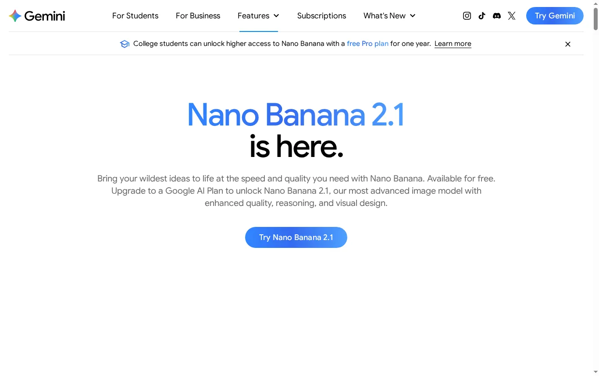
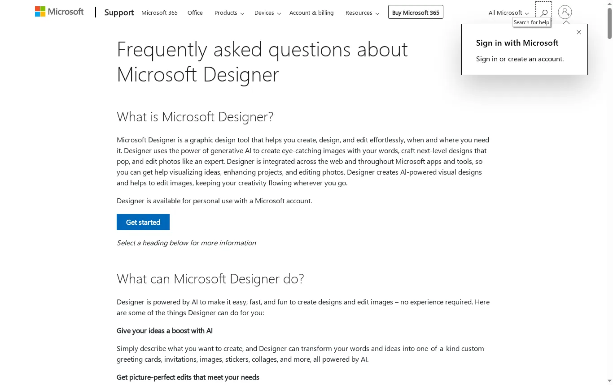
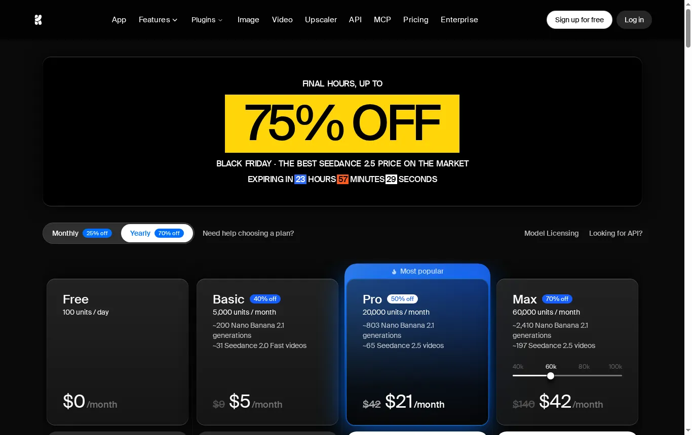

> Thuộc chuyên đề: [Top công cụ AI tạo và chỉnh sửa ảnh](top-cong-cu-ai-chinh-sua-anh.md) · Bài viết của [KimQ Tech](https://kimq.tech)

Bạn gõ một câu mô tả, vài giây sau có bức ảnh chưa từng tồn tại. Đó là cách các công cụ **AI tạo hình ảnh** hoạt động. Chúng được dùng để làm ảnh minh hoạ bài đăng, banner bán hàng, ý tưởng thiết kế, tranh vẽ theo phong cách tuỳ chọn.

Bài này so sánh bốn công cụ phổ biến ở Việt Nam: **Gemini (Nano Banana)**, **ChatGPT**, **Microsoft Designer** và **Krea AI**, kèm công thức viết câu lệnh và lưu ý khi dùng ảnh cho kinh doanh. Thông tin lấy từ trang chính thức ngày **25/11/2026**.

## Tóm tắt nhanh

| | Gemini (Nano Banana) | ChatGPT | Microsoft Designer | Krea AI |
|---|---|---|---|---|
| Miễn phí? | Có, Nano Banana 2 | Có, giới hạn lượt | Có, cần tài khoản Microsoft | Có, 100 đơn vị/ngày |
| Câu lệnh tiếng Việt | Tốt | Tốt | Được | Nên dùng tiếng Anh |
| Chữ trong ảnh | Rõ, nhiều ngôn ngữ | Tốt | Trung bình | Tuỳ mô hình |
| Sửa ảnh có sẵn | Có | Có | Có | Có |
| Điểm mạnh | Ghép ảnh, giữ nhân vật, chữ rõ | Hiểu câu lệnh dài, sửa qua hội thoại | Gắn với bộ Microsoft, làm thiệp, bài đăng | Nhiều mô hình trong một chỗ, có video, 3D |
| Gói trả phí | Google AI Plus, Pro, Ultra | Go, Plus, Pro | Copilot, Microsoft 365 | Basic, Pro, Max, Business |

Mới bắt đầu, muốn miễn phí và gõ tiếng Việt: dùng **Gemini**. Làm thiết kế nhiều, muốn thử nhiều mô hình: dùng **Krea**.

## AI tạo hình ảnh hoạt động thế nào

Các mô hình tạo ảnh được huấn luyện trên lượng lớn cặp ảnh và mô tả. Khi bạn gõ câu lệnh, mô hình "vẽ" ra ảnh khớp với mô tả nhất. Vì vậy:

- **Câu lệnh càng cụ thể, ảnh càng đúng ý.** "Con mèo" cho ra ảnh chung chung. "Con mèo mướp ngủ trên bậu cửa sổ, nắng sớm, ảnh chụp cận" cho ra ảnh có chủ đích.
- **Mỗi lần tạo cho kết quả khác nhau**, kể cả cùng câu lệnh.
- **Ảnh có thể sai chi tiết**: ngón tay thừa, chữ lỗi, logo méo. Luôn xem kỹ trước khi dùng.

## Gemini (Nano Banana): miễn phí, gõ tiếng Việt tốt

*Ảnh chụp màn hình: Trang giới thiệu tạo ảnh bằng Nano Banana trong Gemini. Nguồn: [gemini.google](https://gemini.google/overview/image-generation/), chụp ngày 25/11/2026.*

Mô hình tạo ảnh trong Gemini có tên **Nano Banana**. Theo trang chính thức:

- **Nano Banana 2** dùng miễn phí: giữ nhân vật nhất quán, chữ rõ, ghép ảnh, sửa chi tiết, độ phân giải 2K.
- **Nano Banana 2.1** là mô hình tốt nhất, cần gói Google AI (Plus, Pro, Ultra), có lượt tạo cao hơn. Người dùng trả phí còn tạo lại được ảnh bằng Nano Banana Pro qua mục "Redo with Pro".
- Ảnh Gemini tạo có **thuỷ vân SynthID ẩn** và **thuỷ vân nhìn thấy được** để phân biệt với ảnh do người làm.
- Yêu cầu từ 18 tuổi để dùng đầy đủ tính năng, có giới hạn lượt.

**Cách dùng:** vào [gemini.google.com](https://gemini.google.com), chọn công cụ **Tạo hình ảnh** (biểu tượng 🍌) trong menu công cụ, gõ câu lệnh hoặc tải ảnh lên để sửa.

Google gợi ý công thức: **Tạo ảnh + chủ thể + hành động + bối cảnh**, rồi thêm bố cục, phong cách, chất lượng ảnh và tỷ lệ khung. Xem 35 mẫu câu lệnh tiếng Việt tại [Câu lệnh tạo ảnh, ghép ảnh trên Gemini](cau-lenh-tao-anh-ghep-anh-gemini.md). Muốn ghép nhiều ảnh thành một, xem [Ghép ảnh bằng AI](ghep-anh-bang-ai.md).

## ChatGPT: sửa ảnh qua hội thoại

ChatGPT tạo được ảnh ngay trong khung chat, kể cả với gói Free. Điểm mạnh là **hiểu câu lệnh dài, nhiều yêu cầu cùng lúc** và cho phép sửa từng bước bằng lời: "đổi nền sang màu be", "thêm chữ Khai trương ở góc trên".

Lưu ý:

- Gói Free có **giới hạn lượt tạo ảnh** và lượt được đặt lại sau một khoảng thời gian. OpenAI không công bố con số cố định, ChatGPT sẽ báo khi bạn chạm giới hạn.
- Các gói trả phí (Go, Plus, Pro) có hạn mức cao hơn. Xem bảng giá hiện tại tại [chatgpt.com/pricing](https://chatgpt.com/pricing).
- Ảnh do ChatGPT tạo có kèm [siêu dữ liệu C2PA](https://help.openai.com/en/articles/8912793-provenance-signals-in-content-processed-by-openai-tools) cho biết nguồn gốc AI.

## Microsoft Designer: miễn phí, hợp làm thiệp và bài đăng

*Ảnh chụp màn hình: Câu hỏi thường gặp về Microsoft Designer. Nguồn: [support.microsoft.com](https://support.microsoft.com/en-us/designer/frequently-asked-questions-about-microsoft-designer), chụp ngày 25/11/2026.*

**Microsoft Designer** là ứng dụng thiết kế có **Image Creator** để tạo ảnh từ mô tả. Theo Microsoft, Designer **dùng miễn phí**, chỉ cần đăng nhập tài khoản Microsoft. Người cần tạo thường xuyên có thể phải đăng ký gói trả phí.

Designer hợp với:

- Thiệp mời, thiệp chúc mừng, bài đăng mạng xã hội có sẵn bố cục.
- Người đã dùng Word, PowerPoint, vì ảnh đưa sang bộ Microsoft 365 thuận tiện.
- Dùng trên web, ứng dụng Windows và ứng dụng điện thoại.

Cách dùng: vào [designer.microsoft.com](https://designer.microsoft.com/), chọn **Image Creator**, gõ mô tả, chọn kích thước, bấm tạo và chọn một trong các phương án.

## Krea AI: nhiều mô hình trong một chỗ

*Ảnh chụp màn hình: Bảng giá các gói Krea AI. Nguồn: [krea.ai](https://www.krea.ai/pricing), chụp ngày 25/11/2026.*

**Krea AI** là bộ công cụ sáng tạo gồm tạo ảnh, tạo video, làm nét ảnh, huấn luyện phong cách riêng (LoRA) và trình dựng quy trình dạng sơ đồ. Krea có mô hình riêng (Krea 2, Krea 1) và tích hợp các mô hình khác như Flux, Qwen.

| Gói | Giá (trả theo năm) | Đơn vị tính toán | Ghi chú |
|---|---|---|---|
| Free | $0 | 100 đơn vị/ngày | Làm nét ảnh tới 2K |
| Basic | $5,25/tháng | 5.000/tháng | Có giấy phép thương mại, một số mô hình video |
| Pro | $21/tháng | 20.000/tháng | Mở toàn bộ mô hình video |
| Max | $63/tháng | 60.000/tháng | Dùng nhiều |
| Business | $160/tháng | 80.000/tháng | Tối đa 50 thành viên, điều khoản không dùng dữ liệu để huấn luyện |

Giá trên là khi trả theo năm; Krea ghi trả theo năm tiết kiệm 40% so với trả tháng. Các gói trả phí có **giấy phép thương mại**, dùng được ảnh cho quảng cáo, sản phẩm, dự án khách hàng. Hết đơn vị tính toán, gói trả phí vẫn tạo tiếp được bằng các mô hình ảnh nội bộ của Krea.

Câu lệnh trên Krea nên viết bằng tiếng Anh để kết quả ổn định hơn. Bạn có thể nhờ Gemini hoặc ChatGPT dịch câu lệnh tiếng Việt sang tiếng Anh trước.

## Công thức viết câu lệnh vẽ tranh AI

Một câu lệnh tốt có 6 phần. Không cần đủ cả 6, nhưng càng nhiều càng sát ý:

| Phần | Ví dụ |
|---|---|
| Chủ thể | một cô gái mặc áo dài trắng |
| Hành động | đạp xe |
| Bối cảnh | trên đường Phan Đình Phùng mùa thu, lá vàng rơi |
| Phong cách | tranh màu nước / ảnh chụp phim / hoạt hình 3D |
| Ánh sáng, góc máy | nắng chiều, chụp từ phía sau, góc thấp |
| Kích thước | tỷ lệ 9:16 cho TikTok, 1:1 cho Instagram |

Ví dụ hoàn chỉnh: "Tranh màu nước vẽ một cô gái mặc áo dài trắng đạp xe trên đường Phan Đình Phùng mùa thu, lá vàng rơi, nắng chiều, nhìn từ phía sau, tỷ lệ 4:5."

Một số phong cách vẽ tranh AI hay dùng: tranh sơn dầu, màu nước, tranh khắc gỗ Đông Hồ, anime, pixel art, phác thảo bút chì, ảnh chụp phim 35mm, mô hình đất sét. Mẹo viết câu lệnh cho mọi công cụ AI sẽ có trong bài [Prompt AI: cách viết câu lệnh hiệu quả](prompt-ai.md).

## Dùng ảnh trí tuệ nhân tạo cho kinh doanh: lưu ý

- **Đọc quyền thương mại của từng gói.** Một số gói miễn phí không cho dùng thương mại, hoặc không rõ ràng. Krea ghi rõ giấy phép thương mại ở các gói trả phí.
- **Không tạo ảnh giả người thật**, logo hay nhân vật có bản quyền của thương hiệu khác.
- **Ghi rõ ảnh có dùng AI** khi ảnh có thể khiến khách hiểu nhầm về sản phẩm thật (ví dụ ảnh món ăn, phòng khách sạn).
- **Không tải ảnh khách hàng, tài liệu nội bộ** lên công cụ miễn phí khi chưa đọc chính sách dữ liệu.
- **Kiểm tra lỗi** trước khi in ấn: chữ, ngón tay, logo, số điện thoại.

## Cách nhận biết ảnh do AI tạo

- Gemini: tải ảnh lên app Gemini và hỏi ảnh có do AI của Google tạo không. Tính năng này dựa trên SynthID.
- Ảnh từ ChatGPT, Adobe và nhiều công cụ khác có siêu dữ liệu C2PA, kiểm tra được bằng trang Content Credentials.
- Nhìn chi tiết: tay, chữ, đồ trang sức, phản chiếu trong kính thường lộ lỗi.

Chi tiết các cách kiểm tra có trong bài [Top công cụ AI tạo và chỉnh sửa ảnh](top-cong-cu-ai-chinh-sua-anh.md).

## Câu hỏi thường gặp

**AI tạo hình ảnh nào miễn phí tốt nhất?**
Gemini (Nano Banana 2) là lựa chọn miễn phí dễ dùng nhất với câu lệnh tiếng Việt. Microsoft Designer và Krea cũng có bản miễn phí.

**Krea AI có miễn phí không?**
Có. Gói Free cho 100 đơn vị tính toán mỗi ngày. Gói trả phí từ $5,25/tháng khi trả theo năm.

**Vẽ tranh AI có bị coi là vi phạm bản quyền không?**
Tạo ảnh theo phong cách chung (màu nước, anime) thường không có vấn đề. Sao chép nhân vật, logo, tác phẩm cụ thể của người khác thì có rủi ro.

**Ảnh AI có dùng làm logo được không?**
Được làm ý tưởng, nhưng nên vẽ lại dạng vector và kiểm tra trùng lặp trước khi đăng ký nhãn hiệu.

**Vì sao ảnh có chữ tiếng Việt bị sai dấu?**
Nhiều mô hình vẫn yếu với chữ có dấu. Gemini xử lý chữ tốt hơn; cách chắc nhất là tạo ảnh không chữ rồi thêm chữ bằng Canva.

## Tạo ảnh cho cả đội marketing

[AI Studio của KimQ Tech](https://kimq.tech/san-pham/ai-studio) gom các mô hình tạo ảnh vào một chỗ, kèm thư viện câu lệnh mẫu và phân quyền theo nhân viên, giúp đội marketing làm ảnh đều tay mà vẫn kiểm soát chi phí.

---

> Bài viết có sử dụng AI hỗ trợ soạn thảo. Nội dung và số liệu được đối chiếu với nguồn chính thức ngày 25/11/2026; ảnh là ảnh chụp màn hình trang chính thức, có ghi nguồn và ngày chụp.

## Về KimQ Tech

[KimQ Tech](https://kimq.tech) xây giải pháp AI và tự động hoá vận hành cho doanh nghiệp Việt: [AI Studio](https://kimq.tech/san-pham/ai-studio), [AI Gateway](https://kimq.tech/san-pham/ai-gateway), [Trợ lý AI trên Zalo](https://kimq.tech/san-pham/tro-ly-zalo), [Chatbot đa kênh](https://kimq.tech/san-pham/chatbot-da-kenh), [Tự động hoá](https://kimq.tech/san-pham/tu-dong-hoa). Cần tư vấn? [Liên hệ KimQ Tech](https://kimq.tech/lien-he) hoặc email contact@kimq.tech.

---

*Thông tin kiểm tra trên trang chính thức Google Gemini, Krea, Microsoft và OpenAI ngày 25/11/2026 và có thể thay đổi. KimQ Tech không phải đại lý của Google, Krea, Microsoft hay OpenAI.*
