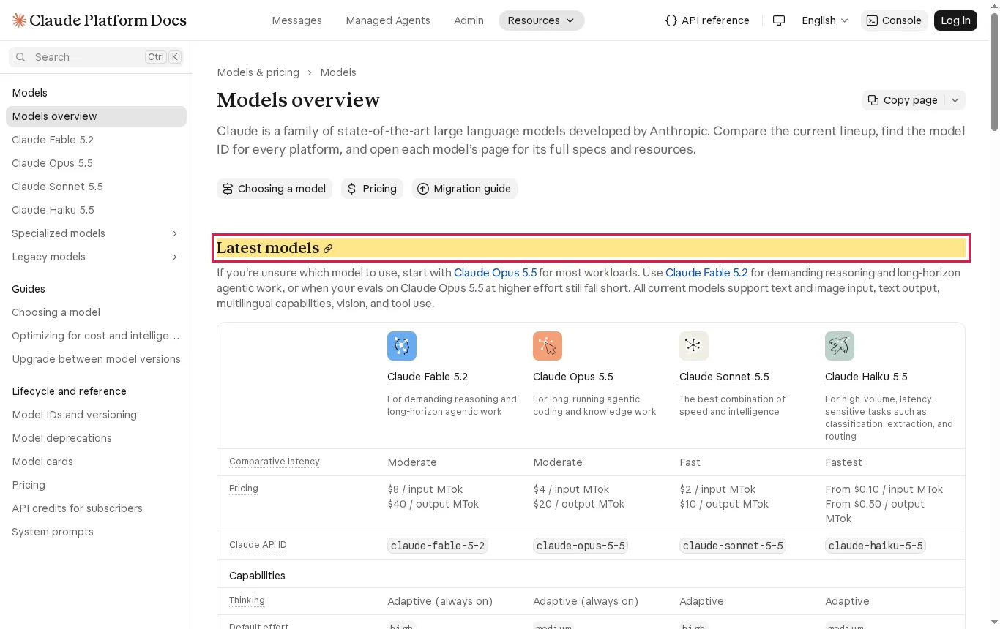
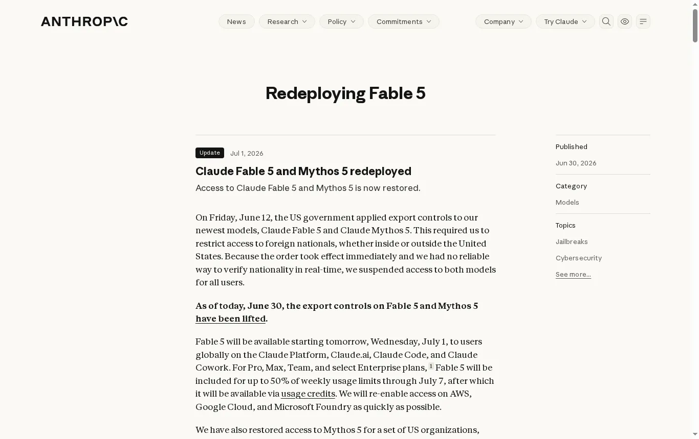
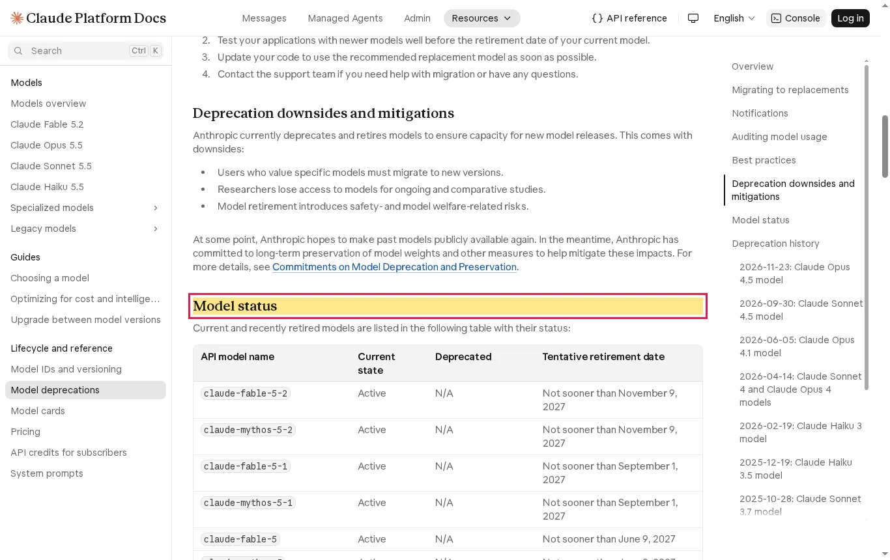

> Thuộc chuyên đề: [Hướng dẫn dùng công cụ AI phổ biến cho công việc](huong-dan-dung-cong-cu-ai-pho-bien.md) · Bài viết của [KimQ Tech](https://kimq.tech)

Claude của Anthropic không phải một mô hình duy nhất mà là **nhiều họ model**: **Fable**, **Opus**, **Sonnet**, **Haiku** (và Mythos dành cho đối tác). Mỗi họ mạnh ở một kiểu việc, giá khác nhau, và mỗi họ có nhiều phiên bản như Opus 4.6, Opus 5.5, Sonnet 5, Sonnet 5.5.

Bài này giải thích các model Claude khác nhau thế nào, nên chọn model nào cho việc gì, model cũ nào còn dùng được, và chuyện **Claude Fable 5 bị tạm ngưng rồi mở lại**. Số liệu lấy từ tài liệu chính thức của Anthropic ngày **25/11/2026**.

## Tóm tắt nhanh

| Model mới nhất | Hợp với | Tốc độ | Giá API (đầu vào / đầu ra, mỗi triệu token) |
|---|---|---|---|
| **Claude Fable 5.2** | Suy luận khó, việc agent chạy dài | Vừa | $8 / $40 |
| **Claude Opus 5.5** | Lập trình agent, công việc chuyên môn; lựa chọn mặc định | Vừa | $4 / $20 |
| **Claude Sonnet 5.5** | Cân bằng tốc độ và trí tuệ, việc hằng ngày | Nhanh | $2 / $10 |
| **Claude Haiku 5.5** | Việc số lượng lớn cần nhanh: phân loại, trích xuất | Nhanh nhất | Từ $0,10 / $0,50 |

Cả bốn đều nhận chữ và ảnh, có khung ngữ cảnh **1 triệu token**, trả lời tối đa **128 nghìn token**, dữ liệu huấn luyện đến **tháng 6/2026**.

## Các họ model Claude là gì?

*Ảnh chụp màn hình: Trang tổng quan các model Claude của Anthropic. Nguồn: [platform.claude.com](https://platform.claude.com/docs/en/about-claude/models/overview), chụp ngày 25/11/2026.*

Anthropic đặt tên model theo **họ + số phiên bản**. Họ cho biết "cỡ" và mục đích; số phiên bản cho biết thế hệ (số càng lớn càng mới).

- **Fable**: họ mạnh nhất được phát hành rộng rãi, dành cho việc đòi hỏi suy luận sâu và tác vụ agent kéo dài nhiều giờ.
- **Opus**: rất mạnh về lập trình và công việc tri thức. Tài liệu Anthropic khuyên **bắt đầu với Opus 5.5** nếu chưa biết chọn gì.
- **Sonnet**: cân bằng nhất giữa tốc độ và chất lượng; model hằng ngày cho đa số người dùng.
- **Haiku**: nhỏ, nhanh, rẻ; hợp phân loại, trích xuất, định tuyến, chạy số lượng lớn.
- **Mythos**: cùng nền với Fable nhưng ít lớp bảo vệ hơn, chỉ cấp cho đối tác được duyệt (chương trình Glasswing về an ninh mạng). Người dùng thường không dùng được.

Theo tài liệu, Anthropic khuyên dùng **Fable 5.2** khi việc thật sự khó, hoặc khi Opus 5.5 ở mức nỗ lực cao vẫn chưa đạt.

## So sánh chi tiết: Fable, Opus, Sonnet, Haiku

| Tiêu chí | Fable 5.2 | Opus 5.5 | Sonnet 5.5 | Haiku 5.5 |
|---|---|---|---|---|
| Vai trò | Việc khó nhất | Mặc định cho việc chuyên môn | Việc hằng ngày | Việc nhanh, số lượng lớn |
| Suy nghĩ thích ứng | Luôn bật | Luôn bật | Có | Có |
| Mức nỗ lực mặc định | Cao | Trung bình | Cao | Trung bình |
| Khung ngữ cảnh | 1M token | 1M token | 1M token | 1M token |
| Trả lời tối đa | 128K token | 128K token | 128K token | 128K token |
| Giá đầu vào / đầu ra | $8 / $40 | $4 / $20 | $2 / $10 | Từ $0,10 / $0,50 |
| Ngừng sớm nhất | Không sớm hơn 09/11/2027 | Không sớm hơn 22/09/2027 | Không sớm hơn 28/09/2027 | Không sớm hơn 07/10/2027 |

Giá trên là giá API cho lập trình viên. Người dùng claude.ai trả theo gói tháng; model nào có trong gói nào xem tại [Claude là gì? So sánh các gói Claude](claude-la-gi-so-sanh-cac-goi-claude.md).

## Claude Fable 5 mở lại: chuyện gì đã xảy ra?

Nhiều người tìm "claude fable 5 mở lại" vì model này từng biến mất khỏi Claude vài tuần. Theo bài [Redeploying Fable 5](https://www.anthropic.com/news/redeploying-fable-5) của Anthropic:

| Ngày | Sự kiện |
|---|---|
| 09/06/2026 | Anthropic ra mắt Fable 5 (bản phổ thông, nhiều lớp bảo vệ) và Mythos 5 (cho đối tác) |
| 12/06/2026 | Chính phủ Mỹ áp kiểm soát xuất khẩu với hai model; Anthropic tạm ngưng truy cập với mọi người dùng vì không xác minh được quốc tịch theo thời gian thực |
| 30/06/2026 | Lệnh kiểm soát được dỡ bỏ sau khi Anthropic bổ sung bộ phân loại an toàn mới |
| 01/07/2026 | Fable 5 mở lại toàn cầu trên Claude Platform, Claude.ai, Claude Code và Claude Cowork |
| Đến 07/07/2026 | Gói Pro, Max, Team và một số gói Enterprise dùng Fable 5 tối đa 50% hạn mức tuần; sau đó dùng qua tín dụng sử dụng |

*Ảnh chụp màn hình: Bài thông báo mở lại Claude Fable 5 của Anthropic. Nguồn: [anthropic.com](https://www.anthropic.com/news/redeploying-fable-5), chụp ngày 25/11/2026.*

Anthropic cũng cho biết: nếu một yêu cầu gửi tới Fable 5 bị bộ phân loại an toàn chặn, người dùng được thông báo và yêu cầu sẽ được chuyển sang **Opus 4.8**. Hiện bản mới nhất của họ Fable là **Fable 5.2** (ra mắt tháng 11/2026), Fable 5 và 5.1 vẫn còn trong danh sách model.

## Model cũ: Claude Opus 4.6, Sonnet 5, Claude 3.5 Sonnet

Nhiều người vẫn tìm tên model cũ vì đọc hướng dẫn cũ hoặc đang dùng qua API. Tình trạng theo trang ngừng hỗ trợ model của Anthropic ngày 25/11/2026:

| Model | Tình trạng | Ghi chú |
|---|---|---|
| **Claude Opus 4.6** | Còn hoạt động, ngừng không sớm hơn 05/02/2027 | 1M ngữ cảnh, $5 / $25 mỗi triệu token |
| **Claude Sonnet 5** | Còn hoạt động, ngừng không sớm hơn 30/06/2027 | Cùng giá Sonnet 5.5 ($2 / $10) |
| **Claude Opus 4.5** | Đã có thông báo ngừng, dự kiến ngừng trên API ngày 22/01/2027 | Anthropic khuyên chuyển sang Opus 5.5 |
| **Claude Sonnet 4.5** | Ngừng ngày 30/11/2026 | Thay bằng Sonnet 5.5 |
| **Claude 3.5 Sonnet** | **Đã ngừng** từ 28/10/2025 | Thay bằng Sonnet 5.5 |

*Ảnh chụp màn hình: Trang lịch ngừng hỗ trợ các model Claude. Nguồn: [platform.claude.com](https://platform.claude.com/docs/en/about-claude/model-deprecations), chụp ngày 25/11/2026.*

Nếu bạn thấy trang web nào còn bán "tài khoản Claude 3.5 Sonnet" thì đó là thông tin cũ hoặc lừa đảo: model này không còn chạy trên API của Anthropic.

## Nên chọn model Claude nào?

| Bạn cần | Chọn |
|---|---|
| Hỏi đáp, viết email, tóm tắt hằng ngày | Sonnet 5.5 |
| Viết báo cáo dài, phân tích tài liệu, lập trình | Opus 5.5 |
| Bài toán rất khó, agent chạy nhiều giờ, Opus chưa đủ | Fable 5.2 |
| Xử lý hàng nghìn tin nhắn, phân loại phiếu hỗ trợ | Haiku 5.5 |
| Làm slide, thiết kế, prototype | Dùng [Claude Design](claude-design-la-gi.md) (chọn model trong đó) |

Mẹo tiết kiệm: model mạnh hơn không phải lúc nào cũng tốt hơn. Anthropic lưu ý đôi khi đổi model cải thiện tốc độ và chi phí hiệu quả hơn là sửa câu lệnh. Bắt đầu bằng Sonnet, chỉ nâng lên Opus hoặc Fable khi kết quả chưa đạt. Cách viết câu lệnh tốt xem [Prompt AI](prompt-ai.md).

## Câu hỏi thường gặp

**Claude Fable 5 là gì?**
Là model thế hệ 5 mạnh nhất được phát hành rộng rãi của Anthropic, ra mắt 09/06/2026, nay đã có bản Fable 5.2.

**Claude Fable 5 mở lại chưa?**
Đã mở lại toàn cầu từ 01/07/2026. Với gói Pro, Max, Team, Fable dùng qua tín dụng sử dụng sau giai đoạn ưu đãi đến 07/07/2026.

**Claude Opus 4.6 còn dùng được không?**
Còn, trên API đến ít nhất 05/02/2027. Trên claude.ai, model mặc định đã là các bản mới hơn.

**Claude 3.5 Sonnet còn không?**
Không. Đã ngừng trên API của Anthropic từ 28/10/2025.

**Claude Sonnet 5 và Sonnet 5.5 khác gì?**
Cùng giá API. Sonnet 5.5 là bản mới hơn, được Anthropic giới thiệu là kết hợp tốt nhất giữa tốc độ và trí tuệ; Sonnet 5 vẫn chạy đến ít nhất 30/06/2027.

**Mythos có dùng được không?**
Không với người dùng thường. Mythos chỉ cấp cho tổ chức đối tác được duyệt.

## Dùng nhiều model Claude trong doanh nghiệp

Khi các nhóm trong công ty dùng nhiều model khác nhau, việc kiểm soát chi phí, quyền truy cập và dữ liệu gửi đi trở nên khó. [AI Gateway của KimQ Tech](https://kimq.tech/san-pham/ai-gateway) giúp gom nhiều model qua một cổng, có phân quyền và theo dõi chi phí theo nhóm.

---

> Bài viết có sử dụng AI hỗ trợ soạn thảo. Nội dung và số liệu được đối chiếu với nguồn chính thức ngày 25/11/2026; ảnh là ảnh chụp màn hình trang chính thức, có ghi nguồn và ngày chụp.

## Về KimQ Tech

[KimQ Tech](https://kimq.tech) xây giải pháp AI và tự động hoá vận hành cho doanh nghiệp Việt: [AI Studio](https://kimq.tech/san-pham/ai-studio), [AI Gateway](https://kimq.tech/san-pham/ai-gateway), [Trợ lý AI trên Zalo](https://kimq.tech/san-pham/tro-ly-zalo), [Chatbot đa kênh](https://kimq.tech/san-pham/chatbot-da-kenh), [Tự động hoá](https://kimq.tech/san-pham/tu-dong-hoa). Cần tư vấn? [Liên hệ KimQ Tech](https://kimq.tech/lien-he) hoặc email contact@kimq.tech.

---

*Thông tin kiểm tra trên tài liệu chính thức của Anthropic ngày 25/11/2026 và có thể thay đổi. KimQ Tech không phải đại lý của Anthropic.*
