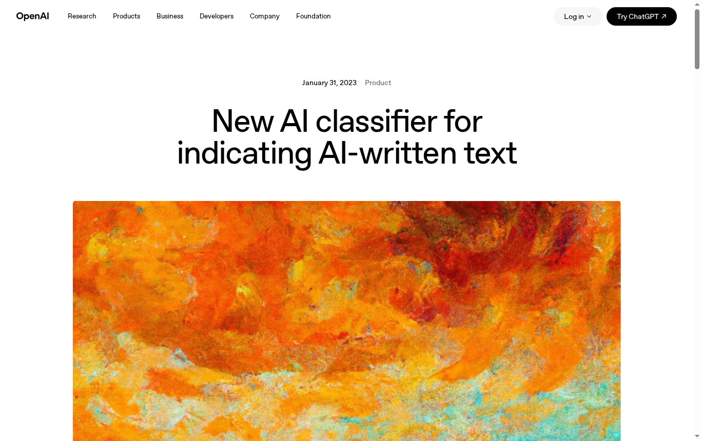
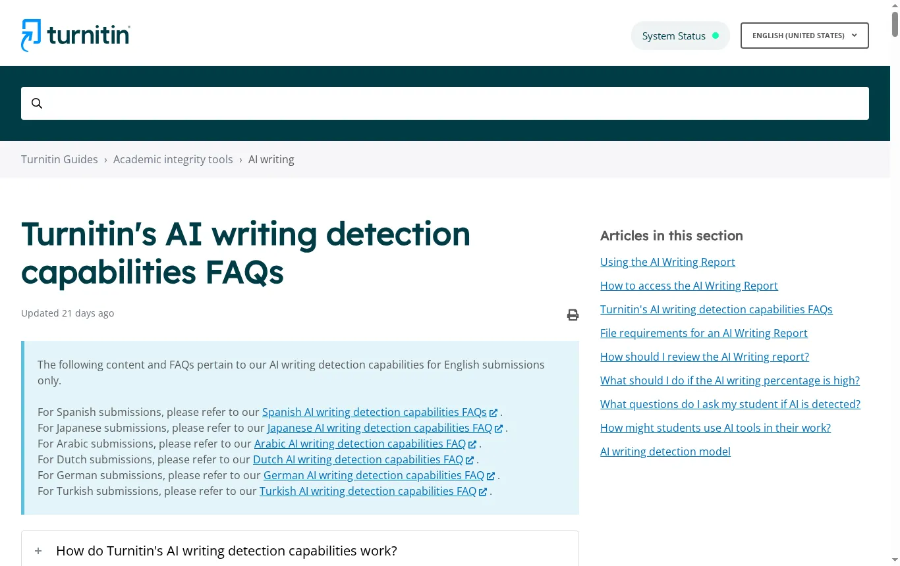
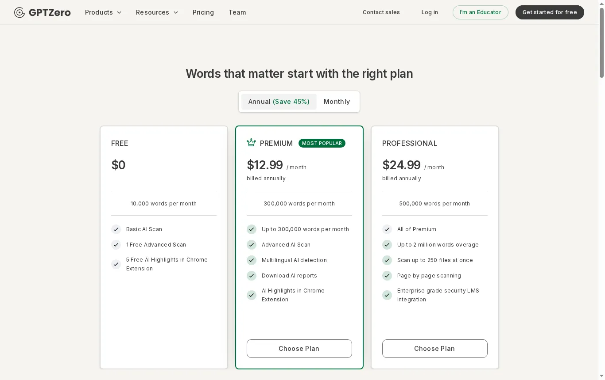

> Thuộc chuyên đề: [Hướng dẫn dùng công cụ AI phổ biến](huong-dan-dung-cong-cu-ai-pho-bien.md) · Bài viết của [KimQ Tech](https://kimq.tech)

"Check đạo văn AI" thực ra gồm hai việc khác nhau. **Kiểm tra trùng lặp** so bài của bạn với kho tài liệu có sẵn để tìm đoạn chép. **Phát hiện văn bản do AI viết** đoán xem câu chữ có giống văn của ChatGPT, Gemini hay không. Việc thứ hai khó hơn nhiều và **có thể báo nhầm**: chính OpenAI đã gỡ công cụ phát hiện AI của mình vì độ chính xác thấp.

Bài này giải thích hai loại công cụ, các công cụ phổ biến (Turnitin, GPTZero, DoIT), giới hạn với tiếng Việt và cách tự bảo vệ khi bài tự viết bị gắn cờ AI. Thông tin lấy từ trang chính thức ngày **25/11/2026**.

## Tóm tắt nhanh

| | Kiểm tra trùng lặp (đạo văn) | Phát hiện văn bản AI |
|---|---|---|
| Làm gì | Tìm đoạn giống tài liệu đã có | Đoán đoạn nào do AI viết |
| Bằng chứng | Chỉ ra nguồn bị trùng | Chỉ là xác suất, không có "nguồn gốc" |
| Báo nhầm | Thấp nếu trích dẫn đúng | Có thể báo nhầm văn người viết |
| Tiếng Việt | DoIT, Turnitin kiểm tra trùng lặp được | **Turnitin chưa hỗ trợ tiếng Việt** cho phát hiện AI |
| Công cụ | DoIT, Turnitin Similarity | Turnitin AI Writing, GPTZero |

## Công cụ phát hiện AI hoạt động thế nào?

Theo [câu hỏi thường gặp của Turnitin](https://guides.turnitin.com/hc/en-us/articles/28477544839821-Turnitin-s-AI-Writing-Detection-FAQs), mô hình ngôn ngữ lớn có xu hướng chọn từ tiếp theo theo cách "dễ đoán", còn người viết thì thất thường và mang dấu ấn riêng. Công cụ phát hiện AI được huấn luyện để nhận ra khác biệt này trong xác suất chọn từ.

Hệ quả: văn người viết nhưng **rất chuẩn mực, khuôn mẫu** (bài tóm tắt, định nghĩa, văn mẫu) có thể bị đoán là AI. Ngược lại, văn AI đã được sửa nhiều có thể lọt qua.

### Bài học từ OpenAI

OpenAI từng phát hành công cụ phân loại văn bản AI. Theo [trang công bố của OpenAI](https://openai.com/index/new-ai-classifier-for-indicating-ai-written-text), trên bộ kiểm tra tiếng Anh công cụ chỉ nhận đúng **26%** văn bản AI và **gắn nhầm 9%** văn bản người viết là AI. Từ **20/7/2023**, OpenAI ngừng cung cấp công cụ này vì độ chính xác thấp.

*Ảnh chụp màn hình: Trang công bố công cụ phân loại văn bản AI của OpenAI, có ghi chú đã ngừng cung cấp. Nguồn: [openai.com](https://openai.com/index/new-ai-classifier-for-indicating-ai-written-text), chụp ngày 25/11/2026.*

## Turnitin: phổ biến ở trường đại học, nhưng chưa phát hiện AI cho tiếng Việt

Turnitin có hai phần: **Similarity Report** (kiểm tra trùng lặp) và **AI Writing Report** (phát hiện AI). Những điểm chính từ trang hướng dẫn của Turnitin:

- **Ngôn ngữ hỗ trợ phát hiện AI**: tiếng Anh, Tây Ban Nha, Nhật, Ả Rập hiện đại, Hà Lan, Đức, Thổ Nhĩ Kỳ (văn bản dài). **Không có tiếng Việt.** Bài bằng ngôn ngữ không hỗ trợ sẽ không được xử lý và không có báo cáo AI.
- **Độ dài tối thiểu**: tuỳ ngôn ngữ, bài có dưới 300 từ trong các câu được đánh giá sẽ không được xử lý.
- **Ngưỡng 20%**: điểm AI từ 1% đến 19% không hiện số cụ thể mà hiện dấu sao (*%), vì vùng này dễ báo nhầm.
- **Tỷ lệ báo nhầm mục tiêu**: dưới 1% với tài liệu có hơn 20% nội dung AI, tức có thể gắn nhầm khoảng 1 trên 100 bài hoàn toàn do người viết.
- **Chỉ giảng viên và quản trị viên** nhìn thấy chỉ số AI; sinh viên không tự xem được.
- Turnitin loại bỏ danh sách, tiêu đề, tài liệu tham khảo, bảng số liệu, công thức, mã khỏi phần chấm.

*Ảnh chụp màn hình: Trang câu hỏi thường gặp về phát hiện văn bản AI của Turnitin. Nguồn: [guides.turnitin.com](https://guides.turnitin.com/hc/en-us/articles/28477544839821-Turnitin-s-AI-Writing-Detection-FAQs), chụp ngày 25/11/2026.*

Với sinh viên Việt Nam: luận văn, tiểu luận **bằng tiếng Anh** có thể bị Turnitin chấm điểm AI; bài **bằng tiếng Việt** thì Turnitin chỉ kiểm tra trùng lặp.

## GPTZero: tự kiểm tra trước khi nộp

GPTZero là công cụ phát hiện AI cho cá nhân dùng được. Theo [trang hỗ trợ GPTZero](https://support.gptzero.me/articles/1272562776-what-is-the-difference-between-the-free-and-paid-for-plans):

| Gói | Có gì |
|---|---|
| Free | Basic AI Scan (điểm AI tổng), 1 lượt Advanced Scan dùng thử, 10.000 từ/tháng, tối đa 10.000 ký tự mỗi lần quét |
| Essential | Thêm kiểm tra ngữ pháp, từ vựng hay gặp ở AI, tiện ích trình duyệt; quét đến 50.000 ký tự |
| Premium | Thêm Advanced Scan (tô sáng từng câu), kiểm tra trùng lặp, gợi ý trích dẫn |
| Professional | Quét đến 150.000 ký tự, tích hợp hệ thống học tập (LMS), bảo mật doanh nghiệp |

*Ảnh chụp màn hình: Bảng giá các gói GPTZero. Nguồn: [gptzero.me](https://gptzero.me/pricing), chụp ngày 25/11/2026.*

GPTZero cũng chỉ cho **xác suất**, không phải bằng chứng. Kết quả với tiếng Việt cần thận trọng hơn tiếng Anh. Không nên dùng điểm GPTZero để kết luận một người gian lận.

## DoIT: kiểm tra trùng lặp tiếng Việt

DoIT là phần mềm kiểm tra trùng lặp cho tiếng Việt do Đại học Quốc gia Hà Nội phát triển, theo [bài giới thiệu trên trang ĐHQGHN](https://vnu.edu.vn/doit-cong-cu-phat-hien-dao-van-cho-tieng-viet-post27741.html). DoIT so bài với kho tài liệu để tìm đoạn trùng và có kiểm tra chính tả. Đây là công cụ **kiểm tra đạo văn (trùng lặp)**, không phải công cụ phát hiện văn bản do AI viết. Nhiều trường dùng song song DoIT cho bài tiếng Việt và Turnitin cho bài tiếng Anh.

## Bài tự viết bị gắn cờ AI: làm gì?

1. **Giữ lịch sử soạn thảo.** Google Docs có Lịch sử phiên bản, Word có lịch sử khi lưu trên OneDrive. Đây là bằng chứng tốt nhất cho thấy bạn viết dần từng phần.
2. **Giữ bản nháp, dàn ý, ghi chép**, ảnh chụp tài liệu tham khảo.
3. **Hỏi rõ công cụ và ngưỡng** giảng viên dùng. Theo Turnitin, điểm dưới 20% không hiện số vì dễ báo nhầm.
4. **Đề nghị trình bày miệng** về nội dung bài: người viết thật giải thích được lập luận của mình.
5. **Đọc quy chế của trường** về dùng AI. Có trường cho phép dùng AI hỗ trợ nếu khai báo rõ.

## Dùng AI khi học mà không vi phạm

- **Khai báo** phần đã dùng AI (lên ý tưởng, sửa ngữ pháp, dịch) nếu trường yêu cầu.
- **Không nộp nguyên văn** đoạn do AI viết như bài của mình.
- **Dùng AI để hỏi, để hiểu**, rồi tự viết lại bằng lời của mình. Xem [AI giải bài tập: cách dùng đúng](ai-giai-bai-tap.md).
- **Kiểm tra trích dẫn**: AI có thể bịa tên sách, tên bài báo. Mọi nguồn phải mở được và đọc được.
- **Đừng dùng "công cụ lách AI"** viết lại câu để qua mặt máy kiểm tra. Turnitin có phát hiện văn bản đã qua công cụ viết lại (paraphrase, bypass) cho bài tiếng Anh, và đây có thể bị coi là gian lận.

## Đọc thêm trong chuyên đề

- [Gemini cho sinh viên: cách nhận gói miễn phí 1 năm](gemini-cho-sinh-vien.md).
- [AI giải bài tập: AI Hay, Gauth và cách dùng đúng](ai-giai-bai-tap.md).
- [Học AI bắt đầu từ đâu](hoc-ai-bat-dau-tu-dau.md).
- [Hướng dẫn dùng công cụ AI phổ biến](huong-dan-dung-cong-cu-ai-pho-bien.md).

Doanh nghiệp cần **kiểm soát việc nhân viên đưa tài liệu nội bộ vào công cụ AI** (ai dùng mô hình nào, gửi dữ liệu gì) có thể xem [AI Gateway của KimQ Tech](https://kimq.tech/san-pham/ai-gateway).

## Câu hỏi thường gặp

**Check đạo văn AI miễn phí ở đâu?**
GPTZero có gói Free 10.000 từ mỗi tháng cho phát hiện AI cơ bản. Kiểm tra trùng lặp tiếng Việt thường dùng DoIT qua thư viện trường.

**Turnitin có phát hiện văn bản AI tiếng Việt không?**
Không. Theo Turnitin, phát hiện AI chỉ hỗ trợ tiếng Anh, Tây Ban Nha, Nhật, Ả Rập, Hà Lan, Đức, Thổ Nhĩ Kỳ. Bài tiếng Việt chỉ được kiểm tra trùng lặp.

**Công cụ phát hiện AI có chính xác không?**
Không tuyệt đối. Turnitin đặt mục tiêu báo nhầm dưới 1% với tài liệu có hơn 20% nội dung AI; OpenAI đã gỡ công cụ của mình vì độ chính xác thấp. Kết quả chỉ nên là gợi ý để xem xét thêm.

**Sửa lại văn AI có qua được máy kiểm tra không?**
Có thể, nhưng không nên. Turnitin có phát hiện công cụ viết lại cho bài tiếng Anh, và dùng AI mà không khai báo có thể vi phạm quy chế học thuật.

**Sinh viên có tự xem điểm AI trên Turnitin được không?**
Theo Turnitin, chỉ giảng viên và quản trị viên thấy chỉ số AI.

---

> Bài viết có sử dụng AI hỗ trợ soạn thảo. Nội dung và số liệu được đối chiếu với nguồn chính thức ngày 25/11/2026; ảnh là ảnh chụp màn hình trang chính thức, có ghi nguồn và ngày chụp.

## Về KimQ Tech

[KimQ Tech](https://kimq.tech) xây giải pháp AI và tự động hoá vận hành cho doanh nghiệp Việt: [AI Studio](https://kimq.tech/san-pham/ai-studio), [AI Gateway](https://kimq.tech/san-pham/ai-gateway), [Trợ lý AI trên Zalo](https://kimq.tech/san-pham/tro-ly-zalo), [Chatbot đa kênh](https://kimq.tech/san-pham/chatbot-da-kenh), [Tự động hoá](https://kimq.tech/san-pham/tu-dong-hoa). Cần tư vấn? [Liên hệ KimQ Tech](https://kimq.tech/lien-he) hoặc email contact@kimq.tech.

---

*Thông tin kiểm tra trên trang chính thức của Turnitin, GPTZero, OpenAI và ĐHQGHN ngày 25/11/2026 và có thể thay đổi. KimQ Tech không phải đại lý của các công cụ trong bài.*
