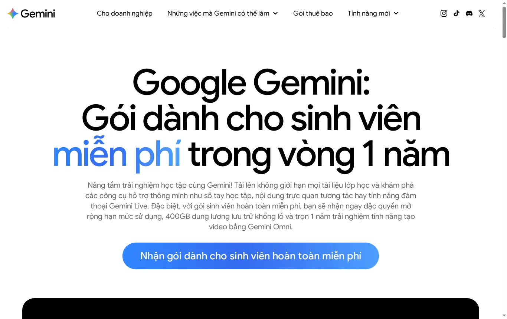
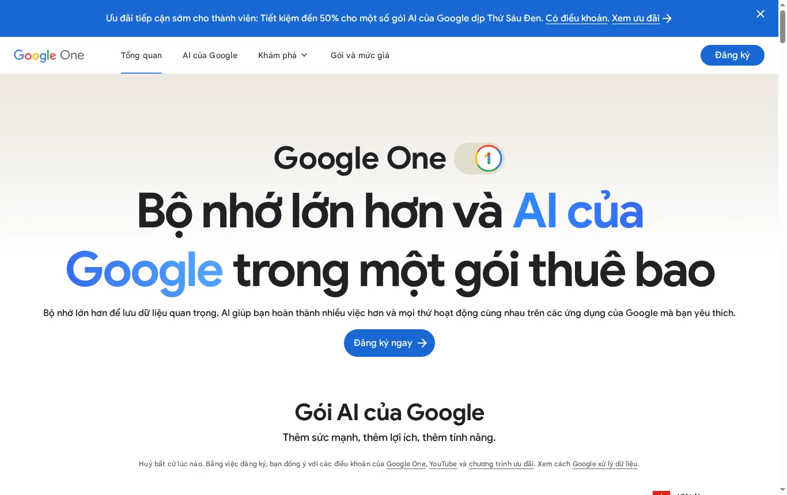
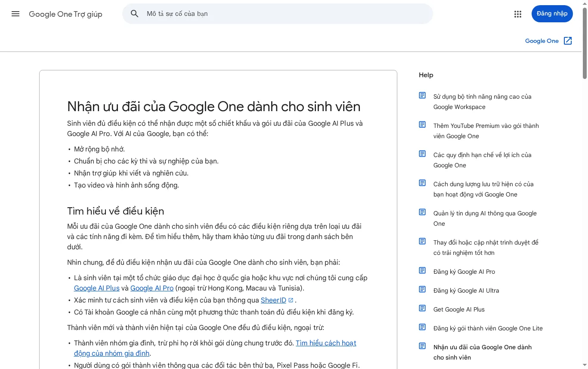

> Thuộc chuyên đề: [Hướng dẫn dùng công cụ AI phổ biến](huong-dan-dung-cong-cu-ai-pho-bien.md) · Bài viết của [KimQ Tech](https://kimq.tech)

Google đang tặng sinh viên Việt Nam **gói Google AI Plus miễn phí 1 năm**: Gemini với hạn mức cao hơn, 400 GB lưu trữ, sổ ghi chú học tập, tạo video bằng Gemini Omni. Hạn nhận ưu đãi là **31/12/2026**. Điều nhiều bạn không để ý: phải thêm phương thức thanh toán, và hết 1 năm gói **tự tính phí 132.000 ₫/tháng** nếu không huỷ.

Bài này tổng hợp điều kiện, các bước đăng ký, lỗi thường gặp khi xác minh và cách tránh bị trừ tiền. Thông tin lấy từ trang chính thức của Google ngày **25/11/2026**.

## Tóm tắt nhanh

| | Thông tin |
|---|---|
| Ưu đãi | Google AI Plus miễn phí 1 năm cho sinh viên |
| Hạn nhận | 31/12/2026 |
| Điều kiện chính | Sinh viên đại học, cao đẳng (giáo dục bậc cao), từ 18 tuổi, Gmail cá nhân, xác minh qua SheerID |
| Cần thẻ/ví thanh toán? | Có, phải thêm phương thức thanh toán hợp lệ |
| Sau 1 năm | Tự chuyển sang AI Plus trả phí 132.000 ₫/tháng nếu không huỷ |
| Trang đăng ký chính thức | one.google.com/ai-student |
| Gồm gì | Hạn mức Gemini cao hơn, 400 GB lưu trữ, sổ ghi chú học tập, Gemini Live, tạo ảnh, tạo video bằng Gemini Omni |

## Gói Google AI Plus cho sinh viên gồm những gì?

*Ảnh chụp màn hình: Trang Gemini dành cho sinh viên tại Việt Nam. Nguồn: [gemini.google](https://gemini.google/vn/students/?hl=vi), chụp ngày 25/11/2026.*

Theo [trang Gemini cho sinh viên](https://gemini.google/vn/students/?hl=vi) của Google:

- **Mở rộng hạn mức sử dụng** Gemini so với bản miễn phí.
- **400 GB lưu trữ** dùng chung cho Gmail, Drive, Google Photos.
- **Sổ ghi chú học tập**: tải tài liệu môn học lên, Gemini lập kế hoạch học, tạo bài kiểm tra, theo dõi phần cần ôn.
- **Gemini Live**: trò chuyện bằng giọng nói để hỏi các khái niệm khó.
- **Tạo hình ảnh** và **tạo video bằng Gemini Omni** trong 1 năm.
- **Kết nối Gmail, Drive** để Gemini tìm và tổng hợp thông tin của bạn.

## Gói AI Plus khác gì AI Pro?

Theo [trang Google One Việt Nam](https://one.google.com/intl/vi_vn/about/) lúc kiểm tra:

| Gói | Giá thường | Lưu trữ |
|---|---|---|
| Google AI Plus | 132.000 ₫/tháng | 400 GB |
| Google AI Pro | 489.000 ₫/tháng | 5 TB |
| Google AI Ultra | Từ 2.250.000 ₫/tháng | Từ 20 TB |

*Ảnh chụp màn hình: Bảng giá các gói Google AI trên Google One Việt Nam. Nguồn: [one.google.com](https://one.google.com/intl/vi_vn/about/), chụp ngày 25/11/2026.*

Ưu đãi sinh viên năm 2025 là gói **AI Pro**; đợt hiện tại ở Việt Nam là **AI Plus**. Theo trang trợ giúp Google One, ưu đãi dùng thử AI Pro 12 tháng hiện **chỉ áp dụng ở Hoa Kỳ**. Nhiều bài hướng dẫn cũ vẫn ghi "Gemini Pro miễn phí cho sinh viên"; hãy kiểm tra trang chính thức trước khi làm theo.

## Điều kiện nhận ưu đãi

Theo [trang trợ giúp Google One về ưu đãi sinh viên](https://support.google.com/googleone/answer/17422238?hl=vi), bạn cần:

1. **Là sinh viên** tại một cơ sở giáo dục đại học ở quốc gia có Google AI Plus và Google AI Pro.
2. **Xác minh tư cách sinh viên qua SheerID** (đơn vị xác minh của bên thứ ba).
3. **Dùng tài khoản Google cá nhân** (@gmail.com). Email do trường cấp **không** đủ điều kiện.
4. **Từ 18 tuổi trở lên**, đã xác minh tuổi trên tài khoản Google; ngày sinh nhập ở SheerID phải khớp với ngày sinh trên tài khoản Google.
5. **Có phương thức thanh toán hợp lệ** khi đăng ký.

Không đủ điều kiện nếu: là thành viên (không phải người tạo) của nhóm gia đình Google One, dùng gói qua đối tác bên thứ ba như nhà mạng, hoặc tài khoản được quản lý bằng Family Link.

## Cách đăng ký Gemini cho sinh viên từng bước

1. **Xác minh tuổi** trên tài khoản Google tại myaccount.google.com/age-verification (nếu chưa làm).
2. **Mở one.google.com/ai-student** bằng đúng tài khoản Gmail cá nhân muốn nhận ưu đãi.
3. **Chọn ưu đãi** dành cho sinh viên.
4. **Xác minh qua SheerID**: chọn trường, nhập họ tên, ngày sinh, email; tải giấy tờ chứng minh nếu được yêu cầu (thẻ sinh viên, giấy xác nhận còn hạn có tên trường và năm học).
5. **Thêm phương thức thanh toán** và hoàn tất đăng ký.
6. Mở Gemini và kiểm tra gói hiển thị là AI Plus.

*Ảnh chụp màn hình: Trang trợ giúp Google One về ưu đãi dành cho sinh viên. Nguồn: [support.google.com](https://support.google.com/googleone/answer/17422238?hl=vi), chụp ngày 25/11/2026.*

Google lưu ý SheerID thường duyệt giấy tờ trong vài phút, nhưng mùa nhập học có thể mất vài ngày. Số lần thử xác minh có giới hạn, nên chuẩn bị giấy tờ rõ ràng trước khi gửi.

## Lỗi thường gặp và cách xử lý

| Lỗi | Nguyên nhân thường gặp | Cách xử lý |
|---|---|---|
| Không nhận được ưu đãi sau khi xác minh | Xác minh bằng một tài khoản, đăng ký bằng tài khoản khác | Dùng đúng một tài khoản Gmail từ đầu đến cuối |
| Bị từ chối vì tuổi | Ngày sinh ở SheerID khác tài khoản Google, hoặc chưa xác minh tuổi | Xác minh tuổi trên tài khoản Google, nhập ngày sinh khớp |
| Báo không đủ điều kiện | Đang ở nhóm gia đình, hoặc dùng email trường | Rời nhóm gia đình hoặc dùng Gmail cá nhân khác |
| Đang có gói qua App Store, nhà mạng | Gói bên thứ ba | Huỷ gói bên thứ ba trước rồi mới đăng ký |
| Trang không tải, hết thời gian | Mạng yếu | Đổi mạng, mở bằng cửa sổ ẩn danh hoặc máy tính |
| Quốc gia không khớp | Quốc gia Google Play hoặc Google Payments khác nơi bạn học | Cập nhật quốc gia cho khớp |

## Cách tránh bị trừ tiền sau 1 năm

Trang ưu đãi ghi rõ: sau thời gian dùng thử, **Google AI Plus tự động tính phí 132.000 ₫/tháng** trừ khi bạn đã huỷ. Google sẽ thông báo trước khi chuyển sang gói trả phí.

- Đặt nhắc lịch trước ngày hết hạn khoảng 1 tuần.
- Vào one.google.com, mục quản lý gói thành viên, để xem ngày gia hạn và huỷ.
- Đọc kỹ email thông báo của Google trước kỳ gia hạn để biết chính xác ngày bắt đầu tính phí.

## Dùng Gemini học tập thế nào cho đúng?

- **Tải tài liệu lên trước khi hỏi** để Gemini trả lời theo giáo trình, không theo kiến thức chung.
- **Nhờ giải thích, không nhờ làm hộ.** Câu lệnh "chỉ tôi cách giải bài này từng bước" giúp học được hơn là xin đáp án. Xem thêm [AI giải bài tập: cách dùng đúng](ai-giai-bai-tap.md).
- **Kiểm tra lại số liệu, trích dẫn.** AI vẫn có thể sai hoặc bịa nguồn.
- **Tuân thủ quy định của trường** về việc dùng AI trong bài nộp. Nhiều trường dùng công cụ phát hiện văn bản AI; xem [check đạo văn AI](check-dao-van-ai.md).
- **Không mua "tài khoản sinh viên"** hay nhờ người lạ xác minh hộ. Tài khoản có thể bị khoá, và bạn phải đưa giấy tờ cá nhân cho người không rõ danh tính.

## Đọc thêm trong chuyên đề

- [35 câu lệnh tạo ảnh, ghép ảnh trên Gemini](cau-lenh-tao-anh-ghep-anh-gemini.md).
- [Chế độ AI của Google (AI Mode) là gì](che-do-ai-google-ai-mode-la-gi.md).
- [Làm slide bằng AI](lam-slide-bang-ai.md): dùng Gemini trong Google Slides làm bài thuyết trình.
- [Học AI bắt đầu từ đâu](hoc-ai-bat-dau-tu-dau.md).

Doanh nghiệp muốn dùng mô hình Gemini, GPT, Claude cho nhân viên trong **một cổng quản lý chi phí và quyền truy cập** có thể xem [AI Gateway của KimQ Tech](https://kimq.tech/san-pham/ai-gateway).

## Câu hỏi thường gặp

**Gemini cho sinh viên có miễn phí thật không?**
Có, miễn phí 1 năm gói Google AI Plus. Bạn phải thêm phương thức thanh toán; sau 1 năm gói tự tính 132.000 ₫/tháng nếu không huỷ.

**Sinh viên được Gemini Pro miễn phí không?**
Đợt hiện tại ở Việt Nam là AI Plus. Theo trang trợ giúp Google One, ưu đãi dùng thử AI Pro 12 tháng hiện chỉ áp dụng ở Hoa Kỳ.

**Dùng email trường có đăng ký được không?**
Không. Phải dùng tài khoản Google cá nhân (@gmail.com).

**Học sinh cấp 3 có nhận được không?**
Không. Ưu đãi dành cho sinh viên giáo dục bậc cao, từ 18 tuổi.

**Hạn đăng ký đến khi nào?**
Trang chính thức ghi hạn nhận ưu đãi là 31/12/2026.

---

> Bài viết có sử dụng AI hỗ trợ soạn thảo. Nội dung và số liệu được đối chiếu với nguồn chính thức ngày 25/11/2026; ảnh là ảnh chụp màn hình trang chính thức, có ghi nguồn và ngày chụp.

## Về KimQ Tech

[KimQ Tech](https://kimq.tech) xây giải pháp AI và tự động hoá vận hành cho doanh nghiệp Việt: [AI Studio](https://kimq.tech/san-pham/ai-studio), [AI Gateway](https://kimq.tech/san-pham/ai-gateway), [Trợ lý AI trên Zalo](https://kimq.tech/san-pham/tro-ly-zalo), [Chatbot đa kênh](https://kimq.tech/san-pham/chatbot-da-kenh), [Tự động hoá](https://kimq.tech/san-pham/tu-dong-hoa). Cần tư vấn? [Liên hệ KimQ Tech](https://kimq.tech/lien-he) hoặc email contact@kimq.tech.

---

*Thông tin kiểm tra trên trang chính thức của Google ngày 25/11/2026 và có thể thay đổi. KimQ Tech không phải đại lý của Google.*
