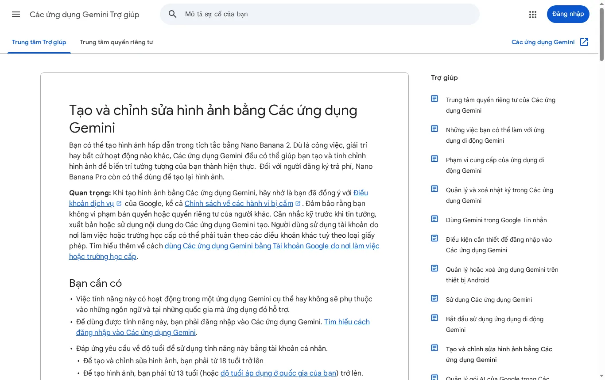
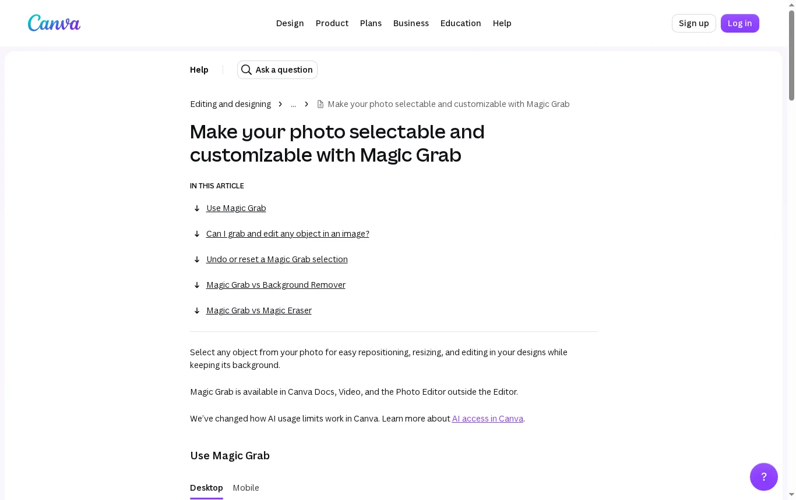
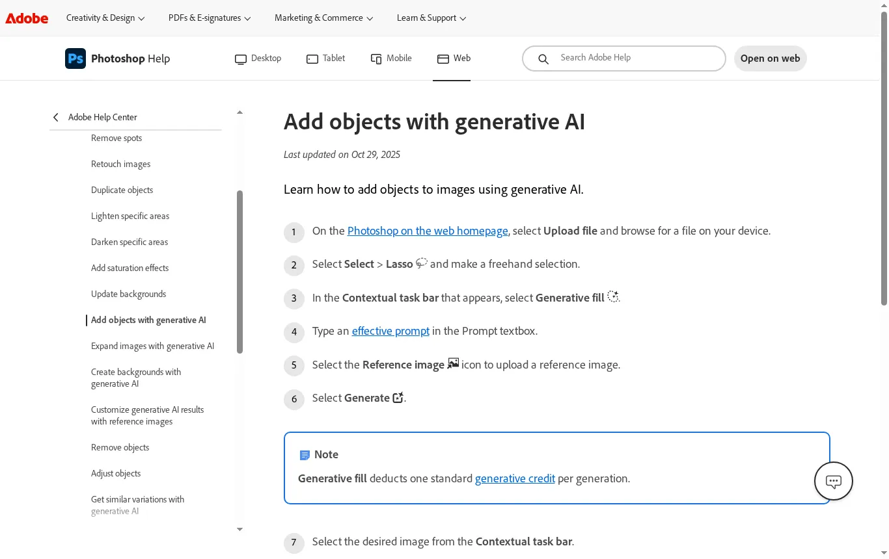

> Thuộc chuyên đề: [Top công cụ AI chỉnh sửa ảnh](top-cong-cu-ai-chinh-sua-anh.md) · Bài viết của [KimQ Tech](https://kimq.tech)

Ghép ảnh trước đây là việc của người rành Photoshop: tách nền từng sợi tóc, chỉnh ánh sáng cho khớp, làm bóng đổ. Với AI, phần lớn việc đó rút lại còn một câu mô tả. Bạn tải hai ảnh lên, gõ "đặt người trong ảnh 1 vào quán cà phê ở ảnh 2, ánh sáng buổi chiều", và nhận kết quả sau vài giây.

Bài này hướng dẫn ba cách ghép ảnh bằng AI phổ biến nhất hiện nay: **Gemini** (ghép bằng câu lệnh), **Canva Magic Grab** (tách vật thể rồi kéo thả) và **Generative Fill trong Photoshop bản web** (thêm vật thể vào vùng chọn). Thông tin lấy từ trang trợ giúp chính thức ngày **25/11/2026**.

## Tóm tắt nhanh

| | Gemini (Nano Banana) | Canva Magic Grab | Photoshop web, Generative Fill |
|---|---|---|---|
| Cách ghép | Tải nhiều ảnh, mô tả bằng lời | Tách vật thể, kéo sang vị trí hoặc thiết kế khác | Khoanh vùng, mô tả vật thể cần thêm, có thể kèm ảnh tham chiếu |
| Miễn phí? | Có, giới hạn lượt theo ngày | Có giới hạn lượt dùng AI, tuỳ gói | Mỗi lần tạo trừ 1 credit tạo sinh tiêu chuẩn |
| Tiếng Việt | Gõ câu lệnh tiếng Việt được | Giao diện tiếng Việt | Câu lệnh tiếng Anh cho kết quả ổn định hơn |
| Điều kiện | Tài khoản cá nhân từ 18 tuổi mới sửa ảnh được | Tài khoản Canva | Tài khoản Adobe |
| Hợp với | Ghép người vào bối cảnh mới, đổi trang phục, ảnh sản phẩm | Bài đăng mạng xã hội, ảnh bán hàng | Người cần kiểm soát từng vùng ảnh |

Muốn ghép nhanh, không cần biết thiết kế: dùng **Gemini**. Muốn giữ nguyên ảnh gốc và chỉ dời vật thể: dùng **Canva Magic Grab**. Muốn chỉnh chi tiết từng vùng: dùng **Photoshop**.

## Ghép ảnh AI là gì, khác ghép ảnh thủ công thế nào

Ghép ảnh thủ công gồm ba bước: tách chủ thể khỏi nền, đặt vào nền mới, rồi chỉnh màu, ánh sáng, bóng cho khớp. Bước thứ ba khó nhất, vì người xem nhận ra ngay khi ánh sáng trên mặt không cùng hướng với ánh sáng của bối cảnh.

AI ghép ảnh làm theo hai kiểu:

- **Tạo lại toàn bộ ảnh** từ ảnh bạn đưa vào (Gemini). Mô hình hiểu nội dung từng ảnh rồi vẽ ra một ảnh mới có ánh sáng đồng nhất. Ưu điểm là kết quả liền mạch. Nhược điểm là chi tiết nhỏ như chữ trên áo, hoa văn, nét mặt có thể bị đổi.
- **Sửa một phần ảnh** (Canva, Photoshop). Bạn chọn vùng, AI chỉ xử lý vùng đó, phần còn lại giữ nguyên điểm ảnh gốc. Ưu điểm là kiểm soát được. Nhược điểm là bạn phải tự sắp bố cục.

## Cách 1: Ghép ảnh bằng Gemini

Gemini dùng mô hình ảnh **Nano Banana** của Google. Theo trang trợ giúp, bạn có thể sửa ảnh do Gemini tạo, tải một ảnh lên để yêu cầu sửa, hoặc **tải nhiều ảnh lên và yêu cầu tạo một ảnh mới dựa trên các ảnh đó**. Kiểu thứ ba chính là ghép ảnh.

*Ảnh chụp màn hình: Trang trợ giúp tạo và sửa ảnh trong Gemini. Nguồn: [support.google.com](https://support.google.com/gemini/answer/14286560), chụp ngày 25/11/2026.*

Điều kiện cần biết:

- Tính năng **sửa ảnh chỉ dành cho người dùng từ 18 tuổi** với tài khoản cá nhân. Tài khoản trường học có thể bị giới hạn khác.
- Mô hình **Nano Banana 2** (khi chọn Flash hoặc Pro) nhận được nhiều ảnh tham chiếu. Bản **Nano Banana Lite** (Flash-Lite) không được thiết kế cho nhiều ảnh tham chiếu, nên khi ghép ảnh hãy chọn Flash hoặc Pro.
- Có gói Google AI thì dùng được **Nano Banana Pro** để tạo lại ảnh chi tiết hơn (nút "Redo with Pro"). Hết hạn mức Nano Banana 2 trong ngày thì không tạo lại bằng Pro được nữa.

### Các bước

1. Vào [gemini.google.com](https://gemini.google.com) hoặc mở app Gemini, đăng nhập.
2. Chọn mô hình Flash hoặc Pro.
3. Bấm dấu **+** để tải lên 2 ảnh trở lên (ví dụ ảnh chân dung và ảnh bối cảnh).
4. Gõ câu lệnh, nói rõ ảnh nào là chủ thể, ảnh nào là nền.
5. Chưa ưng thì nhắn tiếp trong cùng cuộc trò chuyện để sửa từng chi tiết, không cần làm lại từ đầu.
6. Di chuột lên ảnh, bấm tải xuống bản đủ kích thước.

### Mẫu câu lệnh ghép ảnh

- "Ghép người trong ảnh 1 vào khung cảnh ảnh 2. Giữ nguyên khuôn mặt, kiểu tóc và trang phục. Ánh sáng buổi chiều từ bên trái, thêm bóng đổ dưới chân."
- "Đặt chai nước trong ảnh 1 lên mặt bàn gỗ ở ảnh 2, nhãn chai giữ nguyên chữ, phong cách ảnh sản phẩm, nền mờ nhẹ."
- "Ghép ba người ở ba ảnh thành một ảnh chụp chung đứng trước cổng trường, ai cũng nhìn vào máy ảnh, ánh sáng tự nhiên."
- "Thay áo của người trong ảnh 1 bằng chiếc áo trong ảnh 2, giữ nguyên tư thế và nền."

Mẹo: Gemini giữ mặt tốt hơn khi ảnh chân dung rõ, nhìn thẳng, đủ sáng. Nếu mặt bị đổi, nhắn thêm "giữ nguyên khuôn mặt như ảnh gốc, không làm đẹp". Thêm nhiều mẫu tại bài [35 câu lệnh tạo ảnh, ghép ảnh trên Gemini](cau-lenh-tao-anh-ghep-anh-gemini.md).

Ảnh do Gemini tạo hoặc sửa được gắn thuỷ vân SynthID. Nếu bạn dùng ảnh cho quảng cáo, hãy ghi rõ là ảnh có dùng AI.

## Cách 2: Canva Magic Grab, tách vật thể rồi kéo thả

Magic Grab không vẽ lại ảnh. Nó **tách một vật thể khỏi ảnh để bạn di chuyển, phóng to thu nhỏ hoặc chỉnh sửa riêng, trong khi vẫn giữ phần nền**. Chỗ trống mà vật thể để lại được AI lấp đầy. Vật thể đã tách có thể kéo sang thiết kế khác, đó là cách ghép ảnh trong Canva.

*Ảnh chụp màn hình: Trang trợ giúp Magic Grab của Canva. Nguồn: [canva.com](https://www.canva.com/help/using-magic-grab/), chụp ngày 25/11/2026.*

### Các bước

1. Mở thiết kế, chọn ảnh cần xử lý. Lưu ý: Magic Grab **không hỗ trợ ảnh nằm trong khung (frame) hoặc lưới (grid)**.
2. Trên thanh công cụ chọn **Chỉnh sửa** (Edit), vào **Công cụ**, chọn **Xem tất cả**.
3. Kéo xuống cuối, chọn **Magic Grab**.
4. Bấm vào vật thể cần tách, hoặc kéo chọn nhiều vật thể. Có thể dùng **Brush** để tô lên vật thể.
5. Bấm **Grab** và chờ xử lý.
6. Kéo vật thể đến vị trí mới, đổi kích thước, hoặc sao chép sang thiết kế có nền khác.

Muốn quay lại ảnh gốc, bấm hoàn tác hoặc bấm lại nút Magic Grab để bỏ chọn.

### Magic Grab khác Background Remover thế nào

Theo Canva: **Background Remover xoá nền, chỉ giữ chủ thể**. **Magic Grab giữ nền và tách chủ thể ra thành lớp riêng**. Khi ghép người vào ảnh khác, cách thường dùng là:

- Ảnh người: chạy Background Remover để lấy chủ thể.
- Ảnh nền: đặt làm lớp dưới.
- Kéo chủ thể lên, chỉnh kích thước, thêm bóng đổ bằng hiệu ứng Shadows.

Canva đã thay đổi cách tính hạn mức dùng AI. Số lượt Magic Studio miễn phí phụ thuộc gói bạn đang dùng, xem mục "AI access" trong tài khoản.

## Cách 3: Photoshop bản web, Generative Fill

Generative Fill phù hợp khi bạn muốn **thêm một vật thể vào đúng vị trí** trong ảnh: thêm chiếc ghế vào góc phòng, thêm cái cây cạnh cửa, thêm chiếc mũ lên đầu người mẫu.

*Ảnh chụp màn hình: Trang trợ giúp thêm vật thể bằng AI trong Photoshop web. Nguồn: [helpx.adobe.com](https://helpx.adobe.com/photoshop/web/edit-images/retouch/add-objects-with-generative-ai.html), chụp ngày 25/11/2026.*

### Các bước

1. Mở Photoshop bản web, chọn **Upload file** và tải ảnh lên.
2. Chọn công cụ **Lasso** (Select > Lasso), khoanh vùng cần thêm vật thể.
3. Trên thanh tác vụ hiện ra, chọn **Generative fill**.
4. Gõ mô tả vật thể. Có thể bấm biểu tượng **ảnh tham chiếu** để tải lên ảnh vật thể thật, giúp kết quả giống sản phẩm của bạn hơn.
5. Bấm **Generate**, chọn một trong các phương án.

Theo Adobe, **mỗi lần tạo trừ một credit tạo sinh tiêu chuẩn**. Số credit hằng tháng tuỳ gói Adobe bạn dùng.

Mẹo: khoanh vùng rộng hơn vật thể một chút để AI có chỗ vẽ bóng và phần chuyển tiếp. Vùng quá sát thường cho kết quả bị dán.

## Ghép ảnh AI online miễn phí: chọn thế nào

| Nhu cầu | Gợi ý |
|---|---|
| Ghép mình vào ảnh du lịch, ảnh kỷ niệm | Gemini, câu lệnh tiếng Việt |
| Ảnh sản phẩm cho shop online | Gemini để tạo bối cảnh, Canva để thêm giá, chữ, logo |
| Dời vật thể trong cùng một ảnh | Canva Magic Grab |
| Thêm đồ vật vào đúng vị trí | Photoshop Generative Fill |
| Ảnh có chữ, logo cần giữ chính xác | Ghép bằng Canva hoặc Photoshop, tránh để AI vẽ lại chữ |
| Chạy trên máy, không tải ảnh lên mạng | ComfyUI, IOPaint (xem bài [Top công cụ AI chỉnh sửa ảnh](top-cong-cu-ai-chinh-sua-anh.md)) |

Sau khi ghép, ảnh thường bị nhỏ hoặc hơi mờ. Bạn có thể [làm nét ảnh bằng AI](lam-net-anh-bang-ai.md), hoặc cần thêm khoảng trống hai bên để làm ảnh bìa thì [mở rộng ảnh bằng AI](mo-rong-anh-bang-ai.md).

## Lỗi hay gặp và cách sửa

- **Mặt bị đổi so với ảnh gốc.** Dùng ảnh chân dung rõ nét, nhìn thẳng. Ghi rõ "giữ nguyên khuôn mặt". Với Gemini, sửa từng bước nhỏ thay vì yêu cầu nhiều thay đổi cùng lúc.
- **Ánh sáng không khớp.** Mô tả hướng sáng và thời điểm trong ngày, ví dụ "nắng chiều từ bên phải".
- **Chủ thể trông như dán lên.** Yêu cầu thêm bóng đổ, phản chiếu trên sàn, hoặc làm mờ nền nhẹ.
- **Chữ trên sản phẩm bị sai.** Ghép xong thì đặt lại logo, nhãn thật bằng Canva hoặc Photoshop.
- **Tỷ lệ người không đúng.** Nói rõ "người đứng cách máy ảnh khoảng 3 mét, cao bằng khung cửa".

## Lưu ý pháp lý khi ghép ảnh người khác

Ghép ảnh bằng AI dễ đến mức dễ bị lạm dụng. Trước khi đăng, hãy nhớ:

- **Ảnh người khác cần được người đó đồng ý.** Bộ luật Dân sự 2015 (Điều 32) quy định việc sử dụng hình ảnh của cá nhân phải được người đó đồng ý.
- **Không ghép ảnh để bôi nhọ, giả mạo, lừa đảo.** Ảnh giả người thân để vay tiền, ảnh giả người nổi tiếng quảng cáo sản phẩm là các hình thức lừa đảo phổ biến.
- **Ảnh thương mại cần ghi rõ có dùng AI** khi có thể gây hiểu lầm về sản phẩm thật.
- Điều khoản Gemini, Canva, Adobe đều cấm nội dung vi phạm bản quyền và quyền riêng tư của người khác.

Với doanh nghiệp, tránh tải ảnh khách hàng, ảnh nhân viên hoặc tài liệu nội bộ lên công cụ AI miễn phí khi chưa xem chính sách dữ liệu. Ghép ảnh mặt người cụ thể sẽ được phân tích riêng trong bài về ghép mặt bằng AI.

## Câu hỏi thường gặp

**AI ghép ảnh nào miễn phí?**
Gemini cho dùng miễn phí với giới hạn lượt theo ngày. Canva bản miễn phí có giới hạn lượt dùng tính năng AI. Photoshop trừ credit mỗi lần tạo.

**Ghép ảnh trên điện thoại được không?**
Được. App Gemini và app Canva trên điện thoại đều có tính năng tương tự bản web.

**Vì sao Gemini không cho tôi sửa ảnh?**
Tính năng sửa ảnh chỉ mở cho tài khoản cá nhân từ 18 tuổi. Tài khoản trường học hoặc công ty có thể bị quản trị viên giới hạn.

**Ghép ảnh AI có giữ được mặt giống 100% không?**
Không công cụ nào đảm bảo. Cách giữ mặt chắc nhất là ghép kiểu "sửa một phần" (Canva, Photoshop), vì phần mặt giữ nguyên điểm ảnh gốc.

**Có cách nào ghép ảnh mà không tải ảnh lên mạng?**
Có. Các công cụ mã nguồn mở như ComfyUI hoặc IOPaint chạy trên máy tính của bạn, cần card đồ hoạ đủ mạnh.

## Dùng AI ghép ảnh cho cả đội

Nếu công ty bạn làm ảnh sản phẩm, banner hằng ngày, [AI Studio của KimQ Tech](https://kimq.tech/san-pham/ai-studio) gom các mô hình tạo và sửa ảnh vào một chỗ, kèm quản lý quyền truy cập theo nhân viên.

---

> Bài viết có sử dụng AI hỗ trợ soạn thảo. Nội dung và số liệu được đối chiếu với nguồn chính thức ngày 25/11/2026; ảnh là ảnh chụp màn hình trang chính thức, có ghi nguồn và ngày chụp.

## Về KimQ Tech

[KimQ Tech](https://kimq.tech) xây giải pháp AI và tự động hoá vận hành cho doanh nghiệp Việt: [AI Studio](https://kimq.tech/san-pham/ai-studio), [AI Gateway](https://kimq.tech/san-pham/ai-gateway), [Trợ lý AI trên Zalo](https://kimq.tech/san-pham/tro-ly-zalo), [Chatbot đa kênh](https://kimq.tech/san-pham/chatbot-da-kenh), [Tự động hoá](https://kimq.tech/san-pham/tu-dong-hoa). Cần tư vấn? [Liên hệ KimQ Tech](https://kimq.tech/lien-he) hoặc email contact@kimq.tech.

---

*Thông tin kiểm tra trên trang trợ giúp Google Gemini, Canva và Adobe ngày 25/11/2026 và có thể thay đổi. KimQ Tech không phải đại lý của Google, Canva hay Adobe.*
