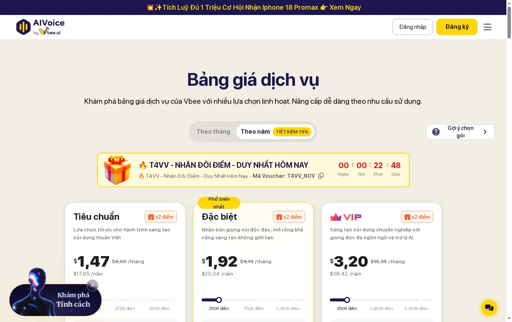
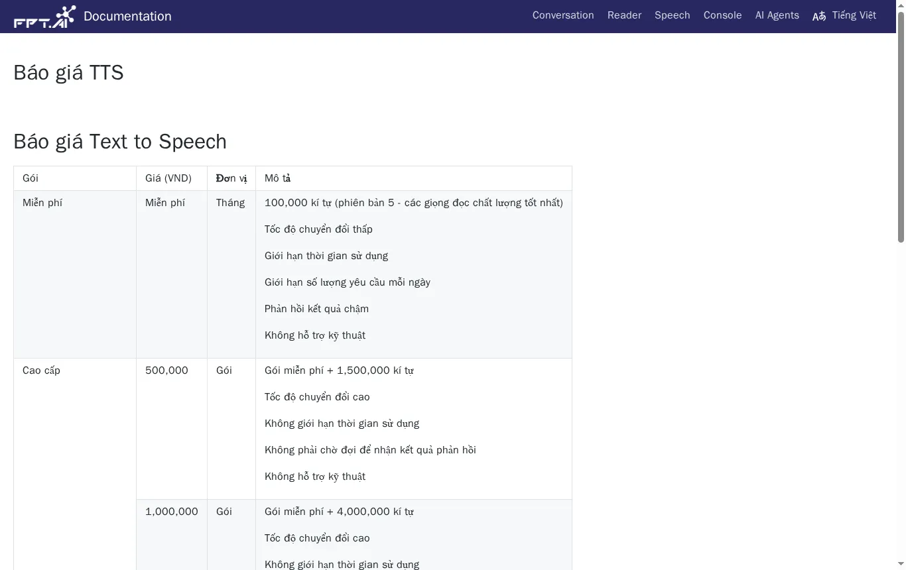
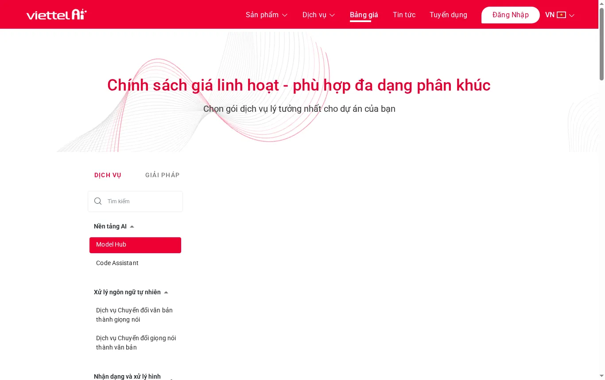
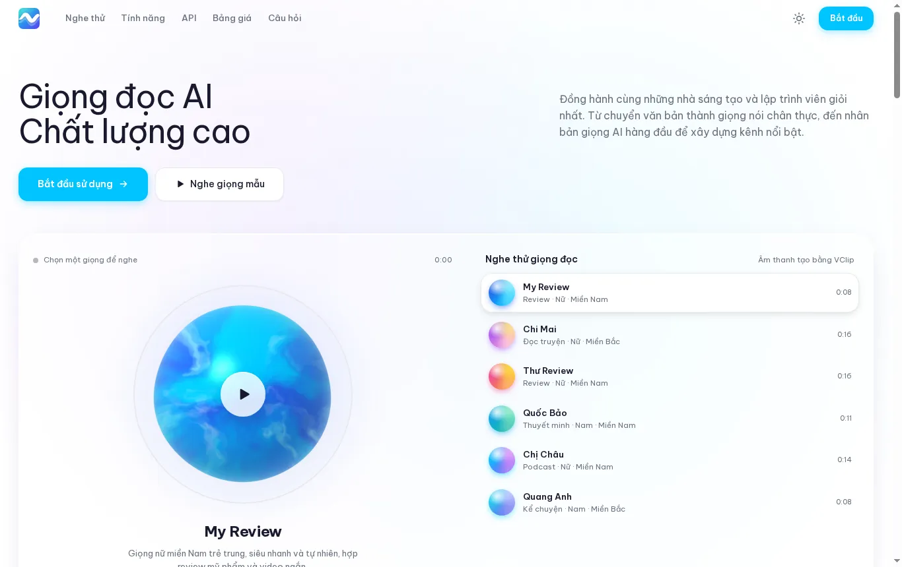

> Thuộc chuyên đề: [Top 10 công cụ tạo video AI 2026](top-cong-cu-tao-video-ai.md) · Bài viết của [KimQ Tech](https://kimq.tech)

Cần giọng đọc tiếng Việt cho video TikTok, bài giảng hay tổng đài mà không thuê người lồng tiếng? Bốn dịch vụ được dùng nhiều nhất là **Vbee**, **FPT.AI**, **Viettel AI** và **VClip**. Cả bốn đều tính tiền theo số ký tự văn bản, nhưng gói miễn phí, cách mua và đối tượng phục vụ khác nhau khá xa.

Bảng giá và tính năng trong bài lấy từ trang chính thức của từng dịch vụ ngày **25/11/2026**.

## Tóm tắt nhanh

| | Vbee | FPT.AI | Viettel AI | VClip |
|---|---|---|---|---|
| Hợp với ai | Người làm nội dung, doanh nghiệp | Lập trình viên, doanh nghiệp cần API | Doanh nghiệp, cơ quan | Người làm video TikTok, truyện audio |
| Dùng thử miễn phí | 3.000 điểm mỗi ngày | 100.000 ký tự mỗi tháng | Có trang nghe thử | Có tài khoản miễn phí, giới hạn lượt xuất |
| Cách mua | Gói tháng/năm theo điểm, mua thêm điểm | Gói trả trước theo số ký tự | Báo giá theo yêu cầu | Credit, 1 credit = 1 ký tự |
| Nhân bản giọng | Có (từ gói miễn phí: nhân bản nhanh) | Không thấy trên bảng giá | Không thấy trên trang chính | Có, từ đoạn ghi âm 5–30 giây |
| Giao diện tạo file | Có (Studio) | Chủ yếu qua API | Có trang thử | Có |

## Vbee: nhiều gói nhất cho người làm nội dung

Vbee là dịch vụ giọng đọc AI lâu năm ở Việt Nam. Trang chủ giới thiệu hỗ trợ hơn 50 ngôn ngữ, hơn 1.000 giọng đọc, có nhân bản giọng và lồng tiếng.

*Ảnh chụp màn hình: Bảng giá các gói Vbee AIVoice. Nguồn: [vbee.vn](https://vbee.vn/pricing), chụp ngày 25/11/2026.*

Bảng giá Vbee chia hai nhóm: **Studio** (dùng trên web) và **API** (tích hợp vào phần mềm). Với Studio, các gói lúc kiểm tra:

| Gói | Điểm (gói năm) | Điểm mua thêm | Tính năng thêm so với gói dưới |
|---|---|---|---|
| Miễn phí | 3.000 điểm mỗi ngày | Không được mua thêm | Giọng tiếng Việt cơ bản, tải không giới hạn, chuyển phụ đề SRT thành giọng, chỉnh ngắt nghỉ, nhân bản giọng nhanh |
| Tiêu chuẩn | 250.000 điểm/tháng | 15.000 ₫ / 50.000 điểm | Truy cập API TTS và STT, không chèn audio quảng cáo |
| Đặc biệt | 500.000 điểm/tháng | 12.000 ₫ / 50.000 điểm | Giọng quốc tế cơ bản, giọng AI nâng cao, nhân bản giọng chuyên nghiệp |
| VIP | 900.000 điểm/tháng | 12.000 ₫ / 50.000 điểm | Giọng AI cao cấp, AI kiểm tra cách đọc |
| Tùy chỉnh | 6 triệu điểm/năm | – | API thời gian thực, mua thêm thiết bị và giọng nhân bản |

Lưu ý khi đọc bảng giá Vbee:

- Lúc chúng tôi mở trang, giá hiển thị bằng USD và đang chạy khuyến mãi nhân đôi điểm, gói năm ghi "tiết kiệm 79%". Giá thay đổi theo đợt khuyến mãi, nên xem lại bảng giá ngay trước khi mua.
- Gói miễn phí **không mua thêm điểm được**. Nếu cần đọc bài dài đều đặn, phải lên gói trả phí.
- Giọng nâng cao và cao cấp trừ điểm khác giọng cơ bản (Vbee đã đổi cơ chế trừ ký tự với giọng nâng cao từ bản cập nhật tháng 5/2025).

## FPT.AI: gói ký tự trả trước, rõ ràng cho doanh nghiệp

FPT.AI Text to Speech chủ yếu dùng qua API, hợp với đội kỹ thuật muốn đưa giọng đọc vào ứng dụng, tổng đài, hệ thống đọc tin. Bảng giá trên trang tài liệu chính thức:

*Ảnh chụp màn hình: Trang bảng giá chuyển văn bản thành giọng nói của FPT.AI. Nguồn: [docs.fpt.ai](https://docs.fpt.ai/docs/vi/speech/documentation/tts-pricing), chụp ngày 25/11/2026.*

| Gói | Giá | Số ký tự |
|---|---|---|
| Miễn phí | 0 ₫ | 100.000 ký tự/tháng, giọng phiên bản 5. Tốc độ chậm, giới hạn số yêu cầu mỗi ngày, không hỗ trợ kỹ thuật |
| Cao cấp | 500.000 ₫ | Gói miễn phí + 1.500.000 ký tự |
| Cao cấp | 1.000.000 ₫ | Gói miễn phí + 4.000.000 ký tự |
| Cao cấp | 2.000.000 ₫ | Gói miễn phí + 10.000.000 ký tự |
| Cao cấp | 5.000.000 ₫ | Gói miễn phí + 27.000.000 ký tự |
| Doanh nghiệp cao cấp | Liên hệ | Có hỗ trợ kỹ thuật tiêu chuẩn, hotline 1900 638 399 |

Cách tính nhanh: gói 500.000 ₫ cho 1,5 triệu ký tự, tức khoảng **0,33 ₫ mỗi ký tự**. Gói 5 triệu ₫ xuống còn khoảng 0,19 ₫ mỗi ký tự. Một bài đọc 1.000 chữ tiếng Việt thường khoảng 4.500–5.000 ký tự (tính cả dấu cách), nên gói 500.000 ₫ đọc được khoảng 300 bài như vậy.

## Viettel AI: báo giá theo yêu cầu

Viettel AI giới thiệu Viettel Text to Speech có giọng đọc "tự nhiên tới 95% như giọng người", dùng cho tin tức, nội dung truyền thông và marketing. Trang chủ có khu vực nghe thử.

*Ảnh chụp màn hình: Trang bảng giá dịch vụ Viettel AI. Nguồn: [viettelai.vn](https://viettelai.vn/bang-gia), chụp ngày 25/11/2026.*

Trang bảng giá của Viettel AI ghi các gói dịch vụ **cung cấp theo yêu cầu**: liên hệ email viettelai@viettel.com.vn hoặc số +84 98 1900 911 để nhận báo giá. Viettel AI hợp với doanh nghiệp lớn, cơ quan cần hợp đồng, hoá đơn và hỗ trợ trực tiếp, ít hợp với cá nhân muốn mua gói nhỏ dùng ngay.

## VClip: nhân bản giọng và đọc truyện dài

VClip (vclip.io) nhắm tới người làm video review, truyện audio, sách nói. Những điểm đáng chú ý trên trang chính thức:

*Ảnh chụp màn hình: Trang chủ VClip với công cụ đọc văn bản và nhân bản giọng. Nguồn: [vclip.io](https://vclip.io/), chụp ngày 25/11/2026.*

- **1 credit = 1 ký tự.** Văn bản được chia đoạn; sửa một câu chỉ trả tiền đoạn mới, đoạn đã tạo được lưu đệm và **không tính lại**.
- **Tự hoàn credit** nếu xuất file thất bại.
- **Nhân bản giọng** từ đoạn ghi âm hoặc file 5–30 giây (MP3, WAV, M4A). VClip tự tách giọng khỏi nhạc nền.
- Thư viện **hơn 90 giọng cộng đồng**, có giọng miền Bắc và miền Nam, lọc theo mục đích: review, tin tức, đọc truyện, thuyết minh, quảng cáo.
- Có **API** dùng chung credit với tài khoản.

Gói miễn phí của VClip giới hạn số giọng nhân bản và số lượt xuất mỗi giờ; gói trả phí bỏ các giới hạn này. Trang chủ không ghi giá cụ thể, phải đăng nhập mới xem được.

Lưu ý tên miền: dịch vụ giọng đọc này ở **vclip.io**. Từ khoá "vclip ai" còn trùng với các dịch vụ khác tên, chẳng hạn gói xem clip của nhà mạng.

## Chọn dịch vụ nào?

| Nhu cầu | Nên chọn | Vì sao |
|---|---|---|
| Thử miễn phí mỗi ngày, làm vài video ngắn | **Vbee** gói miễn phí | 3.000 điểm làm mới mỗi ngày, có chuyển phụ đề SRT |
| Đọc truyện dài, sửa đi sửa lại nhiều | **VClip** | Chỉ tính tiền đoạn mới, đoạn cũ không tính lại |
| Giọng riêng của kênh (giọng chính chủ) | **VClip** hoặc **Vbee** gói Đặc biệt | Nhân bản giọng |
| Tích hợp vào app, tổng đài, giá rõ ràng | **FPT.AI** | Gói trả trước theo ký tự, có bảng giá công khai |
| Doanh nghiệp lớn, cần hợp đồng và hỗ trợ | **Viettel AI** hoặc FPT.AI doanh nghiệp | Báo giá riêng, hỗ trợ kỹ thuật |

## Mẹo cho giọng đọc tự nhiên hơn

1. **Viết số và từ viết tắt thành chữ** khi cần đọc đúng: "2026" có thể đọc thành "hai nghìn không trăm hai mươi sáu", "TP.HCM" nên viết "Thành phố Hồ Chí Minh".
2. **Dùng dấu câu để tạo nhịp.** Dấu phẩy, dấu chấm là chỗ nghỉ; câu quá dài làm giọng đọc đều đều.
3. **Chọn giọng theo vùng khán giả.** Video bán hàng miền Nam nên dùng giọng miền Nam.
4. **Nghe lại từng đoạn trước khi xuất.** Tên riêng, tên thương hiệu tiếng Anh hay bị đọc sai; viết lại theo cách đọc (ví dụ "Gu-gồ" thay vì "Google" nếu giọng đọc sai).
5. **Ghép phụ đề.** Nếu đã có file SRT, Vbee chuyển thẳng phụ đề thành giọng đọc, khớp thời gian sẵn.

## Rủi ro cần biết

- **Nhân bản giọng người khác.** Chỉ nhân bản giọng của chính bạn hoặc người đã đồng ý bằng văn bản. Giả giọng người nổi tiếng, giọng người thân để lừa đảo là hành vi vi phạm pháp luật và điều khoản của các dịch vụ.
- **Gắn nhãn nội dung AI.** Video dùng giọng AI nên ghi rõ "giọng đọc AI" ở mô tả, nhất là quảng cáo.
- **Dữ liệu văn bản.** Không dán hợp đồng, thông tin khách hàng vào công cụ miễn phí. Doanh nghiệp nên dùng gói có hợp đồng và điều khoản bảo mật.

## Đọc thêm trong chuyên đề

- [Tạo nhạc bằng AI: so sánh Suno, Udio](tao-nhac-bang-ai.md): thêm nhạc nền cho video có giọng đọc.
- [Viggle AI là gì](viggle-ai-la-gi.md): tạo clip nhân vật chuyển động để ghép giọng đọc.
- [Top 10 công cụ tạo video AI](top-cong-cu-tao-video-ai.md).

Nếu doanh nghiệp cần **video dọc giới thiệu sản phẩm có giọng đọc tiếng Việt và phụ đề làm sẵn**, xem [AI Studio của KimQ Tech](https://kimq.tech/san-pham/ai-studio).

## Câu hỏi thường gặp

**Giọng đọc AI tiếng Việt nào miễn phí?**
Vbee cho 3.000 điểm mỗi ngày, FPT.AI cho 100.000 ký tự mỗi tháng qua API, VClip có tài khoản miễn phí giới hạn lượt xuất. Gói miễn phí đều có giới hạn tốc độ hoặc số lượt.

**Vbee AI tính tiền thế nào?**
Theo điểm. Gói miễn phí có 3.000 điểm mỗi ngày; gói trả phí có số điểm theo tháng và mua thêm 50.000 điểm giá 12.000–15.000 ₫ tuỳ gói. Giọng nâng cao trừ điểm nhiều hơn giọng cơ bản.

**FPT.AI text to speech giá bao nhiêu?**
Từ 500.000 ₫ cho 1,5 triệu ký tự, cộng 100.000 ký tự miễn phí mỗi tháng.

**Có nhân bản được giọng của mình không?**
Có. VClip nhân bản từ đoạn ghi âm 5–30 giây; Vbee có nhân bản nhanh ở gói miễn phí và nhân bản chuyên nghiệp ở gói Đặc biệt.

**Dùng giọng AI đăng TikTok có bị bóp tương tác không?**
Chưa có thông tin chính thức từ TikTok về việc này. Điều chắc chắn là nội dung tạo bằng AI trông giống thật cần được gắn nhãn theo quy định của nền tảng.

---

> Bài viết có sử dụng AI hỗ trợ soạn thảo. Nội dung và số liệu được đối chiếu với nguồn chính thức ngày 25/11/2026; ảnh là ảnh chụp màn hình trang chính thức, có ghi nguồn và ngày chụp.

## Về KimQ Tech

[KimQ Tech](https://kimq.tech) xây giải pháp AI và tự động hoá vận hành cho doanh nghiệp Việt: [AI Studio](https://kimq.tech/san-pham/ai-studio), [AI Gateway](https://kimq.tech/san-pham/ai-gateway), [Trợ lý AI trên Zalo](https://kimq.tech/san-pham/tro-ly-zalo), [Chatbot đa kênh](https://kimq.tech/san-pham/chatbot-da-kenh), [Tự động hoá](https://kimq.tech/san-pham/tu-dong-hoa). Cần tư vấn? [Liên hệ KimQ Tech](https://kimq.tech/lien-he) hoặc email contact@kimq.tech.

---

*Thông tin kiểm tra trên trang chính thức của Vbee, FPT.AI, Viettel AI và VClip ngày 25/11/2026 và có thể thay đổi. KimQ Tech không phải đại lý của các dịch vụ trong bài.*
