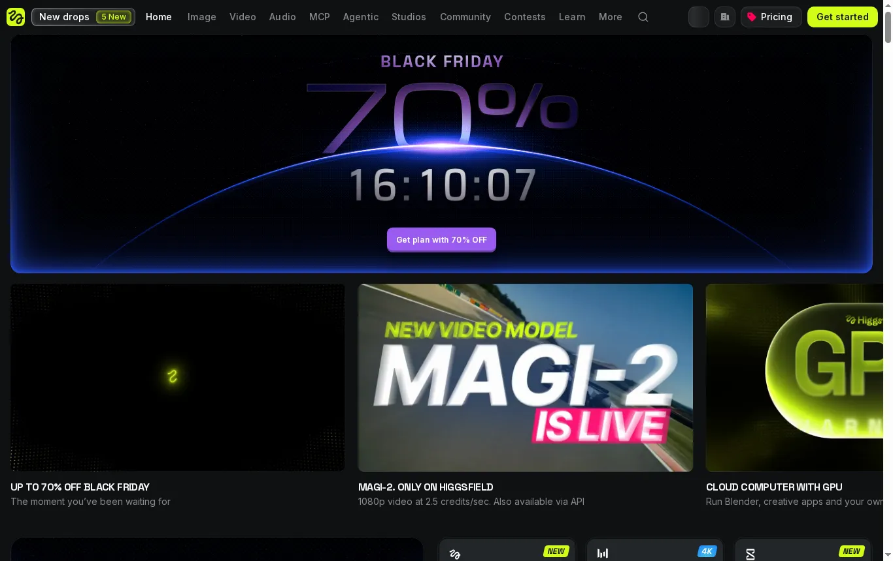
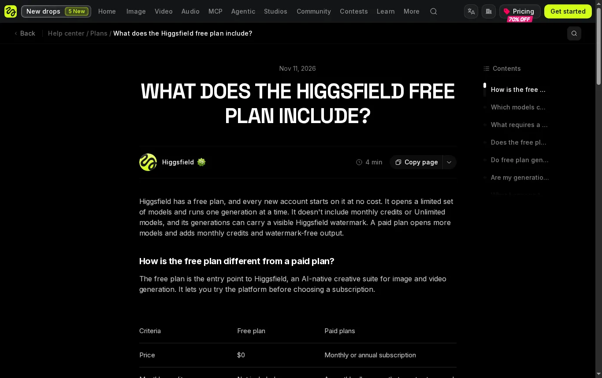
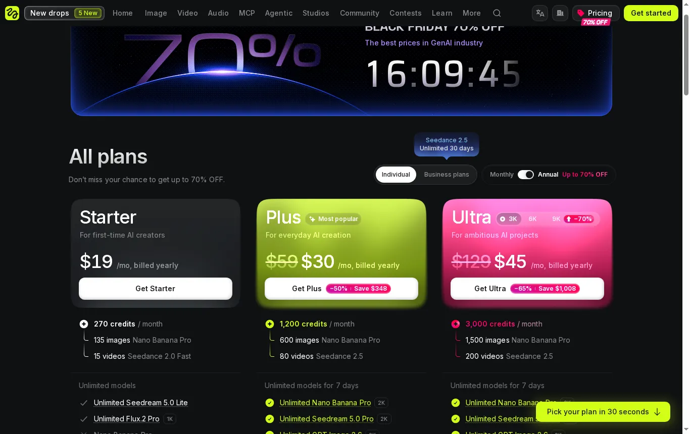

> Thuộc chuyên đề: [Top 10 công cụ tạo video AI 2026](top-cong-cu-tao-video-ai.md) · Bài viết của [KimQ Tech](https://kimq.tech)

**Higgsfield AI** là nền tảng tạo ảnh và video bằng AI gom nhiều mô hình của các hãng khác nhau vào một chỗ: Sora của OpenAI, Veo của Google, Kling, WAN, Seedance, Grok Imagine, cùng các mô hình ảnh như Nano Banana, FLUX, GPT Image và mô hình Soul của riêng Higgsfield. Thay vì đăng ký năm tài khoản, bạn dùng một tài khoản Higgsfield, trả bằng một loại credit.

Bài này giải thích Higgsfield làm được gì, gói miễn phí có gì, giá các gói, cách tạo video đầu tiên và những điều khoản nên đọc trước khi trả tiền. Thông tin lấy từ trang chính thức ngày **25/11/2026**.

## Tóm tắt nhanh

| | Thông tin |
|---|---|
| Là gì | Nền tảng tạo ảnh, video, âm thanh bằng AI, nhiều mô hình trong một tài khoản |
| Mô hình video | Sora 2, Veo 3.1, Kling 3.0, WAN 2.6, Seedance, Grok Imagine… |
| Gói miễn phí | Có, bộ mô hình giới hạn, 1 lượt tạo mỗi lần, có thể có hình mờ, không có credit hằng tháng |
| Gói trả phí rẻ nhất | Starter $19/tháng (trả theo năm), 270 credit/tháng |
| Quyền thương mại | Higgsfield không giữ quyền sở hữu và không hạn chế dùng thương mại kết quả |
| Hoàn tiền | Lần mua đầu, trong 7 ngày, chưa dùng credit nào; trừ phí tối đa 6% |
| Hợp với | Người làm quảng cáo, video mạng xã hội muốn thử nhiều mô hình |

## Higgsfield AI làm được gì?

*Ảnh chụp màn hình: Trang chủ Higgsfield AI. Nguồn: [higgsfield.ai](https://higgsfield.ai/), chụp ngày 25/11/2026.*

Theo [tệp giới thiệu chính thức](https://higgsfield.ai/llms.txt) của Higgsfield, các khu vực chính gồm:

- **AI Video**: tạo video từ văn bản hoặc từ ảnh, chọn mô hình Sora, Veo, Kling, WAN, Seedance.
- **AI Image**: tạo ảnh bằng Nano Banana, Soul, FLUX, GPT Image, Seedream.
- **Cinema Studio**: điều khiển kiểu điện ảnh, chọn thân máy, ống kính, chuyển động máy quay.
- **Lipsync Studio**: tạo nhân vật nói, khớp khẩu hình, dạng video UGC (người thật review sản phẩm).
- **Storyboard**: dựng kịch bản nhiều cảnh, giữ nhân vật nhất quán.
- **Apps**: gần 100 ứng dụng một chạm, mẫu dựng sẵn cho quảng cáo, hiệu ứng.
- **Upscale, Video Edit, Draw to Video**: nâng chất lượng, sửa cảnh, vẽ phác để điều khiển video.

Điểm mạnh thật sự: **so sánh nhiều mô hình trên cùng một câu lệnh**. Một cảnh quay sản phẩm có thể đẹp hơn với Kling, một cảnh người nói chuyện lại hợp Veo. Trên Higgsfield bạn đổi mô hình trong vài giây.

## Gói miễn phí Higgsfield có gì?

Theo [trang trợ giúp về gói miễn phí](https://higgsfield.ai/creator-hub/help-center/plans/what-does-the-free-plan-include), mọi tài khoản mới bắt đầu ở gói Free:

- Mở **một số mô hình giới hạn** (ví dụ Nano Banana Pro, FLUX.2 Pro theo bảng so sánh).
- **Chạy một lượt tạo mỗi lần**, không tạo hàng loạt.
- **Không có credit hằng tháng.** Mô hình trong gói Free vẫn trừ credit, nên bạn cần credit tặng khi đăng ký hoặc lượt miễn phí.
- **Kết quả có thể có hình mờ Higgsfield.**
- Không có Soul ID, điều khiển khung đầu và khung cuối, Higgsfield Speak, công cụ dựng UGC.

*Ảnh chụp màn hình: Trang trợ giúp giải thích gói miễn phí của Higgsfield. Nguồn: [higgsfield.ai](https://higgsfield.ai/creator-hub/help-center/plans/what-does-the-free-plan-include), chụp ngày 25/11/2026.*

Kết luận thực tế: gói Free đủ để **thử giao diện và tạo vài ảnh**. Muốn làm video không hình mờ cho kênh bán hàng thì cần gói trả phí.

## Bảng giá Higgsfield AI

*Ảnh chụp màn hình: Bảng giá các gói Higgsfield AI. Nguồn: [higgsfield.ai](https://higgsfield.ai/pricing), chụp ngày 25/11/2026.*

Giá dưới đây là giá **trả theo năm, tính theo tháng**, lúc kiểm tra Higgsfield đang giảm giá Black Friday:

| Gói | Giá gốc | Giá khuyến mãi | Credit/tháng | Ví dụ theo trang giá |
|---|---|---|---|---|
| Starter | $19 | – | 270 | 135 ảnh Nano Banana Pro hoặc 15 video Seedance 2.0 Fast; tạo song song 2 video, 4 ảnh |
| Plus | $59 | $30 | 1.200 | 600 ảnh hoặc 80 video Seedance 2.5; dùng không giới hạn một số mô hình ảnh trong 7 ngày |
| Ultra | $129 | $45 | 3.000 | 1.500 ảnh hoặc 200 video Seedance 2.5; mọi mô hình và tính năng |

Lưu ý quan trọng từ trang giá:

- **Mô hình "Unlimited" và lượt miễn phí chỉ dùng trên higgsfield.ai**, không áp dụng khi gọi qua MCP, CLI, Canvas hay Supercomputer.
- Khi đông người dùng, tốc độ ở chế độ không giới hạn có thể bị điều chỉnh.
- Trang giá ước tính khoảng **14 credit mỗi video và 2 credit mỗi ảnh**, nhưng mỗi mô hình trừ khác nhau. Chi phí hiện trước khi bấm tạo.
- Giá chưa gồm VAT và thuế địa phương.

### Credit hết hạn khi nào?

Theo [trang trợ giúp về credit](https://higgsfield.ai/creator-hub/help-center/credits/top-up-credits-expire): credit trong gói **reset mỗi kỳ thanh toán, không cộng dồn**. Credit mua thêm (Credit Pack) hết hạn sau **90 ngày** kể từ ngày mua. Huỷ gói thì credit trong gói dùng được đến hết kỳ đã trả, credit mua thêm vẫn còn nhưng chỉ dùng cho mô hình của gói Free.

## Cách dùng Higgsfield AI tạo video đầu tiên

1. **Đăng ký tài khoản** trên higgsfield.ai bằng Google, Apple hoặc email.
2. **Vào mục Video** (Create Video), chọn chế độ tạo từ văn bản hoặc từ ảnh.
3. **Chọn mô hình.** Mới bắt đầu, chọn mô hình có ghi chi phí thấp để thử câu lệnh trước.
4. **Tải ảnh lên** (nếu tạo từ ảnh). Ảnh rõ mặt, ánh sáng tốt, nền gọn cho kết quả ổn định hơn.
5. **Viết câu lệnh bằng tiếng Anh**: chủ thể, hành động, góc máy, ánh sáng. Ví dụ: "Slow dolly in on a ceramic coffee cup on a wooden table, morning sunlight, steam rising, cinematic".
6. **Xem chi phí credit** hiện trên nút tạo, rồi bấm tạo.
7. **Tải video** và ghép giọng đọc, nhạc nền, phụ đề bằng phần mềm dựng.

Mẹo: thử cùng một câu lệnh trên 2–3 mô hình với độ dài ngắn nhất, chọn mô hình hợp nhất rồi mới tạo bản dài, độ phân giải cao.

## Quyền sở hữu, dữ liệu và hoàn tiền

**Quyền sở hữu.** Theo [trang trợ giúp về quyền sở hữu](https://higgsfield.ai/creator-hub/help-center/account/who-owns-my-generations-and-can-i-use-them-commercially), Higgsfield không giữ quyền sở hữu đầu vào và kết quả, không hạn chế dùng thương mại (quảng cáo, nội dung thương hiệu, làm cho khách hàng). Không cần mua giấy phép thương mại riêng. Tuy vậy, kết quả có hình mờ ở gói Free không phù hợp cho quảng cáo.

**Dữ liệu dùng để huấn luyện.** Cũng theo trang này, Higgsfield **được dùng nội dung của bạn để huấn luyện mô hình**, trừ khi bạn xoá nội dung hoặc tài khoản; chỉ hợp đồng Enterprise mới không dùng dữ liệu khách hàng để huấn luyện. Đừng tải ảnh sản phẩm chưa ra mắt, ảnh khách hàng hay tài liệu nội bộ lên gói cá nhân.

**Hoàn tiền.** Chỉ hoàn tiền **lần mua đầu**, trong **7 ngày**, khi **chưa dùng credit nào**; gói gia hạn không hoàn. Phí dịch vụ tối đa 6% bị trừ khi hoàn tiền. Vì vậy hãy thử kỹ bằng gói Free trước khi mua.

**Người và thương hiệu có thật.** Không tạo video giả mạo người nổi tiếng, người quen hay logo thương hiệu khác. Ngoài rủi ro pháp lý, nội dung AI giống thật cần được gắn nhãn khi đăng lên mạng xã hội.

## Higgsfield hay dùng thẳng Kling, Veo?

| Nên dùng Higgsfield khi | Nên dùng thẳng từng công cụ khi |
|---|---|
| Muốn thử nhiều mô hình, chưa biết mô hình nào hợp | Đã chọn được một mô hình và dùng nhiều |
| Cần công cụ phụ trợ: Cinema Studio, Lipsync, Storyboard | Cần tính năng mới nhất của hãng ngay khi ra mắt |
| Muốn một hoá đơn, một loại credit | Muốn gói miễn phí hằng ngày của từng hãng |

Xem cách dùng từng công cụ trong [Kling AI: hướng dẫn và gói miễn phí](kling-ai.md), [Vidu AI](vidu-ai.md) và [Viggle AI](viggle-ai-la-gi.md).

## Đọc thêm trong chuyên đề

- [Viggle AI là gì](viggle-ai-la-gi.md): ghép nhân vật vào video nhảy, meme.
- [Kling AI: hướng dẫn, gói miễn phí](kling-ai.md).
- [Cách tạo video AI từ ảnh](tao-video-ai-tu-anh.md).
- [Top 10 công cụ tạo video AI](top-cong-cu-tao-video-ai.md).

Doanh nghiệp cần **video sản phẩm dạng dọc có giọng đọc tiếng Việt, phụ đề, làm hàng loạt** mà không phải tự học từng công cụ có thể xem [AI Studio của KimQ Tech](https://kimq.tech/san-pham/ai-studio).

## Câu hỏi thường gặp

**Higgsfield AI có miễn phí không?**
Có gói Free nhưng không có credit hằng tháng, chỉ mở một số mô hình, chạy một lượt mỗi lần và kết quả có thể có hình mờ.

**Higgsfield AI giá bao nhiêu?**
Lúc kiểm tra, trả theo năm: Starter $19/tháng (270 credit), Plus $59/tháng (đang giảm còn $30, 1.200 credit), Ultra $129/tháng (đang giảm còn $45, 3.000 credit). Giá chưa gồm thuế.

**Video Higgsfield có dùng quảng cáo được không?**
Được. Higgsfield không hạn chế dùng thương mại kết quả. Nên dùng gói trả phí để có video không hình mờ.

**Higgsfield có phải của Kling hay Google không?**
Không. Higgsfield là nền tảng riêng, cung cấp quyền truy cập vào mô hình của nhiều hãng như OpenAI, Google, Kling, cùng mô hình Soul do Higgsfield phát triển.

**Mua Higgsfield rồi có hoàn tiền được không?**
Chỉ lần mua đầu, trong 7 ngày và chưa dùng credit nào. Gói gia hạn không được hoàn.

---

> Bài viết có sử dụng AI hỗ trợ soạn thảo. Nội dung và số liệu được đối chiếu với nguồn chính thức ngày 25/11/2026; ảnh là ảnh chụp màn hình trang chính thức, có ghi nguồn và ngày chụp.

## Về KimQ Tech

[KimQ Tech](https://kimq.tech) xây giải pháp AI và tự động hoá vận hành cho doanh nghiệp Việt: [AI Studio](https://kimq.tech/san-pham/ai-studio), [AI Gateway](https://kimq.tech/san-pham/ai-gateway), [Trợ lý AI trên Zalo](https://kimq.tech/san-pham/tro-ly-zalo), [Chatbot đa kênh](https://kimq.tech/san-pham/chatbot-da-kenh), [Tự động hoá](https://kimq.tech/san-pham/tu-dong-hoa). Cần tư vấn? [Liên hệ KimQ Tech](https://kimq.tech/lien-he) hoặc email contact@kimq.tech.

---

*Thông tin kiểm tra trên trang chính thức và trang trợ giúp của Higgsfield ngày 25/11/2026 và có thể thay đổi. KimQ Tech không phải đại lý của Higgsfield.*
