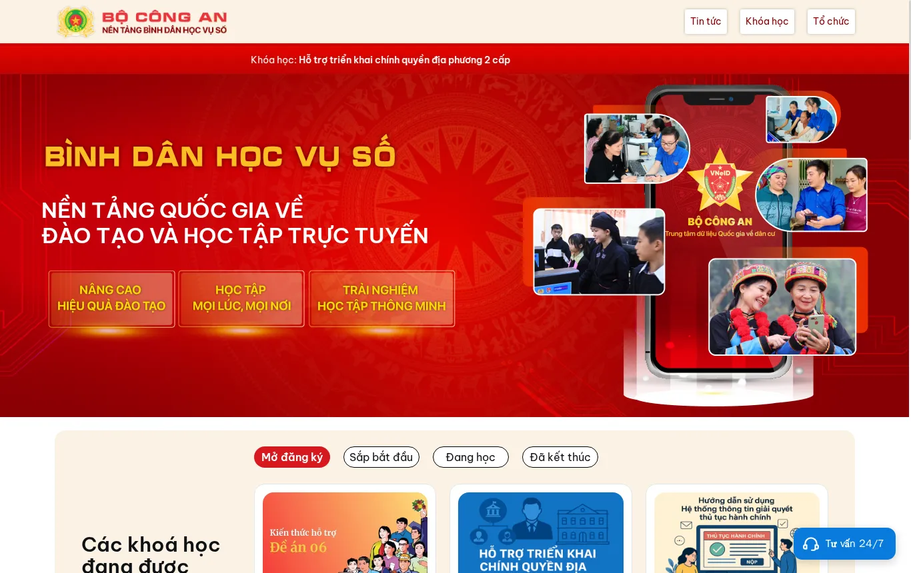
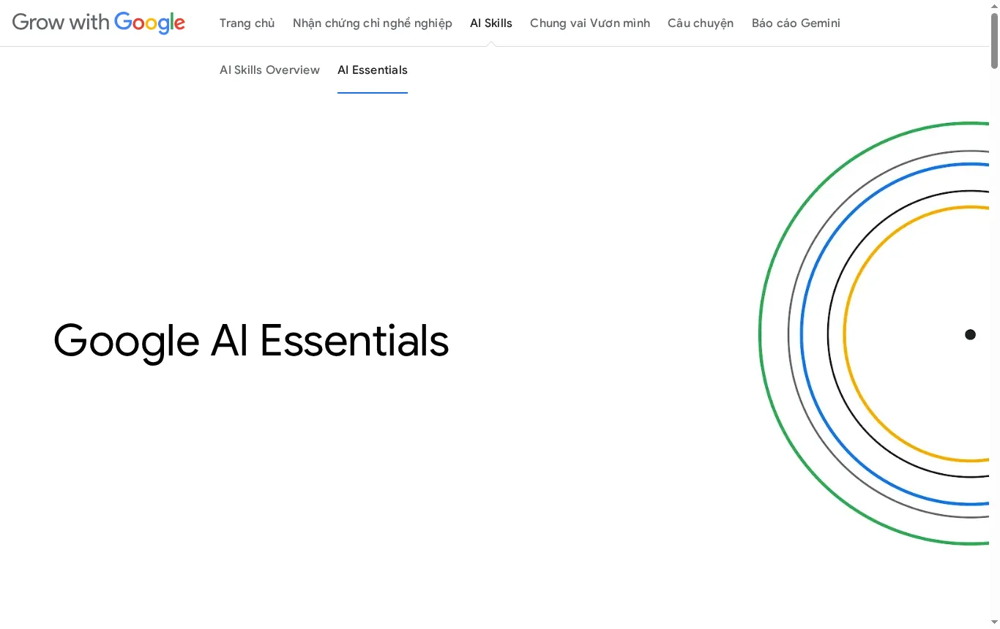
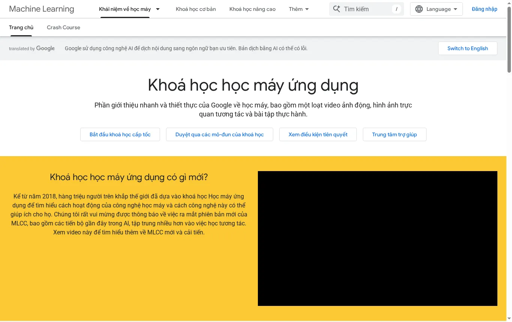

> Thuộc chuyên đề: [Hướng dẫn dùng công cụ AI phổ biến](huong-dan-dung-cong-cu-ai-pho-bien.md) · Bài viết của [KimQ Tech](https://kimq.tech)

"Học AI" có thể hiểu theo hai nghĩa rất khác nhau. Với phần lớn người đi làm, học AI là **học cách dùng công cụ AI** để làm việc nhanh hơn: viết email, tóm tắt tài liệu, làm slide, tạo ảnh. Với kỹ sư, học AI là **học cách xây mô hình và ứng dụng AI**, cần toán và lập trình.

Bài này chia lộ trình thành 3 cấp để bạn biết mình nên bắt đầu từ đâu, kèm danh sách khoá học AI miễn phí hoặc có học bổng từ nguồn chính thức. Thông tin kiểm tra ngày **25/11/2026**.

## Tóm tắt nhanh

| Cấp | Dành cho | Học gì | Thời gian | Khoá học gợi ý |
|---|---|---|---|---|
| 1. Dùng AI | Mọi người, không cần kỹ thuật | Viết câu lệnh, dùng Gemini, ChatGPT, Claude cho công việc | 2–4 tuần | Bình dân học AI, Google AI Essentials, Anthropic AI Fluency |
| 2. Hiểu AI | Quản lý, người làm sản phẩm, sinh viên | AI là gì, làm được gì, rủi ro, cách triển khai trong tổ chức | 1–2 tháng | Elements of AI, AI For Everyone |
| 3. Làm AI | Lập trình viên, sinh viên kỹ thuật | Học máy, Python, gọi API mô hình, xây agent | 3–12 tháng | Machine Learning Crash Course, Kaggle Learn, khoá Claude API |

Đa số người mới nên **bắt đầu từ cấp 1**. Học dùng AI trước giúp bạn thấy ngay lợi ích, sau đó mới quyết định có cần đi sâu hay không.

## Trước khi học: xác định bạn cần AI để làm gì

Học AI không có đích đến chung. Trả lời 3 câu hỏi sau trước khi chọn khoá:

1. **Công việc hằng ngày của bạn tốn thời gian nhất ở đâu?** Viết báo cáo, trả lời khách, làm nội dung, xử lý bảng tính?
2. **Bạn muốn dùng AI hay muốn làm ra sản phẩm AI?** Hai hướng này cần kỹ năng khác nhau.
3. **Bạn có bao nhiêu thời gian mỗi tuần?** 15 phút mỗi ngày vẫn đủ cho cấp 1.

Người học hiệu quả nhất thường chọn **một việc thật** (ví dụ "tóm tắt biên bản họp mỗi tuần") và học đúng phần cần cho việc đó, thay vì học dàn trải.

## Cấp 1: Học dùng công cụ AI (không cần lập trình)

### Bình dân học vụ số và Bình dân học AI

*Ảnh chụp màn hình: Nền tảng Bình dân học vụ số. Nguồn: [binhdanhocvuso.gov.vn](https://www.binhdanhocvuso.gov.vn/), chụp ngày 25/11/2026.*

**Bình dân học vụ số** là nền tảng học trực tuyến miễn phí do cơ quan nhà nước vận hành, có các khoá về kỹ năng số và ứng dụng AI, trong đó có khoá tập huấn AI cho cán bộ, công chức, viên chức. Bạn đăng ký tài khoản, ghi danh vào khoá và học theo tốc độ riêng.

**Bình dân học AI** (binhdanhocai.vn) là phong trào cộng đồng phổ cập AI cho người Việt, miễn phí:

- Học **15 phút mỗi ngày** theo kiểu học ngắn (microlearning).
- Bài học gắn với việc cụ thể: ra lệnh cho AI, xử lý văn bản, hình ảnh, âm thanh, rồi đến tối ưu quy trình, phân tích dữ liệu, bán hàng.
- Chatbot AI chấm bài và nhận xét ngay.
- Có 34 cộng đồng tỉnh thành để học cùng người gần bạn.

### Google AI Essentials

*Ảnh chụp màn hình: Trang khoá Google AI Essentials bản tiếng Việt. Nguồn: [grow.google](https://grow.google/intl/vi_vn/ai-essentials/), chụp ngày 25/11/2026.*

Khoá của Google dành cho người không có kinh nghiệm, **dưới 10 giờ tự học**, gồm 5 module:

1. Giới thiệu về AI
2. Tối đa năng suất với công cụ AI
3. Khám phá nghệ thuật tạo câu lệnh
4. Sử dụng AI có trách nhiệm
5. Dẫn đầu xu hướng AI

Học xong nhận **chứng chỉ Google AI Essentials**. Khoá học trên Coursera; theo trang Google, phí tại Việt Nam là **20 USD/tháng sau 7 ngày dùng thử miễn phí**. Google hợp tác với Trung tâm Đổi mới sáng tạo Quốc gia (NIC) cấp **học bổng cho 40.000 học viên**, đăng ký trên trang khoá học để học miễn phí.

### Anthropic AI Fluency và Claude 101

Anthropic (công ty làm ra Claude) có thư viện [khoá học miễn phí](https://anthropic.skilljar.com/): **AI Fluency** dạy cách cộng tác với AI hiệu quả, có đạo đức và an toàn; **Claude 101** dạy dùng Claude cho công việc hằng ngày; có bản riêng cho sinh viên và giáo viên. Khoá bằng tiếng Anh.

### Tự học bằng cách dùng hằng ngày

Khoá học chỉ là khung. Kỹ năng thật đến từ việc dùng mỗi ngày:

- Chọn một trợ lý AI miễn phí: Gemini, ChatGPT hoặc Claude. Sinh viên có thể [nhận gói Gemini miễn phí](gemini-cho-sinh-vien.md).
- Mỗi ngày giao cho AI một việc thật: soạn email, tóm tắt bài báo, lên dàn ý báo cáo.
- So sánh kết quả, sửa câu lệnh, ghi lại câu lệnh hiệu quả. Cách viết câu lệnh có trong bài [Prompt AI](prompt-ai.md).
- Thử thêm công cụ chuyên dụng: [làm slide bằng AI](lam-slide-bang-ai.md), [AI tạo hình ảnh](ai-tao-hinh-anh.md).

## Cấp 2: Hiểu AI để ra quyết định

Cấp này dành cho người cần **đánh giá, chọn và triển khai AI** trong tổ chức: quản lý, chủ doanh nghiệp, người làm sản phẩm.

- **Elements of AI** (Đại học Helsinki và MinnaLearn): khoá miễn phí, phần 1 "Introduction to AI" không cần toán hay lập trình, giải thích AI làm được gì và không làm được gì. Phần 2 "Building AI" cần Python cơ bản.
- **AI For Everyone** (Andrew Ng, DeepLearning.AI trên Coursera): khoảng 7 giờ, 4 module, dành cho người không làm kỹ thuật, có chứng chỉ chia sẻ được. Có thể học dự thính miễn phí tuỳ chính sách Coursera.

Sau cấp 2 bạn nên trả lời được: việc nào trong công ty nên dùng AI, dữ liệu nào không được đưa vào công cụ AI công cộng, khi nào nên thuê đơn vị triển khai. Bài [AI agency là gì](ai-agency-la-gi.md) giúp bạn chọn đối tác nếu cần.

## Cấp 3: Học làm AI (cho người lập trình)

*Ảnh chụp màn hình: Trang Machine Learning Crash Course của Google. Nguồn: [developers.google.com](https://developers.google.com/machine-learning/crash-course), chụp ngày 25/11/2026.*

### Lộ trình gợi ý

| Bước | Nội dung | Tài liệu miễn phí |
|---|---|---|
| 1 | Python cơ bản, xử lý dữ liệu với pandas | [Kaggle Learn](https://www.kaggle.com/learn) (miễn phí, có chứng chỉ) |
| 2 | Học máy nền tảng: hồi quy, phân loại, đánh giá mô hình | [Machine Learning Crash Course](https://developers.google.com/machine-learning/crash-course) của Google |
| 3 | Gọi API mô hình ngôn ngữ lớn, viết câu lệnh hệ thống | Khoá "Building with the Claude API" của Anthropic |
| 4 | Xây ứng dụng: chatbot hỏi đáp tài liệu, agent tự động hoá | Framework mã nguồn mở, xem [Top 10 framework AI Agent](top-10-framework-ai-agent-ma-nguon-mo.md) |
| 5 | Chạy mô hình trên máy riêng, bảo mật dữ liệu | Xem [Top 7 repo chạy LLM nội bộ](top-7-repo-chay-llm-noi-bo.md) |

**Machine Learning Crash Course** của Google gồm video hoạt hình, mô phỏng tương tác và bài tập thực hành, được cập nhật để có các tiến bộ AI gần đây. Mỗi module độc lập, người đã biết có thể nhảy thẳng vào phần cần học.

**Kaggle Learn** gồm các khoá ngắn về Python, pandas, học máy, chỉ vài giờ mỗi khoá, miễn phí và có chứng chỉ.

Mẹo: học đến đâu làm dự án nhỏ đến đó. Một chatbot trả lời câu hỏi về nội quy công ty, làm xong trong 2 tuần, dạy bạn nhiều hơn 2 tháng xem video.

## Chọn khoá học AI: tránh mất tiền oan

Thị trường có nhiều khoá "học AI kiếm tiền" giá vài triệu đồng. Trước khi trả tiền:

- **Kiểm tra nội dung có bản miễn phí tương đương không.** Phần lớn kiến thức cấp 1 có sẵn miễn phí ở các nguồn trên.
- **Cảnh giác với cam kết thu nhập.** Khoá hứa "kiếm 50 triệu/tháng nhờ AI" thường bán ước mơ, không bán kỹ năng.
- **Xem người dạy đã làm sản phẩm AI thật chưa**, có bài viết, dự án công khai không.
- **Ưu tiên khoá có bài tập, có người chấm**, không chỉ video.
- **Chứng chỉ** chỉ có giá trị khi đi kèm sản phẩm bạn làm được.

## Câu hỏi thường gặp

**Không biết lập trình có học AI được không?**
Được. Cấp 1 và cấp 2 không cần lập trình. Chỉ cấp 3 (làm ra sản phẩm AI) mới cần Python.

**Học AI ở đâu miễn phí?**
Bình dân học vụ số, Bình dân học AI, Elements of AI, Machine Learning Crash Course, Kaggle Learn, khoá Anthropic. Google AI Essentials có học bổng qua NIC.

**Mất bao lâu để dùng AI thành thạo cho công việc?**
Khoảng 2–4 tuần nếu dùng mỗi ngày cho việc thật. Thành thạo ở đây là biết giao việc gì cho AI, viết câu lệnh rõ và kiểm tra lại kết quả.

**Học AI có cần giỏi toán không?**
Chỉ cần khi học cấp 3 chuyên sâu (xây mô hình). Để dùng AI và xây ứng dụng trên API có sẵn, toán phổ thông là đủ.

**Học sinh, sinh viên nên học AI thế nào?**
Học dùng AI để hiểu bài, không phải để làm hộ bài. Xem [Check đạo văn AI](check-dao-van-ai.md) để biết giáo viên kiểm tra thế nào, và bài [AI giải bài tập](ai-giai-bai-tap.md) để dùng đúng cách.

## Đào tạo AI cho đội ngũ doanh nghiệp

Nếu bạn cần cả công ty dùng AI đúng cách và an toàn dữ liệu, [KimQ Tech](https://kimq.tech/lien-he) hỗ trợ triển khai công cụ AI có kiểm soát như [AI Gateway](https://kimq.tech/san-pham/ai-gateway), kèm hướng dẫn sử dụng cho nhân viên.

---

> Bài viết có sử dụng AI hỗ trợ soạn thảo. Nội dung và số liệu được đối chiếu với nguồn chính thức ngày 25/11/2026; ảnh là ảnh chụp màn hình trang chính thức, có ghi nguồn và ngày chụp.

## Về KimQ Tech

[KimQ Tech](https://kimq.tech) xây giải pháp AI và tự động hoá vận hành cho doanh nghiệp Việt: [AI Studio](https://kimq.tech/san-pham/ai-studio), [AI Gateway](https://kimq.tech/san-pham/ai-gateway), [Trợ lý AI trên Zalo](https://kimq.tech/san-pham/tro-ly-zalo), [Chatbot đa kênh](https://kimq.tech/san-pham/chatbot-da-kenh), [Tự động hoá](https://kimq.tech/san-pham/tu-dong-hoa). Cần tư vấn? [Liên hệ KimQ Tech](https://kimq.tech/lien-he) hoặc email contact@kimq.tech.

---

*Thông tin kiểm tra trên trang chính thức của Google, Anthropic, Coursera, Elements of AI, Kaggle và Bình dân học vụ số ngày 25/11/2026 và có thể thay đổi. KimQ Tech không liên kết với các đơn vị cung cấp khoá học được nhắc đến.*
