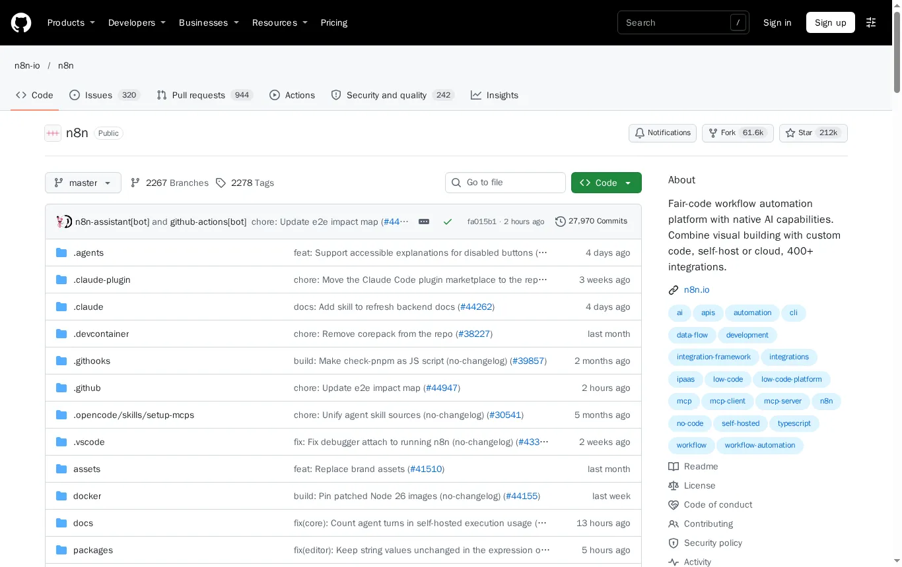
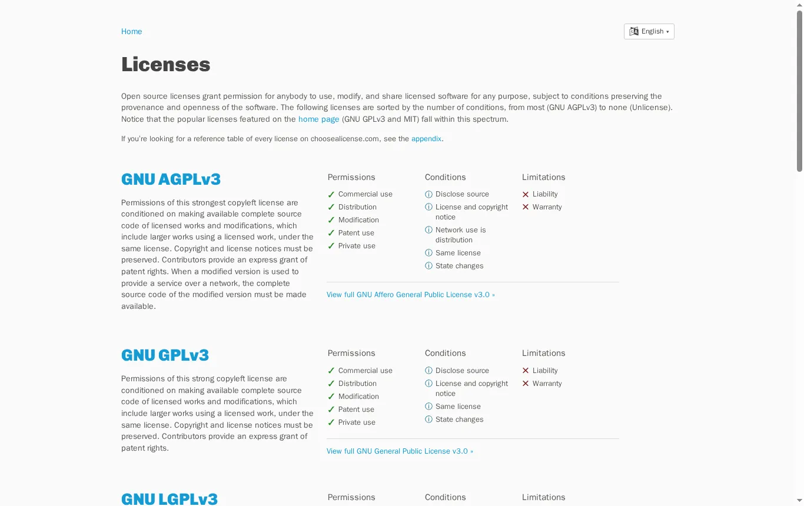
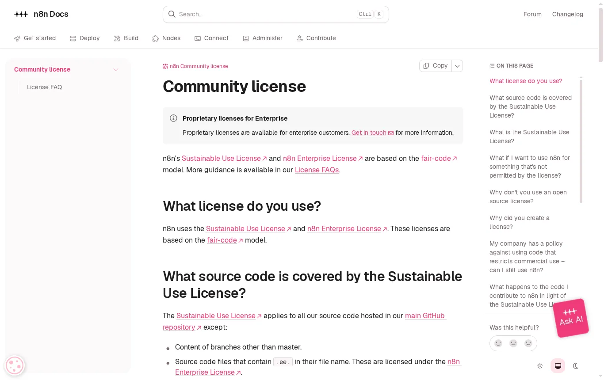

> Chuyên đề của [KimQ Tech](https://kimq.tech). Trang này được cập nhật khi có bài mới.

GitHub có hàng triệu dự án mã nguồn mở, và nhiều trong số đó đủ tốt để doanh nghiệp dùng thật: từ framework AI Agent, công cụ chạy mô hình ngôn ngữ nội bộ, đến phần mềm tự động hoá và ERP. Nhưng "miễn phí trên GitHub" không có nghĩa là miễn phí khi đưa vào vận hành, và không phải repo nhiều sao nào cũng dùng thương mại được.

Trang này là **điểm bắt đầu**: cách đánh giá một repo, cách đọc giấy phép, cách tính chi phí thật, và danh sách các bài so sánh chi tiết theo từng nhóm.

## Bản đồ chuyên đề

### Nhóm 1: AI mã nguồn mở cho doanh nghiệp

| Bài | Trả lời câu hỏi |
|---|---|
| [Top 10 framework AI Agent mã nguồn mở](top-10-framework-ai-agent-ma-nguon-mo.md) | Dùng gì để xây trợ lý AI tự làm việc nhiều bước? |
| [Top 7 AI Gateway mã nguồn mở](top-7-ai-gateway-ma-nguon-mo.md) | Làm sao kiểm soát chi phí, dữ liệu khi nhiều phòng ban cùng dùng AI? |
| [Top 7 repo chạy LLM nội bộ](top-7-repo-chay-llm-noi-bo.md) | Làm sao chạy AI mà không gửi dữ liệu ra ngoài? |

### Nhóm 2: Phần mềm mã nguồn mở cho vận hành

| Bài | Trả lời câu hỏi |
|---|---|
| [Top 8 công cụ tự động hoá quy trình mã nguồn mở](top-8-cong-cu-tu-dong-hoa-quy-trinh-ma-nguon-mo.md) | Thay Zapier bằng gì, tự chạy trên máy chủ công ty? |
| [Top 8 phần mềm ERP, kế toán mã nguồn mở](top-8-phan-mem-erp-ke-toan-ma-nguon-mo.md) | ERP mã nguồn mở nào dùng được ở Việt Nam? |

### Ba lớp ghép lại thành hệ thống AI nội bộ

| Lớp | Vai trò | Đọc bài |
|---|---|---|
| Ứng dụng | Trợ lý, agent, quy trình tự động người dùng thấy | [AI Agent](top-10-framework-ai-agent-ma-nguon-mo.md), [Tự động hoá](top-8-cong-cu-tu-dong-hoa-quy-trinh-ma-nguon-mo.md) |
| Kiểm soát | Một cửa gọi mô hình, phân quyền, ngân sách, che dữ liệu | [AI Gateway](top-7-ai-gateway-ma-nguon-mo.md) |
| Mô hình | Mô hình đám mây (OpenAI, Gemini, Claude…) hoặc chạy nội bộ | [LLM nội bộ](top-7-repo-chay-llm-noi-bo.md) |

Dữ liệu nghiệp vụ (đơn hàng, công nợ, kho) nằm ở ERP hoặc phần mềm kế toán; agent và quy trình tự động đọc, ghi vào đó qua API.

Chỉ cần dùng công cụ AI có sẵn (Claude, Gemini, tạo ảnh, tạo video) mà không tự dựng hệ thống? Xem chuyên đề [Hướng dẫn dùng công cụ AI phổ biến cho công việc](huong-dan-dung-cong-cu-ai-pho-bien.md).

## Bước 1: Đánh giá một repo GitHub trong 10 phút

Số sao chỉ cho biết mức độ quan tâm. Hãy xem thêm:

*Ảnh chụp màn hình: Trang repo n8n trên GitHub: số sao, commit gần nhất, giấy phép. Nguồn: [github.com](https://github.com/n8n-io/n8n), chụp ngày 24/11/2026.*

| Tiêu chí | Xem ở đâu | Dấu hiệu tốt |
|---|---|---|
| Còn được bảo trì | Tab Commits, Releases | Có commit, bản phát hành trong 1–3 tháng gần nhất |
| Đã ngừng phát triển? | Nhãn "Archived" ở đầu trang, README | Không bị lưu trữ, README không ghi "deprecated" |
| Phản hồi lỗi | Tab Issues, Pull requests | Issue được trả lời, PR được duyệt đều |
| Nhiều người đóng góp | Mục Contributors | Không phụ thuộc vào 1–2 người |
| Tài liệu | README, trang docs | Có hướng dẫn cài đặt, cấu hình, nâng cấp |
| Bảo mật | Tab Security, file `SECURITY.md` | Có kênh báo lỗi bảo mật, có vá lỗi kịp thời |
| Giấy phép | File `LICENSE` | Phù hợp cách bạn định dùng (xem bước 2) |

## Bước 2: Đọc giấy phép đúng cách

Đây là phần doanh nghiệp hay bỏ qua nhất. Giấy phép quyết định bạn **được làm gì** với phần mềm.

*Ảnh chụp màn hình: Bảng so sánh các giấy phép mã nguồn mở phổ biến. Nguồn: [choosealicense.com](https://choosealicense.com/licenses/), chụp ngày 24/11/2026.*

| Nhóm | Ví dụ | Dùng nội bộ | Sửa và bán cho khách | Lưu ý |
|---|---|---|---|---|
| Dễ dãi (permissive) | MIT, Apache 2.0, BSD | ✅ | ✅ | Giữ thông báo bản quyền |
| Copyleft yếu | LGPL v3 (Odoo Community) | ✅ | ✅ có điều kiện | Sửa chính thư viện thì phải công bố phần sửa |
| Copyleft | GPL v2, GPL v3 (ERPNext, Dolibarr) | ✅ | ✅ có điều kiện | Phân phối bản sửa thì phải công bố mã nguồn cùng giấy phép |
| Mã nguồn công khai có điều kiện | Elastic License 2.0, Business Source License | ✅ thường được | ⚠️ hạn chế | Cấm làm dịch vụ cho bên thứ ba, giới hạn người dùng… |
| Giấy phép riêng | Dify, Open WebUI, LobeHub, n8n | ✅ thường được | ⚠️ đọc kỹ | Hay có điều khoản giữ thương hiệu, cấm multi-tenant |
| Mở lõi, đóng phần doanh nghiệp | LiteLLM (`enterprise/`), Langfuse, Mastra (`ee/`) | ✅ phần lõi | ⚠️ | Thư mục doanh nghiệp cần mua giấy phép |

Ba câu hỏi cần trả lời trước khi chọn:

1. Chỉ dùng **trong công ty**, hay **cung cấp cho khách hàng** (kể cả dạng phần mềm dịch vụ)?
2. Có **sửa mã nguồn** không? Có **gỡ logo, đổi tên** không?
3. Bao nhiêu **người dùng**, bao nhiêu **công ty con** dùng chung một hệ thống?

Với AI còn có thêm một lớp: **giấy phép của mô hình** (Llama, Qwen, Gemma…) tách biệt với giấy phép của công cụ chạy mô hình.

## Bước 3: Tính tổng chi phí thật

| Khoản | Ghi chú |
|---|---|
| Máy chủ, GPU, lưu trữ, sao lưu | Chạy LLM nội bộ cần GPU, là khoản lớn nhất |
| Phí gọi mô hình AI | Tính theo token nếu dùng mô hình đám mây |
| Triển khai, tuỳ biến | Cấu hình theo nghiệp vụ, chế độ kế toán, mẫu chứng từ Việt Nam |
| Vận hành | Cập nhật phiên bản, vá bảo mật, giám sát, xử lý sự cố |
| Đào tạo | Người dùng cuối và người quản trị |
| Giấy phép thương mại (nếu vượt điều kiện) | Bản Enterprise, giấy phép gỡ thương hiệu… |

Quy tắc thực tế: nếu không có ít nhất một người kỹ thuật phụ trách vận hành, chi phí ẩn của "phần mềm miễn phí" thường lớn hơn mua giải pháp có sẵn.

## Bước 4: Tự dựng hay dùng giải pháp có sẵn?

| Nên tự dựng khi | Nên dùng giải pháp có sẵn khi |
|---|---|
| Có đội kỹ thuật, muốn toàn quyền kiểm soát | Không có người vận hành hệ thống |
| Nghiệp vụ rất riêng, cần tuỳ biến sâu | Nghiệp vụ phổ biến: công nợ, kho, hoá đơn, chăm sóc khách |
| Dữ liệu bắt buộc nằm trên hạ tầng nội bộ | Cần chạy được nhanh, có hỗ trợ khi lỗi |
| Khối lượng lớn, ổn định lâu dài | Đang thử nghiệm, chưa chắc quy mô |

*Ảnh chụp màn hình: Trang giấy phép Sustainable Use License của n8n. Nguồn: [docs.n8n.io](https://docs.n8n.io/sustainable-use-license/), chụp ngày 24/11/2026.*

Hai hướng không loại trừ nhau: nhiều doanh nghiệp dùng giải pháp có sẵn cho phần lõi và tự dựng thêm quy trình riêng bằng công cụ mã nguồn mở.

## Lưu ý riêng cho doanh nghiệp Việt Nam

- **Dữ liệu cá nhân:** gửi dữ liệu khách hàng, nhân viên tới dịch vụ AI nước ngoài cần tuân thủ quy định bảo vệ dữ liệu cá nhân hiện hành. Che hoặc ẩn danh dữ liệu trước khi gửi, hoặc chạy mô hình nội bộ.
- **Kế toán, thuế:** phần mềm nước ngoài cần cấu hình theo chế độ kế toán Việt Nam (Thông tư 99/2025/TT-BTC từ năm 2026) và tích hợp nhà cung cấp hoá đơn điện tử.
- **Tiếng Việt:** thử mô hình AI và tìm kiếm tài liệu bằng câu hỏi, văn bản tiếng Việt thật của công ty.
- **Kênh liên lạc:** khách hàng Việt dùng Zalo nhiều; kiểm tra công cụ có kết nối được Zalo OA hay không.

## KimQ Tech làm gì trong bức tranh này?

[KimQ Tech](https://kimq.tech) cung cấp các giải pháp dựng sẵn cho những phần doanh nghiệp thường cần nhất:

| Nhu cầu | Giải pháp |
|---|---|
| Kiểm soát chi phí, dữ liệu khi dùng nhiều mô hình AI | [KimQ AI Gateway](https://kimq.tech/san-pham/ai-gateway) |
| Trợ lý AI trả lời khách, nhân viên trên Zalo | [Trợ lý AI trên Zalo](https://kimq.tech/san-pham/tro-ly-zalo) |
| Tự động hoá quy trình vận hành | [Tự động hoá](https://kimq.tech/san-pham/tu-dong-hoa) |
| Theo dõi, nhắc công nợ | [Công nợ](https://kimq.tech/san-pham/cong-no) |
| Quản lý kho và mua hàng | [Kho và mua hàng](https://kimq.tech/san-pham/kho-mua-hang) |
| Nhập, đối soát hoá đơn đầu vào | [Hoá đơn đầu vào](https://kimq.tech/san-pham/hoa-don-dau-vao) |

Cần tư vấn chọn công cụ mã nguồn mở hay giải pháp có sẵn? [Liên hệ KimQ Tech](https://kimq.tech/lien-he) hoặc email contact@kimq.tech.

## Câu hỏi thường gặp

**Phần mềm mã nguồn mở có an toàn cho doanh nghiệp không?**
An toàn khi repo còn được bảo trì, bạn cập nhật bản vá thường xuyên và cấu hình đúng (xác thực, phân quyền, không mở cổng quản trị ra Internet). Rủi ro thường đến từ việc cài xong rồi bỏ đó, không cập nhật.

**Repo nhiều sao có phải là tốt nhất?**
Không nhất thiết. Một repo ít sao nhưng hợp nghiệp vụ, giấy phép rõ ràng và được bảo trì đều thường tốt hơn repo nổi tiếng nhưng nặng và nhiều điều kiện.

**Có được dùng phần mềm mã nguồn mở để làm sản phẩm bán cho khách không?**
Tuỳ giấy phép. MIT, Apache 2.0 thường được; GPL có nghĩa vụ công bố mã nguồn; Elastic, BSL và nhiều giấy phép riêng hạn chế hoặc cấm. Xem bảng ở bước 2 và hỏi luật sư khi cần.

**Các bài trong chuyên đề được cập nhật thế nào?**
Mỗi bài ghi ngày lấy số liệu. Chúng tôi cập nhật số sao, trạng thái bảo trì và giấy phép định kỳ, và ghi ngày cập nhật ở đầu bài.

---

*Nội dung giấy phép và quy định tóm tắt để tham khảo, không phải tư vấn pháp lý, thuế hay kế toán.*

> Bài viết có sử dụng AI hỗ trợ soạn thảo. Nội dung và số liệu được đối chiếu với nguồn chính thức ngày 24/11/2026; ảnh là ảnh chụp màn hình trang chính thức, có ghi nguồn và ngày chụp.
