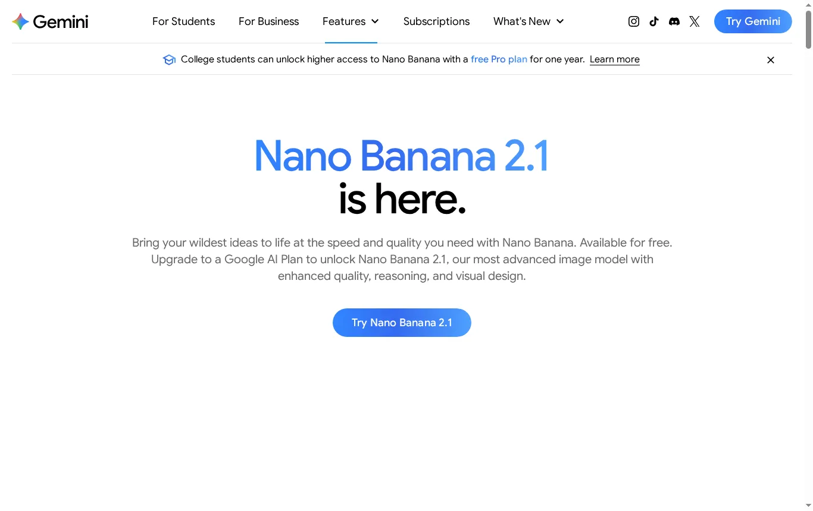
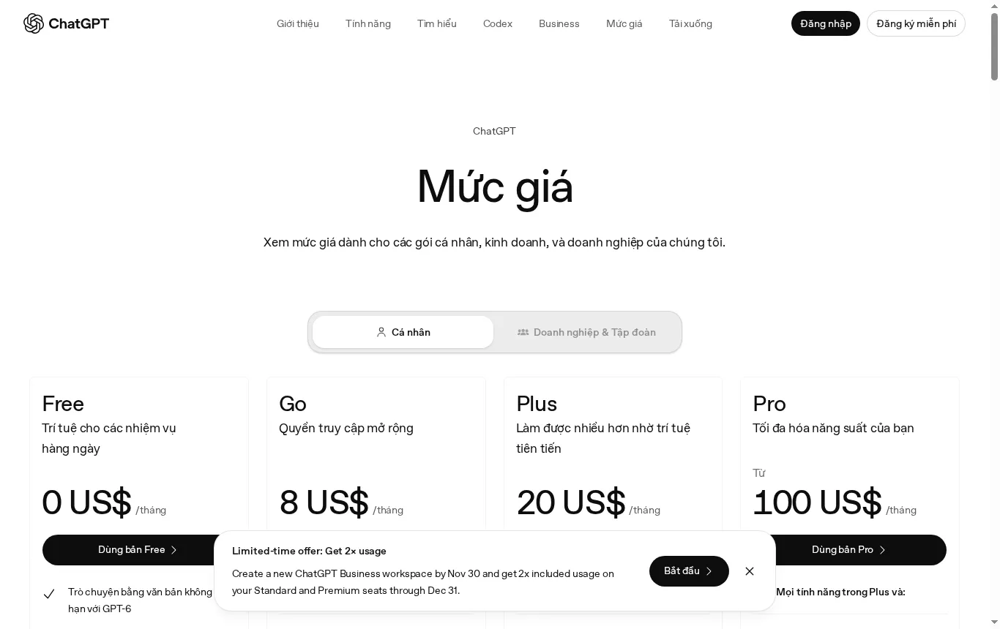
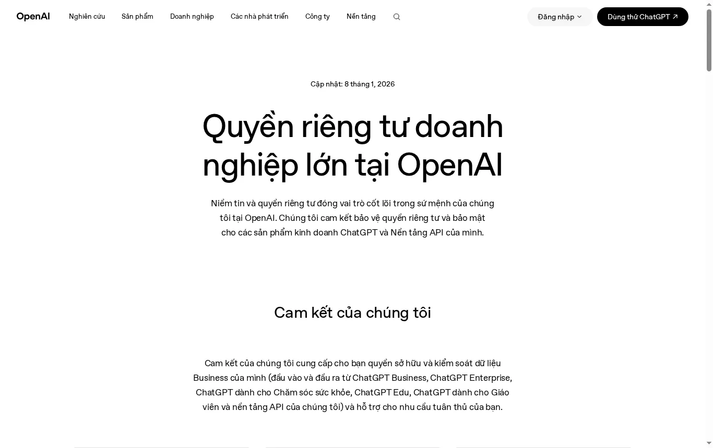

> Chuyên đề của [KimQ Tech](https://kimq.tech). Trang này được cập nhật khi có bài mới.

Mỗi tháng lại có công cụ AI mới, model mới, gói giá mới. Với người đi làm và chủ doanh nghiệp, câu hỏi thực tế không phải "AI nào mạnh nhất", mà là **việc này nên dùng công cụ nào, tốn bao nhiêu, và dùng sao cho an toàn.** Trang này là điểm bắt đầu, dẫn tới các bài hướng dẫn chi tiết.

## Bản đồ chuyên đề

**Trợ lý AI và tìm kiếm bằng AI** (bài trong chuyên đề này):

| Bài | Trả lời câu hỏi |
|---|---|
| [Claude là gì? So sánh các gói Claude](claude-la-gi-so-sanh-cac-goi-claude.md) | Claude làm được gì, gói Free, Pro, Max, Ultra, Team khác nhau thế nào? |
| [Claude Design là gì](claude-design-la-gi.md) | Làm slide, one-pager, prototype bằng AI thế nào? |
| [Chế độ AI của Google là gì](che-do-ai-google-ai-mode-la-gi.md) | Tìm kiếm bằng AI Mode thế nào, doanh nghiệp cần làm gì? |
| [Làm slide bằng AI: so sánh Gamma, Canva, Gemini trong Google Slides, Copilot trong PowerPoint (11/2026)](lam-slide-bang-ai.md) | Làm slide, PowerPoint bằng AI miễn phí với công cụ nào? |
| [AI agency là gì? Dịch vụ, chi phí và cách chọn đơn vị triển khai AI cho doanh nghiệp (11/2026)](ai-agency-la-gi.md) | AI agency là gì, chọn đơn vị triển khai AI thế nào? |
| [Gemini cho sinh viên: cách nhận Google AI Plus miễn phí 1 năm, điều kiện và lỗi thường gặp (11/2026)](gemini-cho-sinh-vien.md) | Sinh viên nhận gói Gemini miễn phí thế nào? |
| [Check đạo văn AI: công cụ phát hiện văn bản do AI viết có chính xác không? (Turnitin, GPTZero, 11/2026)](check-dao-van-ai.md) | Công cụ check AI có tin được không? |
| [Học AI bắt đầu từ đâu? Lộ trình 3 cấp và khoá học AI miễn phí cho người mới (11/2026)](hoc-ai-bat-dau-tu-dau.md) | Người mới học AI nên bắt đầu từ đâu? |
| [AI giải bài tập: AI Hay, Gauth, Gemini, ChatGPT và cách dùng để học thật (11/2026)](ai-giai-bai-tap.md) | Dùng AI giải bài tập sao cho học được thật? |

**Chuyên đề con:**

| Chuyên đề | Nội dung |
|---|---|
| [AI tạo và chỉnh sửa ảnh](top-cong-cu-ai-chinh-sua-anh.md) | Ghép ảnh, làm nét, mở rộng, phục hồi ảnh cũ; câu lệnh tạo ảnh trên Gemini |
| [Tạo video bằng AI](top-cong-cu-tao-video-ai.md) | Tạo video AI miễn phí từ ảnh, từ văn bản; so sánh Veo, Kling, Runway, Vidu |
| [Phần mềm mã nguồn mở cho doanh nghiệp](huong-dan-chon-phan-mem-ma-nguon-mo-cho-doanh-nghiep.md) | Tự xây hệ thống AI, tự động hoá, ERP bằng mã nguồn mở |

## Chọn công cụ AI theo việc

| Việc | Công cụ gợi ý | Đọc bài |
|---|---|---|
| Viết email, báo cáo, tóm tắt tài liệu dài | Claude, Gemini, ChatGPT | [Claude là gì](claude-la-gi-so-sanh-cac-goi-claude.md) |
| Phân tích file Excel, số liệu | Claude (Claude Data, Sheets), Gemini trong Google Sheets, Copilot trong Excel | [Claude là gì](claude-la-gi-so-sanh-cac-goi-claude.md) |
| Làm slide, tài liệu giới thiệu | Claude Design, Canva, Gamma | [Claude Design](claude-design-la-gi.md) |
| Tạo ảnh quảng cáo, banner | Gemini (Nano Banana), Canva, Photoshop | [Câu lệnh Gemini](cau-lenh-tao-anh-ghep-anh-gemini.md) |
| Sửa, ghép, làm nét ảnh | Gemini, Photoshop, Upscayl | [AI chỉnh sửa ảnh](top-cong-cu-ai-chinh-sua-anh.md) |
| Tạo clip ngắn từ ảnh, từ mô tả | Kling, Veo, Runway, Vidu | [Tạo video AI](top-cong-cu-tao-video-ai.md) |
| Video giới thiệu sản phẩm có giọng đọc tiếng Việt | [KimQ AI Studio](https://kimq.tech/san-pham/ai-studio) | [Tạo video AI](top-cong-cu-tao-video-ai.md) |
| Tìm hiểu, so sánh, lên kế hoạch mua sắm | Chế độ AI của Google | [Chế độ AI](che-do-ai-google-ai-mode-la-gi.md) |
| Lập trình | Claude Code, các công cụ AI lập trình | [Top 10 framework AI Agent](top-10-framework-ai-agent-ma-nguon-mo.md) |
| Trả lời khách trên Zalo, Facebook, website | Chatbot AI chuyên cho bán hàng | [Trợ lý Zalo](https://kimq.tech/san-pham/tro-ly-zalo), [Chatbot đa kênh](https://kimq.tech/san-pham/chatbot-da-kenh) |

*Ảnh chụp màn hình: Trang tính năng tạo ảnh của Gemini. Nguồn: [gemini.google](https://gemini.google/overview/image-generation/), chụp ngày 24/11/2026.*

## Miễn phí hay trả phí?

| Mức dùng | Gợi ý |
|---|---|
| Thỉnh thoảng | Bản miễn phí của Claude, Gemini, ChatGPT là đủ |
| Hằng ngày cho công việc | Một gói trả phí khoảng 20 USD/tháng cho công cụ bạn dùng nhiều nhất |
| Sinh viên | Kiểm tra ưu đãi sinh viên chính thức (ví dụ Gemini cho sinh viên, hạn nhận đến 31/12/2026) |
| Công ty từ vài người trở lên | Gói Team, Business của nhà cung cấp, hoặc gọi model qua một cổng quản lý chung |

*Ảnh chụp màn hình: Trang giá các gói ChatGPT. Nguồn: [chatgpt.com](https://chatgpt.com/pricing), chụp ngày 24/11/2026.*

**Không mua tài khoản dùng chung giá rẻ:** dễ bị khoá, lộ dữ liệu, không có hoá đơn.

## 7 quy tắc dùng AI an toàn trong công ty

1. **Không dán dữ liệu nhạy cảm** (CCCD, số tài khoản, lương, hợp đồng mật) vào tài khoản AI cá nhân.
2. **Kiểm tra cài đặt huấn luyện dữ liệu** của từng công cụ; tắt nếu không muốn dữ liệu được dùng để huấn luyện.
3. **Luôn kiểm tra lại** số liệu, trích dẫn, điều khoản pháp lý do AI viết.
4. **Gắn nhãn ảnh, video AI** khi đăng công khai; không dùng ảnh người thật khi chưa được phép.
5. **Ghi rõ ai được dùng công cụ gì,** cho việc gì, bằng tài khoản nào.
6. **Theo dõi chi phí theo phòng ban** khi nhiều người cùng dùng.
7. **Có phương án dự phòng** khi một nhà cung cấp AI gặp sự cố.

*Ảnh chụp màn hình: Trang cam kết quyền riêng tư cho doanh nghiệp của OpenAI. Nguồn: [openai.com](https://openai.com/enterprise-privacy/), chụp ngày 24/11/2026.*

Quy tắc 1, 6 và 7 là lý do nhiều doanh nghiệp đặt **AI Gateway**: một cổng chung giữ key, đặt hạn mức theo phòng ban, che dữ liệu cá nhân trước khi gửi đi và tự chuyển nhà cung cấp khi lỗi. Xem [KimQ AI Gateway](https://kimq.tech/san-pham/ai-gateway).

## Câu hỏi thường gặp

**Nên dùng Claude, Gemini hay ChatGPT?**
Cả ba đều tốt. Thử cùng một việc thật của bạn trên cả ba bản miễn phí trong một tuần, rồi trả phí cho cái hợp nhất. Claude mạnh về viết và tài liệu dài; Gemini gắn với Google (Gmail, Drive, tạo ảnh, video); ChatGPT có hệ sinh thái lớn.

**AI có thay thế nhân viên không?**
AI làm nhanh các phần lặp lại (soạn nháp, tóm tắt, tạo ảnh minh hoạ), nhưng vẫn cần người quyết định, kiểm tra và chịu trách nhiệm.

**Các bài trong chuyên đề được cập nhật thế nào?**
Mỗi bài ghi ngày kiểm tra thông tin. Giá, gói và tên model thay đổi thường xuyên; chúng tôi cập nhật định kỳ và ghi ngày ở đầu bài.

---

> Bài viết có sử dụng AI hỗ trợ soạn thảo. Nội dung và số liệu được đối chiếu với nguồn chính thức ngày 24/11/2026; ảnh là ảnh chụp màn hình trang chính thức, có ghi nguồn và ngày chụp.

## Về KimQ Tech

[KimQ Tech](https://kimq.tech) xây giải pháp AI và tự động hoá vận hành cho doanh nghiệp Việt: [AI Studio](https://kimq.tech/san-pham/ai-studio), [AI Gateway](https://kimq.tech/san-pham/ai-gateway), [Trợ lý AI trên Zalo](https://kimq.tech/san-pham/tro-ly-zalo), [Chatbot đa kênh](https://kimq.tech/san-pham/chatbot-da-kenh), [Trợ lý Fanpage](https://kimq.tech/san-pham/tro-ly-fanpage), [Tự động hoá](https://kimq.tech/san-pham/tu-dong-hoa). Cần tư vấn? [Liên hệ KimQ Tech](https://kimq.tech/lien-he) hoặc email contact@kimq.tech.
