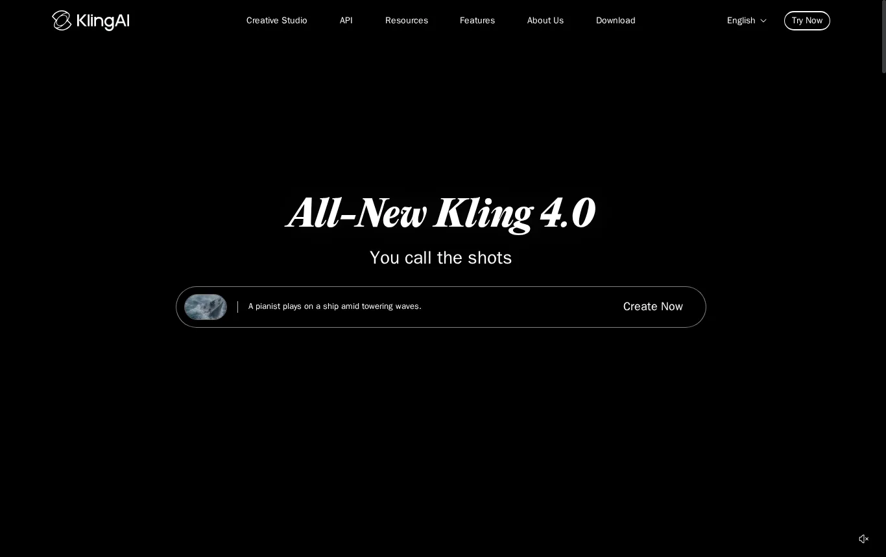
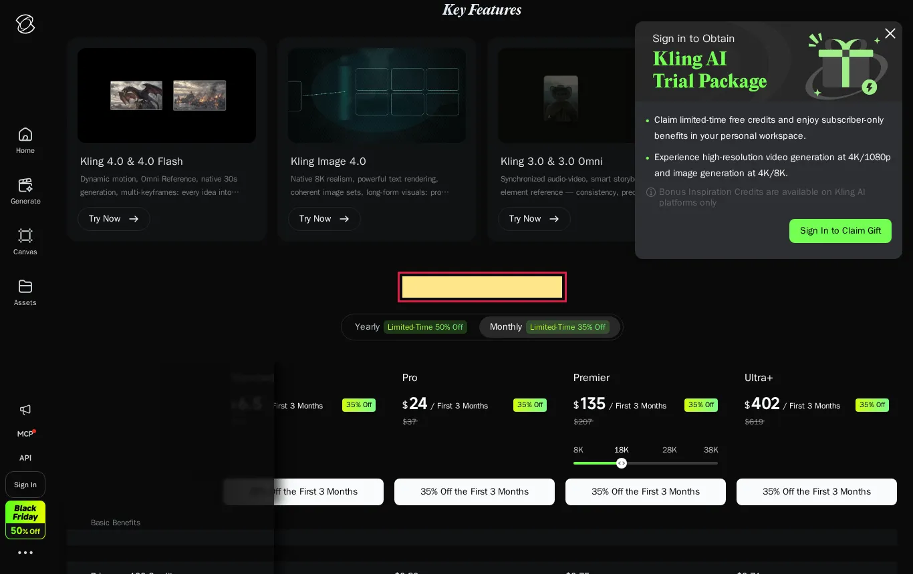
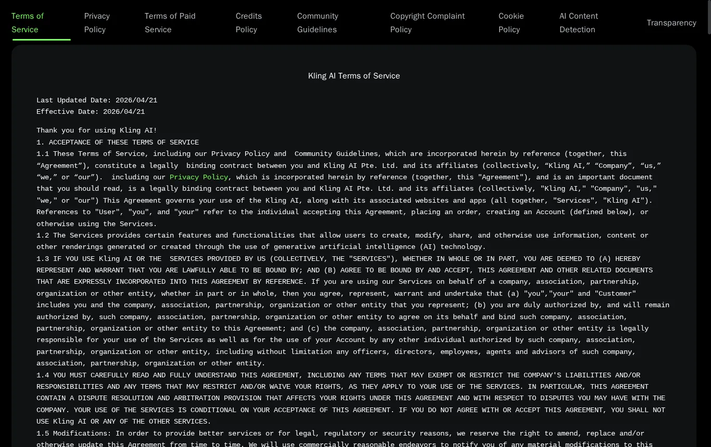

> Thuộc chuyên đề: [Top công cụ tạo video AI](top-cong-cu-tao-video-ai.md) · Bài viết của [KimQ Tech](https://kimq.tech)

**Kling AI** là một trong những công cụ tạo video bằng AI được dùng nhiều nhất hiện nay, nổi bật ở chuyển động người và vật thể tự nhiên. Bạn gõ mô tả hoặc tải ảnh lên, Kling tạo đoạn video vài giây đến vài chục giây, có thể kèm âm thanh.

Bài này hướng dẫn dùng Kling từ đầu: tạo tài khoản, gói miễn phí được gì, bảng giá, các phiên bản mô hình và những điều khoản cần đọc trước khi tải ảnh lên. Thông tin lấy từ trang chính thức **kling.ai** ngày **25/11/2026**.

## Tóm tắt nhanh

| | Thông tin |
|---|---|
| Trang chính thức | kling.ai (cũng có app iOS, Android) |
| Làm được gì | Tạo video từ chữ, từ ảnh, khung đầu và khung cuối, điều khiển chuyển động, tạo ảnh |
| Mô hình mới nhất | Kling 4.0 và 4.0 Flash (video), Kling Image 4.0 (ảnh) |
| Độ dài video | Kling 4.0 tạo gốc tới 30 giây |
| Gói miễn phí | Basic $0: 1 video mỗi lần tạo, có logo, **không có quyền thương mại** |
| Gói trả phí rẻ nhất | Standard $10/tháng, 660 credit/tháng |
| Quyền thương mại | Chỉ ở gói trả phí |
| Độ tuổi | Từ 13 tuổi; người chưa thành niên cần cha mẹ đại diện |

## Kling AI là gì

Kling là nền tảng tạo video và hình ảnh bằng AI. Trang chủ giới thiệu các nhóm tính năng chính:

*Ảnh chụp màn hình: Trang chủ Kling AI. Nguồn: [kling.ai](https://kling.ai/), chụp ngày 25/11/2026.*

- **Kling 4.0 và 4.0 Flash**: chuyển động mạnh, tham chiếu đa nguồn (Omni Reference), **tạo gốc 30 giây**, nhiều khung hình chính.
- **Kling 3.0 và 3.0 Omni**: đồng bộ âm thanh với hình, phân cảnh thông minh, tham chiếu nhân vật và vật thể (element), bám câu lệnh tốt.
- **Kling Image 4.0**: ảnh chân thực tới 8K, chữ trong ảnh rõ, bộ ảnh đồng nhất.
- **Motion Control**: tái tạo chuyển động phức tạp và biểu cảm khuôn mặt dựa trên công nghệ bắt chuyển động.

Từ khoá "kling ai 3.0" vẫn được tìm nhiều. Kling 3.0 vẫn có trong danh sách mô hình, mạnh về video có âm thanh đồng bộ; Kling 4.0 là bản mới hơn, mạnh về độ dài và chuyển động.

## Bảng giá Kling AI và gói miễn phí

*Ảnh chụp màn hình: Bảng giá các gói thành viên Kling AI. Nguồn: [kling.ai](https://kling.ai/app/membership/membership-plan), chụp ngày 25/11/2026.*

| Gói | Giá theo tháng | Credit/tháng | Giá 100 credit | Điểm chính |
|---|---|---|---|---|
| Basic | $0 | Không có credit tháng | – | 1 video mỗi lần tạo, có logo, không dùng thương mại |
| Standard | $10 | 660 | $0,98 | 4 video mỗi lần, 1080p/4K, bỏ logo, dùng thương mại |
| Pro | $37 | 3.000 | $0,80 | Như Standard, nhiều credit hơn |
| Premier | $207 | 18.000 | $0,75 | Dùng nhiều, ưu tiên tính năng mới |
| Ultra+ | $619 | 57.000 | $0,71 | Cho studio, đội sản xuất |

Lúc kiểm tra, Kling đang giảm giá 3 tháng đầu (Standard còn $6,5/tháng, sau đó $8,8/tháng khi trả theo tháng trong chương trình). Giá khuyến mãi thay đổi thường xuyên, hãy xem lại trang giá trước khi trả tiền.

**Gói miễn phí dùng được gì?** Tài khoản Basic dùng được Kling để thử, tạo 1 video mỗi lần, video có logo Kling. Theo bảng so sánh, các gói trả phí có **3 lượt miễn phí mỗi ngày** cho tính năng Element AI Multi-Shot, và mô hình Kling 4.0 HDR được ghi là miễn phí (không tốn credit) với thành viên trả phí.

**Credit hết thì sao?** Mua thêm gói credit lẻ. Gói càng cao, giá mỗi credit càng rẻ.

## Cách dùng Kling AI tạo video

### Tạo video từ chữ

1. Vào [kling.ai](https://kling.ai/), đăng nhập bằng Google hoặc email.
2. Chọn **Generate → Video**, chế độ **Text to Video**.
3. Chọn mô hình (Kling 4.0, 4.0 Flash hoặc 3.0), tỷ lệ khung (16:9, 9:16, 1:1) và độ dài.
4. Gõ câu lệnh. Câu lệnh tiếng Anh cho kết quả ổn định hơn.
5. Bấm tạo, chờ vài phút, xem kết quả trong mục **Assets**.

Mẫu câu lệnh: "A young Vietnamese woman in a white ao dai walking along Hoan Kiem Lake at sunrise, gentle breeze, slow dolly shot following her, cinematic, soft light."

### Tạo video từ ảnh

1. Chọn **Image to Video**, tải ảnh lên.
2. Mô tả chuyển động: ai làm gì, máy quay di chuyển thế nào.
3. Có thể đặt **khung đầu và khung cuối** để Kling tạo chuyển cảnh giữa hai ảnh.

Hướng dẫn chi tiết cách chọn ảnh và câu lệnh chuyển động có trong bài [Cách tạo video AI từ ảnh](tao-video-ai-tu-anh.md).

### Mẹo để video đẹp hơn

- **Một cảnh, một hành động.** Yêu cầu quá nhiều việc trong 5 giây dễ làm hình méo.
- **Mô tả máy quay**: "slow zoom in", "pan left", "handheld", "drone shot".
- **Dùng Flash để thử**, chọn được ý rồi mới dùng mô hình đầy đủ để tiết kiệm credit.
- **Kéo dài video** bằng cách tạo tiếp từ khung cuối, rồi ghép trong phần mềm dựng.

## Điều khoản cần đọc trước khi tải ảnh lên

*Ảnh chụp màn hình: Điều khoản dịch vụ Kling AI, mục cấp phép nội dung. Nguồn: [kling.ai](https://kling.ai/docs/user-policy), chụp ngày 25/11/2026.*

Mục 4.7 trong [Điều khoản dịch vụ của Kling](https://kling.ai/docs/user-policy) ghi rằng khi dùng dịch vụ, bạn đồng ý cho Kling **quyền không độc quyền, miễn phí** để lưu trữ, hiển thị, sao chép, phân phối **cả nội dung bạn tải lên và video được tạo ra**, đồng thời Kling có thể dùng nội dung đó để quảng bá, nâng cấp sản phẩm và nghiên cứu.

Điều đó có nghĩa:

- **Không tải ảnh khách hàng, ảnh nhân viên, tài liệu nội bộ** khi chưa có sự đồng ý.
- **Không tải ảnh người khác** để tạo video, dù chỉ để thử.
- **Sản phẩm chưa ra mắt** không nên đưa lên công cụ AI công cộng.
- Doanh nghiệp cần dùng thường xuyên nên xem gói Business hoặc API có điều khoản riêng.

Về độ tuổi: người dưới 13 tuổi không được dùng; người chưa đủ tuổi thành niên phải được cha mẹ hoặc người giám hộ đại diện đăng ký.

## Dùng video Kling để bán hàng, quảng cáo

Kling chỉ cho **dùng thương mại với nội dung tạo bằng gói trả phí**. Video từ gói miễn phí có logo và không được dùng cho quảng cáo, bán hàng. Ngoài ra:

- Ghi rõ video có dùng AI khi có thể khiến khách hiểu nhầm về sản phẩm thật.
- Không tạo video giả người nổi tiếng, giả người thật.
- Nhạc nền nên dùng nguồn có giấy phép; xem [Tạo nhạc bằng AI](tao-nhac-bang-ai.md).
- Thêm giọng đọc tiếng Việt bằng các dịch vụ trong bài [Giọng đọc AI tiếng Việt](giong-doc-ai-tieng-viet.md).

## Kling so với các công cụ khác

| Nhu cầu | Gợi ý |
|---|---|
| Video người chuyển động tự nhiên, độ dài tới 30 giây | Kling |
| Video có giá rẻ, chế độ giờ thấp điểm | [Vidu AI](vidu-ai.md) |
| Nhảy, nhép theo mẫu meme | [Viggle AI](viggle-ai-la-gi.md) |
| Hiệu ứng điện ảnh, nhiều mô hình trong một chỗ | [Higgsfield AI](higgsfield-ai-la-gi.md) |
| Đã có gói Google AI | Gemini |

So sánh đầy đủ có trong [Top công cụ tạo video AI](top-cong-cu-tao-video-ai.md).

## Câu hỏi thường gặp

**Kling AI có miễn phí không?**
Có gói Basic $0 để thử, tạo 1 video mỗi lần, có logo, không được dùng thương mại.

**Trang chính thức của Kling là gì?**
kling.ai. Cẩn thận các trang giả mạo có tên gần giống bán "tài khoản Kling giá rẻ".

**Kling tạo video dài bao nhiêu?**
Kling 4.0 tạo gốc tới 30 giây. Muốn dài hơn, tạo tiếp từ khung cuối rồi ghép.

**Kling AI 3.0 và 4.0 khác nhau gì?**
Kling 3.0 mạnh về âm thanh đồng bộ và phân cảnh; Kling 4.0 mạnh về chuyển động, tạo gốc 30 giây và tham chiếu đa nguồn.

**Có viết câu lệnh tiếng Việt được không?**
Được, nhưng tiếng Anh cho kết quả ổn định hơn. Có thể nhờ Gemini, ChatGPT dịch câu lệnh trước.

**Video Kling có bị gỡ trên TikTok, Facebook không?**
Các nền tảng yêu cầu gắn nhãn nội dung AI thực tế. Bật nhãn "nội dung AI" khi đăng để tránh bị hạn chế.

## Làm video sản phẩm cho doanh nghiệp

Nếu bạn cần video giới thiệu sản phẩm đều đặn mà không muốn tải tài liệu nội bộ lên nhiều nền tảng, [AI Studio của KimQ Tech](https://kimq.tech/san-pham/ai-studio) gom tạo ảnh, video, giọng đọc vào một quy trình có kiểm soát dữ liệu.

---

> Bài viết có sử dụng AI hỗ trợ soạn thảo. Nội dung và số liệu được đối chiếu với nguồn chính thức ngày 25/11/2026; ảnh là ảnh chụp màn hình trang chính thức, có ghi nguồn và ngày chụp.

## Về KimQ Tech

[KimQ Tech](https://kimq.tech) xây giải pháp AI và tự động hoá vận hành cho doanh nghiệp Việt: [AI Studio](https://kimq.tech/san-pham/ai-studio), [AI Gateway](https://kimq.tech/san-pham/ai-gateway), [Trợ lý AI trên Zalo](https://kimq.tech/san-pham/tro-ly-zalo), [Chatbot đa kênh](https://kimq.tech/san-pham/chatbot-da-kenh), [Tự động hoá](https://kimq.tech/san-pham/tu-dong-hoa). Cần tư vấn? [Liên hệ KimQ Tech](https://kimq.tech/lien-he) hoặc email contact@kimq.tech.

---

*Thông tin kiểm tra trên trang chính thức kling.ai ngày 25/11/2026 và có thể thay đổi. KimQ Tech không phải đại lý của Kling AI.*
