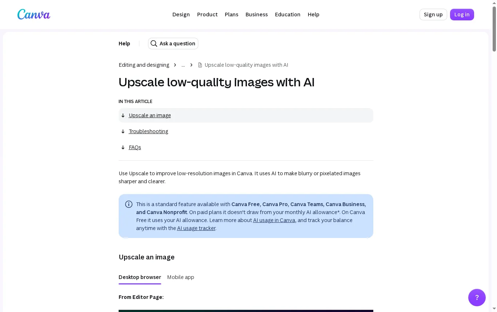
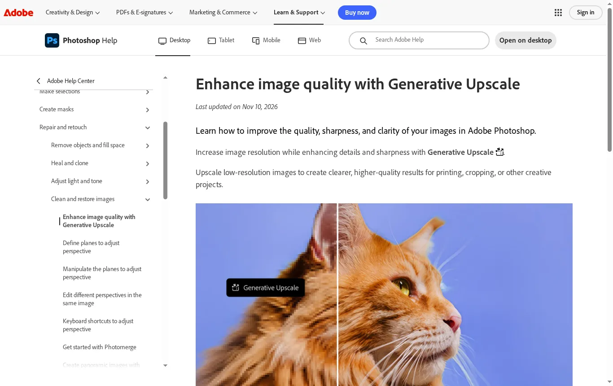
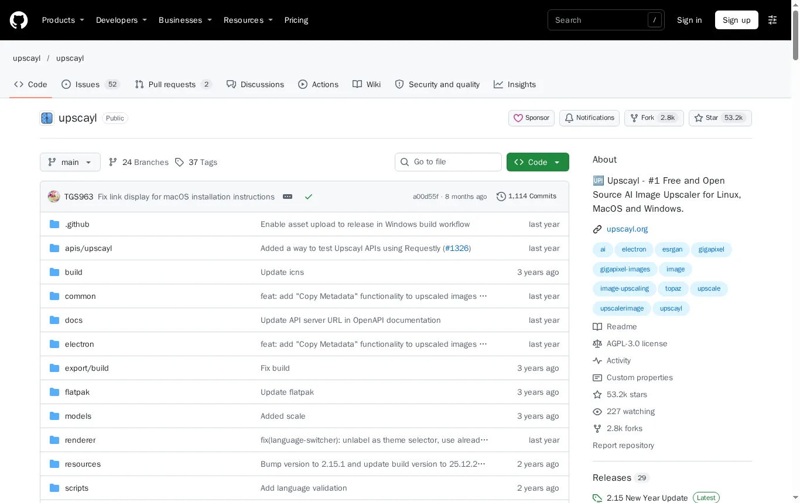

> Thuộc chuyên đề: [Top công cụ AI chỉnh sửa ảnh](top-cong-cu-ai-chinh-sua-anh.md) · Bài viết của [KimQ Tech](https://kimq.tech)

Ảnh sản phẩm chụp vội, ảnh tải từ Zalo bị nén, ảnh cắt nhỏ từ ảnh nhóm, logo cũ chỉ còn file 200 pixel. Khi phóng to, ảnh vỡ hạt và mờ. Các công cụ **làm nét ảnh bằng AI** (còn gọi là upscale) phóng to ảnh gấp 2–16 lần và **vẽ thêm chi tiết** để ảnh trông sắc nét.

Bài này so sánh 4 cách phổ biến, từ miễn phí trên trình duyệt đến phần mềm chuyên nghiệp: **Canva Upscale**, **Photoshop Generative Upscale**, **Lightroom Super Resolution** và **Upscayl** (mã nguồn mở, chạy trên máy). Thông tin lấy từ trang trợ giúp chính thức ngày **25/11/2026**.

## Tóm tắt nhanh

| | Canva Upscale | Photoshop Generative Upscale | Lightroom Super Resolution | Upscayl |
|---|---|---|---|---|
| Giá | Free dùng hạn mức AI; gói trả phí không trừ hạn mức | 10–20 credit tạo sinh mỗi lần | Có trong gói Lightroom | Miễn phí, mã nguồn mở |
| Mức phóng | Tự chọn 4x hoặc 16x | 2x hoặc 4x tuỳ mô hình | 2x mỗi chiều (4x số điểm ảnh) | Nhiều mức, chọn được |
| Giới hạn | Ảnh vào tối đa 25 MP, ra tối đa 50 MP, mỗi ảnh 1 lần | Ảnh ra tới 67 MP | Raw, JPEG, TIFF | Cần card đồ hoạ hỗ trợ Vulkan |
| Ảnh có rời máy không | Có, tải lên Canva | Có, xử lý trên đám mây | Tuỳ phiên bản | Không, chạy hoàn toàn trên máy |
| Hợp với | Ảnh bài đăng, in ấn qua Canva | Ảnh quảng cáo, in khổ lớn | Ảnh chụp máy ảnh, ảnh cắt cúp | Ảnh nhạy cảm, số lượng lớn, không muốn trả phí |

**Gợi ý nhanh:** cần làm nét một vài ảnh, dùng **Canva**. Ảnh khách hàng, tài liệu nội bộ không muốn tải lên mạng, dùng **Upscayl**. Ảnh in khổ lớn cho quảng cáo, dùng **Photoshop**.

## Làm nét ảnh bằng AI khác "tăng độ nét" thông thường

Thanh trượt "Sharpen" trong phần mềm chỉnh ảnh chỉ **tăng tương phản ở đường viền**, không thêm chi tiết. Ảnh 300 pixel làm sắc vẫn là ảnh 300 pixel, phóng to vẫn vỡ.

AI upscale làm việc khác: mô hình đã học từ hàng triệu cặp ảnh mờ và ảnh nét, nên khi gặp ảnh mờ, nó **đoán và vẽ lại** chi tiết như sợi tóc, vân vải, chữ. Kết quả trông nét hơn nhiều, nhưng có một hệ quả quan trọng: **chi tiết được vẽ thêm có thể không giống thật**. Khuôn mặt có thể hơi khác, chữ nhỏ có thể bị đổi.

Vì vậy đừng dùng ảnh AI upscale làm **bằng chứng** (ảnh camera, ảnh giấy tờ) hoặc khi cần chi tiết chính xác tuyệt đối.

## 1. Canva Upscale: miễn phí, một cú bấm

*Ảnh chụp màn hình: Trang trợ giúp tính năng Upscale của Canva. Nguồn: [canva.com](https://www.canva.com/help/upscale-image/), chụp ngày 25/11/2026.*

Theo Canva, **Upscale** dùng AI để làm ảnh mờ, vỡ điểm ảnh sắc nét và rõ hơn. Đây là tính năng chuẩn có ở tất cả các gói: Canva Free, Pro, Teams, Business và Nonprofit.

- **Gói trả phí:** không trừ vào hạn mức AI hằng tháng (có giới hạn sử dụng hợp lý).
- **Canva Free:** mỗi lần dùng trừ vào hạn mức AI.

### Các bước

1. Mở thiết kế, chọn ảnh cần làm nét.
2. Trong mục **Công cụ** (Tools), chọn **Upscale**.
3. Canva tự phóng ảnh theo kích thước gốc.

Khi đặt in qua Canva, nếu bước xem trước phát hiện ảnh độ phân giải thấp, bạn có thể bấm **Upscale images** để Canva làm nét tự động.

### Giới hạn cần biết

- Ảnh đầu vào từ **10 × 10 pixel đến 25 megapixel**; ảnh ra **tối đa 50 megapixel**.
- Canva **tự chọn 4x hoặc 16x**, bạn không chọn được.
- **Mỗi ảnh chỉ upscale được một lần.**
- Upscale dựa trên **kích thước ảnh gốc, không phải phần đã cắt**. Muốn làm nét phần cắt, hãy tải phần cắt thành ảnh mới rồi upscale.
- Ảnh vector cần xuất sang PNG trước.
- Ảnh quá nhỏ hoặc nén quá nặng sẽ cải thiện ít.

## 2. Photoshop Generative Upscale: chọn mô hình, in khổ lớn

*Ảnh chụp màn hình: Trang trợ giúp Generative Upscale của Photoshop. Nguồn: [helpx.adobe.com](https://helpx.adobe.com/photoshop/desktop/repair-retouch/clean-restore-images/enhance-image-quality-with-generative-upscale.html), chụp ngày 25/11/2026.*

Trên Photoshop bản máy tính, Adobe đưa tính năng **Generative Upscale** để tăng độ phân giải và chi tiết cho ảnh in, ảnh cắt cúp.

### Các bước

1. **File → Open**, mở ảnh độ phân giải thấp.
2. Chọn **Image → Generative Upscale**.
3. Chọn mô hình AI: **Firefly Upscaler 2**, **Topaz Gigapixel** hoặc **Topaz Bloom**, và chọn mức phóng.
4. Bấm **Upscale**. Ảnh mới mở ra trong tài liệu riêng.

**Chi phí:** dùng **10 credit tạo sinh** cho ảnh ra tới 25 megapixel và **20 credit** cho ảnh từ 25 đến 67 megapixel. Số credit hằng tháng tuỳ gói Adobe.

Chọn mô hình thế nào: Topaz Gigapixel thường giữ chi tiết sát ảnh gốc; Topaz Bloom và Firefly có xu hướng sáng tạo thêm chi tiết. Ảnh sản phẩm thật nên ưu tiên mô hình giữ chi tiết.

## 3. Lightroom Super Resolution: cho ảnh chụp máy ảnh

Lightroom có ba công cụ trong mục **Detail** của bảng **Edit**:

- **Denoise**: giảm nhiễu hạt cho ảnh chụp thiếu sáng, ISO cao (chỉ với file raw).
- **Raw Details**: làm sắc viền, màu chính xác hơn, giữ nguyên độ phân giải.
- **Super Resolution**: như Raw Details nhưng **tăng gấp đôi chiều rộng và chiều cao**, tức gấp 4 lần tổng số điểm ảnh. Hỗ trợ cả **JPEG và TIFF**, đặc biệt hữu ích với ảnh đã cắt cúp mạnh.

Theo [trang trợ giúp Lightroom](https://helpx.adobe.com/lightroom/desktop/edit-photos/enhance-details.html), tính năng này dùng card đồ hoạ nhiều, cần Windows 10 (1903) hoặc macOS Mojave trở lên.

## 4. Upscayl: miễn phí, mã nguồn mở, ảnh không rời máy

*Ảnh chụp màn hình: Trang GitHub của Upscayl. Nguồn: [github.com](https://github.com/upscayl/upscayl), chụp ngày 25/11/2026.*

**Upscayl** là phần mềm upscale ảnh **miễn phí và mã nguồn mở**, chạy trên Windows 10 trở lên, macOS 12 trở lên và Linux. Vì xử lý ngay trên máy tính, **ảnh không bị tải lên máy chủ nào**, phù hợp với ảnh khách hàng, ảnh hồ sơ, tài liệu nội bộ.

### Cài và dùng

1. Tải bản cài từ trang [upscayl.org](https://upscayl.org) hoặc mục Releases trên GitHub.
2. Windows: chạy file `.exe`. Nếu SmartScreen cảnh báo, chọn **More Info → Run Anyway**. macOS: kéo vào Applications, hoặc cài bằng Homebrew `brew install --cask upscayl`.
3. Mở Upscayl, chọn ảnh, chọn mô hình và mức phóng, chọn thư mục lưu, bấm **Upscayl**.
4. Muốn xử lý cả thư mục, bật chế độ xử lý hàng loạt (batch).

**Yêu cầu:** cần **card đồ hoạ hỗ trợ Vulkan**. Nhiều card tích hợp (iGPU) không chạy được, nhưng vẫn nên thử. Máy văn phòng không có card rời có thể chạy chậm.

Các repo mã nguồn mở khác cho làm nét, phục hồi khuôn mặt (Real-ESRGAN, GFPGAN, CodeFormer) có trong bài [Top công cụ AI chỉnh sửa ảnh](top-cong-cu-ai-chinh-sua-anh.md).

## Mẹo làm nét ảnh cho đẹp

- **Bắt đầu từ ảnh gốc tốt nhất có thể.** Ảnh gửi qua Zalo, Messenger bị nén mạnh; xin file gốc qua email hoặc Google Drive.
- **Làm nét trước, chỉnh màu sau.** Chỉnh màu trên ảnh vỡ hạt làm nhiễu rõ hơn.
- **Phóng vừa đủ.** Ảnh đăng Facebook chỉ cần cạnh dài khoảng 2.000 pixel; phóng 16x làm file nặng mà không cần thiết.
- **Ảnh in:** tính kích thước cần theo công thức cạnh (cm) ÷ 2,54 × 300 = số pixel. Tờ A4 (21 × 29,7 cm) cần khoảng 2.480 × 3.508 pixel.
- **Kiểm tra mặt và chữ** sau khi upscale. Nếu AI làm mặt khác đi, chọn mô hình giữ chi tiết hoặc mức phóng thấp hơn.
- **Ảnh cũ bị xước, ố vàng** cần phục hồi trước rồi mới làm nét.

Sau khi làm nét, nếu ảnh cần thêm khoảng trống để làm ảnh bìa, banner, xem [Mở rộng ảnh bằng AI](mo-rong-anh-bang-ai.md). Cần ghép vào bối cảnh khác, xem [Ghép ảnh bằng AI](ghep-anh-bang-ai.md).

## Câu hỏi thường gặp

**Làm nét ảnh AI miễn phí ở đâu?**
Canva Upscale (bản Free dùng hạn mức AI) và Upscayl (miễn phí hoàn toàn, chạy trên máy).

**Làm nét ảnh trên điện thoại được không?**
Được với app Canva. Upscayl chỉ có bản máy tính.

**Ảnh mờ do rung tay có làm nét được không?**
Cải thiện được một phần. Ảnh rung mạnh, nhòe chuyển động khó cứu; AI có thể vẽ ra chi tiết không đúng.

**Upscale nhiều lần có nét hơn không?**
Thường không. Canva chỉ cho upscale mỗi ảnh một lần. Với các công cụ khác, upscale lặp lại dễ sinh chi tiết giả.

**Dùng ảnh upscale để in biển quảng cáo được không?**
Được nếu ảnh gốc đủ tốt. Biển lớn nhìn từ xa không cần 300 dpi; hỏi nhà in độ phân giải yêu cầu trước khi upscale.

## Xử lý ảnh sản phẩm số lượng lớn

Shop có hàng trăm ảnh sản phẩm cần làm nét, tách nền, đổi bối cảnh có thể dùng [Tự động hoá của KimQ Tech](https://kimq.tech/san-pham/tu-dong-hoa) để xử lý hàng loạt, hoặc [AI Studio](https://kimq.tech/san-pham/ai-studio) cho đội marketing.

---

> Bài viết có sử dụng AI hỗ trợ soạn thảo. Nội dung và số liệu được đối chiếu với nguồn chính thức ngày 25/11/2026; ảnh là ảnh chụp màn hình trang chính thức, có ghi nguồn và ngày chụp.

## Về KimQ Tech

[KimQ Tech](https://kimq.tech) xây giải pháp AI và tự động hoá vận hành cho doanh nghiệp Việt: [AI Studio](https://kimq.tech/san-pham/ai-studio), [AI Gateway](https://kimq.tech/san-pham/ai-gateway), [Trợ lý AI trên Zalo](https://kimq.tech/san-pham/tro-ly-zalo), [Chatbot đa kênh](https://kimq.tech/san-pham/chatbot-da-kenh), [Tự động hoá](https://kimq.tech/san-pham/tu-dong-hoa). Cần tư vấn? [Liên hệ KimQ Tech](https://kimq.tech/lien-he) hoặc email contact@kimq.tech.

---

*Thông tin kiểm tra trên trang trợ giúp Canva, Adobe và GitHub Upscayl ngày 25/11/2026 và có thể thay đổi. KimQ Tech không phải đại lý của Canva hay Adobe.*
