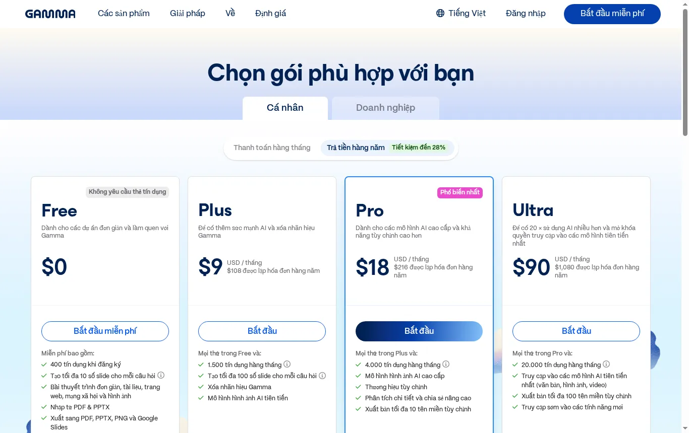
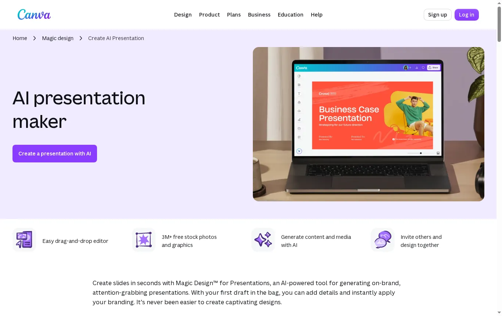
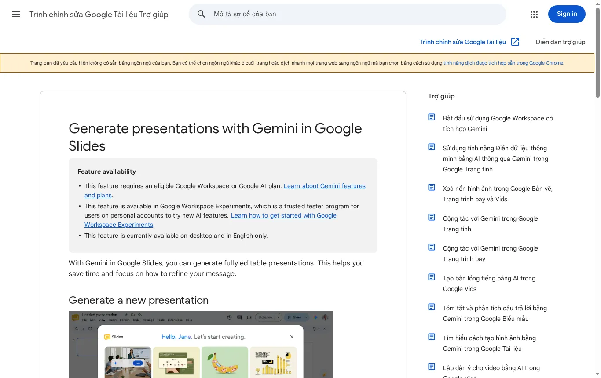
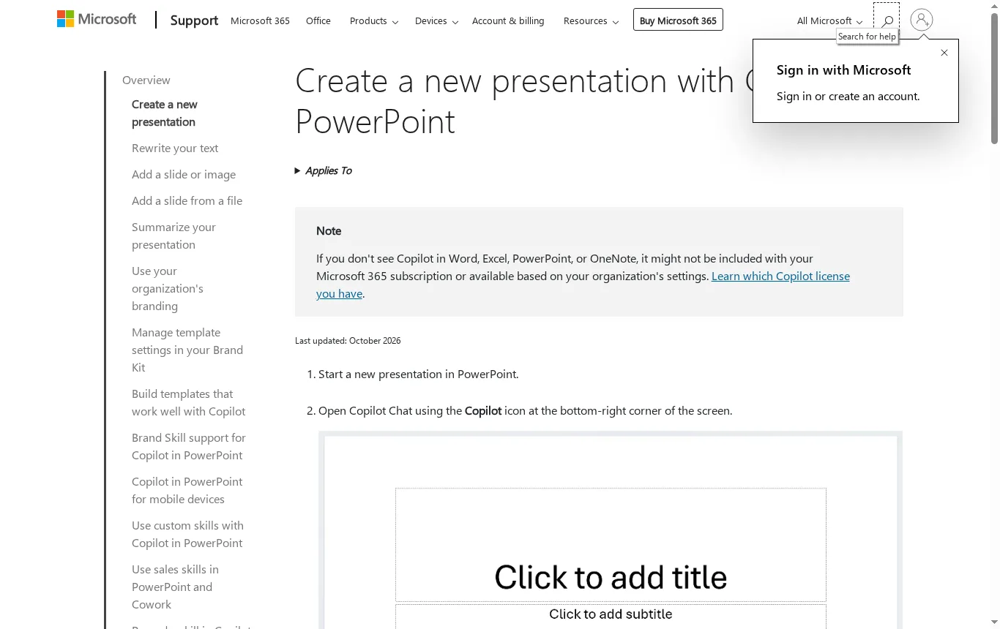

> Thuộc chuyên đề: [Hướng dẫn dùng công cụ AI phổ biến](huong-dan-dung-cong-cu-ai-pho-bien.md) · Bài viết của [KimQ Tech](https://kimq.tech)

Làm một bộ slide 10 trang thường mất cả buổi: viết dàn ý, chọn mẫu, căn chữ, tìm hình. Các công cụ làm slide bằng AI rút việc đó xuống còn vài phút cho bản nháp đầu tiên. Bạn mô tả chủ đề hoặc tải tài liệu lên, AI dựng dàn ý, viết nội dung và dàn trang. Việc còn lại của bạn là sửa số liệu, thêm hình thật và chỉnh giọng văn.

Bài này so sánh bốn cách phổ biến nhất: **Gamma**, **Canva**, **Gemini trong Google Slides** và **Copilot trong PowerPoint**. Thông tin lấy từ trang chính thức ngày **25/11/2026**.

## Tóm tắt nhanh

| | Gamma | Canva | Gemini (Google Slides / app Gemini) | Copilot (PowerPoint) |
|---|---|---|---|---|
| Miễn phí? | Có, 400 credit khi đăng ký | Có, Magic Design dùng thử tối đa 10 lần | Cần gói Workspace hoặc Google AI có Gemini | Cần giấy phép Copilot |
| Số slide mỗi lần tạo | Free: tối đa 10; Plus: 100 | Tuỳ mẫu | Theo dàn ý bạn duyệt | Theo mô tả |
| Xuất PowerPoint (PPTX) | Có, cả gói Free | Có | Tải từ Google Slides | Là file PowerPoint sẵn |
| Dùng tài liệu có sẵn | Nhập PDF, PPTX | Có | File trong Drive, Gmail | File Word, PDF |
| Hợp với | Làm nhanh, đẹp, chia sẻ bằng link | Người đã quen Canva, cần nhiều mẫu | Doanh nghiệp dùng Google Workspace | Doanh nghiệp dùng Microsoft 365 |

Nếu chỉ cần một bộ slide miễn phí trong 5 phút, bắt đầu với **Gamma**. Nếu công ty đã trả tiền Google Workspace hoặc Microsoft 365, dùng AI có sẵn trong bộ đó để giữ tài liệu trong hệ thống công ty.

## Gamma: nhanh nhất, gói miễn phí xuất được PPTX

Gamma là công cụ chuyên tạo bài thuyết trình, tài liệu và trang web bằng AI. Bạn gõ chủ đề, Gamma đề xuất dàn ý, bạn sửa dàn ý rồi bấm tạo. Kết quả là bộ slide có bố cục, hình minh hoạ và màu sắc đồng bộ.

*Ảnh chụp màn hình: Bảng giá các gói Gamma. Nguồn: [gamma.app](https://gamma.app/pricing), chụp ngày 25/11/2026.*

| Gói | Giá (trả theo năm) | Credit | Điểm chính |
|---|---|---|---|
| Free | $0 | 400 credit khi đăng ký | Tối đa 10 slide mỗi câu lệnh, nhập PDF/PPTX, xuất PDF, PPTX, PNG, Google Slides |
| Plus | $9/tháng ($108/năm) | 1.500 credit/tháng | Tối đa 100 slide mỗi câu lệnh, bỏ logo Gamma |
| Pro | $18/tháng ($216/năm) | 4.000 credit/tháng | Thương hiệu riêng, tên miền riêng, thống kê người xem |
| Ultra | $90/tháng | 20.000 credit/tháng | Mô hình AI cao cấp nhất |

Lưu ý: 400 credit gói Free là credit **một lần khi đăng ký**, không nạp lại hằng tháng. Dùng hết thì phải nâng cấp. Slide tạo bằng gói Free có logo Gamma.

## Canva: hợp người đã quen Canva

Canva có tính năng tạo bài thuyết trình bằng AI (trước đây gọi là Magic Design cho bài thuyết trình). Bạn nhập chủ đề, Canva dựng bộ slide theo mẫu thiết kế của Canva, sau đó chỉnh trong trình biên tập quen thuộc. Theo [trang tạo bài thuyết trình AI của Canva](https://www.canva.com/create/ai-presentations/), Magic Design dùng miễn phí **tối đa 10 lần** trên mọi phiên bản; muốn dùng thêm cần Canva Pro.

*Ảnh chụp màn hình: Trang tạo bài thuyết trình bằng AI của Canva. Nguồn: [canva.com](https://www.canva.com/create/ai-presentations/), chụp ngày 25/11/2026.*

Điểm mạnh của Canva là kho mẫu, ảnh và biểu tượng rất lớn, giao diện tiếng Việt, xuất được PPTX và PDF. Điểm yếu: nội dung chữ do AI viết thường chung chung, cần sửa nhiều hơn Gamma.

## Gemini trong Google Slides: tạo slide từ tài liệu trong Drive

Với tài khoản có Gemini, Google Slides tạo được cả bộ slide chỉnh sửa được. Theo [trang hỗ trợ của Google](https://support.google.com/docs/answer/17111393), quy trình như sau:

1. Mở Google Slides, ở màn hình bắt đầu chọn **Presentation** (hoặc mở bản trình bày trống, bấm **Ask Gemini**).
2. Mô tả bài thuyết trình ở khung bên phải, ví dụ: "Tạo bài thuyết trình 5 slide giới thiệu sản phẩm mới cho khách hàng doanh nghiệp".
3. Tuỳ chọn: thêm tài liệu từ Drive làm nguồn, hoặc thêm một bộ slide cũ để Gemini bắt chước phong cách.
4. Trả lời câu hỏi làm rõ của Gemini (có thể bỏ qua), bấm **Next**.
5. Xem kế hoạch gồm tổng quan, nguồn và dàn ý từng slide; sửa, thêm, xoá slide nếu cần.
6. Bấm **Approve** và giữ tab mở đến khi Gemini tạo xong.

*Ảnh chụp màn hình: Hướng dẫn tạo bài thuyết trình bằng Gemini trong Google Slides. Nguồn: [support.google.com](https://support.google.com/docs/answer/17111393), chụp ngày 25/11/2026.*

Lúc kiểm tra, tính năng này **chỉ có trên máy tính và bằng tiếng Anh**, cần gói Google Workspace hoặc Google AI đủ điều kiện. Câu lệnh tiếng Anh, sau đó nhờ Gemini dịch từng slide sang tiếng Việt là cách làm thực tế.

Cách khác: trong **app Gemini**, chọn **Canvas** và gõ "tạo bài thuyết trình". Theo [thông báo của Google Workspace](https://workspaceupdates.googleblog.com/2025/10/generate-presentations-in-gemini-app.html), tính năng này có cho các gói Workspace doanh nghiệp, giáo dục và gói Google AI Pro, Ultra. Sinh viên có thể xem [cách nhận Gemini miễn phí cho sinh viên](gemini-cho-sinh-vien.md).

## Copilot trong PowerPoint: cho doanh nghiệp dùng Microsoft 365

Nếu công ty dùng Microsoft 365 có giấy phép Copilot, làm PowerPoint bằng AI ngay trong PowerPoint:

1. Tạo bản trình bày mới, mở **Copilot Chat** ở góc dưới bên phải.
2. Chọn mô hình AI (hoặc để Auto).
3. Nếu công ty có **Brand Kit** (bộ logo, font, màu chuẩn), chọn Brand Kit để slide đúng nhận diện.
4. Mô tả bài thuyết trình; Copilot có thể hỏi lại để làm rõ.

*Ảnh chụp màn hình: Hướng dẫn tạo bài thuyết trình bằng Copilot trong PowerPoint. Nguồn: [support.microsoft.com](https://support.microsoft.com/en-us/office/create-a-new-presentation-with-copilot-in-powerpoint-3222ee03-f5a4-4d27-8642-9c387ab4854d), chụp ngày 25/11/2026.*

Microsoft lưu ý nếu không thấy Copilot trong PowerPoint, có thể gói Microsoft 365 của bạn không bao gồm Copilot hoặc công ty chưa bật.

## Mẫu câu lệnh làm slide bằng AI

Câu lệnh càng cụ thể, bản nháp càng ít phải sửa. Công thức: **chủ đề + người nghe + số slide + mục tiêu + phong cách**.

- "Tạo bài thuyết trình 8 slide giới thiệu dịch vụ chatbot cho chủ cửa hàng bán lẻ, mục tiêu đặt lịch tư vấn, phong cách tối giản, mỗi slide tối đa 3 ý."
- "Tóm tắt tài liệu đính kèm thành 6 slide báo cáo kết quả kinh doanh quý 3 cho ban giám đốc, có 1 slide số liệu và 1 slide đề xuất."
- "Làm slide bài giảng 10 trang về vòng tuần hoàn nước cho học sinh lớp 6, nhiều hình minh hoạ, chữ to."
- "Dàn ý thuyết trình 5 phút bảo vệ đồ án, có slide mở đầu, vấn đề, giải pháp, kết quả, hướng phát triển."

Thêm câu lệnh theo từng việc trong bài [Prompt AI: cách viết câu lệnh hiệu quả](prompt-ai.md).

## Kiểm tra trước khi trình chiếu

1. **Số liệu**: AI hay tự thêm con số. Xoá mọi số liệu không có nguồn.
2. **Hình ảnh**: ảnh AI có thể sai chi tiết (chữ méo, tay người). Thay bằng ảnh thật của sản phẩm khi thuyết trình với khách hàng.
3. **Chính tả tiếng Việt**: kiểm tra dấu, nhất là khi Gemini dịch từ bản tiếng Anh.
4. **Dữ liệu nội bộ**: không tải hợp đồng, dữ liệu khách hàng lên công cụ miễn phí. Doanh nghiệp nên dùng AI trong gói có hợp đồng (Workspace, Microsoft 365).
5. **Logo công cụ**: gói Free của Gamma có logo Gamma; nâng cấp hoặc xuất PPTX rồi chỉnh.

## Đọc thêm trong chuyên đề

- [Claude Design là gì](claude-design-la-gi.md): làm slide, one-pager, prototype bằng Claude.
- [Prompt AI: cách viết câu lệnh hiệu quả](prompt-ai.md).
- [Hướng dẫn dùng công cụ AI phổ biến](huong-dan-dung-cong-cu-ai-pho-bien.md).

Doanh nghiệp muốn **tự động hoá báo cáo định kỳ** (lấy số liệu, tạo bản tóm tắt, gửi qua email hoặc Zalo) có thể xem [giải pháp Tự động hoá của KimQ Tech](https://kimq.tech/san-pham/tu-dong-hoa).

## Câu hỏi thường gặp

**Làm slide bằng AI miễn phí ở đâu?**
Gamma cho 400 credit khi đăng ký, tối đa 10 slide mỗi lần tạo và xuất được PPTX. Canva cho dùng Magic Design tối đa 10 lần miễn phí.

**AI nào làm PowerPoint tốt nhất?**
Tuỳ hệ thống bạn dùng. Gamma đẹp và nhanh nhất cho cá nhân; Copilot hợp nhất khi công ty dùng Microsoft 365 và cần đúng Brand Kit; Gemini hợp với công ty dùng Google Workspace.

**Slide tạo bằng Gamma có sửa được trong PowerPoint không?**
Có. Gamma xuất PPTX ở mọi gói, kể cả Free. Bố cục có thể lệch nhẹ khi mở bằng PowerPoint, nên kiểm tra lại font.

**Gemini trong Google Slides có tiếng Việt không?**
Lúc kiểm tra, tính năng tạo cả bài thuyết trình chỉ hỗ trợ tiếng Anh trên máy tính. Bạn có thể tạo bằng tiếng Anh rồi nhờ Gemini dịch.

**Dùng slide AI để nộp bài ở trường có sao không?**
Tuỳ quy định từng trường và giảng viên. Nhiều trường yêu cầu ghi rõ phần dùng AI. Xem thêm [cách các công cụ phát hiện văn bản do AI viết](check-dao-van-ai.md).

---

> Bài viết có sử dụng AI hỗ trợ soạn thảo. Nội dung và số liệu được đối chiếu với nguồn chính thức ngày 25/11/2026; ảnh là ảnh chụp màn hình trang chính thức, có ghi nguồn và ngày chụp.

## Về KimQ Tech

[KimQ Tech](https://kimq.tech) xây giải pháp AI và tự động hoá vận hành cho doanh nghiệp Việt: [AI Studio](https://kimq.tech/san-pham/ai-studio), [AI Gateway](https://kimq.tech/san-pham/ai-gateway), [Trợ lý AI trên Zalo](https://kimq.tech/san-pham/tro-ly-zalo), [Chatbot đa kênh](https://kimq.tech/san-pham/chatbot-da-kenh), [Tự động hoá](https://kimq.tech/san-pham/tu-dong-hoa). Cần tư vấn? [Liên hệ KimQ Tech](https://kimq.tech/lien-he) hoặc email contact@kimq.tech.

---

*Thông tin kiểm tra trên trang chính thức của Gamma, Canva, Google và Microsoft ngày 25/11/2026 và có thể thay đổi. KimQ Tech không phải đại lý của các dịch vụ trong bài.*
