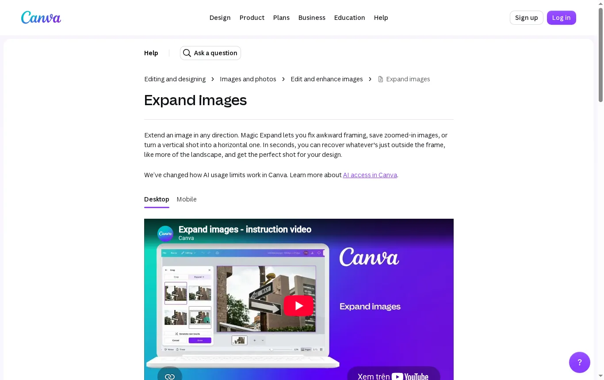
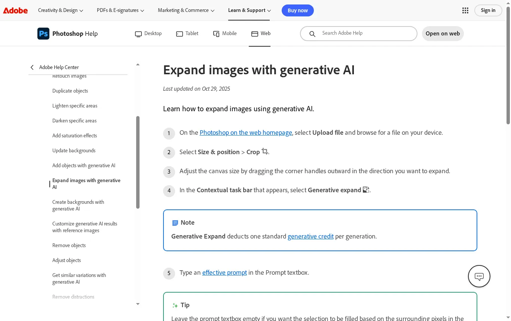
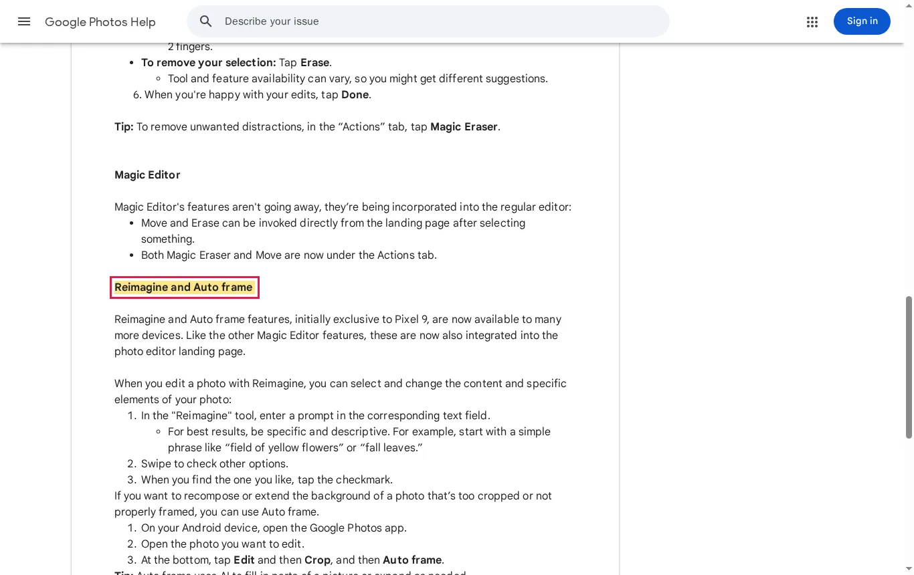

> Thuộc chuyên đề: [Top công cụ AI chỉnh sửa ảnh](top-cong-cu-ai-chinh-sua-anh.md) · Bài viết của [KimQ Tech](https://kimq.tech)

**Mở rộng ảnh bằng AI** (tiếng Anh gọi là *outpainting* hay *generative expand*) là cách kéo rộng khung ảnh ra ngoài viền gốc, để AI tự vẽ thêm phần cảnh còn thiếu: thêm bầu trời, kéo dài bãi biển, biến ảnh dọc thành ảnh ngang để làm ảnh bìa Facebook hay banner website.

Bài này hướng dẫn 4 cách mở rộng ảnh AI online phổ biến: **Canva Magic Expand**, **Photoshop Generative Expand**, **Google Photos Auto frame** và **Gemini**. Thao tác lấy từ trang trợ giúp chính thức ngày **25/11/2026**.

## Tóm tắt nhanh

| Công cụ | Dùng ở đâu | Cách mở rộng | Chi phí |
|---|---|---|---|
| Canva Magic Expand | Web, app Canva | Chọn khổ có sẵn hoặc kéo viền | Cần tài khoản có quyền dùng công cụ AI của Canva |
| Photoshop Generative Expand | Photoshop web, desktop | Kéo khung cắt ra ngoài, có thể gõ mô tả | Trừ 1 credit tạo sinh mỗi lần |
| Google Photos Auto frame | App Google Photos | Gợi ý khung mới, tự lấp phần trống | Tuỳ máy và tài khoản, tính năng đang mở dần |
| Gemini | gemini.google.com, app | Tải ảnh lên, ra lệnh mở rộng theo tỷ lệ | Có lượt miễn phí, giới hạn theo gói |

**Cần nhanh, làm thiết kế:** Canva. **Cần kiểm soát chi tiết:** Photoshop. **Ảnh trong điện thoại:** Google Photos. **Không muốn cài gì:** Gemini.

## Mở rộng ảnh bằng AI dùng để làm gì?

- **Đổi tỷ lệ ảnh**: ảnh chụp dọc 9:16 cần thành ảnh ngang 16:9 cho YouTube, banner website, slide.
- **Cứu ảnh bị cắt sát**: chụp bị mất đầu, mất chân, sát mép khung.
- **Thêm chỗ trống để chèn chữ**: ảnh sản phẩm cần khoảng trời hoặc nền rộng để đặt tiêu đề quảng cáo.
- **Làm ảnh bìa**: ảnh bìa Facebook, Zalo OA, LinkedIn có tỷ lệ rất dài, ảnh gốc hiếm khi vừa.

AI không "nhìn thấy" phần ngoài khung thật. Nó **đoán** dựa trên điểm ảnh xung quanh, nên phần thêm vào là ảnh mới do máy tạo, không phải cảnh thật.

## Cách 1: Mở rộng ảnh trên Canva (Magic Expand)

Theo trang trợ giúp Canva, Magic Expand mở rộng ảnh theo mọi hướng, giúp sửa bố cục, cứu ảnh bị zoom sát hoặc biến ảnh dọc thành ảnh ngang.


*Ảnh chụp màn hình: Trang trợ giúp Canva hướng dẫn mở rộng ảnh bằng Magic Expand. Nguồn: [canva.com](https://www.canva.com/help/using-magic-expand/), chụp ngày 25/11/2026.*

Các bước trên máy tính:

1. Chọn ảnh muốn sửa trong thiết kế.
2. Trên thanh công cụ, bấm **Edit** (Chỉnh sửa).
3. Vào **Tools**, chọn **See All**.
4. Chọn **Magic Expand**.
5. Chọn một khổ có sẵn hoặc kéo viền khung ra ngoài ảnh.
6. Bấm **Expand** và chờ xử lý, sau đó chọn phương án ưng ý.

Lưu ý từ Canva:

- Ảnh mở rộng chỉ tải riêng được khi tải **cùng thiết kế**.
- Ảnh có **khuôn mặt, bàn tay** hoặc **nền trong suốt** có thể cho kết quả kém.
- Canva vừa thay đổi cách tính giới hạn dùng AI; kiểm tra lượt còn lại trong mục theo dõi AI của tài khoản.

## Cách 2: Mở rộng ảnh bằng Photoshop (Generative Expand)

Photoshop có Generative Expand cả trên bản desktop và **Photoshop trên web** (chạy ngay trong trình duyệt). Theo trang trợ giúp của Adobe, quy trình trên bản web:

1. Ở trang chủ Photoshop web, chọn **Upload file** và tải ảnh lên.
2. Chọn **Size & position > Crop**.
3. Kéo các góc khung cắt ra ngoài theo hướng muốn mở rộng.
4. Trên thanh tác vụ hiện ra, chọn **Generative expand**.
5. Gõ mô tả vào ô Prompt, hoặc **để trống** để AI lấp theo điểm ảnh xung quanh.
6. Chọn phương án ưng ý trên thanh tác vụ.


*Ảnh chụp màn hình: Trang trợ giúp Adobe hướng dẫn mở rộng ảnh bằng Generative Expand trên Photoshop web. Nguồn: [helpx.adobe.com](https://helpx.adobe.com/photoshop/web/edit-images/retouch/expand-images-with-generative-ai.html), chụp ngày 25/11/2026.*

Mỗi lần tạo **trừ 1 credit tạo sinh tiêu chuẩn**. Ưu điểm của Photoshop là bạn được gõ mô tả cho phần mở rộng (ví dụ "thêm hàng dừa và bãi cát"), xử lý theo lớp (layer) nên sửa lại dễ, phù hợp ảnh cần in hoặc dùng cho quảng cáo.

## Cách 3: Mở rộng ảnh trong Google Photos (Auto frame)

Google Photos có **Auto frame** trong mục cắt ảnh. Theo thông báo của đội Google Photos trên trang cộng đồng chính thức, Auto frame dùng khi ảnh **bị cắt quá sát hoặc lệch khung**: AI lấp thêm phần ảnh hoặc mở rộng nền khi cần. Tính năng ban đầu chỉ có trên Pixel 9, nay đã mở cho nhiều máy hơn.


*Ảnh chụp màn hình: Thông báo trình chỉnh sửa mới của Google Photos, mục Reimagine và Auto frame. Nguồn: [support.google.com](https://support.google.com/photos/thread/363127706/easy-edits-with-our-new-editor?hl=en), chụp ngày 25/11/2026.*

Cách làm trên điện thoại:

1. Mở ảnh trong app Google Photos.
2. Ở dưới cùng, bấm **Edit** (Chỉnh sửa), chọn **Crop** (Cắt).
3. Chọn **Auto frame**, vuốt để xem các phương án AI đề xuất, bấm dấu tích khi ưng ý.
4. Lưu thành bản sao để giữ ảnh gốc.

Auto frame có trên nhiều máy Android nhưng chưa phải máy nào cũng có; nếu chưa thấy nút, cập nhật app hoặc dùng cách khác. Theo trang trợ giúp Google Photos, ảnh đã chỉnh có thể xem thông tin AI trong chi tiết ảnh.

## Cách 4: Mở rộng ảnh bằng Gemini

Gemini không có nút "Expand" riêng, nhưng bạn có thể tải ảnh lên và ra lệnh bằng chữ. Mẫu câu lệnh:

```
Mở rộng ảnh này thành tỷ lệ 16:9 theo chiều ngang.
Giữ nguyên người và vật thể trong ảnh gốc, không đổi khuôn mặt, màu sắc, ánh sáng.
Vẽ thêm phần cảnh hai bên cho liền mạch với nền hiện có.
```

Mẹo khi dùng Gemini:

- Nói rõ **tỷ lệ đích** (16:9, 4:5, 1:1) và **hướng** mở rộng.
- Nhấn mạnh **giữ nguyên chủ thể**; AI tạo ảnh đôi khi vẽ lại cả khuôn mặt.
- So kỹ với ảnh gốc trước khi dùng; nếu chủ thể bị đổi, quay lại Canva hoặc Photoshop.

Xem thêm câu lệnh mẫu tại [35 câu lệnh tạo ảnh, ghép ảnh trên Gemini](cau-lenh-tao-anh-ghep-anh-gemini.md) và cách viết câu lệnh tại [Prompt AI](prompt-ai.md).

## So sánh nhanh: chọn công cụ nào?

| Tiêu chí | Canva | Photoshop | Google Photos | Gemini |
|---|---|---|---|---|
| Dễ dùng | Rất dễ | Trung bình | Rất dễ | Dễ |
| Gõ mô tả phần thêm | Không | Có | Không | Có |
| Giữ chủ thể ảnh gốc | Tốt | Tốt | Tốt | Không chắc chắn |
| Hợp nhất cho | Bài đăng, banner | Ảnh in, quảng cáo | Ảnh cá nhân | Thử nhanh |

## Lỗi hay gặp và cách khắc phục

- **Phần mở rộng lệch màu, lệch ánh sáng**: mở rộng ít một lần (20–30%), làm nhiều lần thay vì kéo gấp đôi ngay.
- **Tay, mặt bị méo**: tránh để vùng mở rộng chạm vào người; Canva cũng cảnh báo ảnh có mặt, tay dễ lỗi.
- **Chữ, logo bị vẽ sai**: AI không chép được chữ thật. Mở rộng phần nền, chèn chữ sau bằng công cụ thiết kế.
- **Ảnh mờ sau khi mở rộng**: dùng thêm công cụ làm nét, xem [Làm nét ảnh bằng AI](lam-net-anh-bang-ai.md).
- **Cần ghép nhiều ảnh thay vì kéo rộng một ảnh**: xem [Ghép ảnh bằng AI](ghep-anh-bang-ai.md).

## Lưu ý pháp lý và đạo đức

- Phần mở rộng là **nội dung do AI tạo**. Với ảnh báo chí, ảnh làm bằng chứng, ảnh hồ sơ, **không** mở rộng rồi trình bày như ảnh thật.
- Ảnh có người khác: cần sự đồng ý của họ trước khi chỉnh sửa và đăng lại.
- Ảnh tải từ mạng vẫn thuộc bản quyền tác giả; mở rộng không làm ảnh thành của bạn.
- Khi đăng quảng cáo, kiểm tra quy định gắn nhãn nội dung AI của nền tảng.

## Câu hỏi thường gặp

**Mở rộng ảnh AI online miễn phí được không?**
Được, nhưng có giới hạn. Gemini và Google Photos có lượt miễn phí theo tài khoản; Canva và Photoshop tính theo lượt AI hoặc credit của gói.

**Mở rộng ảnh có làm giảm chất lượng không?**
Phần mở rộng thường kém chi tiết hơn phần gốc, nhất là khi kéo rộng nhiều. Mở rộng từng chút và làm nét sau.

**Có mở rộng ảnh chân dung được không?**
Được, nếu chỉ mở rộng phần nền. Đừng để AI vẽ thêm phần cơ thể bị khuất, dễ lỗi.

**Outpainting là gì?**
Là thuật ngữ tiếng Anh cho việc vẽ thêm phần bên ngoài khung ảnh, ngược với inpainting (vẽ lại phần bên trong ảnh).

## Làm ảnh sản phẩm hàng loạt cho doanh nghiệp

Nếu bạn cần đổi khổ hàng trăm ảnh sản phẩm cho website, sàn thương mại điện tử và quảng cáo, [AI Studio của KimQ Tech](https://kimq.tech/san-pham/ai-studio) gom tạo ảnh, chỉnh ảnh vào một quy trình có kiểm soát dữ liệu.

---

> Bài viết có sử dụng AI hỗ trợ soạn thảo. Nội dung và số liệu được đối chiếu với nguồn chính thức ngày 25/11/2026; ảnh là ảnh chụp màn hình trang chính thức, có ghi nguồn và ngày chụp.

## Về KimQ Tech

[KimQ Tech](https://kimq.tech) xây giải pháp AI và tự động hoá vận hành cho doanh nghiệp Việt: [AI Studio](https://kimq.tech/san-pham/ai-studio), [AI Gateway](https://kimq.tech/san-pham/ai-gateway), [Trợ lý AI trên Zalo](https://kimq.tech/san-pham/tro-ly-zalo), [Chatbot đa kênh](https://kimq.tech/san-pham/chatbot-da-kenh), [Tự động hoá](https://kimq.tech/san-pham/tu-dong-hoa). Cần tư vấn? [Liên hệ KimQ Tech](https://kimq.tech/lien-he) hoặc email contact@kimq.tech.

---

*Thông tin kiểm tra trên trang trợ giúp chính thức của Canva, Adobe và cộng đồng Google Photos ngày 25/11/2026 và có thể thay đổi. KimQ Tech không phải đại lý của Canva, Adobe hay Google.*
