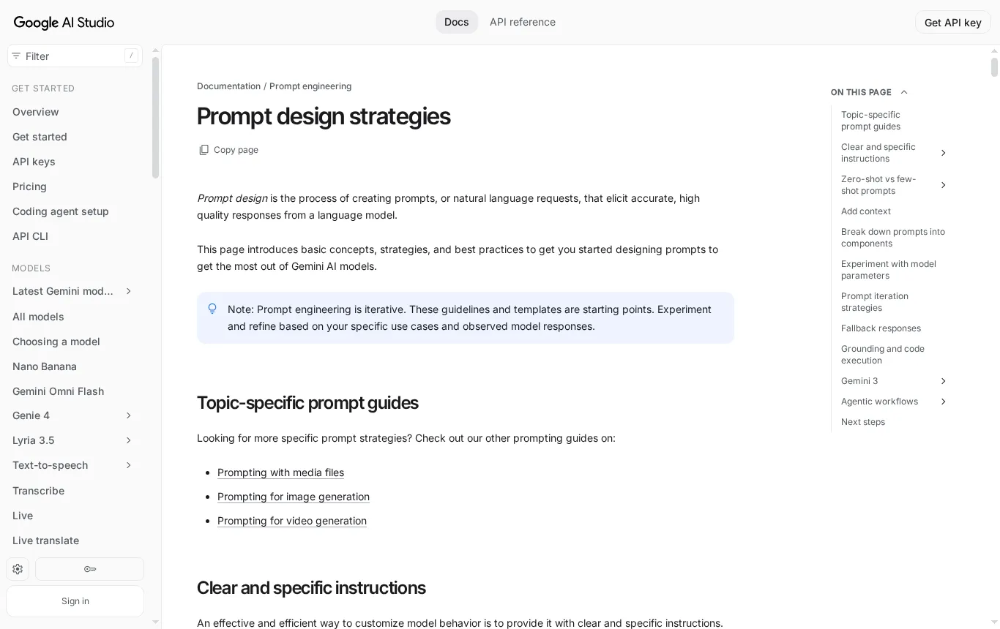
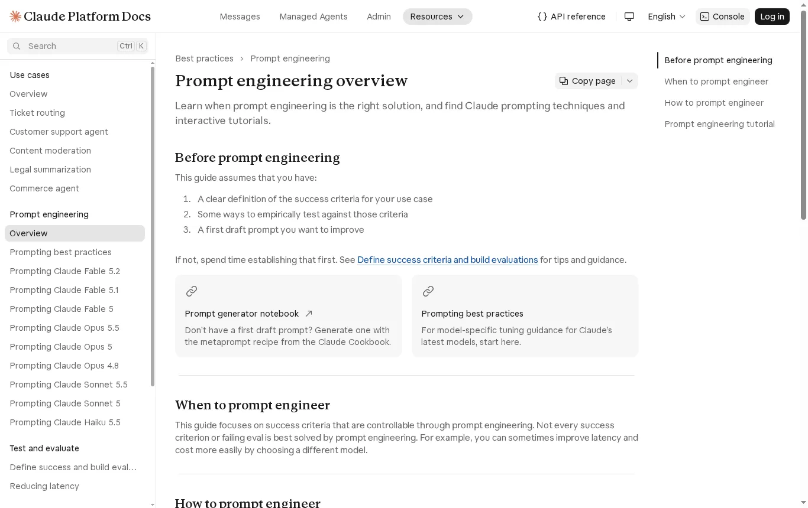
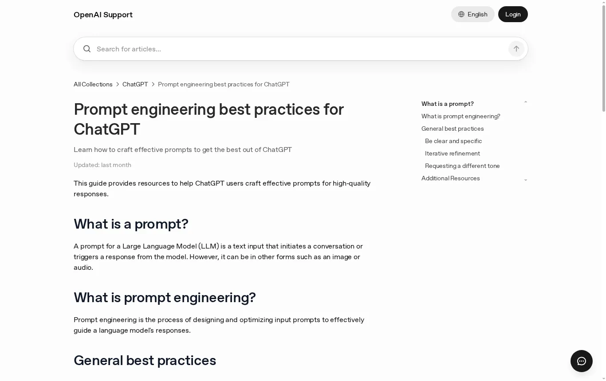

> Thuộc chuyên đề: [Hướng dẫn dùng công cụ AI phổ biến cho công việc](huong-dan-dung-cong-cu-ai-pho-bien.md) · Bài viết của [KimQ Tech](https://kimq.tech)

**Prompt AI** (câu lệnh AI) là đoạn chữ bạn gõ để yêu cầu ChatGPT, Gemini, Claude hay một công cụ tạo ảnh làm việc gì đó. Cùng một công cụ, câu lệnh mơ hồ cho ra câu trả lời chung chung; câu lệnh rõ việc, rõ bối cảnh, rõ định dạng cho ra kết quả dùng được ngay.

Bài này gom lại những nguyên tắc mà chính **Google**, **Anthropic** và **OpenAI** khuyên trong tài liệu hướng dẫn của họ, viết lại bằng tiếng Việt kèm mẫu câu lệnh cho việc văn phòng hằng ngày. Tài liệu được đối chiếu ngày **25/11/2026**.

## Tóm tắt nhanh

| Nguyên tắc | Làm thế nào | Nguồn khuyên |
|---|---|---|
| Rõ ràng, cụ thể | Nói đúng việc cần làm, cho ai, để làm gì | Google, OpenAI, Anthropic |
| Cho bối cảnh | Dán tài liệu, số liệu, thông tin người đọc | Google, Anthropic |
| Đặt giới hạn | Độ dài, giọng văn, điều không được làm | Google, OpenAI |
| Chỉ định định dạng | Bảng, gạch đầu dòng, JSON, email | Google |
| Cho ví dụ mẫu | 2–3 ví dụ đầu vào, đầu ra (few-shot) | Google, Anthropic |
| Chia nhỏ việc lớn | Mỗi câu lệnh một bước, nối kết quả | Google, Anthropic |
| Sửa dần | Đọc kết quả, chỉnh câu lệnh, thử lại | Cả ba |

## Prompt AI là gì?

Theo trang hướng dẫn của OpenAI, prompt là đầu vào bắt đầu cuộc trò chuyện hoặc kích hoạt câu trả lời của mô hình ngôn ngữ; thường là chữ, nhưng cũng có thể là ảnh hoặc âm thanh. **Prompt engineering** là việc thiết kế và tinh chỉnh câu lệnh đó để mô hình trả lời đúng ý.

Với người dùng văn phòng, bạn không cần học lập trình. Chỉ cần nhớ: **AI không biết điều bạn không nói ra**. Nó không biết bạn là ai, người đọc là ai, công ty bạn bán gì, và bạn muốn kết quả dài bao nhiêu. Mỗi thông tin bạn thêm vào câu lệnh là một chỗ AI bớt phải đoán.


*Ảnh chụp màn hình: Trang hướng dẫn chiến lược viết prompt của Gemini API. Nguồn: [ai.google.dev](https://ai.google.dev/gemini-api/docs/prompting-strategies), chụp ngày 25/11/2026.*

## Công thức 5 phần cho một câu lệnh tốt

Gom các khuyến nghị của ba hãng lại, một câu lệnh đủ ý thường có 5 phần. Không phải lúc nào cũng cần đủ cả 5, nhưng thiếu phần nào thì AI sẽ tự đoán phần đó.

| Phần | Câu hỏi cần trả lời | Ví dụ |
|---|---|---|
| 1. Vai trò | AI đóng vai ai? | "Bạn là chuyên viên chăm sóc khách hàng của một shop mỹ phẩm" |
| 2. Nhiệm vụ | Cần làm việc gì? | "Viết câu trả lời cho khách phàn nàn giao hàng chậm" |
| 3. Bối cảnh | Thông tin nền nào? | "Đơn đặt ngày 20/11, dự kiến giao 23/11, đang trễ 2 ngày do kho" |
| 4. Giới hạn | Điều gì bắt buộc, điều gì cấm? | "Dưới 80 chữ, xưng em gọi chị, không hứa bồi thường tiền" |
| 5. Định dạng | Kết quả trông thế nào? | "Một đoạn tin nhắn Zalo, không dùng biểu tượng cảm xúc" |

Ghép lại thành câu lệnh hoàn chỉnh:

```
Bạn là chuyên viên chăm sóc khách hàng của một shop mỹ phẩm online.
Hãy viết câu trả lời cho khách phàn nàn giao hàng chậm.
Bối cảnh: đơn đặt ngày 20/11, dự kiến giao 23/11, đang trễ 2 ngày do kho thiếu hàng; hàng sẽ giao trong ngày 26/11.
Yêu cầu: dưới 80 chữ, xưng "em" gọi "chị", xin lỗi chân thành, không hứa bồi thường tiền.
Định dạng: một tin nhắn Zalo, không dùng biểu tượng cảm xúc.
```

So với câu lệnh "viết tin nhắn xin lỗi khách giao hàng chậm", bản trên cho ra kết quả gần như gửi được ngay.

## 7 kỹ thuật viết prompt theo tài liệu chính thức

### 1. Rõ ràng và cụ thể

OpenAI khuyên câu lệnh cần rõ, cụ thể, đủ bối cảnh và tránh mơ hồ. Google gọi đây là cách hiệu quả nhất để điều chỉnh hành vi mô hình. Thay "viết bài về sản phẩm" bằng "viết đoạn mô tả 150 chữ cho kem chống nắng SPF50, đối tượng nữ văn phòng 25–35 tuổi, nhấn vào việc không bết dính".

### 2. Cho bối cảnh, đặt tài liệu trước, câu hỏi sau

Tài liệu của Google cho Gemini 3 khuyên: khi đưa nhiều dữ liệu (báo cáo, hợp đồng, bảng số liệu), hãy **dán toàn bộ dữ liệu trước**, đặt câu hỏi ở **cuối**, và dùng câu nối như "Dựa trên thông tin ở trên…". Cách này giúp AI không bỏ sót phần đầu tài liệu.

### 3. Đặt giới hạn rõ ràng

Nói rõ độ dài, giọng văn, và cả những điều **không được làm**. OpenAI gợi ý dùng tính từ để chỉ giọng: trang trọng, thân thiện, chuyên nghiệp, hài hước. Ví dụ: "Tóm tắt trong 3 câu, giọng trang trọng, không thêm số liệu ngoài văn bản".

### 4. Chỉ định định dạng đầu ra

Muốn bảng thì nói bảng, muốn gạch đầu dòng thì nói gạch đầu dòng. Google nêu các định dạng hay dùng: bảng, danh sách, đoạn văn, từ khoá, câu giới thiệu ngắn. Khi cần dán vào Excel, yêu cầu "trả về bảng có cột A, B, C, mỗi dòng một sản phẩm".

### 5. Cho ví dụ mẫu (few-shot)

Google khuyến nghị **luôn kèm ví dụ** trong câu lệnh; câu lệnh không có ví dụ thường kém hiệu quả hơn. Ví dụ tốt đôi khi thay được cả đoạn giải thích dài. Giữ cấu trúc các ví dụ giống nhau và đừng cho quá nhiều để AI không bắt chước máy móc.

```
Viết tiêu đề email ngắn theo mẫu:
Sản phẩm: Máy lọc không khí → "Thở sạch cả mùa khói bụi"
Sản phẩm: Bình giữ nhiệt → "Cà phê nóng tới tận chiều"
Sản phẩm: Đèn bàn chống cận →
```

### 6. Chia nhỏ việc lớn

Google và Anthropic đều khuyên tách việc phức tạp thành nhiều bước, mỗi câu lệnh một bước (Anthropic gọi là **prompt chaining**). Ví dụ làm báo cáo tháng: bước 1 tóm tắt số liệu, bước 2 tìm 3 điểm bất thường, bước 3 viết nhận xét cho sếp. Mỗi bước bạn kiểm tra được kết quả trước khi đi tiếp.

### 7. Sửa dần, đừng mong đúng ngay lần đầu

Cả OpenAI và Google đều nói viết prompt là quá trình lặp: đọc kết quả, chỉnh câu chữ, thêm bối cảnh, thử lại. Google gợi ý thêm ba cách khi bị kẹt: **đổi cách diễn đạt**, **chuyển sang việc tương tự** (ví dụ biến câu hỏi mở thành câu trắc nghiệm), và **đổi thứ tự** ví dụ, bối cảnh, câu hỏi.


*Ảnh chụp màn hình: Trang tổng quan prompt engineering của Claude. Nguồn: [platform.claude.com](https://platform.claude.com/docs/en/build-with-claude/prompt-engineering/overview), chụp ngày 25/11/2026.*

## Dùng thẻ và tiêu đề để tách các phần

Khi câu lệnh dài, hãy tách phần bằng tiêu đề hoặc thẻ. Google khuyên chọn **một** kiểu (thẻ dạng `<boi_canh>`, `<nhiem_vu>` hoặc tiêu đề Markdown) và dùng thống nhất trong cả câu lệnh; Anthropic cũng liệt kê cấu trúc bằng thẻ XML trong các kỹ thuật cho Claude.

```
# Vai trò
Bạn là trợ lý nhân sự.

# Tài liệu
<dán nội quy công ty vào đây>

# Nhiệm vụ
Dựa trên tài liệu trên, trả lời câu hỏi của nhân viên mới bên dưới.
Chỉ dùng thông tin trong tài liệu; nếu không có, trả lời "Chưa có trong nội quy".

# Định dạng
Tối đa 5 gạch đầu dòng.

# Câu hỏi
Nghỉ phép năm được bao nhiêu ngày?
```

Câu "nếu không có, trả lời…" là một mẹo quan trọng: nó cho AI một lối thoát thay vì bịa ra câu trả lời.

## Khác biệt nhỏ giữa ChatGPT, Gemini và Claude

Nguyên tắc chung giống nhau, nhưng mỗi hãng có vài điểm riêng đáng biết:

| Công cụ | Điểm riêng theo tài liệu hãng | Tính năng hỗ trợ |
|---|---|---|
| ChatGPT | Nhấn mạnh rõ ràng, lặp lại, giọng văn | Custom Instructions: lưu sẵn thông tin về bạn và cách muốn trả lời |
| Gemini | Gemini 3 trả lời ngắn gọn mặc định, muốn chi tiết phải yêu cầu; đặt chỉ dẫn quan trọng ở đầu | Gems: lưu câu lệnh dùng lại; tìm kiếm Google để cập nhật thông tin |
| Claude | Xác định tiêu chí thành công trước, kiểm thử câu lệnh; dùng thẻ XML, đóng vai, chuỗi câu lệnh | Projects: lưu tài liệu và hướng dẫn cho cả nhóm |

Anthropic còn lưu ý một điểm hay bị bỏ qua: không phải vấn đề nào cũng giải được bằng câu lệnh. Nếu AI chậm hoặc tốn chi phí, đôi khi **đổi mô hình** hiệu quả hơn là viết lại câu lệnh. Xem thêm [so sánh các gói Claude](claude-la-gi-so-sanh-cac-goi-claude.md).


*Ảnh chụp màn hình: Trang hướng dẫn viết prompt cho ChatGPT của OpenAI. Nguồn: [help.openai.com](https://help.openai.com/en/articles/10032626-prompt-engineering-best-practices-for-chatgpt), chụp ngày 25/11/2026.*

## Mẫu prompt AI cho việc văn phòng

| Việc | Mẫu câu lệnh |
|---|---|
| Tóm tắt cuộc họp | "Dưới đây là biên bản họp. Tóm tắt thành 3 phần: quyết định đã chốt, việc cần làm (ai, hạn nào), câu hỏi còn mở. Dạng bảng." |
| Viết email | "Viết email gửi đối tác xin dời lịch họp từ thứ 5 sang thứ 2 tuần sau, lý do trùng lịch kiểm toán. Giọng lịch sự, dưới 120 chữ." |
| Phân tích số liệu | "Đây là doanh thu 6 tháng theo kênh. Chỉ ra 3 xu hướng chính và 1 điểm bất thường, mỗi ý một câu, có dẫn số." |
| Soạn nội dung | "Viết 3 phương án caption Facebook cho chương trình giảm 20% áo khoác, đối tượng sinh viên, mỗi phương án dưới 40 chữ." |
| Làm slide | "Lập dàn ý 8 slide giới thiệu quy trình onboarding nhân viên mới, mỗi slide gồm tiêu đề và 3 ý chính." |
| Tra cứu | "Giải thích hợp đồng thử việc khác hợp đồng lao động thế nào, cho người không học luật, kèm lưu ý cần hỏi lại phòng nhân sự." |

Với slide, xem chi tiết tại [Làm slide bằng AI](lam-slide-bang-ai.md). Với ảnh, câu lệnh cần mô tả chủ thể, bối cảnh, ánh sáng, góc chụp; xem [35 câu lệnh tạo ảnh, ghép ảnh trên Gemini](cau-lenh-tao-anh-ghep-anh-gemini.md) và [AI tạo hình ảnh](ai-tao-hinh-anh.md).

## Lỗi hay gặp khi viết prompt

- **Quá ngắn**: "viết bài marketing" thiếu sản phẩm, đối tượng, kênh, độ dài.
- **Nhồi nhiều việc vào một câu lệnh**: AI làm ẩu từng việc. Tách ra.
- **Không nói điều cấm**: AI tự thêm số liệu, lời hứa, biểu tượng cảm xúc.
- **Tin kết quả tuyệt đối**: AI vẫn có thể bịa số liệu, trích dẫn. Luôn kiểm tra lại với nguồn gốc.
- **Dán dữ liệu nhạy cảm**: số CCCD, hợp đồng khách hàng, mật khẩu không nên dán vào công cụ AI công cộng. Kiểm tra chính sách dữ liệu của gói bạn dùng.
- **Dùng văn bản AI mà không ghi nhận**: với bài nộp học tập, xem [Check đạo văn AI](check-dao-van-ai.md).

## Câu hỏi thường gặp

**Prompt AI là gì?**
Là câu lệnh bạn đưa cho công cụ AI. Câu lệnh tốt nói rõ vai trò, nhiệm vụ, bối cảnh, giới hạn và định dạng kết quả.

**Viết prompt bằng tiếng Việt hay tiếng Anh?**
ChatGPT, Gemini, Claude hiểu tiếng Việt tốt cho việc văn bản. Với công cụ tạo ảnh, video, câu lệnh tiếng Anh thường cho kết quả ổn định hơn.

**Có cần học khoá prompt engineering không?**
Không bắt buộc. Tài liệu miễn phí của Google, Anthropic, OpenAI đủ cho người dùng văn phòng. Anthropic còn có bài hướng dẫn tương tác miễn phí. Lộ trình học rộng hơn xem [Học AI bắt đầu từ đâu](hoc-ai-bat-dau-tu-dau.md).

**Prompt dài có tốt hơn prompt ngắn không?**
Không hẳn. Câu lệnh cần đủ thông tin, không cần dài. Google khuyên viết thẳng, tránh lời lẽ thuyết phục thừa.

**Lưu prompt hay dùng ở đâu?**
ChatGPT có Custom Instructions, Gemini có Gems, Claude có Projects. Nhóm làm việc nên có một file chung lưu các câu lệnh đã thử tốt.

## Dùng AI an toàn cho cả nhóm

Khi cả phòng cùng dùng AI, việc quản lý câu lệnh mẫu, chi phí và dữ liệu đưa vào AI trở thành bài toán chung. [AI Gateway của KimQ Tech](https://kimq.tech/san-pham/ai-gateway) giúp doanh nghiệp dùng nhiều mô hình qua một cổng, có phân quyền và theo dõi chi phí.

---

> Bài viết có sử dụng AI hỗ trợ soạn thảo. Nội dung và số liệu được đối chiếu với nguồn chính thức ngày 25/11/2026; ảnh là ảnh chụp màn hình trang chính thức, có ghi nguồn và ngày chụp.

## Về KimQ Tech

[KimQ Tech](https://kimq.tech) xây giải pháp AI và tự động hoá vận hành cho doanh nghiệp Việt: [AI Studio](https://kimq.tech/san-pham/ai-studio), [AI Gateway](https://kimq.tech/san-pham/ai-gateway), [Trợ lý AI trên Zalo](https://kimq.tech/san-pham/tro-ly-zalo), [Chatbot đa kênh](https://kimq.tech/san-pham/chatbot-da-kenh), [Tự động hoá](https://kimq.tech/san-pham/tu-dong-hoa). Cần tư vấn? [Liên hệ KimQ Tech](https://kimq.tech/lien-he) hoặc email contact@kimq.tech.

---

*Thông tin kiểm tra trên tài liệu chính thức của Google, Anthropic và OpenAI ngày 25/11/2026 và có thể thay đổi. KimQ Tech không phải đại lý của các hãng trên.*
