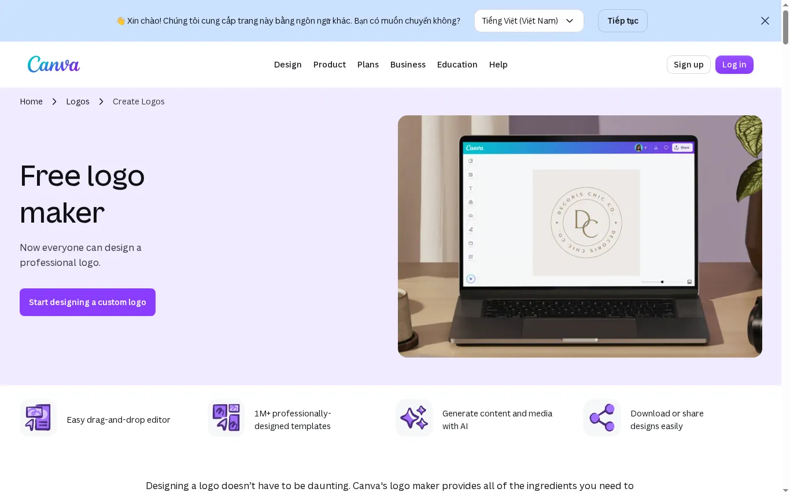
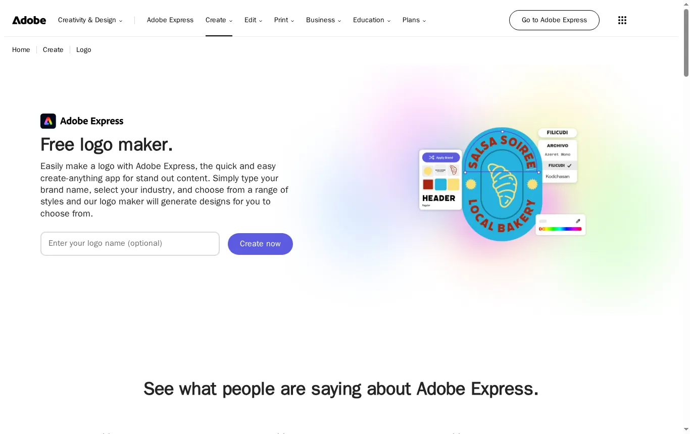
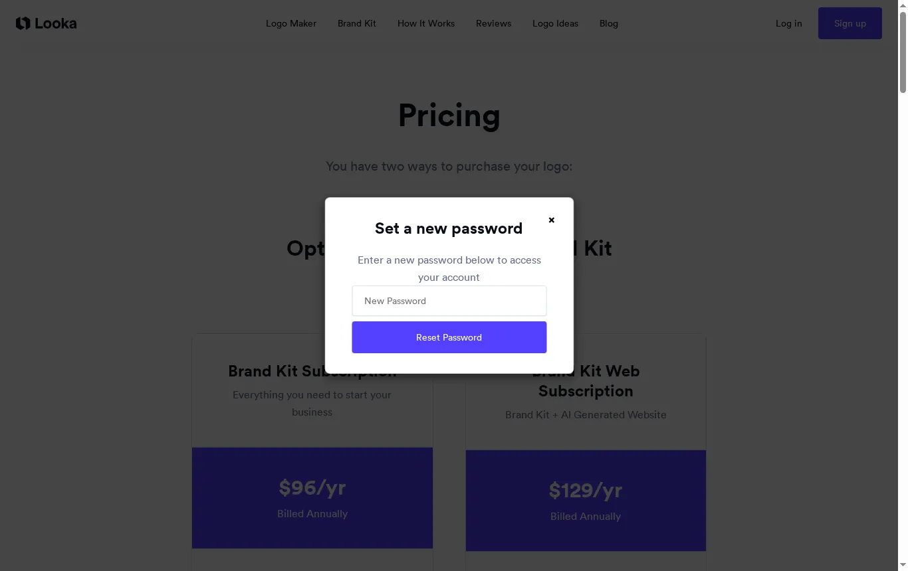

> Thuộc chuyên đề: [Top công cụ AI tạo và chỉnh sửa ảnh](top-cong-cu-ai-chinh-sua-anh.md) · Bài viết của [KimQ Tech](https://kimq.tech)

Một cửa hàng mới mở, một kênh TikTok, một dự án khởi nghiệp đều cần logo. Thuê nhà thiết kế mất vài triệu đến vài chục triệu đồng và vài tuần. Các công cụ **tạo logo bằng AI** cho bạn hàng chục phương án trong vài phút, phần lớn miễn phí ở bước thử.

Nhưng logo AI cũng có bẫy: file độ phân giải thấp, trùng ý tưởng với logo khác, khó đăng ký nhãn hiệu. Bài này so sánh 4 công cụ phổ biến và đưa ra **quy trình 6 bước** để có logo dùng được lâu dài. Thông tin lấy từ trang chính thức ngày **25/11/2026**.

## Tóm tắt nhanh

| | Gemini (Nano Banana) | Canva | Adobe Express | Looka |
|---|---|---|---|---|
| Cách tạo | Mô tả bằng lời, AI vẽ hình | Mẫu logo có sẵn + công cụ AI | Nhập tên, chọn ngành, chọn kiểu | Nhập tên, chọn màu, biểu tượng |
| Miễn phí? | Có, giới hạn lượt | Có, nhiều mẫu miễn phí | Có, tải PNG, JPG miễn phí | Tạo miễn phí, trả tiền khi tải |
| File vector (SVG, EPS) | Không, chỉ ảnh | Có với gói trả phí | Tuỳ gói | Gói Premium $72 |
| Logo động | Không | Có | Có, xuất MP4 | Không |
| Hợp với | Tìm ý tưởng, phác thảo | Shop nhỏ, bộ nhận diện đơn giản | Logo nhanh, có font đẹp | Muốn trọn bộ nhận diện thương hiệu |

**Gợi ý:** dùng **Gemini** để tìm ý tưởng, rồi dựng logo chính thức trên **Canva** hoặc **Adobe Express** để có chữ chuẩn và file sạch. Nếu cần cả danh thiếp, mẫu bài đăng, chữ ký email theo cùng bộ nhận diện, cân nhắc **Looka**.

## Logo AI khác ảnh AI thế nào

Logo không phải tranh minh hoạ. Một logo tốt cần:

- **Đơn giản**: nhận ra được khi thu nhỏ còn 16 pixel trên tab trình duyệt.
- **Ít màu**: in được trên áo, hộp giấy, con dấu, kể cả bản đen trắng.
- **Dạng vector**: phóng to bao nhiêu cũng không vỡ, để in biển hiệu.
- **Không trùng** với logo đã đăng ký của người khác.

Các mô hình tạo ảnh như Gemini cho ra **ảnh điểm (PNG, JPG)** đẹp nhưng nhiều chi tiết, khó in và không phải vector. Công cụ chuyên làm logo như Looka, Adobe Express, Canva tạo logo từ **biểu tượng và phông chữ có sẵn**, nên file sạch hơn và chữ luôn đúng.

## 1. Gemini: tìm ý tưởng logo bằng câu lệnh

Trang giới thiệu của Gemini nêu rõ Nano Banana tạo được **logo, thiệp mời, poster với chữ rõ, nhiều ngôn ngữ**. Điểm mạnh là bạn mô tả ý tưởng bằng tiếng Việt và thử nhiều hướng rất nhanh.

Mẫu câu lệnh:

- "Thiết kế logo tối giản cho tiệm cà phê tên 'Mộc', biểu tượng hạt cà phê kết hợp chiếc lá, nét đơn, 2 màu nâu và kem, nền trắng, phong cách phẳng."
- "Logo chữ lồng 'KQ' cho công ty công nghệ, hình học, đường nét mảnh, màu xanh navy, nền trắng, không có chi tiết thừa."
- "Đưa ra 6 hướng logo khác nhau cho thương hiệu trà sữa 'Mây', mỗi hướng một phong cách: tối giản, cổ điển, dễ thương, hiện đại, chữ viết tay, biểu tượng linh vật."

Hạn chế: ảnh từ Gemini có **thuỷ vân**, không phải vector, và chữ đôi khi sai dấu. Hãy coi đây là **bản phác thảo**, không phải logo cuối cùng. Xem thêm [AI tạo hình ảnh](ai-tao-hinh-anh.md) và [35 câu lệnh tạo ảnh trên Gemini](cau-lenh-tao-anh-ghep-anh-gemini.md).

## 2. Canva: mẫu logo và công cụ AI

*Ảnh chụp màn hình: Trang tạo logo của Canva. Nguồn: [canva.com](https://www.canva.com/create/logos/), chụp ngày 25/11/2026.*

Canva có thư viện lớn mẫu logo, giao diện tiếng Việt, kéo thả dễ. Bạn chọn mẫu gần ý tưởng nhất, đổi tên, màu, biểu tượng, phông chữ. Các tính năng AI của Canva (tạo hình từ mô tả, xoá nền, đổi màu) giúp tạo biểu tượng riêng thay vì dùng biểu tượng chung.

Lưu ý khi dùng mẫu Canva cho logo: mẫu có sẵn được nhiều người dùng, nên **không thể đăng ký độc quyền** một logo chỉ đổi tên từ mẫu. Hãy thay biểu tượng và bố cục đủ khác biệt.

## 3. Adobe Express: logo miễn phí, có phông chữ Adobe

*Ảnh chụp màn hình: Trang tạo logo miễn phí của Adobe Express. Nguồn: [adobe.com](https://www.adobe.com/express/create/logo), chụp ngày 25/11/2026.*

Theo Adobe, cách làm gồm 3 bước:

1. Nhập tên thương hiệu, chọn ngành và phong cách.
2. Chọn biểu tượng miễn phí, công cụ tạo ra nhiều phương án.
3. Tuỳ chỉnh trong trình chỉnh sửa, **tải logo miễn phí** dạng PNG, JPG chất lượng cao.

Điểm cộng: kho **phông chữ Adobe Fonts** với gợi ý phông hợp dự án, và có thể **làm logo động**, xuất MP4 để dùng cho đầu video. Logo lưu vào **Brand Kit** để áp dụng cho các thiết kế sau. Một số mẫu và tài nguyên được đánh dấu Premium, cần gói trả phí.

## 4. Looka: logo kèm cả bộ nhận diện thương hiệu

*Ảnh chụp màn hình: Bảng giá Looka. Nguồn: [looka.com](https://looka.com/pricing/), chụp ngày 25/11/2026.*

Looka cho tạo logo miễn phí, **chỉ trả tiền khi tải về**:

| Gói | Giá | Nhận được |
|---|---|---|
| Basic Logo Package | $35, một lần | Một file PNG độ phân giải thấp |
| Premium Logo Package | $72, một lần | PNG, EPS, SVG, PDF độ phân giải cao, nhiều biến thể màu, nền trong suốt, sửa không giới hạn, sở hữu toàn bộ |
| Brand Kit Subscription | $96/năm | Logo + hơn 300 mẫu: danh thiếp, bài đăng mạng xã hội, chữ ký email, tiêu đề thư, hoá đơn, hướng dẫn thương hiệu |
| Brand Kit Web Subscription | $129/năm | Như trên + website tạo bằng AI |

Looka ghi bạn **sở hữu logo kể cả khi hết hạn gói**. Nếu cần file vector để in ấn, gói Basic $35 là không đủ; nên chọn Premium.

## Quy trình 6 bước tạo logo bằng AI dùng được lâu dài

1. **Viết brief một đoạn**: tên, ngành, khách hàng, 3 tính từ mô tả thương hiệu (ví dụ "gần gũi, sạch, tự nhiên"), màu nên và không nên dùng.
2. **Tìm ý tưởng bằng Gemini hoặc ChatGPT**: tạo 20–30 phương án, chọn 3 hướng.
3. **Dựng logo chính thức** trên Canva, Adobe Express hoặc Looka, dùng phông chữ có giấy phép thương mại.
4. **Kiểm tra**: thu nhỏ còn 32 pixel, in đen trắng, đặt trên nền tối, xem còn rõ không.
5. **Xuất đủ file**: SVG hoặc EPS (vector), PNG nền trong suốt, bản ngang và bản vuông, bản một màu.
6. **Tra cứu và đăng ký nhãn hiệu** tại [Cục Sở hữu trí tuệ](https://ipvietnam.gov.vn/) trước khi in biển hiệu, bao bì số lượng lớn.

Nếu ý tưởng từ AI đẹp nhưng chỉ có file PNG, bạn có thể thuê người vẽ lại dạng vector, chi phí thấp hơn nhiều so với thiết kế từ đầu.

## Bản quyền và nhãn hiệu: điều cần biết

- **Tra cứu trùng lặp trước.** AI học từ hàng triệu hình ảnh, nên logo AI có thể giống logo đã có. Tra trên cơ sở dữ liệu nhãn hiệu của Cục Sở hữu trí tuệ và tìm kiếm hình ảnh ngược.
- **Quyền tác giả với hình do AI tự tạo hoàn toàn chưa rõ ràng** ở nhiều nước. Logo có người chỉnh sửa, sáng tạo đáng kể sẽ an toàn hơn.
- **Đăng ký nhãn hiệu** mới là cách bảo vệ logo trong kinh doanh. Không có đăng ký, người khác dùng logo tương tự, bạn khó khiếu nại.
- **Không yêu cầu AI bắt chước logo thương hiệu khác** ("logo giống Starbucks"), dễ bị coi là xâm phạm nhãn hiệu.
- **Đọc điều khoản công cụ**: mẫu có sẵn của Canva, Adobe Express có giới hạn khi dùng làm nhãn hiệu.

## Câu hỏi thường gặp

**Tạo logo bằng AI miễn phí ở đâu?**
Gemini (ý tưởng), Canva và Adobe Express (tải PNG miễn phí). Looka cho tạo miễn phí nhưng trả tiền khi tải.

**Logo AI có dùng thương mại được không?**
Được với các công cụ cho phép trong điều khoản. Nhưng muốn độc quyền, bạn cần logo khác biệt đủ để đăng ký nhãn hiệu.

**Vì sao logo AI bị vỡ khi in biển hiệu?**
Vì file là ảnh điểm (PNG, JPG). In khổ lớn cần file vector (SVG, EPS, PDF).

**Logo có chữ tiếng Việt bị sai dấu thì làm sao?**
Tạo phần biểu tượng bằng AI, phần chữ gõ lại bằng phông có hỗ trợ tiếng Việt trên Canva hoặc Adobe Express.

**Nên dùng logo AI hay thuê nhà thiết kế?**
Giai đoạn thử nghiệm, logo AI là đủ. Khi thương hiệu bắt đầu có doanh thu ổn định, nên thuê thiết kế bộ nhận diện chuyên nghiệp và đăng ký nhãn hiệu.

## Thương hiệu xong, tiếp theo là nội dung

Có logo rồi, bạn cần ảnh và video để quảng bá. Xem [Làm slide bằng AI](lam-slide-bang-ai.md) cho hồ sơ năng lực, hoặc dùng [AI Studio của KimQ Tech](https://kimq.tech/san-pham/ai-studio) để tạo ảnh, video sản phẩm theo đúng bộ nhận diện.

---

> Bài viết có sử dụng AI hỗ trợ soạn thảo. Nội dung và số liệu được đối chiếu với nguồn chính thức ngày 25/11/2026; ảnh là ảnh chụp màn hình trang chính thức, có ghi nguồn và ngày chụp.

## Về KimQ Tech

[KimQ Tech](https://kimq.tech) xây giải pháp AI và tự động hoá vận hành cho doanh nghiệp Việt: [AI Studio](https://kimq.tech/san-pham/ai-studio), [AI Gateway](https://kimq.tech/san-pham/ai-gateway), [Trợ lý AI trên Zalo](https://kimq.tech/san-pham/tro-ly-zalo), [Chatbot đa kênh](https://kimq.tech/san-pham/chatbot-da-kenh), [Tự động hoá](https://kimq.tech/san-pham/tu-dong-hoa). Cần tư vấn? [Liên hệ KimQ Tech](https://kimq.tech/lien-he) hoặc email contact@kimq.tech.

---

*Thông tin kiểm tra trên trang chính thức Google Gemini, Canva, Adobe và Looka ngày 25/11/2026 và có thể thay đổi. KimQ Tech không phải đại lý của Google, Canva, Adobe hay Looka. Bài viết không phải tư vấn pháp lý.*
