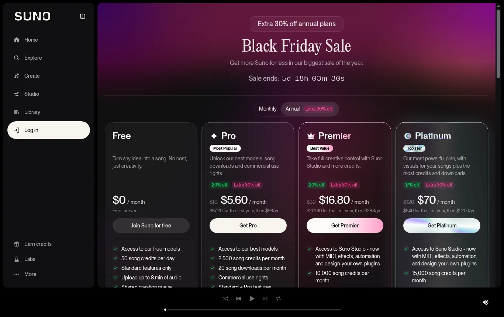
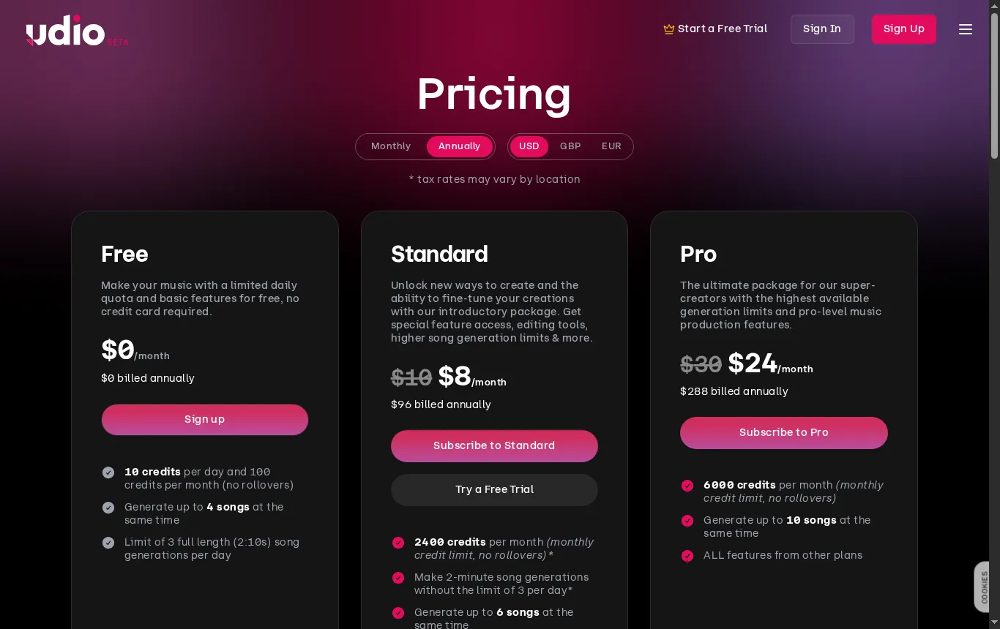
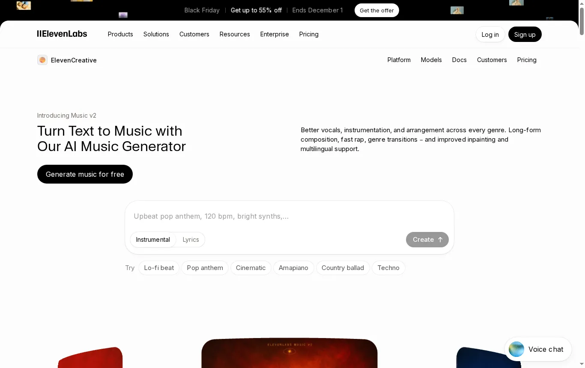

> Thuộc chuyên đề: [Top 10 công cụ tạo video AI 2026](top-cong-cu-tao-video-ai.md) · Bài viết của [KimQ Tech](https://kimq.tech)

Gõ một câu mô tả như "nhạc pop vui tươi, giọng nữ, về quán cà phê buổi sáng" và nhận về một bài hát hoàn chỉnh có lời, có hoà âm sau chưa đầy một phút. Đó là cách các công cụ tạo nhạc bằng AI như **Suno**, **Udio** và **ElevenMusic** đang hoạt động. Phần dễ là bấm nút tạo; phần khó là hiểu gói miễn phí có tải được file không, ai sở hữu bài hát và có được dùng làm nhạc nền quảng cáo hay không.

Bảng giá và điều khoản trong bài lấy từ trang chính thức của từng dịch vụ ngày **25/11/2026**.

## Tóm tắt nhanh

| | Suno | Udio | ElevenMusic (ElevenLabs) |
|---|---|---|---|
| Gói miễn phí | 50 credit/ngày (khoảng 10 bài) | 10 credit/ngày, tối đa 100/tháng | Có, giới hạn lượt tải |
| Tải file về máy | Gói miễn phí: không; Pro: 20 bài/tháng | **Đang tắt tải** audio, video, stem | Free: 5 bản lossless/ngày (trong app ElevenMusic) |
| Dùng thương mại | Chỉ gói trả phí | Xem điều khoản; hiện không tải được | Free: được nếu ghi nguồn ElevenMusic; trừ phim, TV, radio |
| Gói trả phí rẻ nhất | Pro $10/tháng | Standard $10/tháng ($8 nếu trả năm) | Starter $6/tháng ($5 nếu trả năm) |
| Hợp với | Làm bài hát có lời, nhiều thể loại | Nghe thử, sáng tác trong nền tảng | Nhạc nền cho video, podcast, nội dung có nhãn hiệu |

Nếu cần nhạc nền tải về để ghép vào video ngay hôm nay, Suno gói Pro và ElevenMusic là hai lựa chọn thực tế. Udio vẫn tạo nhạc được nhưng không cho tải file.

## Suno: phổ biến nhất, tạo bài hát có lời

Suno là công cụ tạo nhạc bằng AI được dùng nhiều nhất. Bạn mô tả thể loại, tâm trạng, hoặc tự dán lời bài hát, Suno trả về bài hát hoàn chỉnh gồm giọng hát và nhạc đệm. Theo trang hỗ trợ của Suno, mỗi lần bấm tạo cho ra **2 bài**, tốn tổng **10 credit**.

*Ảnh chụp màn hình: Bảng giá các gói Suno. Nguồn: [suno.com](https://suno.com/pricing), chụp ngày 25/11/2026.*

Các gói lúc kiểm tra (giá gốc theo tháng; Suno đang giảm giá Black Friday cho gói năm):

| Gói | Giá | Credit | Tải bài | Quyền thương mại |
|---|---|---|---|---|
| Free | $0 | 50 credit/ngày | Không có lượt tải hằng tháng | Không |
| Pro | $10/tháng | 2.500 credit/tháng | 20 bài/tháng | Có |
| Premier | $30/tháng | 10.000 credit/tháng | 60 bài/tháng | Có, thêm Suno Studio |
| Platinum | $120/tháng | 15.000 credit nhạc + 20.000 credit hình | 120 bài/tháng | Có |

Một số điểm cần biết trước khi trả tiền:

- **Credit không cộng dồn.** Credit trong gói hết hạn theo ngày (Free) hoặc theo tháng (trả phí). Credit mua thêm không hết hạn nhưng chỉ dùng được khi còn thuê bao.
- **Hết credit tháng vẫn còn 50 credit/ngày** cho gói trả phí, theo trang hỗ trợ của Suno.
- **Gói Pro trở lên** cho tách stem (giọng, trống, bass riêng), thu giọng của chính bạn để tạo bài, và chạy tối đa 10 bài cùng lúc.

### Ai sở hữu bài hát tạo bằng Suno?

Trang hỗ trợ của Suno phân biệt rõ **quyền sở hữu** và **bản quyền**:

- Bài tạo bằng **gói miễn phí**: Suno là chủ sở hữu, bạn chỉ được dùng cho mục đích phi thương mại.
- Bài tạo khi đang dùng **Pro hoặc Premier**: bạn là chủ sở hữu.
- Dù thuộc gói nào, bài hát tạo hoàn toàn bằng AI **có thể không được bảo hộ bản quyền**. Theo luật Mỹ, viết câu lệnh không được xem là sáng tác. Nếu bạn tự viết lời, phần lời đó là của bạn.

Hệ quả thực tế: bài tạo lúc dùng gói Free **không được dùng cho quảng cáo, kênh kiếm tiền**, kể cả khi sau này bạn nâng cấp lên Pro.

## Udio: tạo nhạc tốt nhưng đang không cho tải file

Udio cũng tạo bài hát từ mô tả hoặc lời bài hát, có công cụ chỉnh sửa và kéo dài bài. Điểm khác lớn nhất lúc này: sau khi ký hợp tác với Universal Music Group ngày 29/10/2025, Udio **tắt chức năng tải audio, video và stem**, theo [trang hỗ trợ của Udio](https://help.udio.com/en/articles/12683565). Bạn nghe và chia sẻ trong nền tảng, nhưng không lấy file về ghép video được.

*Ảnh chụp màn hình: Bảng giá các gói Udio. Nguồn: [udio.com](https://www.udio.com/pricing), chụp ngày 25/11/2026.*

| Gói | Giá tháng | Giá khi trả năm | Credit |
|---|---|---|---|
| Free | $0 | $0 | 10 credit/ngày, 100/tháng; tối đa 3 bài dài 2 phút 10 giây mỗi ngày |
| Standard | $10 | $8/tháng | 2.400 credit/tháng |
| Pro | $30 | $24/tháng | 6.000 credit/tháng |

Với người làm video cần file nhạc, Udio hiện chưa phải lựa chọn phù hợp. Nên theo dõi trang hỗ trợ của Udio vì chính sách tải có thể thay đổi.

## ElevenMusic: nhạc nền cho video, điều khoản rõ ràng

ElevenLabs, công ty nổi tiếng với giọng đọc AI, có mô hình tạo nhạc riêng. Có hai cách dùng, và điều khoản hơi khác nhau:

- **App ElevenMusic**: theo [bài công bố Music v2.5](https://elevenlabs.io/blog/music-v2-5-model), bạn sở hữu bài hát ở mọi gói. Gói Free được **5 lượt tải lossless mỗi ngày** và được dùng thương mại nếu ghi nguồn ElevenMusic. Bài tham chiếu bài hát của nghệ sĩ khác sẽ bị chặn tải.
- **Nền tảng ElevenLabs** (cùng tài khoản với giọng đọc): theo [Điều khoản âm nhạc](https://elevenlabs.io/music-terms), gói Free tạo được 11 phút nhạc mỗi tháng nhưng **không được tải**; từ gói Starter được tải 30 phút/tháng. Mọi gói tự phục vụ đều cấm dùng cho phim, truyền hình, radio và game thương mại lớn; đưa lên nền tảng nghe nhạc trực tuyến chỉ được từ gói Creator.

*Ảnh chụp màn hình: Trang giới thiệu tạo nhạc của ElevenLabs. Nguồn: [elevenlabs.io](https://elevenlabs.io/music), chụp ngày 25/11/2026.*

Ưu điểm của ElevenLabs với người làm video: một tài khoản có cả **giọng đọc AI** và **nhạc nền**, phù hợp quy trình làm video giới thiệu sản phẩm.

## Cách tạo nhạc bằng AI từng bước (áp dụng cho Suno)

1. **Đăng ký tài khoản** trên suno.com bằng Google hoặc email.
2. **Bấm Create**, chọn chế độ đơn giản (chỉ mô tả) hoặc tuỳ chỉnh (tự nhập lời và phong cách).
3. **Viết mô tả cụ thể**: thể loại, nhịp, nhạc cụ, giọng hát, tâm trạng. Ví dụ: "lo-fi chill, piano và guitar mộc, không lời, 80 BPM, cảm giác thư giãn buổi tối".
4. **Muốn nhạc nền không lời**, bật tuỳ chọn Instrumental để tránh giọng hát lấn lời thoại video.
5. **Tự viết lời tiếng Việt** nếu cần bài có lời. Viết câu ngắn, có vần; nghe lại để kiểm tra phát âm vì mô hình có thể đọc sai dấu.
6. **Nghe cả 2 bản**, chọn bản tốt hơn, dùng chức năng kéo dài hoặc chỉnh sửa nếu cần.
7. **Tải về** (cần gói trả phí) và ghép vào video.

## Mẹo viết mô tả để nhạc AI hay hơn

- **Nêu công dụng**: "nhạc nền video giới thiệu quán cà phê, 30 giây" giúp AI chọn độ dài và cường độ hợp lý.
- **Tránh tên nghệ sĩ, tên bài hát có thật.** Nhiều nền tảng chặn hoặc không cho tải các bài tham chiếu nghệ sĩ khác; dùng cũng dễ dính tranh chấp.
- **Mô tả cấu trúc**: "mở đầu nhẹ, điệp khúc mạnh ở giây 15" khi cần nhạc khớp nhịp cắt cảnh.
- **Tạo nhiều lần, giữ một phong cách**: lưu mô tả đã thành công để các video cùng thương hiệu có âm thanh thống nhất.

## Dùng nhạc AI cho kinh doanh: những điều cần kiểm tra

| Câu hỏi | Vì sao quan trọng |
|---|---|
| Tạo bài khi đang dùng gói nào? | Với Suno, bài tạo ở gói Free thuộc về Suno, chỉ dùng phi thương mại. |
| Điều khoản có cấm loại kênh bạn dùng không? | ElevenLabs cấm phim, TV, radio ở mọi gói tự phục vụ. |
| Có được đưa lên Spotify, YouTube Music? | ElevenLabs chỉ cho phép từ gói Creator; nền tảng phát hành có thể từ chối nhạc không được bảo hộ bản quyền. |
| Có phải ghi nguồn? | Gói Free của ElevenMusic yêu cầu ghi nguồn khi dùng thương mại. |
| Nền tảng đăng có yêu cầu gắn nhãn AI? | Nhiều nền tảng yêu cầu khai báo nội dung tạo bằng AI. |

Lưu lại ảnh chụp trang gói và điều khoản tại thời điểm tạo bài. Nếu sau này có tranh chấp, đó là bằng chứng bạn tạo bài khi đang có quyền thương mại.

## Đọc thêm trong chuyên đề

- [Giọng đọc AI tiếng Việt: so sánh Vbee, FPT.AI, Viettel AI, VClip](giong-doc-ai-tieng-viet.md): thêm lời thuyết minh cho video có nhạc nền AI.
- [Viggle AI là gì](viggle-ai-la-gi.md): làm clip nhân vật nhảy theo nhạc.
- [Top 10 công cụ tạo video AI](top-cong-cu-tao-video-ai.md).

Doanh nghiệp cần **video giới thiệu sản phẩm có nhạc nền, giọng đọc và phụ đề tiếng Việt làm sẵn** có thể xem [AI Studio của KimQ Tech](https://kimq.tech/san-pham/ai-studio).

## Câu hỏi thường gặp

**Tạo nhạc bằng AI miễn phí ở đâu?**
Suno cho 50 credit mỗi ngày (khoảng 10 bài), Udio cho 10 credit mỗi ngày, ElevenMusic có gói Free với 5 lượt tải mỗi ngày. Gói miễn phí của Suno không cho tải theo tháng và không có quyền thương mại.

**Nhạc AI có bản quyền không?**
Tuỳ quốc gia. Suno lưu ý bài hát tạo hoàn toàn bằng AI có thể không được bảo hộ bản quyền theo luật Mỹ, dù bạn là chủ sở hữu theo điều khoản. Phần lời do bạn tự viết vẫn là của bạn.

**Dùng nhạc Suno bản miễn phí làm nhạc nền TikTok bán hàng được không?**
Không nên. Bài tạo ở gói Free thuộc về Suno và chỉ được dùng phi thương mại. Video bán hàng là mục đích thương mại.

**Udio có tải nhạc về được không?**
Hiện không. Udio đã tắt tải audio, video và stem sau khi hợp tác với Universal Music Group.

**AI có hát được tiếng Việt không?**
Suno và Udio cho phép nhập lời tuỳ ý, kể cả tiếng Việt. Chất lượng phát âm thay đổi theo từng lần tạo; nên nghe kỹ các từ có dấu trước khi dùng.

---

> Bài viết có sử dụng AI hỗ trợ soạn thảo. Nội dung và số liệu được đối chiếu với nguồn chính thức ngày 25/11/2026; ảnh là ảnh chụp màn hình trang chính thức, có ghi nguồn và ngày chụp.

## Về KimQ Tech

[KimQ Tech](https://kimq.tech) xây giải pháp AI và tự động hoá vận hành cho doanh nghiệp Việt: [AI Studio](https://kimq.tech/san-pham/ai-studio), [AI Gateway](https://kimq.tech/san-pham/ai-gateway), [Trợ lý AI trên Zalo](https://kimq.tech/san-pham/tro-ly-zalo), [Chatbot đa kênh](https://kimq.tech/san-pham/chatbot-da-kenh), [Tự động hoá](https://kimq.tech/san-pham/tu-dong-hoa). Cần tư vấn? [Liên hệ KimQ Tech](https://kimq.tech/lien-he) hoặc email contact@kimq.tech.

---

*Thông tin kiểm tra trên trang chính thức của Suno, Udio và ElevenLabs ngày 25/11/2026 và có thể thay đổi. KimQ Tech không phải đại lý của các dịch vụ trong bài.*
