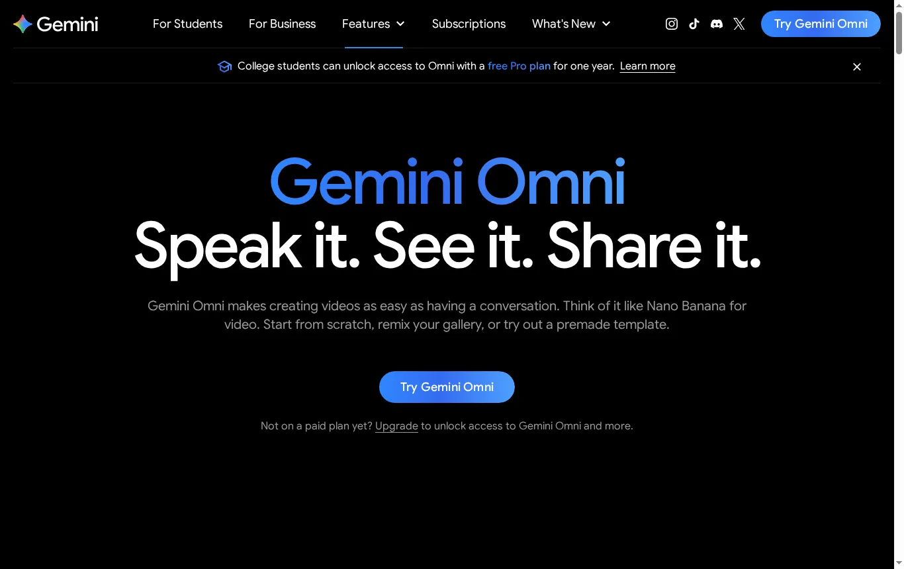
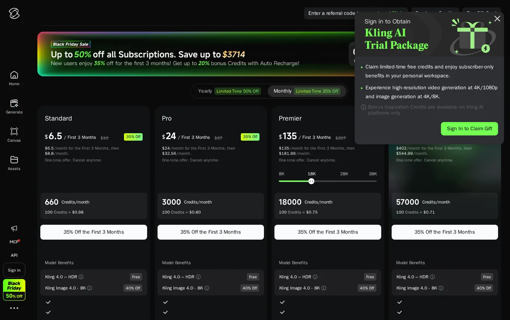
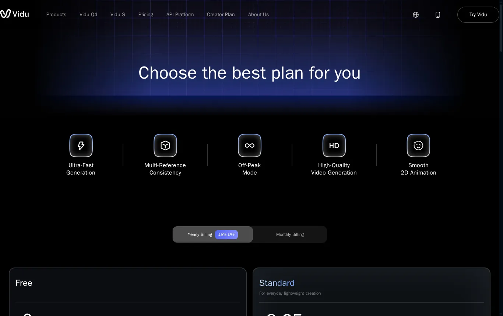

> Thuộc chuyên đề: [Top 10 công cụ tạo video AI 2026](top-cong-cu-tao-video-ai.md) · Bài viết của [KimQ Tech](https://kimq.tech)

Một tấm ảnh sản phẩm, ảnh chân dung hay ảnh phong cảnh có thể thành đoạn video 5–10 giây có chuyển động máy quay, gió thổi, người mỉm cười, chỉ bằng một câu mô tả. Đây là tính năng **tạo video từ ảnh** (image to video), có trên hầu hết công cụ video AI hiện nay, chạy trực tuyến trên trình duyệt, không cần cài phần mềm.

Bài này so sánh ba lựa chọn phổ biến (**Gemini**, **Kling**, **Vidu**), hướng dẫn từng bước, cách chọn ảnh và mẫu câu lệnh chuyển động. Giá và điều kiện lấy từ trang chính thức ngày **25/11/2026**.

## Tóm tắt nhanh

| | Gemini (Gemini Omni) | Kling AI | Vidu AI |
|---|---|---|---|
| Miễn phí? | Không, cần gói Google AI hoặc Workspace đủ điều kiện | Gói Basic $0, nhận credit theo chương trình | Gói Free $0, tặng credit khi đăng nhập |
| Số ảnh đầu vào | Tối đa 5 ảnh + 1 video | Ảnh đầu, có chế độ nhiều khung hình | Ảnh hoặc ảnh tham chiếu (Free: 10 tham chiếu/tháng) |
| Độ dài | 10 giây, kéo dài được | Đến 30 giây với Kling 4.0 (theo trang giá) | 3–16 giây ở gói trả phí |
| Dùng thương mại gói miễn phí | – | Không (chỉ gói trả phí) | Không ghi; gói trả phí ghi rõ được dùng |
| Gói trả phí rẻ nhất | Theo gói Google AI | Standard $10/tháng | Standard $10/tháng ($8,25 trả năm) |
| Hợp với | Người đã có gói Google AI, muốn sửa video bằng trò chuyện | Video sản phẩm, chuyển động phức tạp | Tạo nhiều, thử nhiều, hoạt hình 2D |

**Muốn miễn phí:** thử Kling và Vidu bằng credit tặng; kết quả có logo và độ phân giải thấp. **Muốn đăng bán hàng:** cần gói trả phí để bỏ logo và có quyền thương mại.

## Cách tạo video từ ảnh bằng Gemini

Gemini dùng mô hình **Gemini Omni**, thay cho Veo trong app Gemini. Theo [trang trợ giúp của Google](https://support.google.com/gemini/answer/16126339):

1. Vào gemini.google.com, mở thanh bên, chọn **Create video**.
2. (Tuỳ chọn) chọn một mẫu có sẵn.
3. Bấm **Add image** để tải ảnh lên (tối đa **5 ảnh** và 1 video).
4. Mô tả chuyển động mong muốn, bấm gửi. Video tạo mất vài phút.
5. Muốn sửa, gõ tiếp yêu cầu: đổi góc máy, thay nền, xoá vật thể.
6. Tải về bằng nút **Share → Download video**.

*Ảnh chụp màn hình: Trang giới thiệu Gemini Omni tạo video từ ảnh. Nguồn: [gemini.google](https://gemini.google/overview/video-generation/), chụp ngày 25/11/2026.*

Điều kiện: tài khoản cá nhân cần **gói Google AI**, tài khoản công việc cần giấy phép Workspace đủ điều kiện, và **người dùng phải từ 18 tuổi**. Video tạo trong app Gemini có dấu thuỷ vân ẩn **SynthID** để nhận biết nội dung AI. Sinh viên có thể xem [cách nhận gói Gemini cho sinh viên](gemini-cho-sinh-vien.md).

## Cách tạo video từ ảnh bằng Kling AI

Kling là công cụ video AI mạnh về chuyển động người và vật thể. Các bước cơ bản:

1. Đăng nhập kling.ai, vào **Generate → Video**, chọn chế độ **Image to Video**.
2. Tải ảnh lên làm khung hình đầu. Có thể thêm khung hình cuối để AI chuyển cảnh giữa hai ảnh.
3. Mô tả chuyển động, chọn độ dài và tỷ lệ khung hình (9:16 cho TikTok, Reels).
4. Bấm tạo, xem số credit bị trừ trước khi xác nhận.

*Ảnh chụp màn hình: Bảng giá các gói Kling AI. Nguồn: [kling.ai](https://kling.ai/app/membership/membership-plan), chụp ngày 25/11/2026.*

Theo trang giá Kling lúc kiểm tra: gói **Basic miễn phí** tạo 1 video mỗi lần, **không có quyền thương mại**, video có logo. Gói **Standard** $10/tháng (đang giảm còn $6,5 cho 3 tháng đầu) có 660 credit/tháng, bỏ logo, xuất 1080p/4K và **được dùng nội dung cho mục đích thương mại**. Chi tiết hơn trong bài [Kling AI: hướng dẫn và gói miễn phí](kling-ai.md).

## Cách tạo video từ ảnh bằng Vidu AI

Vidu của Shengshu có chế độ **Image to Video** và **Reference to Video** (giữ nhân vật, sản phẩm nhất quán từ nhiều ảnh tham chiếu).

1. Vào vidu.com, chọn **Image to Video**.
2. Tải ảnh, viết mô tả chuyển động, chọn mô hình và độ dài.
3. Bấm tạo; gói trả phí có chế độ giờ thấp điểm (off-peak) để tạo thêm video không tốn credit trong hạn mức.

*Ảnh chụp màn hình: Bảng giá các gói Vidu AI. Nguồn: [vidu.com](https://vidu.com/pricing), chụp ngày 25/11/2026.*

Theo [trang giá Vidu](https://vidu.com/pricing): gói **Free** dùng mô hình Q4 ở 540p (2 credit/giây), 10 ảnh tham chiếu/tháng, tặng credit khi đăng nhập. Gói **Standard** $10/tháng ($8,25 nếu trả năm) có 800 credit/tháng, tạo 4 video cùng lúc và ghi rõ **được dùng thương mại**. Xem thêm [Vidu AI: hướng dẫn](vidu-ai.md).

## Chọn ảnh thế nào để video đẹp?

| Nên | Tránh |
|---|---|
| Ảnh rõ nét, độ phân giải cao | Ảnh mờ, vỡ hạt (làm nét trước, xem [làm nét ảnh bằng AI](lam-net-anh-bang-ai.md)) |
| Chủ thể rõ ràng, nền gọn | Nhiều người chồng lên nhau, nền rối |
| Tỷ lệ ảnh trùng tỷ lệ video (9:16 cho TikTok) | Ảnh ngang rồi ép thành video dọc |
| Mặt người nhìn thẳng, đủ sáng | Mặt bị che, ngược sáng |
| Có khoảng trống quanh chủ thể nếu muốn máy quay lùi | Chủ thể sát mép ảnh (mở rộng trước, xem [mở rộng ảnh bằng AI](mo-rong-anh-bang-ai.md)) |

## Mẫu câu lệnh chuyển động

Mô tả **cái gì chuyển động** và **máy quay làm gì**. Câu lệnh tiếng Anh thường cho kết quả ổn định hơn, nhưng Gemini hiểu tốt tiếng Việt.

- **Sản phẩm**: "Máy quay tiến chậm vào chai nước hoa trên bàn đá, ánh nắng chiếu qua cửa sổ, hạt bụi lấp lánh, cảm giác sang trọng."
- **Chân dung**: "Người trong ảnh mỉm cười nhẹ, quay đầu sang phải, tóc khẽ bay trong gió, nền mờ."
- **Phong cảnh**: "Mây trôi chậm, mặt hồ gợn sóng, máy quay lia ngang từ trái sang phải."
- **Món ăn**: "Hơi nóng bốc lên từ bát phở, nước dùng sóng sánh, cận cảnh, ánh sáng ấm."
- **Ảnh cũ**: "Cảnh trong ảnh chuyển động nhẹ nhàng, giữ nguyên màu và chi tiết gốc, không thêm người."

Mẹo: viết **một hành động chính** cho mỗi đoạn 5–10 giây. Nhiều hành động trong một câu lệnh dễ làm hình biến dạng.

## Quyền dùng ảnh và nhãn nội dung AI

- **Chỉ dùng ảnh bạn có quyền.** Trang trợ giúp của Google nhắc rõ bạn phải có quyền với mọi ảnh tải lên. Ảnh người khác, ảnh lấy trên mạng có thể vi phạm quyền hình ảnh và bản quyền.
- **Không làm video giả người thật** để lừa đảo, bôi nhọ, hoặc giả người nổi tiếng quảng cáo sản phẩm.
- **Gắn nhãn nội dung AI** khi đăng lên TikTok, Facebook, YouTube nếu video trông giống thật.
- **Ảnh trẻ em**: hạn chế tối đa; nhiều công cụ chặn hoặc giới hạn.

## Đọc thêm trong chuyên đề

- [Viggle AI là gì](viggle-ai-la-gi.md): ghép nhân vật từ 1 tấm ảnh vào video nhảy, meme.
- [Higgsfield AI là gì](higgsfield-ai-la-gi.md): nhiều mô hình video trong một tài khoản.
- [Kling AI: hướng dẫn, gói miễn phí](kling-ai.md).
- [Top 10 công cụ tạo video AI](top-cong-cu-tao-video-ai.md).

Doanh nghiệp có **sẵn ảnh sản phẩm và muốn ra video dọc có giọng đọc tiếng Việt, phụ đề** có thể xem [AI Studio của KimQ Tech](https://kimq.tech/san-pham/ai-studio).

## Câu hỏi thường gặp

**Tạo video AI từ ảnh miễn phí ở đâu?**
Kling và Vidu có gói miễn phí với credit tặng, kết quả có logo và độ phân giải thấp hơn. Gemini cần gói Google AI trả phí.

**Tạo video từ ảnh online có cần cài app không?**
Không. Gemini, Kling, Vidu đều chạy trên trình duyệt; cả ba cũng có app điện thoại.

**Video từ ảnh bản miễn phí có đăng bán hàng được không?**
Không nên. Kling chỉ cho dùng thương mại ở gói trả phí; Vidu ghi quyền thương mại ở gói trả phí. Video miễn phí cũng có logo.

**Tạo video dài hơn 10 giây được không?**
Gemini cho kéo dài cảnh. Kling 4.0 tạo đến 30 giây theo trang giá; Vidu gói trả phí tạo 3–16 giây. Video dài hơn thường ghép nhiều đoạn.

**Có tạo video từ nhiều ảnh được không?**
Có. Gemini nhận tối đa 5 ảnh; Kling cho chọn khung đầu và khung cuối; Vidu có chế độ ảnh tham chiếu.

---

> Bài viết có sử dụng AI hỗ trợ soạn thảo. Nội dung và số liệu được đối chiếu với nguồn chính thức ngày 25/11/2026; ảnh là ảnh chụp màn hình trang chính thức, có ghi nguồn và ngày chụp.

## Về KimQ Tech

[KimQ Tech](https://kimq.tech) xây giải pháp AI và tự động hoá vận hành cho doanh nghiệp Việt: [AI Studio](https://kimq.tech/san-pham/ai-studio), [AI Gateway](https://kimq.tech/san-pham/ai-gateway), [Trợ lý AI trên Zalo](https://kimq.tech/san-pham/tro-ly-zalo), [Chatbot đa kênh](https://kimq.tech/san-pham/chatbot-da-kenh), [Tự động hoá](https://kimq.tech/san-pham/tu-dong-hoa). Cần tư vấn? [Liên hệ KimQ Tech](https://kimq.tech/lien-he) hoặc email contact@kimq.tech.

---

*Thông tin kiểm tra trên trang chính thức của Google, Kling và Vidu ngày 25/11/2026 và có thể thay đổi. KimQ Tech không phải đại lý của các dịch vụ trong bài.*
