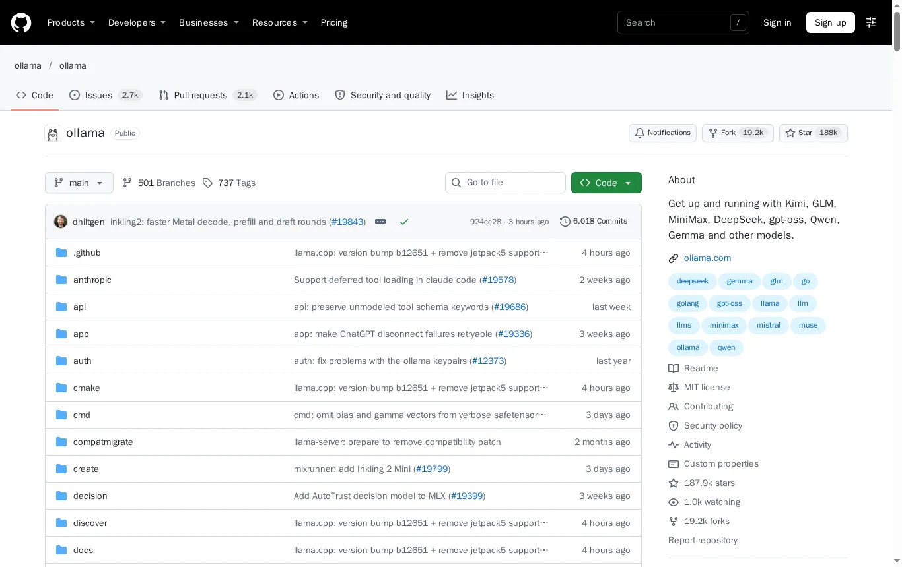
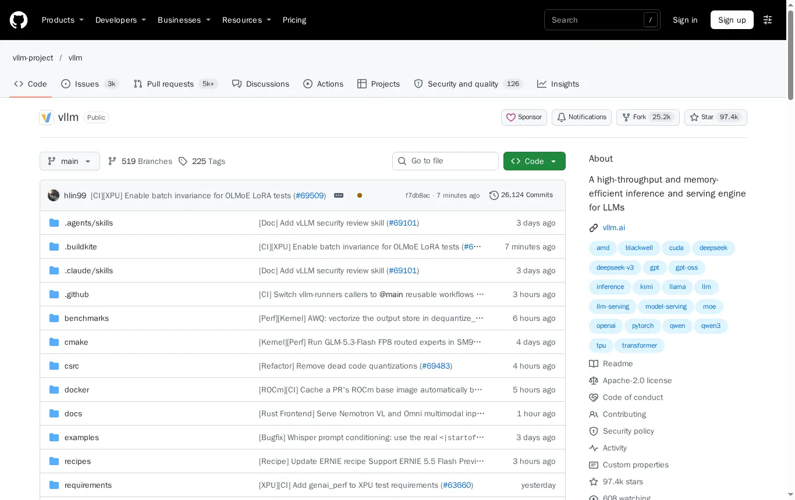
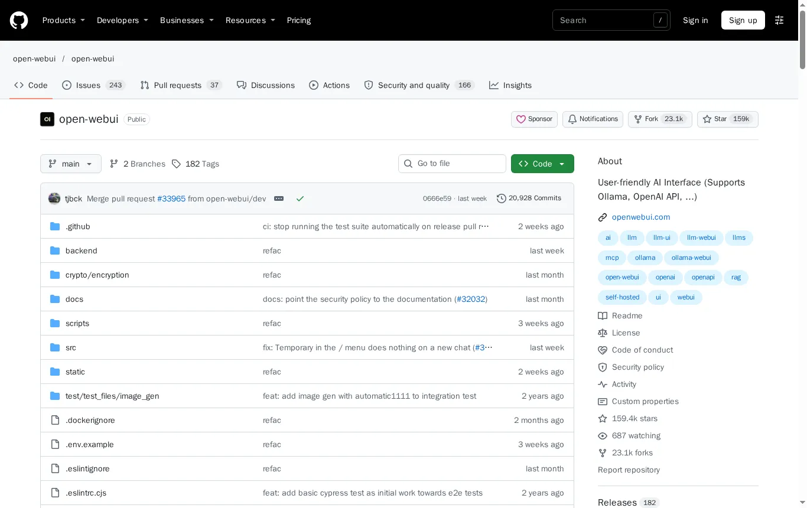

> Thuộc chuyên đề: [Hướng dẫn chọn phần mềm mã nguồn mở cho doanh nghiệp](huong-dan-chon-phan-mem-ma-nguon-mo-cho-doanh-nghiep.md) · Bài viết của [KimQ Tech](https://kimq.tech)

Nhiều doanh nghiệp muốn dùng AI nhưng không muốn gửi hợp đồng, bảng lương hay dữ liệu khách hàng tới máy chủ nước ngoài. Cách làm phổ biến là **tự chạy mô hình ngôn ngữ (LLM) mã nguồn mở** như Qwen, Llama, Gemma, DeepSeek ngay trên máy chủ của công ty.

Bài này tổng hợp **7 repo GitHub đáng chú ý nhất để chạy LLM nội bộ**, chia theo hai nhóm: **công cụ chạy mô hình** (phần "động cơ") và **giao diện chat** (phần người dùng nhìn thấy). Số liệu lấy ngày **20/11/2026**.

## Tóm tắt nhanh

| # | Repo | Sao GitHub | Ngôn ngữ | Giấy phép | Hợp nhất với |
|---|---|---|---|---|---|
| 1 | [ollama/ollama](https://github.com/ollama/ollama) | ~187,7 nghìn | Go | MIT | Chạy thử nhanh trên một máy, một lệnh là xong |
| 2 | [ggml-org/llama.cpp](https://github.com/ggml-org/llama.cpp) | ~135,8 nghìn | C++ | MIT | Máy yếu, chỉ có CPU, laptop, máy Mac |
| 3 | [vllm-project/vllm](https://github.com/vllm-project/vllm) | ~97,2 nghìn | Python | Apache 2.0 | Máy chủ GPU phục vụ nhiều người cùng lúc |
| 4 | [sgl-project/sglang](https://github.com/sgl-project/sglang) | ~38,9 nghìn | Python | Apache 2.0 | Tải lớn, cần tốc độ cao, nhiều lượt hỏi lặp lại |
| 5 | [mudler/LocalAI](https://github.com/mudler/LocalAI) | ~50,5 nghìn | Go | MIT | Một máy chủ thay API OpenAI cho cả chữ, ảnh, giọng nói |
| 6 | [open-webui/open-webui](https://github.com/open-webui/open-webui) | ~159,1 nghìn | Svelte | Giấy phép riêng (dựa trên BSD) | Giao diện chat nội bộ cho cả công ty |
| 7 | [janhq/jan](https://github.com/janhq/jan) | ~45,9 nghìn | Rust, TypeScript | Apache 2.0 | Ứng dụng chat chạy offline trên máy cá nhân |

*Số sao làm tròn, lấy từ GitHub API ngày 20/11/2026. Số sao cho biết mức độ quan tâm, không phải chất lượng.*

## Chúng tôi chọn thế nào

- **Còn được bảo trì:** có commit trong tháng 11/2026.
- **Chạy được hoàn toàn trên hạ tầng của mình:** không bắt buộc gửi dữ liệu ra dịch vụ bên ngoài.
- **Có API tương thích OpenAI** (hoặc giao diện dùng được ngay), để phần mềm sẵn có kết nối vào dễ dàng.
- **Giấy phép rõ ràng** cho dùng trong doanh nghiệp; điều kiện riêng được ghi rõ.

## Hiểu nhanh: "động cơ" và "giao diện"

- **Động cơ** (Ollama, llama.cpp, vLLM, SGLang, LocalAI) tải mô hình vào bộ nhớ và trả lời qua API. Người dùng cuối không thấy phần này.
- **Giao diện** (Open WebUI, Jan) là màn hình chat, quản lý người dùng, lịch sử hội thoại. Giao diện gọi tới động cơ.

Một hệ thống nội bộ hoàn chỉnh thường là **một động cơ + một giao diện**, ví dụ vLLM + Open WebUI.

## 1. Ollama: cách dễ nhất để bắt đầu

**Ollama** cho phép tải và chạy mô hình bằng một lệnh, ví dụ `ollama run qwen3`. Có sẵn kho mô hình đã đóng gói, chạy trên Windows, macOS, Linux và có API tương thích OpenAI.

*Ảnh chụp màn hình: Repo Ollama trên GitHub. Nguồn: [github.com](https://github.com/ollama/ollama), chụp ngày 24/11/2026.*

- **Điểm mạnh:** cài đặt đơn giản nhất; hợp để thử nghiệm và cho nhóm nhỏ.
- **Điểm cần cân nhắc:** khi nhiều người hỏi cùng lúc trên GPU, vLLM hoặc SGLang thường phục vụ được nhiều yêu cầu hơn.
- **Giấy phép:** MIT.

## 2. llama.cpp: chạy được trên máy yếu

**llama.cpp** là thư viện C/C++ chạy LLM hiệu quả trên CPU, máy Mac (Apple Silicon) và GPU phổ thông. Định dạng mô hình GGUF và kỹ thuật lượng tử hoá (nén mô hình xuống 4–8 bit) giúp mô hình lớn chạy được trên máy ít bộ nhớ. Nhiều công cụ khác, kể cả Ollama, dựa trên llama.cpp.

- **Hợp với:** văn phòng không có GPU, máy trạm cá nhân, thiết bị biên.
- **Có sẵn:** `llama-server` cung cấp API tương thích OpenAI.
- **Giấy phép:** MIT.

## 3. vLLM: phục vụ nhiều người trên GPU

**vLLM** là động cơ phục vụ LLM thông lượng cao, quản lý bộ nhớ GPU tốt để xử lý nhiều yêu cầu song song. Đây là lựa chọn phổ biến khi đưa LLM nội bộ vào chạy thật cho cả công ty.

*Ảnh chụp màn hình: Repo vLLM trên GitHub. Nguồn: [github.com](https://github.com/vllm-project/vllm), chụp ngày 24/11/2026.*

- **Điểm mạnh:** nhanh khi nhiều người dùng; hỗ trợ nhiều dòng mô hình; API tương thích OpenAI.
- **Điểm cần cân nhắc:** cần GPU và người có kinh nghiệm vận hành máy chủ.
- **Giấy phép:** Apache 2.0.

## 4. SGLang: tối ưu cho tải lớn

**SGLang** cũng là động cơ phục vụ hiệu năng cao cho LLM và mô hình đa phương thức. Điểm riêng của SGLang là tái sử dụng phần đã tính toán khi nhiều câu hỏi có cùng phần đầu (ví dụ cùng một lời nhắc hệ thống dài), giúp giảm thời gian chờ.

- **Hợp với:** chatbot nội bộ có lời nhắc hệ thống dài, agent gọi mô hình nhiều lần.
- **Giấy phép:** Apache 2.0.

## 5. LocalAI: một máy chủ thay nhiều API

**LocalAI** đóng vai trò "API OpenAI tự chạy": cùng một điểm truy cập cho sinh văn bản, nhận dạng giọng nói, tạo ảnh, tạo embedding. Bên trong dùng nhiều động cơ khác nhau, có thể chạy chỉ bằng CPU.

- **Hợp với:** phần mềm đang gọi API OpenAI, muốn chuyển về chạy nội bộ mà sửa ít code.
- **Giấy phép:** MIT.

## 6. Open WebUI: giao diện chat cho cả công ty

**Open WebUI** là giao diện web giống ChatGPT, kết nối được với Ollama hoặc bất kỳ API tương thích OpenAI nào. Có đăng nhập, phân quyền người dùng, nạp tài liệu để hỏi đáp (RAG), lịch sử hội thoại.

*Ảnh chụp màn hình: Repo Open WebUI trên GitHub. Nguồn: [github.com](https://github.com/open-webui/open-webui), chụp ngày 24/11/2026.*

- **Điểm mạnh:** dựng trợ lý nội bộ nhanh mà không cần viết giao diện.
- **Lưu ý giấy phép:** Open WebUI dùng **giấy phép riêng dựa trên BSD-3** có thêm điều khoản giữ thương hiệu: nếu triển khai cho **hơn 50 người dùng trong 30 ngày**, không được gỡ hoặc thay logo "Open WebUI" khi chưa có giấy phép doanh nghiệp. Dùng nội bộ, giữ nguyên thương hiệu thì thường không vướng.

## 7. Jan: chat offline trên máy cá nhân

**Jan** là ứng dụng máy tính (Windows, macOS, Linux) thay thế ChatGPT, chạy mô hình **100% offline** trên máy người dùng. Có thể bật API cục bộ để phần mềm khác gọi vào.

- **Hợp với:** cá nhân hoặc bộ phận cần xử lý tài liệu nhạy cảm trên máy riêng, không qua mạng.
- **Giấy phép:** Apache 2.0 (GitHub API không tự nhận diện được; xem tệp LICENSE gốc).

## Đáng chú ý khác

- [lobehub/lobehub](https://github.com/lobehub/lobehub) (~85,9 nghìn sao, TypeScript): giao diện chat và agent cho nhóm, kết nối nhiều nhà cung cấp mô hình, kể cả Ollama. Dùng **LobeHub Community License** (dựa trên Apache 2.0, có điều kiện riêng khi dùng thương mại hoặc làm sản phẩm phái sinh), nên đọc kỹ trước khi đưa vào sản phẩm bán cho khách.

## Nên chọn cái nào?

| Tình huống | Gợi ý |
|---|---|
| Thử nghiệm trên một máy, chưa có kinh nghiệm | Ollama + Open WebUI |
| Không có GPU, chỉ có CPU hoặc máy Mac | llama.cpp (hoặc Ollama) |
| Phục vụ cả công ty trên máy chủ GPU | vLLM hoặc SGLang + Open WebUI |
| Phần mềm đang gọi API OpenAI, muốn chuyển về nội bộ | LocalAI, vLLM |
| Nhân viên xử lý tài liệu nhạy cảm trên máy riêng | Jan |

## Phần cứng cần bao nhiêu?

Con số dưới đây là **ước lượng thô** cho mô hình đã lượng tử hoá 4 bit, chỉ để hình dung:

| Cỡ mô hình | Bộ nhớ cần (xấp xỉ) | Thiết bị tham khảo |
|---|---|---|
| 3–8 tỷ tham số | 4–8 GB | Laptop, máy Mac 16 GB, GPU phổ thông |
| 14–32 tỷ tham số | 10–24 GB | GPU 24 GB, máy Mac 32–64 GB |
| 70 tỷ tham số trở lên | 40 GB trở lên | Nhiều GPU hoặc GPU máy chủ |

Ngoài trọng số mô hình, cần thêm bộ nhớ cho ngữ cảnh dài và số người dùng đồng thời. Hãy chạy thử với dữ liệu thật trước khi mua phần cứng.

## 5 điều cần làm trước khi đưa LLM nội bộ vào dùng

1. **Chọn mô hình theo giấy phép:** mỗi mô hình (Llama, Qwen, Gemma…) có giấy phép riêng, khác với giấy phép của công cụ chạy nó.
2. **Đánh giá trên tiếng Việt:** thử bằng câu hỏi và tài liệu thật của công ty, không chỉ dựa vào bảng xếp hạng.
3. **Không mở API ra Internet** khi chưa có xác thực; nhiều công cụ mặc định không đặt mật khẩu.
4. **Phân quyền tài liệu:** trợ lý không được trả lời bằng tài liệu mà người hỏi không có quyền xem.
5. **Kết hợp nội bộ và đám mây:** việc nhạy cảm chạy nội bộ, việc cần mô hình mạnh hơn gọi API có che dữ liệu.

Điểm 5 là lý do nhiều doanh nghiệp đặt một **AI Gateway** đứng trước cả mô hình nội bộ lẫn mô hình đám mây: một cửa duy nhất để định tuyến, che dữ liệu nhạy cảm và theo dõi chi phí. Xem [KimQ AI Gateway](https://kimq.tech/san-pham/ai-gateway) và bài [Top 7 AI Gateway mã nguồn mở](top-7-ai-gateway-ma-nguon-mo.md). Nếu muốn xây agent trên mô hình nội bộ, xem [Top 10 framework AI Agent mã nguồn mở](top-10-framework-ai-agent-ma-nguon-mo.md).

## Câu hỏi thường gặp

**Chạy LLM nội bộ có rẻ hơn gọi API không?**
Tuỳ khối lượng. Ít người dùng thì gọi API thường rẻ hơn vì không phải mua GPU và vận hành. Khi khối lượng lớn, đều đặn, hoặc dữ liệu không được phép ra ngoài, chạy nội bộ mới có lợi.

**Mô hình mã nguồn mở có hiểu tiếng Việt không?**
Các dòng mô hình mới như Qwen, Gemma, Llama đều xử lý tiếng Việt khá tốt, nhưng chất lượng khác nhau theo cỡ mô hình. Nên thử trực tiếp với dữ liệu của bạn.

**Ollama và vLLM khác nhau thế nào?**
Ollama ưu tiên dễ dùng, hợp cho thử nghiệm và nhóm nhỏ. vLLM ưu tiên phục vụ nhiều người cùng lúc trên GPU, hợp khi đưa vào chạy thật.

**Dữ liệu có thật sự không ra ngoài không?**
Có, nếu mô hình, giao diện và cơ sở dữ liệu đều chạy trên hạ tầng của bạn và bạn tắt các tính năng gọi dịch vụ ngoài (tìm kiếm web, mô hình đám mây). Hãy kiểm tra cấu hình mạng để chắc chắn.

> Bài viết có sử dụng AI hỗ trợ soạn thảo. Nội dung và số liệu được đối chiếu với nguồn chính thức ngày 24/11/2026; ảnh là ảnh chụp màn hình trang chính thức, có ghi nguồn và ngày chụp.

## Về KimQ Tech

[KimQ Tech](https://kimq.tech) xây giải pháp AI và tự động hoá vận hành cho doanh nghiệp Việt: [AI Gateway](https://kimq.tech/san-pham/ai-gateway), [Trợ lý AI trên Zalo](https://kimq.tech/san-pham/tro-ly-zalo), [Tự động hoá](https://kimq.tech/san-pham/tu-dong-hoa), [Công nợ](https://kimq.tech/san-pham/cong-no), [Kho và mua hàng](https://kimq.tech/san-pham/kho-mua-hang), [Hoá đơn đầu vào](https://kimq.tech/san-pham/hoa-don-dau-vao). Cần tư vấn chọn và triển khai? [Liên hệ KimQ Tech](https://kimq.tech/lien-he) hoặc email contact@kimq.tech.

---

*Số liệu lấy từ GitHub API ngày 20/11/2026 và có thể đã thay đổi. Nội dung giấy phép tóm tắt để tham khảo, không phải tư vấn pháp lý; hãy đọc tệp LICENSE gốc của từng repo và giấy phép của từng mô hình trước khi dùng thương mại.*
