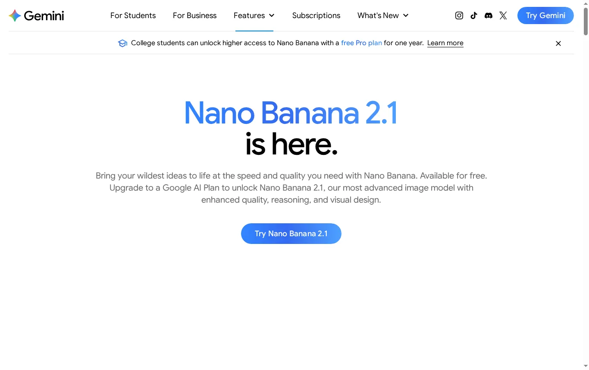
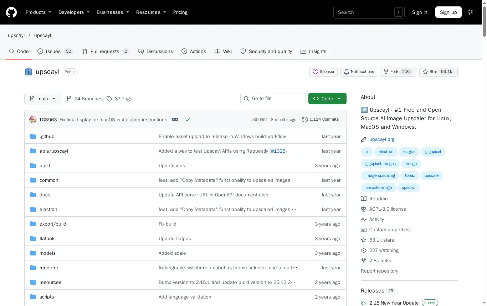
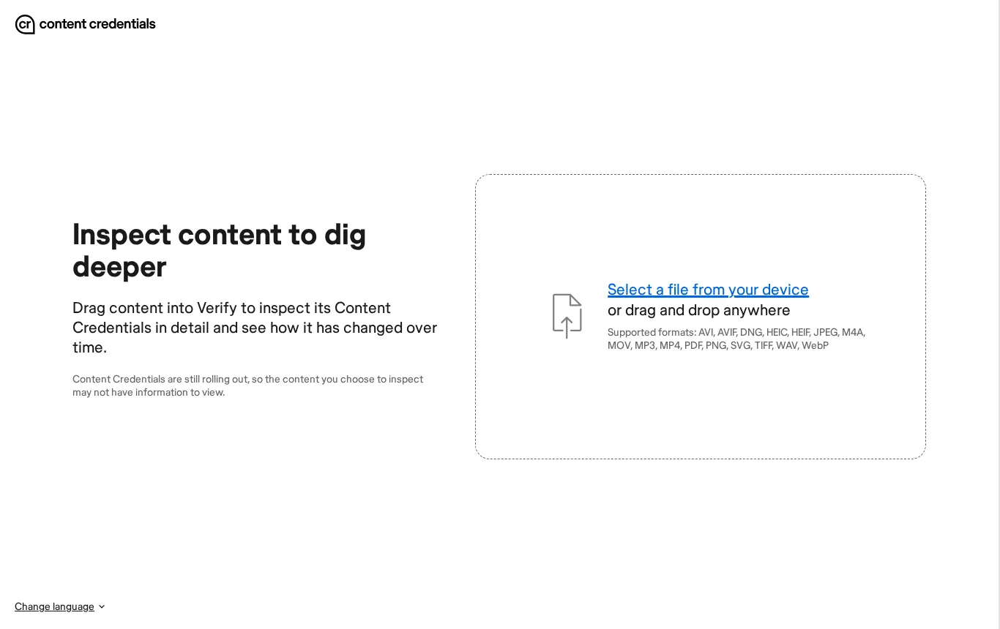

> Chuyên đề **AI tạo và chỉnh sửa ảnh** của [KimQ Tech](https://kimq.tech). Trang này được cập nhật khi có bài mới. Xem thêm các chuyên đề khác tại [Hướng dẫn dùng công cụ AI phổ biến cho công việc](huong-dan-dung-cong-cu-ai-pho-bien.md).

Trước đây, ghép ảnh, xoá người thừa hay mở rộng khung ảnh cần thành thạo Photoshop. Giờ chỉ cần **mô tả bằng lời** hoặc bấm một nút. Bài này chia **công cụ AI chỉnh sửa ảnh theo đúng việc bạn cần**, có lựa chọn miễn phí, trả phí và mã nguồn mở chạy trên máy.

Thông tin kiểm tra ngày **23/11/2026**.

## Bài trong chuyên đề

| Bài | Trả lời câu hỏi |
|---|---|
| [35 câu lệnh tạo ảnh, ghép ảnh trên Gemini](cau-lenh-tao-anh-ghep-anh-gemini.md) | Viết câu lệnh tạo ảnh, ghép ảnh ra sao, xoá logo Gemini được không? |
| [Top công cụ tạo video AI](top-cong-cu-tao-video-ai.md) | Ảnh đã đẹp, biến thành video bằng công cụ nào? |

Các hướng dẫn chi tiết (làm nét ảnh, ghép mặt, tạo logo, mở rộng ảnh bằng AI) sẽ được bổ sung vào bảng này.

## Tóm tắt: việc nào dùng công cụ nào

| Việc cần làm | Miễn phí, dễ dùng | Chuyên nghiệp | Mã nguồn mở (tự chạy) |
|---|---|---|---|
| **Ghép ảnh, sửa ảnh bằng lời** | Gemini (Nano Banana) | Photoshop (Generative Fill) | ComfyUI |
| **Làm nét, tăng độ phân giải** | Upscayl | Photoshop, Topaz | Upscayl, Real-ESRGAN |
| **Mở rộng ảnh (outpainting)** | Gemini, Canva (bản miễn phí có giới hạn) | Photoshop (Generative Expand) | ComfyUI, Fooocus |
| **Xoá vật thể, người thừa** | Google Photos, Canva | Photoshop | ComfyUI |
| **Tách nền, xoá phông** | Canva, remove.bg | Photoshop | rembg |
| **Phục hồi ảnh cũ, làm rõ khuôn mặt** | Gemini, Remini (giới hạn) | Photoshop (Neural Filters) | GFPGAN, CodeFormer* |
| **Kiểm tra ảnh có phải AI không** | Gemini (SynthID), Content Credentials | – | – |

*CodeFormer chỉ dùng cho mục đích phi thương mại. Xem bảng giấy phép bên dưới.*

## 1. Ghép ảnh, sửa ảnh bằng AI: Gemini (Nano Banana)

Mô hình ảnh của Google trong ứng dụng **Gemini**, thường gọi là **Nano Banana**, cho phép **tải nhiều ảnh lên và ra lệnh bằng tiếng Việt**: ghép người vào bối cảnh mới, đổi trang phục, đổi màu sản phẩm, thêm chữ.

*Ảnh chụp màn hình: Trang tính năng tạo và chỉnh ảnh của Gemini. Nguồn: [gemini.google](https://gemini.google/overview/image-generation/), chụp ngày 24/11/2026.*

- **Ví dụ:** *"Ghép người trong ảnh 1 vào khung cảnh bãi biển ở ảnh 2, giữ nguyên khuôn mặt, ánh sáng hoàng hôn, trông tự nhiên."*
- **Ưu:** miễn phí có hạn mức, hiểu tiếng Việt, giữ khuôn mặt khá tốt.
- **Lưu ý:** ảnh có hình mờ hiển thị và hình mờ ẩn SynthID. Ở Việt Nam, chỉ gói **AI Ultra** mới tắt được hình mờ hiển thị.

Xem 30+ mẫu câu lệnh tại bài [Câu lệnh tạo ảnh, ghép ảnh trên Gemini](cau-lenh-tao-anh-ghep-anh-gemini.md).

## 2. Photoshop: "AI Photoshop" cho người làm chuyên

**Adobe Photoshop** tích hợp AI Firefly:
- **Generative Fill:** khoanh vùng, gõ mô tả để thêm, xoá, thay vật thể.
- **Generative Expand:** kéo rộng khung ảnh, AI vẽ thêm phần còn thiếu.
- **Neural Filters:** làm mịn da, phục hồi ảnh, tô màu ảnh đen trắng.

Hợp với người cần kiểm soát từng điểm ảnh và in ấn chất lượng cao. Cần gói trả phí Adobe.

## 3. Canva: nhanh cho dân văn phòng, bán hàng

**Canva** có bộ công cụ AI (xoá nền, xoá vật thể, mở rộng ảnh, chỉnh sửa theo mô tả) ngay trong trình thiết kế. Tiện khi bạn vừa sửa ảnh vừa làm banner, bài đăng. Nhiều tính năng AI nằm ở gói Pro.

## 4. Làm nét ảnh bằng AI: Upscayl và Real-ESRGAN

**Upscayl** là ứng dụng **miễn phí, mã nguồn mở** cho Windows, macOS, Linux: kéo ảnh vào, chọn mức phóng to (2x, 4x), AI làm nét và tăng độ phân giải. Chạy hoàn toàn trên máy, không tải ảnh lên mạng. Bên dưới dùng các mô hình họ **Real-ESRGAN**.

*Ảnh chụp màn hình: Repo Upscayl trên GitHub. Nguồn: [github.com](https://github.com/upscayl/upscayl), chụp ngày 24/11/2026.*

- **Hợp với:** ảnh sản phẩm nhỏ, ảnh chụp màn hình mờ, ảnh cũ độ phân giải thấp.
- **Cần:** card đồ hoạ hỗ trợ Vulkan để chạy nhanh.

## 5. Phục hồi ảnh cũ và khuôn mặt: GFPGAN, CodeFormer

Ảnh gia đình cũ bị mờ, nhoè, xước có thể được AI làm rõ khuôn mặt:
- **GFPGAN** (Tencent ARC): phục hồi khuôn mặt trong ảnh cũ, ảnh chất lượng thấp.
- **CodeFormer:** chất lượng khuôn mặt rất tốt, **nhưng chỉ cho phép dùng phi thương mại** (giấy phép S-Lab).

Với người không rành kỹ thuật: hỏi Gemini *"Phục hồi ảnh cũ này: làm nét, xoá vết xước, giữ nguyên khuôn mặt, tô màu tự nhiên"*, hoặc dùng ứng dụng điện thoại như Remini (bản miễn phí giới hạn).

**Lưu ý:** AI có thể "tưởng tượng" ra chi tiết khuôn mặt không có thật. Với ảnh kỷ niệm quan trọng, hãy giữ bản gốc và so sánh kỹ.

## 6. Tách nền: rembg

**rembg** là thư viện mã nguồn mở xoá nền ảnh, chạy bằng một lệnh hoặc tích hợp vào phần mềm. Hợp với shop cần **xoá phông hàng loạt ảnh sản phẩm**.

## 7. Bộ công cụ tổng hợp mã nguồn mở: ComfyUI, Fooocus

**ComfyUI** là giao diện dạng sơ đồ nối các bước xử lý ảnh, video bằng mô hình AI mở: ghép ảnh, mở rộng, xoá vật thể, làm nét. Mạnh nhất nhưng cần học. **Fooocus** đơn giản hơn, tập trung vào tạo ảnh bằng câu lệnh.

## Bảng repo mã nguồn mở

| Repo | Sao GitHub | Giấy phép | Dùng để |
|---|---|---|---|
| [Comfy-Org/ComfyUI](https://github.com/Comfy-Org/ComfyUI) | ~148,2 nghìn | GPL v3 | Mọi tác vụ ảnh, video bằng sơ đồ xử lý |
| [AUTOMATIC1111/stable-diffusion-webui](https://github.com/AUTOMATIC1111/stable-diffusion-webui) | ~165,4 nghìn | AGPL v3 | Giao diện Stable Diffusion; cập nhật chậm từ 03/2026 |
| [lllyasviel/Fooocus](https://github.com/lllyasviel/Fooocus) | ~54,0 nghìn | GPL v3 | Tạo ảnh đơn giản bằng câu lệnh |
| [upscayl/upscayl](https://github.com/upscayl/upscayl) | ~53,1 nghìn | AGPL v3 | Làm nét, phóng to ảnh |
| [xinntao/Real-ESRGAN](https://github.com/xinntao/Real-ESRGAN) | ~37,6 nghìn | BSD-3 | Mô hình làm nét ảnh, video |
| [TencentARC/GFPGAN](https://github.com/TencentARC/GFPGAN) | ~37,7 nghìn | Xem tệp LICENSE | Phục hồi khuôn mặt |
| [danielgatis/rembg](https://github.com/danielgatis/rembg) | ~25,6 nghìn | MIT | Tách nền ảnh |
| [sczhou/CodeFormer](https://github.com/sczhou/CodeFormer) | ~18,3 nghìn | S-Lab 1.0 (phi thương mại) | Phục hồi khuôn mặt |

*Số sao lấy từ GitHub API ngày 23/11/2026. [Sanster/IOPaint](https://github.com/Sanster/IOPaint) (xoá vật thể) đã lưu trữ, không còn phát triển. Real-ESRGAN và GFPGAN ít cập nhật từ 2024 nhưng vẫn được dùng rộng rãi.*

## Cách kiểm tra ảnh có phải do AI tạo không ("check ảnh AI")

1. **SynthID trong Gemini:** tải ảnh lên Gemini và hỏi *"Ảnh này có phải do AI của Google tạo không?"*. Gemini kiểm tra hình mờ ẩn SynthID. Giới hạn khoảng 10 lượt kiểm tra ảnh mỗi 24 giờ, và **chỉ nhận ra nội dung do công cụ AI của Google tạo**; không thấy SynthID không có nghĩa ảnh là thật.
2. **Content Credentials (C2PA):** nhiều công cụ (Adobe, Google, OpenAI) gắn thông tin nguồn gốc vào ảnh. Kiểm tra tại [contentcredentials.org/verify](https://contentcredentials.org/verify). Thông tin này mất nếu ảnh bị chụp màn hình hoặc đăng qua nền tảng xoá siêu dữ liệu.
3. **Quan sát bằng mắt:** bàn tay, chữ trong ảnh, đồ trang sức, phản chiếu, nền bị méo thường lộ dấu hiệu AI.

*Ảnh chụp màn hình: Công cụ kiểm tra Content Credentials của ảnh. Nguồn: [contentcredentials.org](https://contentcredentials.org/verify), chụp ngày 24/11/2026.*

Không có cách nào chắc chắn 100%; hãy kết hợp cả ba.

## Ảnh đẹp rồi, bước tiếp theo?

- Biến ảnh sản phẩm thành video: xem [Top công cụ tạo video AI](top-cong-cu-tao-video-ai.md), hoặc dùng [KimQ AI Studio](https://kimq.tech/san-pham/ai-studio) để có video dọc giới thiệu sản phẩm, giọng đọc tiếng Việt, phụ đề.
- Đăng bài và trả lời khách tự động trên Facebook: xem [Trợ lý Fanpage](https://kimq.tech/san-pham/tro-ly-fanpage).

## Lưu ý pháp lý và đạo đức

- **Không chỉnh sửa ảnh người khác** để bôi nhọ, giả mạo hoặc tạo nội dung nhạy cảm; đây có thể là hành vi vi phạm pháp luật.
- **Ảnh quảng cáo:** không dùng AI làm sai lệch công dụng, kích thước, màu sắc thật của sản phẩm.
- **Bản quyền:** chỉ chỉnh sửa ảnh bạn có quyền sử dụng.

## Câu hỏi thường gặp

**Chỉnh sửa ảnh bằng AI miễn phí dùng gì?**
Gemini (sửa bằng lời, ghép ảnh), Upscayl (làm nét, miễn phí hoàn toàn), Canva bản miễn phí, Google Photos (xoá vật thể trên điện thoại).

**AI ghép ảnh nào giữ mặt giống nhất?**
Gemini và Photoshop hiện giữ khuôn mặt khá tốt. Mẹo: dùng ảnh mặt chính diện, rõ nét, và nhắc rõ "giữ nguyên khuôn mặt" trong câu lệnh.

**Làm nét ảnh AI có làm ảnh thật hơn không?**
AI "đoán" thêm chi tiết nên ảnh nét hơn nhưng có thể sai khác bản gốc. Với giấy tờ, chứng từ, đừng dùng ảnh đã làm nét bằng AI làm bằng chứng.

**Mở rộng ảnh bằng AI để làm gì?**
Đổi tỉ lệ khung hình (ảnh ngang thành dọc cho TikTok, Story), thêm khoảng trống để đặt chữ, cứu ảnh bị cắt sát.

---

> Bài viết có sử dụng AI hỗ trợ soạn thảo. Nội dung và số liệu được đối chiếu với nguồn chính thức ngày 24/11/2026; ảnh là ảnh chụp màn hình trang chính thức, có ghi nguồn và ngày chụp.

## Về KimQ Tech

[KimQ Tech](https://kimq.tech) xây giải pháp AI và tự động hoá vận hành cho doanh nghiệp Việt: [AI Studio](https://kimq.tech/san-pham/ai-studio), [Trợ lý Fanpage](https://kimq.tech/san-pham/tro-ly-fanpage), [Chatbot đa kênh](https://kimq.tech/san-pham/chatbot-da-kenh), [Trợ lý AI trên Zalo](https://kimq.tech/san-pham/tro-ly-zalo), [AI Gateway](https://kimq.tech/san-pham/ai-gateway). Cần tư vấn? [Liên hệ KimQ Tech](https://kimq.tech/lien-he) hoặc email contact@kimq.tech.

---

*Thông tin kiểm tra ngày 23/11/2026 và có thể thay đổi. Số liệu repo lấy từ GitHub API; tóm tắt giấy phép không phải tư vấn pháp lý.*
