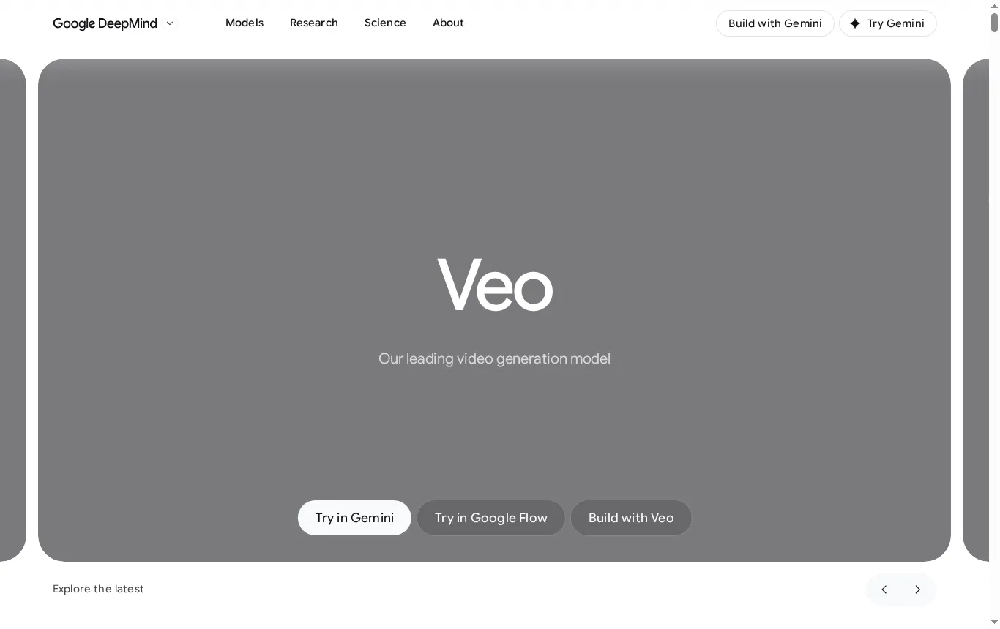
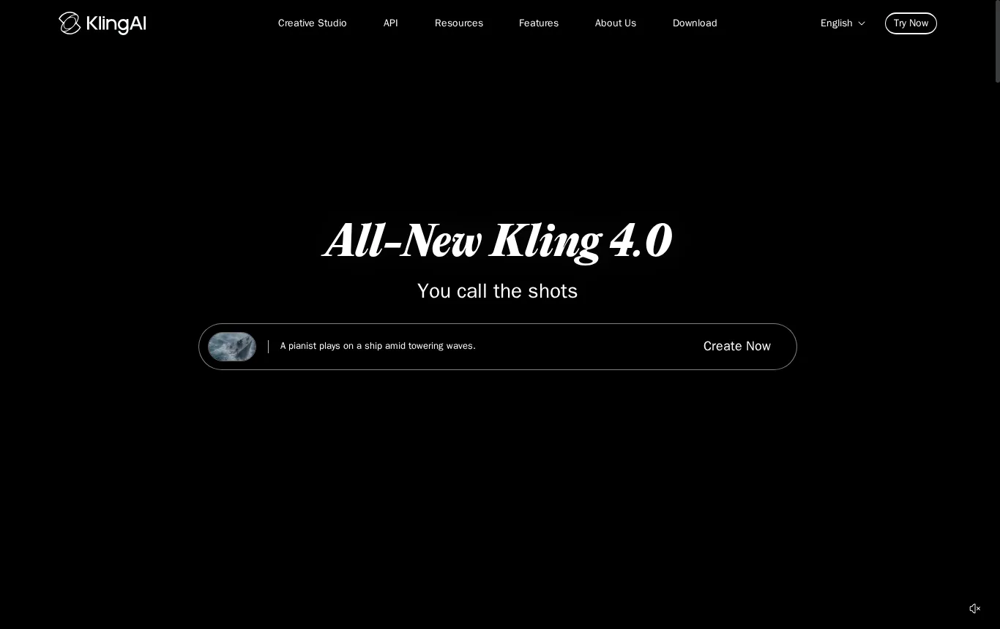
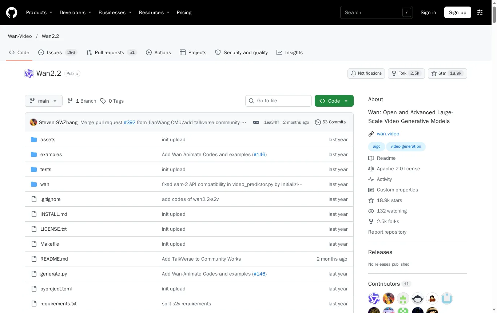

> Chuyên đề **Tạo video bằng AI** của [KimQ Tech](https://kimq.tech). Trang này được cập nhật khi có bài mới. Xem thêm các chuyên đề khác tại [Hướng dẫn dùng công cụ AI phổ biến cho công việc](huong-dan-dung-cong-cu-ai-pho-bien.md).

Chỉ cần một câu mô tả hoặc một tấm ảnh, công cụ **tạo video AI** có thể dựng ra đoạn video vài giây đến vài chục giây, có chuyển động, ánh sáng và cả âm thanh. Bài này so sánh **10 công cụ đáng dùng nhất cuối năm 2026**, chỉ ra cách **tạo video AI miễn phí từ ảnh và từ văn bản**, kèm mẫu câu lệnh tiếng Việt.

Thông tin kiểm tra ngày **23/11/2026**. Lĩnh vực này đổi rất nhanh; tên phiên bản và hạn mức miễn phí có thể khác khi bạn đọc.

## Bài trong chuyên đề

| Bài | Trả lời câu hỏi |
|---|---|
| [Top công cụ AI tạo và chỉnh sửa ảnh](top-cong-cu-ai-chinh-sua-anh.md) | Chuẩn bị ảnh đẹp trước khi biến thành video bằng công cụ nào? |
| [35 câu lệnh tạo ảnh, ghép ảnh trên Gemini](cau-lenh-tao-anh-ghep-anh-gemini.md) | Video tạo bằng Gemini có hình mờ không, viết câu lệnh thế nào? |
| [Viggle AI là gì? Cách dùng Viggle AI](viggle-ai-la-gi.md) | Ghép nhân vật từ 1 tấm ảnh vào video nhảy, meme thế nào, giá bao nhiêu? |
| [Giọng đọc AI tiếng Việt: so sánh Vbee, FPT.AI, Viettel AI, VClip (cập nhật 11/2026)](giong-doc-ai-tieng-viet.md) | Nên chọn Vbee, FPT.AI, Viettel AI hay VClip để lồng tiếng tiếng Việt, giá bao nhiêu? |
| [Tạo nhạc bằng AI: so sánh Suno, Udio, ElevenMusic và cách dùng nhạc AI không dính bản quyền](tao-nhac-bang-ai.md) | Tạo nhạc, bài hát bằng AI với Suno, Udio, ElevenMusic thế nào? |
| [Higgsfield AI là gì? Cách dùng Higgsfield tạo video, bảng giá và gói miễn phí (11/2026)](higgsfield-ai-la-gi.md) | Higgsfield AI là gì, gói miễn phí được gì? |
| [Cách tạo video AI từ ảnh miễn phí và trả phí: Gemini, Kling, Vidu từng bước (11/2026)](tao-video-ai-tu-anh.md) | Tạo video AI từ ảnh bằng công cụ nào, miễn phí không? |

Các hướng dẫn chi tiết từng công cụ (Kling, Higgsfield), giọng đọc AI tiếng Việt và tạo nhạc AI sẽ được bổ sung vào bảng này.

## Tóm tắt nhanh

| # | Công cụ | Mạnh nhất ở | Miễn phí? | Từ ảnh | Từ văn bản |
|---|---|---|---|---|---|
| 1 | **Google Veo** (trong Gemini, Flow) | Video chân thực, có âm thanh, lời thoại | Hạn chế; nhiều lượt hơn ở gói Google AI trả phí | ✅ | ✅ |
| 2 | **Kling AI** | Biến ảnh thành video, chuyển động tự nhiên, giá tốt | Có tín dụng miễn phí hằng tháng | ✅ | ✅ |
| 3 | **Runway** (Gen-4.5) | Kiểm soát sáng tạo, bộ chỉnh sửa video đầy đủ | Dùng thử | ✅ | ✅ |
| 4 | **Vidu** (Vidu Q4 Preview) | Giữ nhân vật nhất quán theo ảnh tham chiếu | Có lượt dùng thử | ✅ | ✅ |
| 5 | **Grok Imagine** (xAI) | Tạo clip ngắn rất nhanh | Tuỳ gói X/Grok | ✅ | ✅ |
| 6 | **Seedance** (ByteDance, qua Dreamina, CapCut) | Clip theo ảnh tham chiếu, tiện cho TikTok | Có lượt miễn phí | ✅ | ✅ |
| 7 | **Hailuo** (MiniMax) | Chuyển động mạnh, hiệu ứng điện ảnh | Có lượt miễn phí | ✅ | ✅ |
| 8 | **Luma** (Dream Machine) | Điều khiển khung hình đầu, cuối | Dùng thử | ✅ | ✅ |
| 9 | **HeyGen, Synthesia** | Người dẫn ảo (avatar) đọc kịch bản | Dùng thử | – | ✅ kịch bản |
| 10 | **Wan** (mã nguồn mở) | Tự chạy trên máy có GPU, không giới hạn lượt | ✅ miễn phí phần mềm | ✅ | ✅ |

**Sora đâu rồi?** OpenAI đã **ngừng ứng dụng và trang web Sora từ ngày 26/04/2026**, nên Sora không còn là lựa chọn cho người dùng phổ thông.

## Chúng tôi chọn thế nào

- **Chất lượng video** (độ chân thực, chuyển động, giữ nhân vật) theo các bảng xếp hạng và bài so sánh công khai cuối năm 2026.
- **Có lối dùng miễn phí hoặc dùng thử** cho người mới.
- **Dùng được từ Việt Nam,** câu lệnh tiếng Việt hoặc tiếng Anh.
- **Đa dạng nhu cầu:** từ clip mạng xã hội, quảng cáo, đến người dẫn ảo và tự chạy mã nguồn mở.

## 1. Google Veo: chân thực, có âm thanh

**Veo** là mô hình video của Google, dùng trong **ứng dụng Gemini** (tạo video 8 giây có âm thanh) và công cụ làm phim **Flow**. Điểm mạnh là hình ảnh chân thực, âm thanh và lời thoại tạo cùng lúc với hình.

*Ảnh chụp màn hình: Trang mô hình Veo của Google DeepMind. Nguồn: [deepmind.google](https://deepmind.google/models/veo/), chụp ngày 24/11/2026.*

- **Hợp với:** quảng cáo ngắn, cảnh sản phẩm, video có thoại.
- **Miễn phí:** hạn mức theo gói Google AI; sinh viên Việt Nam đủ điều kiện có ưu đãi gói Google AI miễn phí 1 năm (hạn nhận đến 31/12/2026).
- **Lưu ý:** video tạo bằng Gemini có hình mờ hiển thị và hình mờ ẩn SynthID. Xem bài [Câu lệnh tạo ảnh, ghép ảnh trên Gemini](cau-lenh-tao-anh-ghep-anh-gemini.md).

## 2. Kling AI: biến ảnh thành video tốt nhất trong tầm giá

**Kling** (của Kuaishou) nổi tiếng với **tạo video từ ảnh**: chuyển động người, vật tự nhiên, clip dài hơn nhiều đối thủ. Người dùng không trả phí nhận **tín dụng miễn phí hằng tháng** khi đăng nhập.

*Ảnh chụp màn hình: Trang chủ Kling AI. Nguồn: [kling.ai](https://kling.ai/), chụp ngày 24/11/2026.*

- **Hợp với:** biến ảnh sản phẩm, ảnh chân dung thành clip động; video TikTok, Reels.
- **Lưu ý:** gói trả phí không hoàn tiền sau khi kích hoạt; nên dùng hết tín dụng miễn phí để thử trước.

## 3. Runway: cho người làm video chuyên nghiệp

**Runway** (Gen-4.5) kết hợp mô hình tạo video với **bộ chỉnh sửa đầy đủ**: cắt ghép, đổi cảnh, điều khiển chuyển động máy quay, xoá vật thể. Hợp với người làm phim, agency.

## 4. Vidu: giữ nhân vật nhất quán

**Vidu** (ShengShu, Trung Quốc) mạnh ở **tạo video theo ảnh tham chiếu**: đưa ảnh nhân vật, sản phẩm, bối cảnh, Vidu ghép thành một cảnh và giữ nhân vật nhất quán qua nhiều clip. Phiên bản mới nhất là **Vidu Q4 Preview** (10/2026), tập trung vào diễn xuất chân thực.

## 5. Grok Imagine: nhanh

**Grok Imagine** của xAI tạo clip 6 giây độ phân giải 720p trong khoảng 25 giây với bản Video 1.5 Fast. Hợp để thử ý tưởng nhanh. Lưu ý chính sách nội dung và quyền riêng tư khi đưa ảnh người thật lên.

## 6. Seedance: tiện cho người làm TikTok

**Seedance** của ByteDance có mặt trong **Dreamina** và hệ sinh thái **CapCut**, thuận tiện nếu bạn đã dựng video bằng CapCut: tạo clip từ ảnh tham chiếu rồi đưa thẳng vào dự án dựng.

## 7. Hailuo: chuyển động mạnh, điện ảnh

**Hailuo** (MiniMax) được ưa chuộng nhờ chuyển động mạnh, hiệu ứng như phim, có lượt miễn phí cho người mới.

## 8. Luma Dream Machine: điều khiển khung hình

**Luma** cho phép đặt **khung hình đầu và cuối**, AI dựng chuyển động ở giữa; hợp để tạo cảnh chuyển mượt giữa hai ảnh.

## 9. HeyGen, Synthesia: người dẫn ảo đọc kịch bản

Nếu bạn cần **một người dẫn nói trước ống kính** (video đào tạo, giới thiệu công ty, tin tức), các công cụ avatar như **HeyGen** và **Synthesia** phù hợp hơn công cụ tạo cảnh. Cả hai hỗ trợ nhiều ngôn ngữ, gồm tiếng Việt.

## 10. Wan và các mô hình mã nguồn mở

Muốn **tự chạy, không giới hạn lượt, không gửi dữ liệu ra ngoài**? Có các mô hình video mã nguồn mở trên GitHub:

*Ảnh chụp màn hình: Repo Wan 2.2 trên GitHub. Nguồn: [github.com](https://github.com/Wan-Video/Wan2.2), chụp ngày 24/11/2026.*

| Repo | Sao GitHub | Giấy phép mã nguồn | Ghi chú |
|---|---|---|---|
| [Wan-Video/Wan2.2](https://github.com/Wan-Video/Wan2.2) | ~18,8 nghìn | Apache 2.0 | Tạo video từ văn bản, từ ảnh; của Alibaba |
| [hpcaitech/Open-Sora](https://github.com/hpcaitech/Open-Sora) | ~29,9 nghìn | Apache 2.0 | Dự án mở, mục tiêu tạo video giá rẻ |
| [Tencent-Hunyuan/HunyuanVideo](https://github.com/Tencent-Hunyuan/HunyuanVideo) | ~12,8 nghìn | Giấy phép riêng của Tencent | Đọc kỹ giới hạn vùng lãnh thổ, thương mại |
| [Lightricks/LTX-Video](https://github.com/Lightricks/LTX-Video) | ~11,5 nghìn | Apache 2.0 (mã nguồn) | Trọng số mô hình có giấy phép riêng |

*Số sao lấy từ GitHub API ngày 23/11/2026.* Cần **GPU nhiều bộ nhớ** (thường từ 16–24 GB trở lên cho bản nhỏ) và nên dùng qua giao diện như [ComfyUI](https://github.com/Comfy-Org/ComfyUI). Giấy phép của **trọng số mô hình** có thể khác giấy phép mã nguồn.

## Cách tạo video AI miễn phí từ ảnh (5 bước)

1. **Chọn ảnh rõ nét,** chủ thể ở giữa, ánh sáng tốt. Ảnh mờ cho video méo.
2. **Mở công cụ có tín dụng miễn phí** (Kling, Hailuo, Seedance hoặc Gemini), chọn chế độ **Image to Video / Ảnh thành video**.
3. **Tải ảnh lên** và **mô tả chuyển động**, không mô tả lại ảnh. Ví dụ: *"Máy quay chậm rãi tiến lại gần, hơi nước bốc lên từ tách cà phê, ánh nắng sáng dần."*
4. **Chọn thời lượng và tỉ lệ khung hình:** 9:16 cho TikTok, Reels; 16:9 cho YouTube.
5. **Tạo 2–3 phiên bản,** chọn bản tốt nhất, ghép nhạc và chữ bằng CapCut hoặc phần mềm dựng.

## Cách tạo video AI từ văn bản: công thức câu lệnh

**[Chủ thể] + [hành động] + [bối cảnh] + [góc máy, chuyển động máy] + [ánh sáng, phong cách] + [âm thanh]**

Ví dụ:
- *"Một cô gái mặc áo dài trắng đạp xe qua phố cổ Hội An lúc hoàng hôn, đèn lồng sáng dần, máy quay đi theo từ bên cạnh, phong cách điện ảnh, tiếng chuông xe đạp và tiếng phố."*
- *"Cận cảnh ly trà sữa trân châu đặt trên bàn gỗ, đá rơi vào ly chậm, ánh sáng studio, nền màu kem, quay xoay quanh ly 180 độ."*
- *"Cảnh quay từ trên cao ruộng bậc thang Mù Cang Chải mùa lúa chín, mây trôi nhanh, phong cách phim tài liệu."*

**Mẹo:** viết câu lệnh bằng tiếng Anh thường cho kết quả ổn định hơn ở các công cụ nước ngoài; có thể nhờ Gemini, Claude hoặc ChatGPT dịch và chi tiết hoá câu lệnh.

## Nên chọn công cụ nào?

| Nhu cầu | Gợi ý |
|---|---|
| Muốn miễn phí, biến ảnh thành video | Kling, Hailuo, Seedance |
| Video chân thực có âm thanh, lời thoại | Google Veo |
| Giữ cùng một nhân vật qua nhiều cảnh | Vidu |
| Làm phim, cần chỉnh sửa chuyên sâu | Runway |
| Người dẫn ảo đọc kịch bản | HeyGen, Synthesia |
| Tự chạy, không giới hạn, dữ liệu nội bộ | Wan + ComfyUI |
| **Video giới thiệu sản phẩm có giọng đọc tiếng Việt, phụ đề, đúng thương hiệu** | [KimQ AI Studio](https://kimq.tech/san-pham/ai-studio) |

## Doanh nghiệp làm video AI đều đặn: vấn đề thật nằm ở đâu?

Tạo một clip đẹp không khó. Khó là **ra video đều đặn mỗi tuần, đúng giọng thương hiệu, có giọng đọc tiếng Việt, phụ đề khớp và sửa nhanh khi cần**. Các công cụ ở trên chủ yếu tạo từng cảnh rời; bạn vẫn phải viết kịch bản, thu âm, dựng, gắn phụ đề.

[AI Studio của KimQ Tech](https://kimq.tech/san-pham/ai-studio) giải quyết phần đó: bạn gửi mô tả sản phẩm, ảnh và thông điệp chính; AI Studio viết kịch bản, đọc bằng giọng tiếng Việt có giấy phép thương mại, dựng hình theo thương hiệu, gắn phụ đề khớp từng câu và xuất video dọc. Bạn duyệt kịch bản và bản dựng trước khi đăng.

## Lưu ý pháp lý và đạo đức

- **Không dùng ảnh người khác** khi chưa được đồng ý, đặc biệt người nổi tiếng hoặc trẻ em.
- **Gắn nhãn nội dung AI** khi đăng: YouTube, TikTok, Facebook đều có quy định gắn nhãn nội dung AI trông như thật.
- **Đọc điều khoản thương mại:** nhiều gói miễn phí không cho dùng video vào quảng cáo hoặc có hình mờ.
- **Nhạc nền:** dùng nhạc có bản quyền hoặc nhạc miễn phí bản quyền.

Đọc thêm: [Top công cụ AI chỉnh sửa ảnh](top-cong-cu-ai-chinh-sua-anh.md) để chuẩn bị ảnh đẹp trước khi biến thành video.

## Câu hỏi thường gặp

**Có công cụ tạo video AI miễn phí hoàn toàn không?**
Có hai hướng: dùng tín dụng miễn phí hằng ngày, hằng tháng của Kling, Hailuo, Seedance…; hoặc tự chạy mô hình mã nguồn mở như Wan trên máy có GPU. Bản miễn phí thường có hình mờ, giới hạn độ phân giải và thời lượng.

**Video AI dài tối đa bao lâu?**
Mỗi lần tạo thường từ 5–30 giây tuỳ công cụ và gói. Video dài hơn được ghép từ nhiều cảnh.

**Tạo video AI bằng tiếng Việt được không?**
Viết câu lệnh tiếng Việt được ở nhiều công cụ; lời thoại tiếng Việt trong video vẫn chưa ổn định ở mọi công cụ. Với video cần giọng đọc tiếng Việt chuẩn, nên tạo hình bằng AI và lồng giọng đọc riêng.

**Có tạo video AI trên điện thoại được không?**
Được. Gemini, Kling, CapCut, Hailuo đều có ứng dụng điện thoại.

---

> Bài viết có sử dụng AI hỗ trợ soạn thảo. Nội dung và số liệu được đối chiếu với nguồn chính thức ngày 24/11/2026; ảnh là ảnh chụp màn hình trang chính thức, có ghi nguồn và ngày chụp.

## Về KimQ Tech

[KimQ Tech](https://kimq.tech) xây giải pháp AI và tự động hoá vận hành cho doanh nghiệp Việt: [AI Studio](https://kimq.tech/san-pham/ai-studio), [Trợ lý Fanpage](https://kimq.tech/san-pham/tro-ly-fanpage), [Chatbot đa kênh](https://kimq.tech/san-pham/chatbot-da-kenh), [Trợ lý AI trên Zalo](https://kimq.tech/san-pham/tro-ly-zalo), [AI Gateway](https://kimq.tech/san-pham/ai-gateway). Cần tư vấn? [Liên hệ KimQ Tech](https://kimq.tech/lien-he) hoặc email contact@kimq.tech.

---

*Thông tin công cụ kiểm tra ngày 23/11/2026 từ trang chính thức và các bài so sánh công khai; tên phiên bản, giá và hạn mức miễn phí thay đổi thường xuyên. Tóm tắt giấy phép không phải tư vấn pháp lý.*
