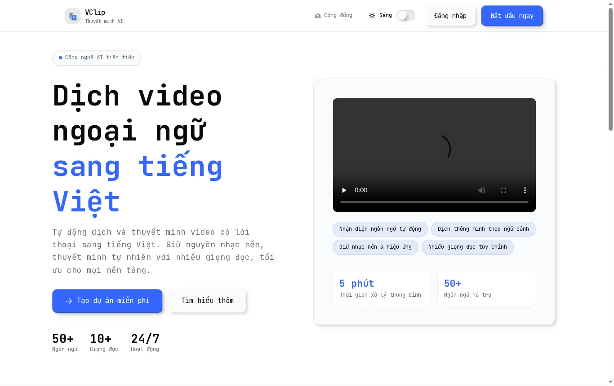
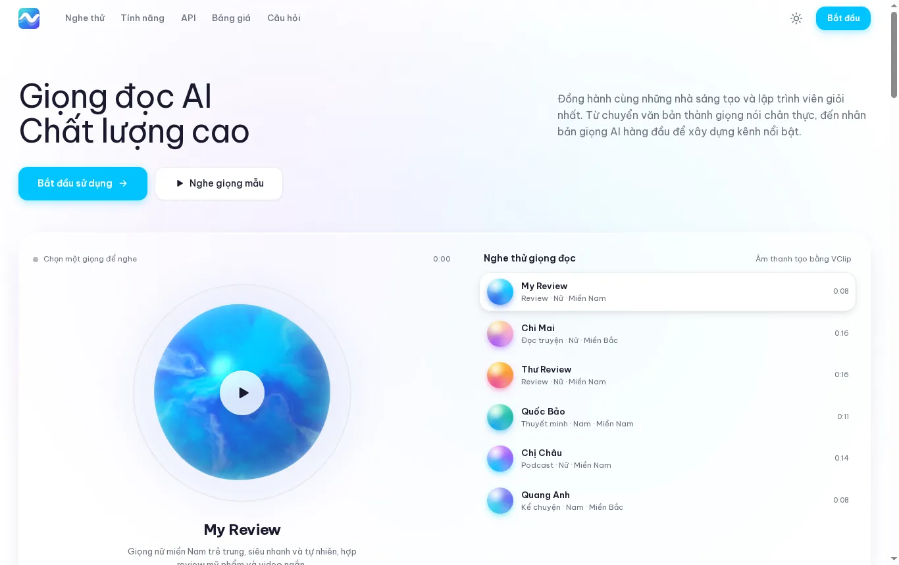

> Thuộc chuyên đề: [Top công cụ tạo video AI](top-cong-cu-tao-video-ai.md) · Bài viết của [KimQ Tech](https://kimq.tech)

Nhiều kênh review phim, truyện audio và video TikTok tiếng Việt dùng chung một kiểu giọng đọc AI. Khi hỏi nguồn, câu trả lời hay gặp là "Vclip". Bài này giải thích **Vclip AI là gì**, gồm những công cụ nào, tính tiền ra sao và cách dùng từng bước. Thông tin lấy từ trang chính thức **vclip.io** ngày **25/11/2026**.

## Tóm tắt nhanh

| | VClip TTS (giọng đọc) | VClip Thuyết minh AI |
|---|---|---|
| Địa chỉ | tts.vclip.io | app.vclip.io |
| Làm gì | Chuyển văn bản thành giọng nói tiếng Việt, nhân bản giọng | Dịch và lồng tiếng Việt cho video ngoại ngữ |
| Đầu vào | Văn bản, đoạn ghi âm 5–30 giây để nhân bản | File video hoặc link YouTube, TikTok |
| Giọng | 90+ giọng cộng đồng, miền Bắc và miền Nam | 10+ giọng tiếng Việt |
| Tính phí | 1 credit = 1 ký tự, đoạn đã tạo không tính lại | Có thể tạo dự án miễn phí |
| API | Có, JSON-RPC, dùng chung credit | Không nêu trên trang |

Nếu bạn cần giọng đọc cho video tự quay, dùng **VClip TTS**. Nếu cần chuyển video tiếng nước ngoài **của chính bạn** sang tiếng Việt, dùng **Thuyết minh AI**.

## Vclip AI là gì? Lưu ý trùng tên

**VClip** (vclip.io) là nền tảng AI giọng nói và video của Việt Nam, gồm hai sản phẩm chính: công cụ chuyển văn bản thành giọng nói (TTS) và công cụ thuyết minh video tự động.

Khi tìm "vclip ai", bạn sẽ gặp nhiều dịch vụ khác cùng tên nhưng không liên quan:

- **vclip.co**: tạo ảnh chân dung kiểu truyện tranh bằng AI.
- **getvclip.com**: tạo video ngắn "không lộ mặt" bằng tiếng Anh.
- **tryvclip.com**: tiện ích cắt đoạn video trên trình duyệt.
- **VClip của VNPT**: cổng video giải trí trên di động.

Bài này chỉ nói về **vclip.io**, dịch vụ giọng đọc tiếng Việt mà các kênh TikTok, YouTube hay dùng. Kiểm tra kỹ tên miền trước khi đăng nhập hoặc nạp tiền.

## VClip TTS: đọc văn bản thành giọng nói

*Ảnh chụp màn hình: Trang chủ VClip với công cụ đọc văn bản. Nguồn: [vclip.io](https://vclip.io/), chụp ngày 25/11/2026.*

Theo trang chủ, VClip TTS phục vụ nhiều loại nội dung: review TikTok, sách nói, podcast, truyện audio, bản tin, quảng cáo, thuyết minh phim, video YouTube, đọc thơ và bài giảng e-learning.

Các điểm đáng chú ý:

- **Chia đoạn tự động.** Văn bản dán vào được chia thành từng đoạn để bạn nghe lại, sửa chữ, chỉnh tốc độ trước khi xuất.
- **Chỉ tính phí đoạn mới.** Đoạn đã tạo được lưu đệm (cache), sửa một câu không phải trả lại cả bài.
- **Tự hoàn credit** nếu xuất file thất bại.
- **Văn bản dài, truyện nhiều chương** được tạo song song rồi ghép thành một file.
- **Hơn 90 giọng cộng đồng**, nam và nữ, miền Bắc và miền Nam, lọc theo mục đích: review, tin tức, đọc truyện, thuyết minh, podcast, quảng cáo.

### Các bước đọc văn bản

1. Vào [vclip.io](https://vclip.io/), bấm **Bắt đầu** và đăng nhập bằng tài khoản Google.
2. Chọn **Đọc văn bản**.
3. Dán nội dung. Nên tách câu ngắn, viết số và từ viết tắt thành chữ ("2026" thành "hai nghìn không trăm hai mươi sáu" nếu giọng đọc sai).
4. Bấm **Chọn giọng nói**, nghe thử vài giọng trong thư viện.
5. Nghe lại từng đoạn, sửa câu đọc sai, chỉnh tốc độ.
6. Xuất file âm thanh và ghép vào video bằng CapCut hoặc phần mềm dựng bạn quen dùng.

### Cách tính credit

Trang chủ ghi **1 credit = 1 ký tự**. Một bài review 1.000 chữ tiếng Việt thường vào khoảng 4.000–5.000 ký tự tính cả dấu cách, nên tốn khoảng chừng ấy credit cho lần tạo đầu. Các lần sửa sau chỉ tính phần thay đổi.

Gói miễn phí cho dùng thử, nhưng **giới hạn số giọng nhân bản và số lượt xuất mỗi giờ**. Bảng giá gói trả phí nằm trong trang tts.vclip.io/pricing và cần đăng nhập mới xem được, vì vậy bài này không ghi giá.

## Nhân bản giọng nói

Đây là tính năng khiến VClip phổ biến với người làm kênh: bạn dùng **giọng của chính mình** để đọc mọi kịch bản mà không cần thu âm lại.

- Chuẩn bị một đoạn giọng nói rõ ràng **dài 5–30 giây**, định dạng **MP3, WAV, M4A**, hoặc ghi âm trực tiếp trên web.
- Nếu đoạn ghi âm có nhạc nền hay tạp âm, bấm **Tách giọng** để làm sạch.
- VClip nhận diện lời thoại để bạn kiểm tra, rồi tạo giọng dùng được ngay.
- Giọng nhân bản có thể **để riêng tư** hoặc **chia sẻ cho cộng đồng**.

Mẹo thu mẫu giọng: thu trong phòng kín, cách micro khoảng một gang tay, đọc với tốc độ và cảm xúc bạn muốn giọng AI bắt chước. Mẫu đọc đều đều sẽ cho giọng AI đều đều.

**Chỉ nhân bản giọng của bạn hoặc người đã đồng ý bằng văn bản.** Nhân bản giọng người nổi tiếng, người thân của người khác để đăng nội dung hoặc lừa đảo có thể vi phạm quyền nhân thân và pháp luật.

## VClip Thuyết minh AI: lồng tiếng Việt cho video

*Ảnh chụp màn hình: Trang thuyết minh video bằng AI của VClip. Nguồn: [app.vclip.io](https://app.vclip.io/), chụp ngày 25/11/2026.*

Thuyết minh AI tự động **dịch lời thoại video sang tiếng Việt và lồng giọng đọc**, giữ nguyên nhạc nền và hiệu ứng âm thanh gốc. Theo trang giới thiệu:

- Nhận diện hơn **50 ngôn ngữ**, dịch theo ngữ cảnh và căn theo thời lượng từng câu.
- Hơn **10 giọng đọc tiếng Việt**, chỉnh được tốc độ và âm sắc.
- Tự tạo **phụ đề tiếng Việt**, chỉnh kiểu chữ, vị trí, màu.
- Đổi tỷ lệ khung hình **16:9, 9:16, 1:1** cho YouTube, TikTok, Instagram, Facebook.
- Có thể **làm mờ vùng nhạy cảm, logo, khuôn mặt**. Video được mã hoá và tự xoá sau xử lý.
- Thời gian xử lý trung bình khoảng **5 phút**.

### Ba bước làm video thuyết minh

1. **Tải video lên** hoặc dán link, chọn giọng đọc, tốc độ và âm sắc.
2. **Chỉnh bản dịch** và thời gian từng câu, thêm phụ đề, chọn tỷ lệ video.
3. **Xuất video**: hệ thống trộn giọng thuyết minh với nhạc nền gốc, tải bản HD về máy.

Bản dịch máy vẫn có lỗi với tên riêng, thuật ngữ và câu đùa. Hãy đọc lại toàn bộ bản dịch ở bước 2 trước khi xuất.

### Cảnh báo bản quyền khi thuyết minh video người khác

Công cụ cho phép dán link YouTube, TikTok, nhưng **có công cụ không có nghĩa là có quyền**. Tải video của người khác, lồng tiếng Việt rồi đăng lại (kiểu "reup") là sử dụng tác phẩm khi chưa được phép. Hậu quả thường gặp:

- Video bị gỡ, kênh bị cảnh cáo bản quyền hoặc bị tắt kiếm tiền.
- Chủ sở hữu có thể khiếu nại theo Luật Sở hữu trí tuệ.

Dùng tính năng này cho **video của chính bạn hoặc của doanh nghiệp bạn**, ví dụ chuyển video giới thiệu sản phẩm tiếng Anh sang tiếng Việt, hoặc video đã được chủ sở hữu cấp phép.

## API cho nhà phát triển

*Ảnh chụp màn hình: Phần giới thiệu API giọng đọc của VClip. Nguồn: [vclip.io](https://vclip.io/), chụp ngày 25/11/2026.*

VClip có API để đưa giọng đọc tiếng Việt vào ứng dụng, chatbot hay quy trình tự động:

- Tạo **API key** trong tài khoản, thu hồi được bất cứ lúc nào.
- Gửi văn bản và ID giọng (kể cả giọng bạn tự nhân bản) tới endpoint JSON-RPC, nhận về mã xuất file.
- Gọi kiểm tra trạng thái cho đến khi hoàn tất để lấy đường dẫn file âm thanh.
- Dùng chung credit với tài khoản web.

Hướng dẫn chi tiết ở [tài liệu API của VClip](https://tts.vclip.io/docs/api-keys). Với doanh nghiệp, nên đặt API key ở máy chủ, không nhúng vào ứng dụng điện thoại hay trang web.

## VClip so với các dịch vụ giọng đọc khác

| Nhu cầu | Gợi ý |
|---|---|
| Kênh review, truyện audio, cần nhân bản giọng | VClip |
| Doanh nghiệp cần hợp đồng, hoá đơn, cam kết dữ liệu | Vbee, FPT AI, Viettel AI |
| Video cần cả hình và giọng đọc | Kết hợp công cụ tạo video và giọng đọc |

So sánh chi tiết giá và chất lượng các dịch vụ tại bài [Giọng đọc AI tiếng Việt: Vbee, FPT AI, Viettel AI, Vclip](giong-doc-ai-tieng-viet.md). Cần nhạc nền cho video, xem [Tạo nhạc bằng AI](tao-nhac-bang-ai.md). Muốn biến ảnh thành clip động trước khi lồng tiếng, xem [Cách tạo video AI từ ảnh](tao-video-ai-tu-anh.md) hoặc [Viggle AI là gì](viggle-ai-la-gi.md). Cần video hình ảnh chất lượng cao hơn để ghép giọng đọc, tham khảo [Kling AI](kling-ai.md) và [Higgsfield AI](higgsfield-ai-la-gi.md).

## Câu hỏi thường gặp

**Vclip AI có miễn phí không?**
Có tài khoản miễn phí để dùng thử. Gói miễn phí giới hạn số giọng nhân bản và số lượt xuất mỗi giờ. Trang Thuyết minh AI cho tạo dự án miễn phí.

**Vclip.io và vclip.co có phải một không?**
Không. vclip.io là dịch vụ giọng đọc và thuyết minh tiếng Việt. vclip.co là dịch vụ tạo ảnh chân dung, không liên quan.

**Nhân bản giọng cần bao lâu ghi âm?**
Từ 5 đến 30 giây giọng nói rõ ràng. Có thể tải file MP3, WAV, M4A hoặc ghi âm trực tiếp.

**Có giọng miền Nam không?**
Có. Thư viện cộng đồng có giọng nam, nữ ở cả miền Bắc và miền Nam.

**Dùng giọng VClip cho video bán hàng được không?**
Đọc kỹ điều khoản sử dụng trong tài khoản trước khi dùng cho mục đích thương mại, nhất là với giọng cộng đồng do người khác chia sẻ.

**Xuất lỗi có mất credit không?**
Không. Theo VClip, credit được hoàn tự động nếu xuất file thất bại.

## Làm video có giọng đọc cho doanh nghiệp

Nếu bạn cần video giới thiệu sản phẩm có giọng đọc tiếng Việt mà không muốn ghép nhiều công cụ, [AI Studio của KimQ Tech](https://kimq.tech/san-pham/ai-studio) gom tạo kịch bản, hình ảnh và giọng đọc vào một quy trình.

---

> Bài viết có sử dụng AI hỗ trợ soạn thảo. Nội dung và số liệu được đối chiếu với nguồn chính thức ngày 25/11/2026; ảnh là ảnh chụp màn hình trang chính thức, có ghi nguồn và ngày chụp.

## Về KimQ Tech

[KimQ Tech](https://kimq.tech) xây giải pháp AI và tự động hoá vận hành cho doanh nghiệp Việt: [AI Studio](https://kimq.tech/san-pham/ai-studio), [AI Gateway](https://kimq.tech/san-pham/ai-gateway), [Trợ lý AI trên Zalo](https://kimq.tech/san-pham/tro-ly-zalo), [Chatbot đa kênh](https://kimq.tech/san-pham/chatbot-da-kenh), [Tự động hoá](https://kimq.tech/san-pham/tu-dong-hoa). Cần tư vấn? [Liên hệ KimQ Tech](https://kimq.tech/lien-he) hoặc email contact@kimq.tech.

---

*Thông tin kiểm tra trên trang chính thức vclip.io ngày 25/11/2026 và có thể thay đổi. KimQ Tech không phải đại lý của VClip.*
