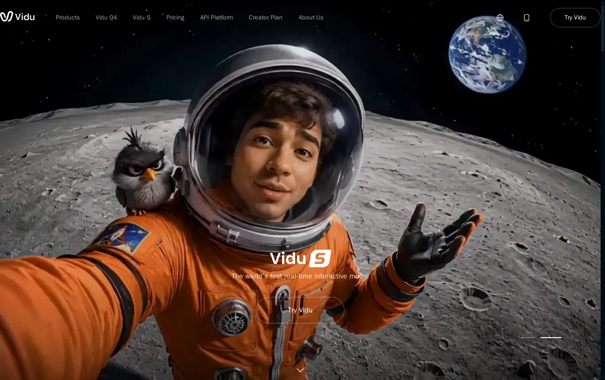
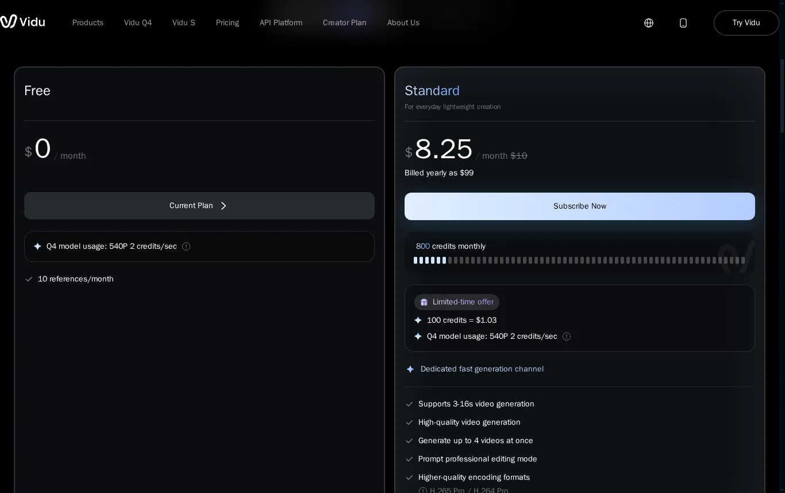
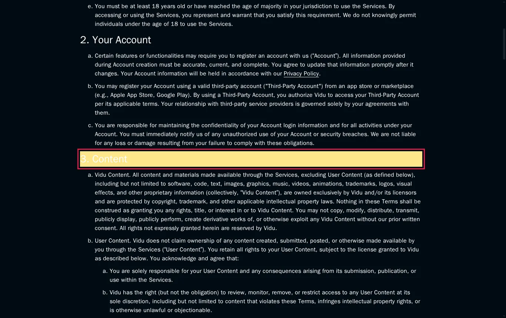

> Thuộc chuyên đề: [Top công cụ tạo video AI](top-cong-cu-tao-video-ai.md) · Bài viết của [KimQ Tech](https://kimq.tech)

**Vidu AI** là công cụ tạo video bằng AI của Shengshu, nổi bật ở khả năng **giữ nhân vật, sản phẩm nhất quán** qua nhiều cảnh nhờ chế độ dùng ảnh tham chiếu. Vidu được nhiều người làm hoạt hình, video ngắn và quảng cáo sản phẩm dùng vì giá credit thấp và có chế độ tạo video giờ thấp điểm.

Bài này hướng dẫn dùng Vidu từ đầu: các chế độ tạo video, cách viết mô tả, bảng giá các gói và những điều khoản cần đọc trước khi tải ảnh lên. Thông tin lấy từ trang chính thức **vidu.com** ngày **25/11/2026**.

## Tóm tắt nhanh

| | Thông tin |
|---|---|
| Trang chính thức | vidu.com (có app Vidu) |
| Làm được gì | Video từ chữ, từ ảnh, từ ảnh tham chiếu; ảnh từ chữ, từ ảnh tham chiếu; mẫu có sẵn; Vidu Agent |
| Mô hình | Vidu Q4 (mới nhất), Vidu Q3, Vidu S |
| Độ dài video | 3–16 giây mỗi lần tạo (gói trả phí) |
| Gói miễn phí | Q4 ở 540p, 2 credit/giây, 10 ảnh tham chiếu/tháng, credit tặng khi đăng nhập |
| Gói trả phí rẻ nhất | Standard $10/tháng ($8,25 nếu trả năm), 800 credit/tháng |
| Quyền thương mại | Chỉ gói trả phí |
| Tuổi tối thiểu | 18 tuổi theo điều khoản |

## Vidu AI là gì? Vidu Studio là gì?

Vidu là nền tảng tạo video AI, gồm bản web vidu.com, **Vidu App** trên điện thoại và **API Platform** cho doanh nghiệp tích hợp vào hệ thống riêng. Người dùng hay tìm "Vidu Studio" để chỉ khu vực tạo video trên web của Vidu, nơi chọn chế độ, tải ảnh và quản lý video đã tạo.


*Ảnh chụp màn hình: Trang chủ Vidu AI. Nguồn: [vidu.com](https://www.vidu.com/), chụp ngày 25/11/2026.*

Trên menu sản phẩm của Vidu có các chế độ:

| Chế độ | Dùng khi nào |
|---|---|
| **Text to Video** | Chỉ có ý tưởng, mô tả cảnh bằng chữ |
| **Image to Video** | Có một ảnh, muốn ảnh chuyển động |
| **Reference to Video** | Có nhiều ảnh nhân vật, sản phẩm, bối cảnh; muốn giữ đúng chúng trong video |
| **Text / Reference to Image** | Tạo ảnh trước để làm khung đầu cho video |
| **AI Templates** | Dùng mẫu có sẵn (ôm, hôn, biến hình, hiệu ứng) |
| **Vidu Agent** | Mô tả một câu, để agent lên kịch bản và ghép nhiều cảnh |

## Cách dùng Vidu AI từng bước

### 1. Tạo tài khoản

Vào vidu.com, bấm **Try Vidu**, đăng nhập bằng Google, Apple hoặc email. Đăng nhập lần đầu được tặng credit để thử. Theo điều khoản, người dùng phải **từ 18 tuổi** trở lên.

### 2. Tạo video từ ảnh (Image to Video)

1. Chọn **Image to Video**.
2. Tải ảnh rõ nét, chủ thể ở giữa, nền gọn.
3. Viết mô tả chuyển động: ai làm gì, máy quay di chuyển thế nào.
4. Chọn mô hình (Q4 hoặc Q3), độ phân giải và độ dài.
5. Bấm tạo; gói trả phí tạo được tới 4 video cùng lúc để chọn bản đẹp nhất.

Ảnh mờ thì làm nét trước, xem [Làm nét ảnh bằng AI](lam-net-anh-bang-ai.md). So sánh với cách làm trên Gemini và Kling tại [Cách tạo video AI từ ảnh](tao-video-ai-tu-anh.md).

### 3. Giữ nhân vật nhất quán (Reference to Video)

Đây là điểm mạnh nhất của Vidu. Bạn tải lên vài ảnh tham chiếu (khuôn mặt nhân vật, sản phẩm, trang phục, bối cảnh), rồi mô tả cảnh. Vidu dựng video giữ đúng những yếu tố đó. Rất hợp để:

- Làm loạt video quảng cáo cùng một sản phẩm, nhiều bối cảnh.
- Làm phim hoạt hình ngắn nhiều tập với cùng nhân vật.
- Làm video giới thiệu với linh vật thương hiệu.

Gói Free có **10 ảnh tham chiếu/tháng**, gói trả phí có **300/tháng**.

### 4. Viết mô tả cho Vidu

Mẫu mô tả dễ ra kết quả ổn:

```
A young woman in a red ao dai walks slowly along Hoi An old town street at sunset,
lanterns glowing, camera tracking from the side, soft warm light, cinematic.
```

- Viết theo thứ tự: **chủ thể → hành động → bối cảnh → góc máy → ánh sáng, phong cách**.
- Một video chỉ nên có **một hành động chính**.
- Tiếng Anh thường ổn định hơn; có thể nhờ Gemini, ChatGPT dịch. Xem thêm [Prompt AI](prompt-ai.md).

## Bảng giá Vidu AI


*Ảnh chụp màn hình: Bảng so sánh các gói Vidu AI. Nguồn: [vidu.com](https://www.vidu.com/pricing), chụp ngày 25/11/2026.*

| Gói | Giá tháng | Giá nếu trả năm | Credit/tháng | Điểm chính |
|---|---|---|---|---|
| Free | $0 | – | Credit tặng khi đăng nhập | Q4 540p, 10 ảnh tham chiếu/tháng, không thương mại |
| Standard | $10 | $8,25/tháng ($99/năm) | 800 | Kênh tạo nhanh, 3–16 giây, 4 video cùng lúc, thương mại |
| Premium | $43 | $35,42/tháng ($425/năm) | 3.500 | Thêm 20 video giờ thấp điểm mỗi ngày, kênh siêu nhanh |
| Ultimate | Từ $115 | Từ $95,83/tháng | Từ 8.000–10.000, có mức cao hơn | 200 video giờ thấp điểm mỗi ngày |

Đọc bảng giá cho đúng:

- **Credit tính theo giây video.** Q4 ở 540p tốn 2 credit/giây; độ phân giải cao hơn tốn nhiều hơn.
- **Giờ thấp điểm (off-peak)**: gói Premium, Ultimate được tạo thêm video vào giờ ít người dùng theo hạn mức mỗi ngày; video ra chậm hơn.
- **Ultimate có nhiều mức**: trang giá hiển thị các mức credit và giá khác nhau giữa thẻ gói và bảng so sánh; kiểm tra lại ở bước thanh toán.
- Giá có thể đổi theo khuyến mãi, kiểm tra trên trang chính thức trước khi mua.

## Điều khoản cần đọc trước khi tải ảnh lên


*Ảnh chụp màn hình: Điều khoản sử dụng Vidu, mục nội dung và cấp phép. Nguồn: [vidu.com](https://www.vidu.com/terms), chụp ngày 25/11/2026.*

Theo [điều khoản sử dụng của Vidu](https://www.vidu.com/terms) đọc ngày 25/11/2026:

- **Bạn giữ quyền với nội dung của mình**, Vidu không nhận sở hữu.
- Nhưng khi tải lên, bạn **cấp cho Vidu giấy phép toàn cầu, vĩnh viễn, không thể huỷ** để dùng nội dung đó, bao gồm **huấn luyện AI** và dùng cho mục đích quảng bá, thương mại. Giấy phép này vẫn còn sau khi bạn xoá tài khoản.
- Gói miễn phí chỉ được dùng **cá nhân, phi thương mại**; gói trả phí mới được dùng thương mại.
- Bạn chịu trách nhiệm về nội dung tải lên và tạo ra.

Vì vậy: **không** tải ảnh khách hàng, ảnh nhân viên chưa đồng ý, ảnh sản phẩm chưa ra mắt hay tài liệu nội bộ lên Vidu. Doanh nghiệp nên đọc kỹ điều khoản trước khi đưa vào quy trình chính thức.

## Vidu so với Kling, Higgsfield

| Nhu cầu | Nên thử |
|---|---|
| Giữ cùng nhân vật, sản phẩm qua nhiều cảnh | Vidu (Reference to Video) |
| Chuyển động người tự nhiên, video dài 30 giây | [Kling AI](kling-ai.md) |
| Nhiều mô hình trong một nơi, hiệu ứng máy quay | [Higgsfield AI](higgsfield-ai-la-gi.md) |
| Video nhảy, meme từ 1 ảnh | [Viggle AI](viggle-ai-la-gi.md) |
| Lồng giọng đọc tiếng Việt | [VClip AI](vclip-ai-la-gi.md) |

## Câu hỏi thường gặp

**Vidu AI có miễn phí không?**
Có gói Free với credit tặng, dùng mô hình Q4 ở 540p và 10 ảnh tham chiếu mỗi tháng. Video miễn phí không được dùng thương mại.

**Vidu tạo video dài bao nhiêu?**
Mỗi lần tạo 3–16 giây. Muốn dài hơn, tạo nhiều đoạn rồi ghép.

**Vidu có tiếng Việt không?**
Giao diện chủ yếu tiếng Anh. Mô tả bằng tiếng Việt vẫn dùng được, nhưng tiếng Anh thường cho kết quả ổn định hơn.

**Vidu có dùng ảnh của tôi để huấn luyện AI không?**
Điều khoản cho phép Vidu dùng nội dung người dùng tải lên để cải thiện sản phẩm, bao gồm huấn luyện AI. Đừng tải tài liệu nhạy cảm.

**Vidu Studio và Vidu App khác gì?**
Cùng tài khoản và tính năng chính; Vidu Studio là bản web trên máy tính, Vidu App dùng trên điện thoại.

## Làm video sản phẩm cho doanh nghiệp

Nếu bạn cần video sản phẩm đều đặn mà không muốn tải ảnh nội bộ lên nhiều nền tảng có điều khoản cấp phép rộng, [AI Studio của KimQ Tech](https://kimq.tech/san-pham/ai-studio) gom tạo ảnh, video, giọng đọc vào một quy trình có kiểm soát dữ liệu.

---

> Bài viết có sử dụng AI hỗ trợ soạn thảo. Nội dung và số liệu được đối chiếu với nguồn chính thức ngày 25/11/2026; ảnh là ảnh chụp màn hình trang chính thức, có ghi nguồn và ngày chụp.

## Về KimQ Tech

[KimQ Tech](https://kimq.tech) xây giải pháp AI và tự động hoá vận hành cho doanh nghiệp Việt: [AI Studio](https://kimq.tech/san-pham/ai-studio), [AI Gateway](https://kimq.tech/san-pham/ai-gateway), [Trợ lý AI trên Zalo](https://kimq.tech/san-pham/tro-ly-zalo), [Chatbot đa kênh](https://kimq.tech/san-pham/chatbot-da-kenh), [Tự động hoá](https://kimq.tech/san-pham/tu-dong-hoa). Cần tư vấn? [Liên hệ KimQ Tech](https://kimq.tech/lien-he) hoặc email contact@kimq.tech.

---

*Thông tin kiểm tra trên trang chính thức vidu.com ngày 25/11/2026 và có thể thay đổi. KimQ Tech không phải đại lý của Vidu.*
