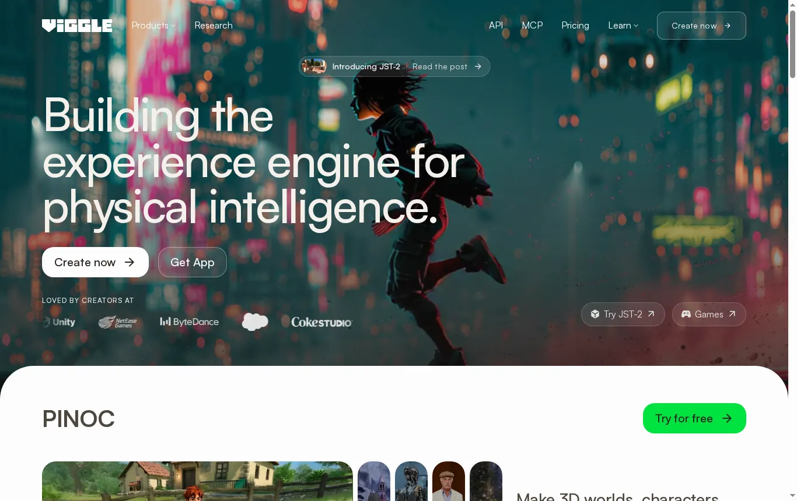
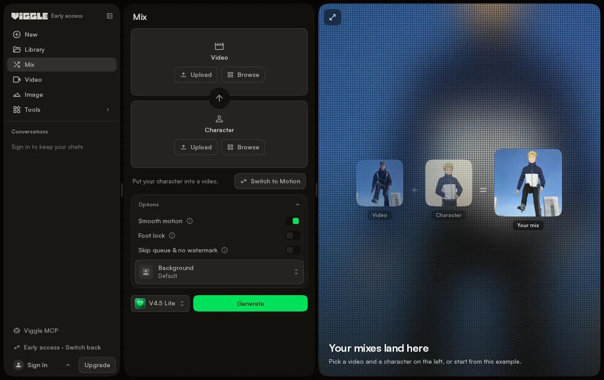
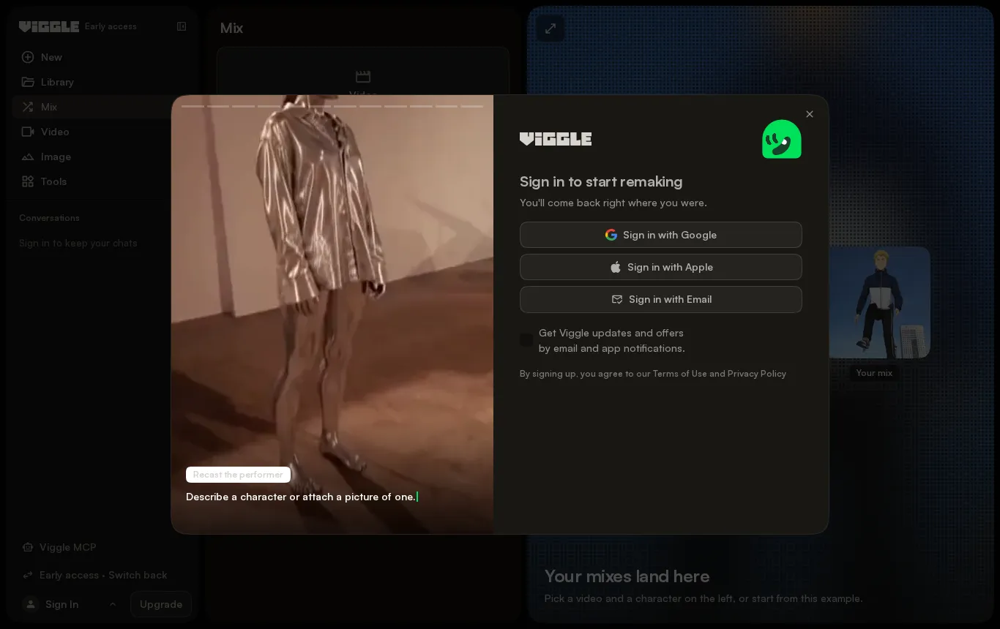
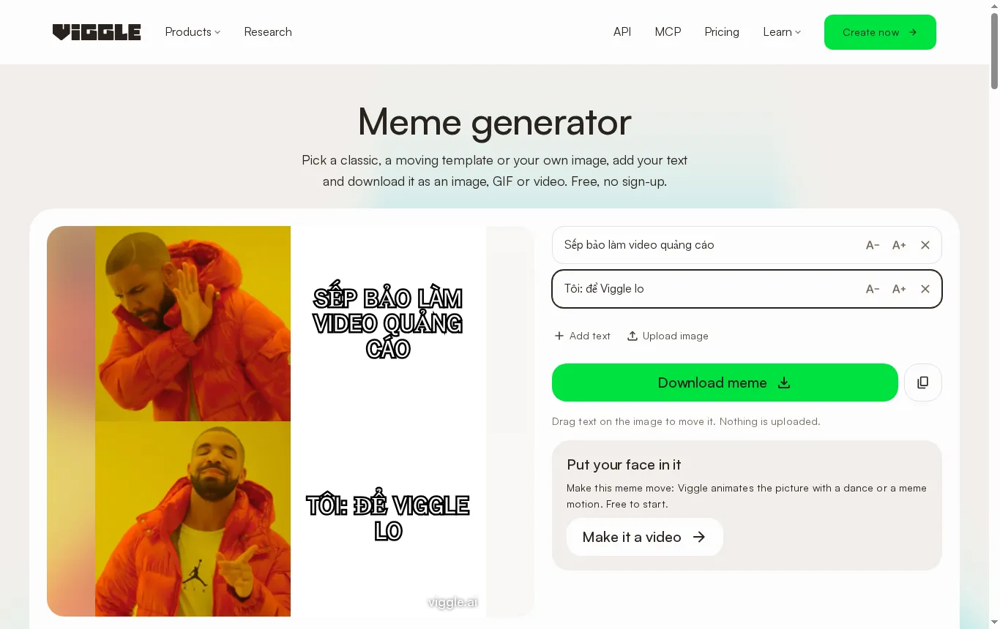
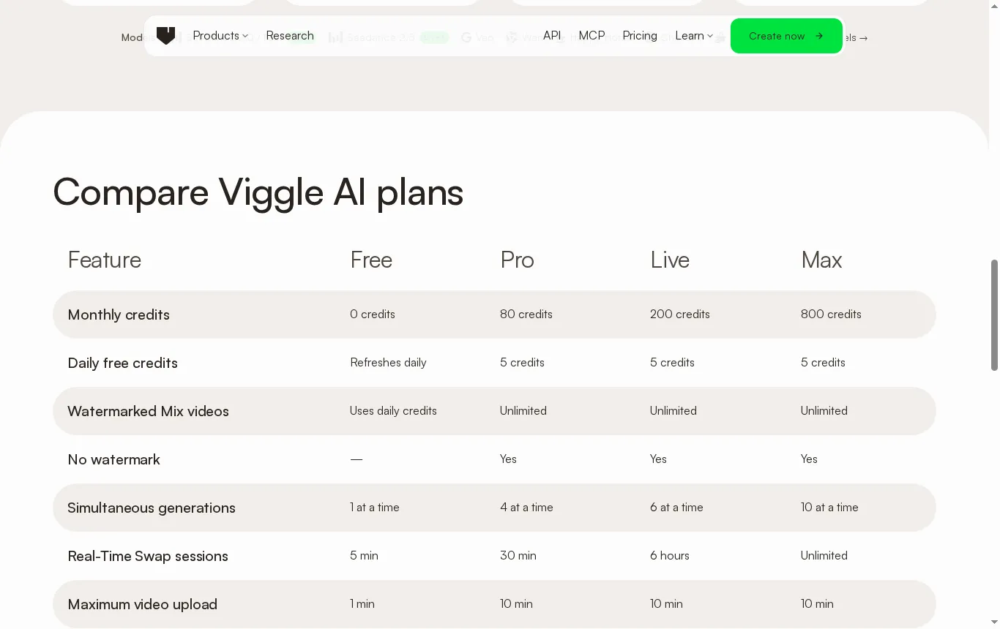

> Thuộc chuyên đề: [Top 10 công cụ tạo video AI 2026](top-cong-cu-tao-video-ai.md) · Bài viết của [KimQ Tech](https://kimq.tech)

**Viggle AI** là công cụ lấy **một tấm ảnh nhân vật** và **một video chuyển động** (điệu nhảy, meme, đoạn diễn), rồi tạo ra video nhân vật trong ảnh làm đúng động tác đó. Kiểu clip "ghép mình vào điệu nhảy, meme" rất hay gặp trên TikTok, Reels thường làm theo cách này. Dùng thử miễn phí được, nhưng video bản miễn phí có logo chìm và dữ liệu bạn tải lên có thể được dùng để huấn luyện AI.

Thông tin trong bài kiểm tra trên trang chính thức viggle.ai ngày **24/11/2026**. Giá và hạn mức có thể đổi khi bạn đọc.

## Tóm tắt nhanh

| Câu hỏi | Trả lời |
|---|---|
| Ai làm? | Công ty Viggle; mô hình JST do Viggle tự phát triển |
| Trang chính thức | **viggle.ai** (không phải các tên miền na ná, xem phần rủi ro) |
| Dùng ở đâu? | Trình duyệt trên máy tính và ứng dụng iOS, Android |
| Có miễn phí không? | Có. Gói Free được credit miễn phí làm mới mỗi ngày, video có logo chìm, mỗi lần tạo 1 video |
| Giá gói trả phí | Pro 7,99 USD/tháng nếu trả theo năm (9,99 USD nếu trả theo tháng) |
| Có tiếng Việt không? | Giao diện chỉ có tiếng Anh. Chữ tiếng Việt có dấu trong trình tạo meme hiển thị đúng (đã thử) |
| Có cần đăng nhập? | Trình tạo meme thì không. Tạo video Mix thì có (Google, Apple hoặc Email) |

*Ảnh chụp màn hình: Trang chủ Viggle AI. Nguồn: [viggle.ai](https://viggle.ai/), chụp ngày 24/11/2026.*

## Viggle AI làm được gì?

Viggle có nhiều sản phẩm, nhưng khi người ta nói "Viggle AI" thì thường là ứng dụng tạo video nhân vật. Các chức năng chính, theo trang chính thức:

| Chức năng | Làm gì | Ai hay dùng |
|---|---|---|
| **Mix** | Ghép nhân vật trong 1 ảnh vào một video chuyển động có sẵn (bạn tải lên hoặc chọn từ thư viện hơn 10.000 mẫu) | Làm clip nhảy, meme trend trên TikTok, Reels |
| **Multi** | Ghép nhiều nhân vật vào một video có nhiều người | Clip nhóm, cặp đôi |
| **Motion Control** (Move) | Làm nhân vật trong ảnh tĩnh cử động theo một video bạn quay | Biến ảnh meme, mascot thành ảnh động |
| **Video** | Tạo video từ câu lệnh, ảnh tham chiếu. Gói miễn phí chỉ chạy mô hình Viggle-Optimized Minimax H3; Veo 3.1 cần gói trả phí; Seedance cần gói Live trở lên | Video ngắn có âm thanh |
| **Viggle LIVE** | Đổi nhân vật theo thời gian thực qua webcam, độ trễ 1–2 giây, xuất ra OBS, Zoom, Discord | Người livestream |
| **Meme generator** | Gõ chữ lên mẫu meme rồi tải ảnh, GIF hoặc video. Không cần đăng ký | Làm meme nhanh |
| **PINOC** | Tạo thế giới, nhân vật và chuyển động 3D, xuất FBX/GLB | Làm game, hoạt hình 3D. Tính phí riêng |

Điểm khác của Viggle so với công cụ tạo video từ văn bản: **Mix không tự nghĩ ra chuyển động**. Bạn đưa động tác (video mẫu), Viggle chỉ thay người diễn. Muốn tạo cảnh mới từ câu mô tả thì dùng chức năng Video hoặc công cụ khác trong bài [Top 10 công cụ tạo video AI](top-cong-cu-tao-video-ai.md).

## Cách dùng Viggle AI từng bước

Ví dụ dưới đây dùng chức năng Mix trên trình duyệt máy tính, tại trang tạo video của viggle.ai. Giao diện gồm ô **Video** (video chuyển động), ô **Character** (nhân vật), phần **Options** và nút **Generate**.

*Ảnh chụp màn hình: Giao diện Mix của Viggle AI. Nguồn: [viggle.ai](https://viggle.ai/meme/app/mix), chụp ngày 24/11/2026.*

### Bước 1: Đăng nhập tài khoản

Bạn xem được giao diện Mix khi chưa đăng nhập, nhưng bấm chọn mẫu hoặc tạo video thì Viggle hiện hộp thoại đăng nhập bằng Google, Apple hoặc Email. Khi đăng ký, bạn đồng ý với Điều khoản sử dụng và Chính sách quyền riêng tư của Viggle. Điều khoản yêu cầu người dùng **đủ tuổi thành niên theo luật nơi mình sống** (ở Việt Nam là 18 tuổi).

*Ảnh chụp màn hình: Hộp thoại đăng nhập Viggle hiện ra khi bấm chọn mẫu. Nguồn: [viggle.ai](https://viggle.ai/meme/app/mix), chụp ngày 24/11/2026.*

### Bước 2: Chọn video chuyển động

Ở ô **Video**, bấm **Browse** để chọn trong thư viện mẫu (điệu nhảy, meme đang hot), hoặc **Upload** để tải video của bạn. Gói Free tải lên tối đa video 1 phút; gói trả phí tối đa 10 phút.

Mẹo chọn video:

- Chọn video **một người, thấy rõ toàn thân**, không bị vật che.
- Người trong video càng ít xoay lưng, càng ít bị cắt khung thì kết quả càng ổn định.
- Video có nhạc bản quyền có thể bị gỡ hoặc bị tắt tiếng khi đăng lên mạng xã hội. Nếu làm video cho thương hiệu, nên ghép nhạc có bản quyền sau.

### Bước 3: Tải ảnh nhân vật

Ở ô **Character**, bấm **Upload** để tải ảnh nhân vật. Ảnh nên:

- Thấy rõ toàn thân, đứng thẳng, nền đơn giản.
- Là ảnh của bạn, nhân vật bạn sở hữu, hoặc người đã đồng ý cho dùng (xem phần rủi ro).

Mục **Switch to Motion** đổi sang chế độ ngược lại: giữ ảnh tĩnh, lấy chuyển động từ video bạn quay để làm ảnh cử động.

### Bước 4: Chọn tuỳ chọn và bấm Generate

Trong **Options** có:

- **Smooth motion**: làm chuyển động mượt hơn.
- **Foot lock**: khoá vị trí chân, giúp nhân vật đỡ bị "trôi" khỏi mặt đất.
- **Skip queue & no watermark**: bỏ hàng chờ và bỏ logo chìm. Video của gói Free luôn có logo chìm.
- **Background**: chọn nền cho video (mặc định là Default).

Chọn phiên bản mô hình ở góc dưới (lúc kiểm tra là **V4.5 Lite**), rồi bấm **Generate**. Gói Free mỗi lần chỉ tạo 1 video; Pro tạo 4 video cùng lúc, Live 6, Max 10.

### Bước 5: Xem và tải video

Video xong hiện ở khung bên phải ("Your mixes land here"). Nếu một đoạn bị lỗi (tay méo, mặt lệch), công cụ **Multi-Track** cho phép tạo lại riêng đoạn đó thay vì làm lại cả clip. Gói Free chỉ lưu video và tài nguyên **7 ngày**; tải về máy ngay nếu muốn giữ.

## Thử thật: làm meme chữ tiếng Việt

Chúng tôi thử trình tạo meme của Viggle (không cần tài khoản) với mẫu meme hai khung, gõ chữ tiếng Việt có dấu: "Sếp bảo làm video quảng cáo" và "Tôi: để Viggle lo".

*Ảnh chụp màn hình: Thử gõ chữ tiếng Việt có dấu vào trình tạo meme của Viggle. Nguồn: [viggle.ai](https://viggle.ai/meme), chụp ngày 24/11/2026.*

Kết quả:

- **Dấu tiếng Việt hiển thị đúng**, kể cả chữ có hai dấu như "ể", "ả". Chữ tự chuyển thành in hoa theo kiểu meme quen thuộc.
- Ảnh có **logo chìm "viggle.ai"** ở góc dưới.
- Trang ghi rõ ảnh chỉ xử lý trên trình duyệt ("Nothing is uploaded"), không tải lên máy chủ.
- Nút **Make it a video** chuyển sang Mix để biến meme thành video, bước này cần đăng nhập.

Ở phần Mix, chúng tôi xem được giao diện nhưng **bấm chọn mẫu là bị yêu cầu đăng nhập**, nên không thử tạo video khi chưa có tài khoản được.

## Bảng giá Viggle AI

Viggle có 4 gói cho ứng dụng tạo video. PINOC (3D) và API tính phí riêng.

*Ảnh chụp màn hình: Bảng so sánh các gói Viggle AI. Nguồn: [viggle.ai](https://viggle.ai/pricing), chụp ngày 24/11/2026.*

| | Free | Pro | Live | Max |
|---|---|---|---|---|
| Giá trả theo năm (USD/tháng) | 0 | 7,99 | 15,99 | 63,99 |
| Giá trả theo tháng (USD/tháng) | 0 | 9,99 | 19,99 | 79,99 |
| Credit mỗi tháng | 0 (credit miễn phí làm mới mỗi ngày) | 80 | 200 | 800 |
| Bỏ logo chìm | Không | Có | Có | Có |
| Số video tạo cùng lúc | 1 | 4 | 6 | 10 |
| Thời lượng đổi nhân vật trực tiếp (Real-Time Swap) | 5 phút | 30 phút | 6 giờ | Không giới hạn |
| Video chuyển động tải lên tối đa | 1 phút | 10 phút | 10 phút | 10 phút |
| Lưu trữ | 7 ngày | Vĩnh viễn | Vĩnh viễn | Vĩnh viễn |
| Mô hình Seedance | Không | Không | Có | Có |

**Một credit đổi được bao nhiêu video?** Theo trang điều khoản Animation Tools của Viggle, mỗi credit tạo **15 giây** video bằng Mix, Multi hoặc Motion Control, không có logo chìm. Như vậy 80 credit của gói Pro tương đương khoảng **20 phút** video Mix mỗi tháng. Các mô hình khác (Veo, Seedance) tính credit theo giây với mức riêng.

**Hết credit thì sao?** Mua thêm 20 credit giá 3 USD. Credit trong gói hết hạn vào ngày gia hạn; credit mua thêm thì không hết hạn nhưng chỉ dùng được khi còn gói trả phí.

**Chọn gói nào?**

- Thỉnh thoảng làm clip vui: **Free** là đủ, chấp nhận logo chìm.
- Làm nội dung đều đặn cho TikTok, Reels: **Pro**, vì bỏ logo chìm và dữ liệu không bị dùng để huấn luyện AI (xem phần dưới).
- Livestream bằng nhân vật ảo, hoặc cần Seedance: **Live**.

## Giới hạn và rủi ro cần biết

Phần này tóm tắt từ Điều khoản sử dụng của Viggle (cập nhật 26/8/2026). Điều khoản chỉ có bản tiếng Anh.

1. **Gói Free: dữ liệu có thể được dùng để huấn luyện AI.** Khi dùng Viggle, bạn cấp cho Viggle quyền dùng ảnh, video bạn tải lên và video tạo ra để phát triển sản phẩm, gồm cả huấn luyện AI. Viggle cam kết **không dùng nội dung tạo trong thời gian bạn trả phí** để huấn luyện nếu không có đồng ý bằng văn bản, kể cả sau khi bạn ngừng trả phí.
2. **Chia sẻ công khai là mất quyền kiểm soát.** Nếu bạn bật chia sẻ nội dung cho người dùng khác, họ được xem, tải, chỉnh sửa và dùng nội dung đó cho mọi mục đích.
3. **Không dùng ảnh người khác khi chưa được phép.** Điều khoản cấm tải lên nội dung xâm phạm quyền hình ảnh, quyền riêng tư của người khác, và cho phép Viggle gỡ nội dung có hình người nổi tiếng. Ở Việt Nam, Điều 32 Bộ luật Dân sự 2015 quy định dùng hình ảnh của cá nhân phải được người đó đồng ý. Ghép mặt người khác vào clip nhảy, clip hài mà không xin phép có thể gây rắc rối pháp lý, chưa kể nguy cơ thành deepfake.
4. **Dùng cho mục đích thương mại.** Trang Motion Control của Viggle nói nội dung tạo bằng Viggle được dùng cho quảng cáo, nội dung thương hiệu, sản phẩm giao cho khách hàng. Với video cho thương hiệu, nên dùng gói trả phí để bỏ logo chìm, và tự kiểm tra quyền với nhạc, nhân vật, mẫu chuyển động trong clip.
5. **Cẩn thận tên miền giả.** Tìm "viggle ai" sẽ gặp các trang như viggle.lol, viggleai.io, viggleai.net. Đây không phải viggle.ai; giá và điều khoản ở đó khác trang chính thức. Chỉ đăng nhập, thanh toán tại **viggle.ai** hoặc ứng dụng chính thức trên App Store, Google Play.

## Viggle so với các công cụ tạo video AI khác

| Nhu cầu | Nên dùng |
|---|---|
| Ghép mình hoặc mascot vào điệu nhảy, meme đang trend | **Viggle Mix** |
| Làm ảnh tĩnh cử động theo video mình quay | **Viggle Motion Control** |
| Tạo cảnh hoàn toàn mới từ câu mô tả hoặc ảnh | Công cụ tạo video từ văn bản, ảnh như Veo, Kling (so sánh trong [Top 10 công cụ tạo video AI](top-cong-cu-tao-video-ai.md)) |
| Chuyển động người tự nhiên, video tới 30 giây | Xem [Kling AI](kling-ai.md) |
| Giữ cùng một nhân vật qua nhiều cảnh | Xem [Vidu AI](vidu-ai.md) |
| Lồng giọng đọc tiếng Việt cho video | Xem [VClip AI](vclip-ai-la-gi.md) |
| Chuẩn bị ảnh nhân vật đẹp, tách nền trước khi đưa vào Viggle | Xem [Top công cụ AI tạo và chỉnh sửa ảnh](top-cong-cu-ai-chinh-sua-anh.md) |
| Tạo ảnh nhân vật bằng câu lệnh tiếng Việt | Xem [35 câu lệnh tạo ảnh, ghép ảnh trên Gemini](cau-lenh-tao-anh-ghep-anh-gemini.md) |

## Doanh nghiệp có nên dùng Viggle?

Viggle hợp với clip giải trí, bắt trend nhanh: mascot thương hiệu nhảy theo điệu đang hot, nhân vật hoạt hình chào khách. Viggle **không hợp** với video giới thiệu sản phẩm cần giọng đọc, phụ đề và thông tin chính xác.

Nếu doanh nghiệp cần **video dọc giới thiệu sản phẩm có giọng đọc tiếng Việt và phụ đề**, xem [AI Studio của KimQ Tech](https://kimq.tech/san-pham/ai-studio).

## Câu hỏi thường gặp

**Viggle AI có miễn phí không?**
Có. Gói Free có credit miễn phí làm mới mỗi ngày, mỗi lần tạo 1 video, video có logo chìm và chỉ lưu 7 ngày. Trình tạo meme dùng miễn phí, không cần đăng ký.

**Viggle AI có tiếng Việt không?**
Giao diện chỉ có tiếng Anh (lúc kiểm tra không có trang viggle.ai/vi). Chữ tiếng Việt có dấu trong trình tạo meme vẫn hiển thị đúng.

**Làm sao bỏ logo chìm trên video Viggle?**
Dùng gói trả phí (từ Pro). Video tạo bằng gói Free luôn có logo chìm.

**Viggle AI có dùng trên điện thoại được không?**
Có. Viggle có ứng dụng iOS và Android. Một số mô hình như Veo 3.1 và Seedance chỉ chạy trên trình duyệt máy tính.

**Ảnh tải lên Viggle có an toàn không?**
Với gói Free, Viggle được dùng ảnh và video của bạn để huấn luyện AI. Không tải lên ảnh trẻ em, giấy tờ tuỳ thân hoặc ảnh người khác khi chưa được đồng ý.

---

> Bài viết có sử dụng AI hỗ trợ soạn thảo. Nội dung và số liệu được đối chiếu với nguồn chính thức ngày 24/11/2026; ảnh là ảnh chụp màn hình trang chính thức, có ghi nguồn và ngày chụp.

## Về KimQ Tech

[KimQ Tech](https://kimq.tech) xây giải pháp AI và tự động hoá vận hành cho doanh nghiệp Việt: [AI Studio](https://kimq.tech/san-pham/ai-studio), [AI Gateway](https://kimq.tech/san-pham/ai-gateway), [Trợ lý AI trên Zalo](https://kimq.tech/san-pham/tro-ly-zalo), [Chatbot đa kênh](https://kimq.tech/san-pham/chatbot-da-kenh), [Tự động hoá](https://kimq.tech/san-pham/tu-dong-hoa). Cần tư vấn? [Liên hệ KimQ Tech](https://kimq.tech/lien-he) hoặc email contact@kimq.tech.

---

*Thông tin kiểm tra trên trang chính thức viggle.ai ngày 24/11/2026 và có thể thay đổi. KimQ Tech không phải đại lý của Viggle.*
